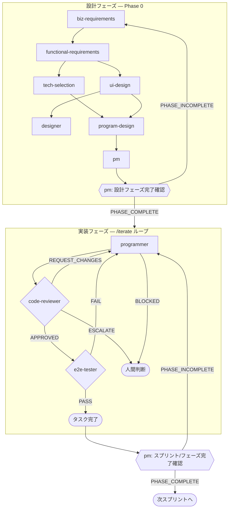

# A2P — Amazon Automated Publishing Tool

> **This repo is the M2P (Money-Making Platform) monorepo.** A2P is its first tool. The platform
> shell lives in `apps/portal` (`@m2p/portal`, 共通ログイン＋ツール選択) with shared auth in
> `packages/auth`; future tools are added as more `apps/*`. Folder = `C:\DEV\M2P` (旧 A2P). See
> `docs/10-platform-portal.md`. A2P-specific packages stay `@a2p/*`.
>
> **2nd tool = ANP (Automated Note Publishing Tool)** — note 記事の企画〜執筆〜出版〜販促〜収益化を
> **テーマ別マルチアカウント**で自動化（＝note版A2P）。ポータルに横並びタイル済（ロゴ `apps/portal/public/tools/anp.png`）。
> 設計 = `docs/11-anp-design.md`。実装は `apps/anp` 予定、本番サブドメイン案 `anp.m2p.tools`。共通 packages を流用。
>
> **3rd tool = 3DP (3D Products)** — 3Dモデル系商材 (ワールド用プロップ・家具・小物 / アクセサリ /
> 既存衣装の改変用テクスチャ) を開発し BOOTH で販売する。**アバター本体は作らない**
> (リグ/ウェイトが必要で AI 生成の品質が届かず、かつ「◯◯風」は依拠性リスクの本命)。
> 設計 = `docs/12-3dp-design.md`。実装は `apps/3dp` 予定、本番サブドメイン案 `3dp.m2p.tools`。
> **BOOTH の AI 生成物規制 (2025-07-18) が設計の前提**: 依拠性の高い商品と**大量・連続出品**は
> 強制非公開→ショップ非公開→アカウント停止。よって 3DP は「大量出品機にしない」
> (月間出品上限をツール側に持つ)、依拠性のある企画を機械的に弾く、AI 生成であることを明記する。

This repository builds a personal, web-based tool that automates the end-to-end production of Amazon KDP books (実用書・ビジネス書・自己啓発) using a team of AI agents. It also automates its own development through a harness of Claude Code subagents.

## Mental model

Two distinct agent layers coexist in this repo. **Do not confuse them.**

| Layer | Where defined | Purpose |
|---|---|---|
| **Runtime agents** | `packages/agents/` (Claude Agent SDK) | Run inside the deployed app to produce books — Marketer, Writer, Editor, Thumbnail Designer, Quality Judge, Prompt Optimizer |
| **Harness agents** | `.claude/agents/` (Claude Code subagents) | Run during development inside this repo — Business/Functional/Tech/UI/Program design, Designer, PM, Programmer, Code Reviewer, E2E Tester |

When the user says "ライターを直して" they mean the runtime Writer agent in `packages/agents/`. When they say "プログラマーエージェントを呼んで" they mean the Claude Code subagent invoked via `Agent(subagent_type=programmer, ...)`.

## Harness agents — roles

10 個のハーネスエージェントは「設計フェーズ」と「実装フェーズ」に二分される。

### 設計フェーズ (Phase 0)

| # | エージェント | 役割 | 入力 | 出力 |
|---|---|---|---|---|
| 1 | `biz-requirements` | 業務要件定義 — 誰が何のために何を得るか | `CLAUDE.md` | `docs/01-business-requirements.md` |
| 2 | `functional-requirements` | 機能要件定義 — 各機能の入出力・受入基準・非機能要件 | `docs/01` | `docs/02-functional-requirements.md` |
| 3 | `tech-selection` | 技術選定 — CLAUDE.md の確定スタックを肉付け＋未決領域を選定 | `docs/01`, `docs/02` | `docs/03-tech-selection.md` |
| 4 | `ui-design` | 画面設計 — 画面一覧・遷移・各画面のセクション/コンポーネント | `docs/01`, `docs/02` | `docs/04-ui-design.md` |
| 5 | `designer` | ワイヤーフレーム作成 (ASCII/mermaid) | `docs/04` | `docs/wireframes/{S-xxx}-*.md` |
| 6 | `program-design` | プログラム設計 — DB/API/ジョブ/エージェント仕様/シーケンス | `docs/01..04` | `docs/05-program-design.md` |
| 7 | `pm` | 開発計画とスプリント分解 (タスク粒度まで) | `docs/01..05` | `docs/dev-plan.md`, `docs/sprints/SP-NN-*.md` |

### 実装フェーズ (Phase 1+)

| # | エージェント | 役割 | 入力 | 出力 |
|---|---|---|---|---|
| 8 | `programmer` | コード実装 (1 タスク = 1 起動) | タスク ID または指示 + `docs/05` | コード変更 + `## DONE`/`## BLOCKED` |
| 9 | `code-reviewer` | コードレビュー (要件・設計・型・テスト・セキュリティ) | programmer の変更 + `docs/05` | `## APPROVED`/`## REQUEST_CHANGES`/`## ESCALATE` |
| 10 | `e2e-tester` | Playwright で E2E テスト作成・実行 | タスクが触る機能 + `docs/02`/`docs/05` | `## DONE` (= PASS) / `## BLOCKED` (= FAIL) |

## Harness execution flow



設計フェーズは **上流から順に1回ずつ** 実行。後段エージェントは必ず前段ドキュメントを読む契約。
実装フェーズは **タスクごとに `/iterate` を起動** し、内部で programmer → code-reviewer → e2e-tester の三段ループを APPROVED+PASS まで回す。

### フェーズ/スプリント完了確認

各フェーズ（設計フェーズ全体、各実装スプリント、Phase 1〜4 の各マイルストーン）の完了時、**`pm` エージェントを「完了確認モード」で起動**し、以下を機械的に検証する：

- 当該フェーズに紐づく全タスク (`docs/sprints/SP-NN-*.md` の `T-NN-MM`) が完了状態か
- 各タスクの受け入れ基準を満たす成果物（コード/ドキュメント/テスト）が存在するか
- 申し送り事項（前フェーズドキュメント末尾の「後続エージェントへの申し送り」）が後段で全て参照・対応されているか
- 次フェーズの前提条件（依存ドキュメント、DB マイグレーション、env 変数等）が揃っているか

PM は最後に `## PHASE_COMPLETE` または `## PHASE_INCOMPLETE: <未消化リスト>` を出力する。INCOMPLETE の場合、不足項目を担当エージェント（programmer / 該当設計エージェント）へ差し戻し、解消後に再確認する。

### `/iterate` の合否判定プロトコル

`/iterate "<タスク ID または指示>"` で起動。programmer の 1 回呼び出しを 1 iteration とカウント、**最大 5 iterations**。

1. `programmer` 実行 → `## DONE` を待つ（`## BLOCKED` なら停止し人間に escalation）
2. `code-reviewer` 実行
   - `## APPROVED` → 次のステップへ
   - `## REQUEST_CHANGES` → フィードバックを次回 programmer に渡して step 1 へ戻る
   - `## ESCALATE` → 停止し人間に escalation
3. `e2e-tester` 実行
   - `## DONE` (= 全 PASS) → タスク完了
   - `## BLOCKED` (= FAIL or 環境問題) → 失敗詳細を次回 programmer に渡して step 1 へ戻る

5 iteration 経過しても完了しなければ、`## /iterate ESCALATED` を出力して人間判断に委ねる。

## Project layout (target)

```
.claude/
  agents/              ← harness subagents
  commands/            ← slash commands (/iterate, etc.)
docs/                  ← design artifacts produced by harness
apps/
  portal/              ← Next.js 15 — プラットフォームのハブ (共通ログイン + ツール選択, SSO)。docs/10
  web/                 ← Next.js 15 (App Router) — A2P の UI + API routes
  anp/                 ← Next.js 15 — ANP (note 記事) の UI。docs/11
  3dp/                 ← Next.js 15 — 3DP (3Dモデル商材) の UI。docs/12 (予定)
  worker/              ← graphile-worker process — long-running pipelines
packages/
  agents/              ← Claude Agent SDK subagents (Marketer, Writer, ...)
  auth/                ← 全アプリ共有の認証基盤 (buildAuthConfig + 認証コア) = SSO の要。docs/10
  db/                  ← Prisma schema + client
  storage/             ← Cloudflare R2 client
  contracts/           ← shared TypeScript types (job payloads, agent IO)
tests/
  e2e/                 ← Playwright specs
```

The codebase will be a `pnpm` workspace.

## Tech stack (decided)

- **Framework:** Next.js 15 + TypeScript
- **Hosting:** Railway (Web service + Worker service + Postgres)
- **DB:** PostgreSQL via Prisma
- **Job queue:** `graphile-worker` (PG-backed, no Redis needed)
- **AI orchestration:** 二層構造 — `AISdkClient` = Vercel AI SDK (`ai` ^5 + `@ai-sdk/{anthropic,openai,google}` ^2) で全 LLM 汎用呼び出し、`AgentSdkClient` = `@anthropic-ai/sdk` (公式 Messages API) で Marketer の Web 検索付き呼び出し。Opus 4.7 for creative, Sonnet 4.6 for judging
- **Web search:** Anthropic Messages API `web_search_20250305` server tool（`@anthropic-ai/sdk` 経由）
- **Image gen:** OpenAI `gpt-image-1`
- **Word output:** `docx` (npm)
- **PDF output:** `@react-pdf/renderer`
- **Object storage:** Cloudflare R2 (S3 compatible)
- **Auth:** NextAuth Credentials provider (single user, env-based password)
- **UI:** Tailwind + shadcn/ui
- **Testing:** Vitest (unit), Playwright (E2E)

Reasoning is in `docs/03-tech-selection.md` once produced.

## Phased roadmap

- **Phase 0 (now):** Harness setup — 10 subagents + `/iterate` + `docs/01..05` produced
- **Phase 1 (MVP):** Pipeline Marketer→Writer→Editor→Thumbnail, Word/PDF/PNG output, dashboard skeleton
- **Phase 2:** Quality Judge + prompt versioning + sales tracking + Prompt Optimizer batch
- **Phase 3:** Playwright-based KDP auto-publish (separate worker, 2FA via push-and-wait)
- **Phase 4:** Additional output channels (note articles, etc.)

## Hard rules for any agent in this repo

1. **Single user.** No multi-tenant abstractions, no org/team models. Just `accounts` (= KDP publishing accounts), all owned by the operator.
2. **Japanese is the primary content language.** UI, generated books, prompts — all 日本語. Code/comments may be English.
3. **Don't invent files outside the documented layout.** If a new top-level concept is needed, propose it in `docs/05-program-design.md` first.
4. **Prompt templates live in DB**, not in code. The `prompts` table is the source of truth for runtime agent system prompts. Seed scripts populate initial versions.
5. **Cost & token usage is observable.** Every Claude/OpenAI call records into `token_usage`. Don't add a model call without wiring this.
6. **Never commit secrets.** `.env.local`, `.env.production` are gitignored. Use Railway env vars in production.
7. **Keep design docs current.** Whenever you add or change a feature (a DB table, an agent role, a worker task, a page/screen, an env var), update the relevant `docs/` in the same body of work — primarily `docs/05-program-design.md` (DB/API/job/agent specs), plus `docs/02-functional-requirements.md` / `docs/04-ui-design.md` when behavior or screens change. Periodically (at least at the end of a working session that shipped features) reconcile `docs/` against the codebase so the design docs never silently drift from reality.
8. **Upstream-docs-first, and record every spec change / new discovery there.** Implement from the upstream design docs (`docs/01`→`02`→`03`/`04`→`05`), not ad-hoc. Any spec change, decision reversal, or newly-discovered fact about how an external system actually behaves (e.g. a KDP wizard selector, an anti-bot behavior, a re-auth rule, an API quirk) MUST be written into the relevant upstream doc in the same change — `docs/02-functional-requirements.md` for behavior/acceptance changes and `docs/05-program-design.md` for DB/API/job/agent/flow specs (and `docs/03`/`04` when stack or screens change). The design docs — not chat, not memory, not code comments alone — are the durable source of truth; memory files are a personal aide, not a substitute. If reality contradicts a doc, fix the doc.

## 稼働中の出版自動化 — 「できる/できない」の確定事実

> **ここは推測で答えてはいけない節。** 一度解決した能力を「できない」と答える事故が起きたので、
> 稼働中の到達点を確定事実として置く。詳細な根拠は `docs/02` / `docs/05` の該当節にある。

### A2P (KDP) — サーバーからの完全自動出版は **できる**（2026-08-01 に実証済み）

- **タスク `kdp.submit`** (`apps/worker/src/tasks/kdp-submit.ts`, F-041 Phase 3) が、Railway の worker 上で
  Playwright を動かして **入稿〜出版まで無人で完走する**。原稿/表紙は R2 から取り、
  セッションは `accounts.kdp_session_state_enc` を再利用する。
- **2FA / 再認証ウォールは突破済み。** 出版に近い遷移で `openid.pape.max_auth_age=0` の再認証が
  割り込むが、**パスワード実タイプ + OTP（`AMAZON_TOTP_SECRET` の TOTP 自動生成 → 無ければ
  LINE 双方向認証リレー `kdp_auth_requests`）** で各段ごとに通す (`isReauthWall`→`passReauth`)。
  「2FA があるからサーバー無人化は不能」という**旧判断は覆っている**（docs/05 §5.3.15 の設計転換）。
- **既存下書きの resume が基本経路**なので KDP の作成枠を消費しない。下書きが無ければ新規作成に
  切り替わり、そこで初めて週次の作成上限を 1 消費する。`target_title_id` を渡すと販売中タイトルの
  上書きもできる（不可逆なので自動 dispatcher は付けない）。
- **自動運転**: cron `kdp.submit.dispatch`（30 分毎）が `kdp_auto_submit_enabled=true` のとき
  入稿キューから **1 冊だけ** enqueue する。抑制は 2 つ:
  `books.kdp_submit_cooldown_until`（その本を ~20h 待たせる）と
  `app_settings.kdp_creation_paused_until`（作成上限に当たったら全体を止める）。
- **作成上限は【週次・フォーマット別】**で、リセットは**日曜 0:00 UTC = 日曜 9:00 JST**
  （「1 日 5 冊」は誤り。2026-10-14 にモーダル実測で確定）。
- `scripts/kdp-assist.sh`（`kdp-publish.mjs --assist`）は**運営者が自分の端末で動かす別経路**。
  サーバーが使えないから在るのではなく、**週次の作成枠や審査の都合で手元から押したいとき**に使う。
  選択順は `done_at` 昇順（dispatcher 側は `updated_at` 昇順）。

### 他チャネルの到達点

| チャネル | 自動化 | 根拠 |
|---|---|---|
| KDP 電子書籍 | **完全自動**（上記） | docs/05 §5.3.15 |
| ペーパーバック | **完全自動**（`paperback.draft` → `paperback.submit`） | docs/05 F-097 系 |
| BookWalker | **完全自動**（サーバー入稿） | docs/02 F-094 |
| 楽天 Kobo | **完全自動** | docs/02 F-095 |
| BOOTH | **半自動**（作品ファイル UP と公開だけ人手。reCAPTCHA enterprise で自動化不可） | docs/02 F-096 |
| note (ANP) | **完全自動**（企画〜執筆〜公開〜販促） | docs/11 |

### 自動運転のスイッチを触るときの必須手順

条件付き cron (`buildCronItemsWithSettings`) は **worker 起動時に 1 回だけ**組み立てられる。
`app_settings` のフラグを変えても **worker を再起動しないと永久に発火しない**（UI に警告も出ない）。
実害: `promotion-dispatch` が 3 週間、`note-theme-auto-daily` が 6 日止まっていた（2026-10-15 発覚）。
→ **フラグ変更と `railway redeploy --service A2P-Worker` は必ずセット**。確認は
`graphile_worker._private_known_crontabs` の `identifier` 在席 + `last_execution`。
engage 系（`note.engage` / `promotion.x.engage` / `promotion.sns.engage`）は cron 常時登録で
タスク内でフラグを見るので再起動不要 — どちらの方式かは必ずコードで確認する。
