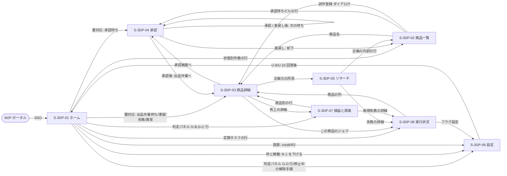
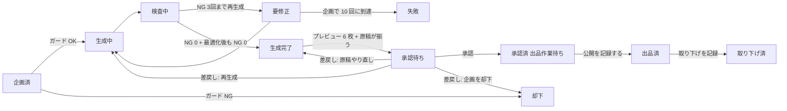
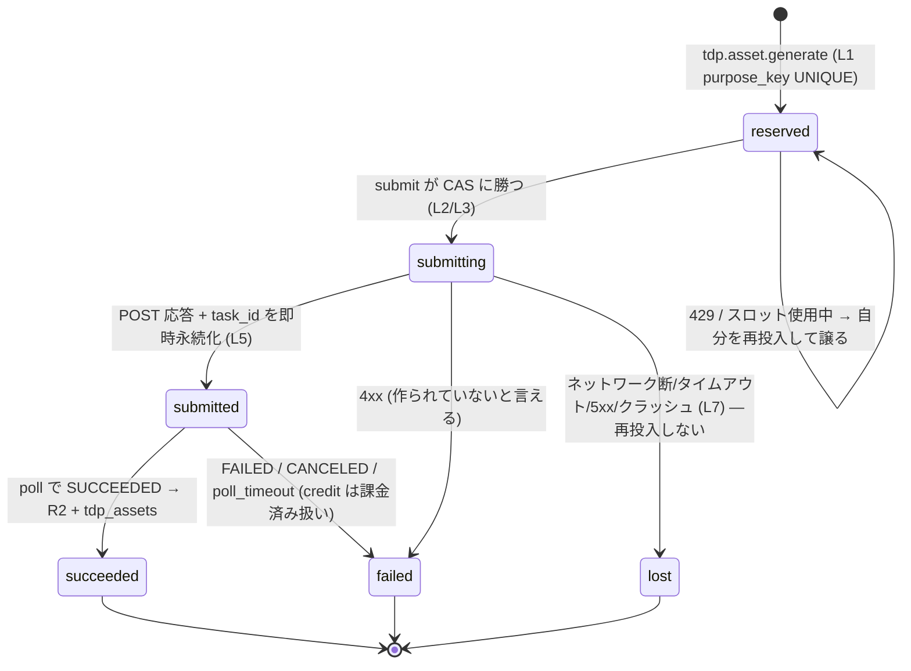
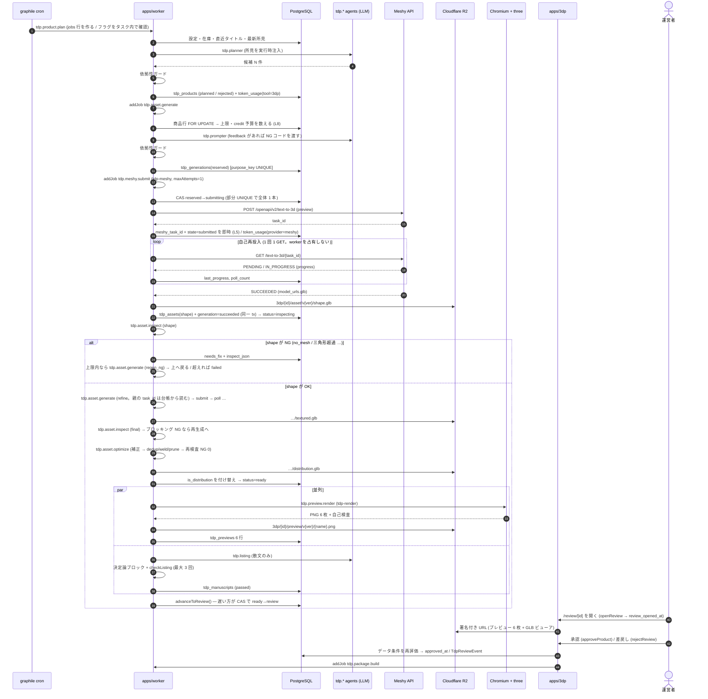
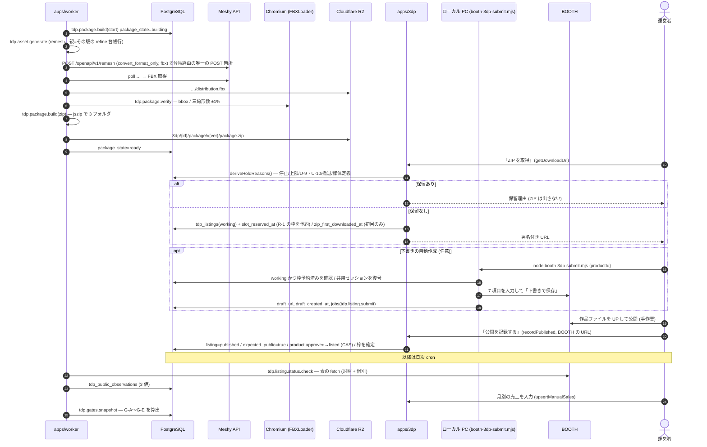
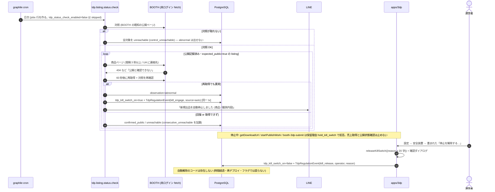

# 12. 3DP — 3Dモデル商材 開発・販売ツール 設計

> **M2P プラットフォーム 第3ツール。** 第1 = A2P (Amazon KDP 書籍)、第2 = ANP (note 記事)、
> 第3 = **3DP (3D Products)**。共通ログイン/ツール選択は `apps/portal` (docs/10)、
> 共有認証は `packages/auth`。実装は `apps/3dp` 予定、本番サブドメイン案 `3dp.m2p.tools`。

運営者指示 (2026-10-14):

> M2P に新たに 3DP というツールを新規構築したいです。このツールは 3Dモデル系の商材を
> 開発・販売するツールです。特に Booth で 3Dモデルカテゴリの商材が売れているのに着目しています。

> その方針でツール構築していきましょう。

合意済みの方針 (同日):
**ワールド用プロップ・家具・小物 / アクセサリ (リグ不要) / 既存衣装の改変用テクスチャ** を作る。
**アバター本体は作らない。** BOOTH の AI 開示要件を守り、大量の類似出品はしない。

---

## 目次

- §1 なぜこの市場か (実測値)
- §2 絶対制約 — BOOTH の AI 生成物規制 (2025-07-18 公式発表)
- §3 作るもの / 作らないもの
- §4 技術的可否 (2026-10 時点の実測)
- §5 出品経路 — 主力 BOOTH (半自動) + 併売 Jinxxy
- §6 パイプライン
- §7 DB スキーマ (確定 — 2026-10-15 program-design)
- §8 役割 (runtime agents)
- §9 画面 (apps/3dp)
- §10 増分計画
- §11 未確定事項 (実測が必要)
- §12 実装状況
- §13 出品先の比較と選定 (リサーチ 2026-10-15)
- §14 業務要件
- §15 機能要件 (F-3DP-NN)
- §16 技術選定 (tech-selection、2026-10-15)
- §17 プログラム設計 (program-design、2026-10-15)

> ファイルは分割しない (理由は `docs/dev-plan.md` §11.11)。代わりにこの目次で探す。節番号は変えない。

---

## 1. なぜこの市場か (実測値)

> **2026-10-15 改訂 (出典の切り分け)。** 初版はこの表の全行を「取引白書2026」出典としていたが、
> 一次情報 (pixiv inside / PR TIMES) を読み直したところ **白書はサブカテゴリ別の価格帯を公表していない**。
> 白書が出しているのは取扱高・注文件数・注文者数と「**3Dキャラクター商材で最多の注文価格帯は ¥5,000〜6,999**」まで。
> 衣装・アクセサリの価格帯として初版が書いた数字は二次情報 (個人ブログ) の推定だった。
> 誤った帰属は後続の判断を汚すので、出典を行ごとに分け、**自前で観測した値に置き換えた** (§13.2)。

| 指標 | 値 | 出典 |
|---|---|---|
| BOOTH 3Dモデルカテゴリ 年間取扱高 (2025年) | **¥104 億** (前年 ¥58 億 / **+179%**) | 取引白書2026 (一次) — pixiv inside 2026-02-06 |
| 年間注文件数 | 約 **774 万件** | 同 (一次) |
| 年間注文者数 | 約 **28.1 万人** (前年 21.8 万人) | 白書を報じた各媒体 (MoguLive / ゲームメーカーズ 等)。白書本文は「増加」としか書いていない |
| 1 ユーザーあたり年間注文数 | **約 27.5 件** | **当方の算出** (774万 ÷ 28.1万)。白書に直接の記載は無い |
| 最多の注文価格帯 | **¥5,000〜6,999** — ただし **3Dキャラクター商材 (= アバター本体) の話** | 同 (一次)。3DP が作るものの価格帯ではない |
| 価格帯 — 装飾品 / 小道具 / テクスチャ | §13.2 の**実観測**に置き換え (白書には無い) | BOOTH カテゴリページ直接観測 2026-10-15 |

牽引しているのは VRChat 等のソーシャル VR 需要。
注目すべきは **1 人あたり約 27.5 件** — アバターを買った人が衣装・小物を継続的に買い足す構造が
できている。**単価の低いアクセサリ・小物でも回転で成立する**市場であり、
これは「リグ不要で AI 生成の品質が届く領域」とちょうど重なる。

ただし「最多の注文価格帯 ¥5,000〜6,999」が**アバター本体**の数字であることは重要で、
**市場の金額の中心は 3DP が作らない領域にある**。3DP が狙うのは金額の中心ではなく
**回転 (1 人 27.5 件) の受け皿**であり、§14.3 の月商試算はその前提で立てる。

---

## 2. 絶対制約 — BOOTH の AI 生成物規制 (2025-07-18 公式発表)

**この節は設計の制約ではなく前提である。** 違反すると出品どころかアカウントが消える。

> **2026-10-15 再確認 (現行であることの確認)。** 2025-07-18 の発表は
> <https://booth.pm/announcements/828> に**今も掲載されており、取り下げ・緩和はされていない**。
> 本文に**数値上限は書かれていない** (「大量・連続的」という定性表現のみ) ことも再確認した。
> なおこの発表は 2023-05-16 の告知の続報として出されている。
> その後 **2026-06-22 にサービス共通利用規約が改定**され (<https://booth.pm/announcements/949>)、
> 第14条 (禁止行為) が「明文化・細分化」されたが、同告知は
> **「創作物の内容・題材に関する新たな制限は追加していない」**と明記している。
> よって **§2 の前提は 2026-10 時点でも有効**。R-1/R-2/R-3 は据え置く。

BOOTH「AI生成作品への対応強化について」(2025-07-18) が監視対象として挙げるもの:

- **特定の作品・作家への依拠性が高い商品の出品**
  (サービス共通利用規約 第14条5項「特定の第三者の作品、肖像または音声等に類似した投稿情報を投稿等する行為」)
- **上記に準ずる商品を大量・連続的に出品する行為**

処分は段階的または即時に:

1. 商品の強制非公開化
2. ショップの強制非公開化
3. アカウント停止

> 別名義での再出品は「行為の内容にかかわらず、同様の対応を行う」と明記されている。

### 2.1 これが設計に課す 3 つの要件

| # | 要件 | 実装 |
|---|---|---|
| R-1 | **大量出品機にしない。** 月あたりの出品数に**ツール側の上限**を持つ | `app_settings.tdp_monthly_publish_limit` (既定 8)。超過分はキューに残し出品しない |
| R-2 | **依拠性のある企画を機械的に弾く。** 既存作家名・作品名・キャラクター名を含むプロンプト/商品名を拒否 | `packages/contracts/src/tdp/derivative-guard.ts`。企画・生成・出品の 3 箇所で検査 (生成後に気づいても credit は戻らないため**企画段階で止める**のが本番) |
| R-3 | **AI 生成であることを商品ページに明記する。** | 商品説明テンプレートに固定節を持つ。運営者指示による方針で、外せない |

> R-3 について: BOOTH の当該発表自体には「AI 生成の表示義務」の明記は**無い**
> (義務だとする二次情報はあるが、公式発表には書かれていない)。
> それでも入れるのは、運営者の指示であり、かつ購入者が後から知って揉める方が損失が大きいため。
> **「規約上の義務だから」ではなく「こちらの方針として」入れる**と区別して記録しておく。

### 2.2 A2P との決定的な違い

A2P (KDP) は「作成上限は週◯冊」という**プラットフォーム側の数量制限**との戦いだった
(docs/05 の KDP 週次作成上限)。3DP は逆で、**プラットフォームは数を制限していないが、
数を出すと消される**。したがって 3DP の KPI は「出品数」ではなく
**「1 商品あたりの売上」と「アカウントが生きていること」**にする。
A2P のような「在庫を積む」設計を持ち込むと死ぬ。

---

## 3. 作るもの / 作らないもの

### 3.1 作る (リグ不要・依拠性が低い・AI の品質が届く)

> **2026-10-15 改訂 (優先順位の入れ替え)。** 初版は 3 種別を**並列**に置いていた。
> BOOTH の各カテゴリの人気上位を実際に見た結果 (§13.2)、**需要の中心が初版の想定と違う**ことが
> 分かったので、順位を付け替えた。初版の 3 種別はいずれも残す (消すほどの証拠は無い) が、
> **着手順は 装飾品 → テクスチャ → プロップ・家具** とする。
> また **BOOTH のサービス利用料が 5.6% + ¥45 に改定された** (2025-10-28) ため、
> **価格下限を ¥500 に引き上げる** (¥300 商品は手取り 79%、¥100 商品は 49% しか残らない。§13.3)。

| 優先 | 種別 | 例 | 想定価格 | 実観測から言えること |
|---|---|---|---|---|
| **1** | アクセサリ (装飾品) | ネイル・ピアス・指輪・角・耳・尻尾・ヘアアクセ | **¥500〜1,500** | **3D装飾品 27,204 件**。人気上位は**ネイル・ピアス・角・耳**で ¥300〜¥800 に密集。リグ不要で、当方の「生成そのままで届く」領域と完全に重なる。**ここが本命** |
| **2** | テクスチャ・マテリアル | 布地・柄・金属・汚し・刺繍のタイリング集、肌・ネイルのマテリアル | **¥500〜1,000** | **3Dテクスチャ 29,100 件**。ただし人気上位は**アイテクスチャ / メイク / 肌マテリアル**で、初版が想定した「タイリング布地」ではない (§13.2 の注意点)。3D 生成が不要という利点は変わらないので優先 2 に置く |
| **3** | ワールド用プロップ・家具 | 椅子・机・棚・街灯・自販機・観葉植物・小物セット | **¥500〜1,500** | **3D小道具 37,008 件 / 3D環境・ワールド 10,691 件**。件数は多いが、**人気上位は「ギミック」(Unity の prefab + Animator + Modular Avatar 設定) が占めており、静的メッシュ単体ではない**。さらに 3D環境・ワールドは **¥0 の無料素材が人気上位に多数**。つまり**静的 GLB を置くだけでは一番弱い場所に入る**。優先 3 に落とす |

**この並べ替えが設計に与える影響**: §6 のパイプラインは変えない (どの種別も同じ流れで通る)。
変わるのは `tdp.planner` が立てる企画の**構成比**で、これは
`app_settings` の重み付けとして持ち、ロール本文には焼かない (§8 の方針どおり)。

### 3.2 作らない

| 種別 | 理由 |
|---|---|
| **アバター本体** | ① リグ・ウェイト・シェイプキー (表情) が必須で、AI 生成の出力は実用水準に届かない ② 単価は高いが「◯◯風アバター」は**依拠性リスクの本命**。R-2 に正面衝突する |
| 衣装本体 | アバターごとのボーン構造に合わせたウェイト調整が必要。リグ前提なので同上 |
| 既存 IP のファンアイテム | R-2 に抵触する。収益性が高く見えるが、アカウント停止で全てを失う |

---

## 4. 技術的可否 (2026-10 時点の実測)

### 4.1 3D 生成 API

| サービス | 商用利用 | API | 出力形式 | 価格 |
|---|---|---|---|---|
| **Meshy** (本命) | 有料プラン全てで可。Pro で**所有権あり** | ✅ REST (非同期タスク: text-to-3D / image-to-3D / AI texturing / remesh / rigging) | GLB / FBX / OBJ / STL / 3MF / USDZ / BLEND | Pro $20/月 = 1,000 credits |
| Tripo | $20 プラン以降で明示的に可 | ✅ | OBJ / GLB | $20/月〜 |
| Rodin | 有料プランで「Commercial license included」 | ✅ | OBJ / STL / GLB | $24/月〜 |

> Meshy の**無料枠は CC BY 4.0** (商用可だが帰属表示が必要で、かつ**他人も同じモデルを使える**)。
> 販売物には使えないので **Pro 以上が前提**。

**コスト試算 (Meshy Pro)**: text-to-3D のメッシュ生成 5〜20 credits + AI texturing 10 credits
= 1 モデルあたり概ね 15〜30 credits → **$20/月で月 30〜60 モデル**。
R-1 で月 8 商品に絞るので、1 商品に 4〜7 回の作り直しを許してもなお余る。
**生成コストは制約にならない。制約は品質ゲートと BOOTH 側の規制。**

### 4.2 「AI で 3D は作れるのか」への回答

**リグ不要の小物・プロップ・家具なら、生成そのままで販売水準に届く。**
一方で**アバター・衣装は届かない** (リグ/ウェイト/表情が要る)。
これが §3 の線引きの根拠であり、「売れているのはアバター」という市場データに
あえて乗らない理由である。

### 4.3 本当の難所は生成ではなく「使えるデータにすること」

AI の 3D 出力は**見た目は良いが使えない**ことが多い。VRChat/Unity に持ち込む時点で
弾かれる要因を機械的に潰す必要がある。

| 検査項目 | なぜ要るか |
|---|---|
| ポリゴン数 | Quest 向けは厳しい上限がある。超えるとワールド/アバターに入れられない |
| テクスチャ解像度・枚数 | VRAM を食う。4K × 5 枚の小物は使われない |
| スケール | 1 unit = 1m。AI 出力はスケールが無茶なことがある (椅子が 40m) |
| 原点・ピボット | 床置き家具は足元が原点でないと配置できない |
| マテリアル数 | 多いと Draw Call が増える。小物は 1 マテリアルが理想 |
| non-manifold / 穴 | 改変・ブーリアンで壊れる |

**実装**: `@gltf-transform/core` + `@gltf-transform/functions` (Node で GLB を読み書き・検査・最適化)。
`weld` / `dedup` / `textureCompress` / `simplify` を適用して「そのまま使える GLB」にする。
ここが 3DP の付加価値であり、**生成 API を叩くだけのツールとの差**になる。

---

## 5. 出品経路 — 主力 BOOTH (半自動) + 併売 Jinxxy

> **2026-10-15 改訂。** 初版は「BOOTH 決め打ち」だった。これは A2P の BOOTH 入稿資産を
> 流用できるという**都合**で決まった選択で、「どこが一番売れるか」は調べていなかった。
> 11 媒体を実証的に比べ直した結果 (**§13**)、**主力は BOOTH 継続**で正しかったが、
> **併売先として Jinxxy を追加**し、Vket Store / Sketchfab Store が**既に存在しない**ことが分かった。
> 選定根拠・手数料・AI 規約・支払い条件は §13 に全部置く。ここには経路の実装だけを書く。

### 5.1 主力 = BOOTH (半自動)

A2P で既に **BOOTH 半自動入稿エンジン**が動いている (docs/05 §5.3.15)。
`scripts/booth/booth-submit.mjs` が作品ファイル以外の 7 項目を全自動入力して
「下書きで保存」まで到達する。3DP はこれを**カテゴリ差し替えで流用**する。

| 項目 | A2P (書籍) | 3DP |
|---|---|---|
| カテゴリ | 「小説・その他書籍」 | **商材別に 4 つを使い分ける** (2026-10-15 実観測、§13.2): アクセサリ → **3D装飾品** / テクスチャ → **3Dテクスチャ** / 小物・ギミック → **3D小道具** / 家具・ワールド素材 → **3D環境・ワールド**。セレクタ階層は `booth-cat-recon.mjs` で取得する |
| 作品ファイル | EPUB/PDF (運営者が手動 UP) | GLB/FBX + README + ライセンス (同じく手動 UP) |
| 商品画像 | 運営者が手動ドラッグ | **3DP では自動化の価値が高い** — レンダリング済みプレビューを生成するため |

**完全自動は不可**と既に確認済み: ファイル追加モーダルに file input が無く、
reCAPTCHA enterprise が常駐している。**BOOTH には出品用の公開 API も存在しない。**
運営者の操作は **「作品ファイル UP + 公開で保存」の 2 操作**に留まる。
R-1 (月 8 商品) の規模なら手作業として現実的であり、
むしろ**人間が 1 商品ずつ目で見る工程が残ることが R-1/R-2 の安全弁になる**。

### 5.2 併売 = Jinxxy (API 経路、Inc-5 後半)

Jinxxy は **VRChat 専業**のマーケットで、買い手の母集団が BOOTH と同じ
(ただし英語圏側)。3DP にとっての意味は 3 つ:

| 効能 | 中身 |
|---|---|
| **AI 規約が成文化されている** | 利用規約 §6.7 が「AI 利用を商品説明と**メタデータ**に開示せよ」「開示漏れは自動検出する」と明記。BOOTH の「大量・連続的 (数値非開示)」と違い、**守るべき内容が読める**。R-3 がここでは「方針」ではなく「規約上の義務」になる |
| **自動化が規約で認められている** | 同 §23.2「自動アクセスは公式 API を使うこと」。Creator API (OpenAPI) が公開されており、キーはクリエイターダッシュボードから取得する。**スクレイピングの黙認ではなく、API での自動化が正規ルート** |
| **手数料と入金が小規模に優しい** | 標準 5% (+決済 3%)、**最低支払額 $10** で週次、PayPal 受取可 (§13.3)。Fab の $100 と違い当方の規模で実際に受け取れる |

**ただし商品の「作成」が API でできるかは未確認** (公開情報で確認できたスコープは
`products_read` 等の読み取り系まで)。したがって Jinxxy 経路は

1. **Inc-5 前半**: BOOTH への半自動出品を成立させる (従来通り)
2. **Inc-5 後半**: Jinxxy は**まず手動出品で 1 件通し**、`products_*` の書き込みスコープが
   実在するかを実キーで確認してから自動化する

の順で進める。**「API があるはずだ」で実装順を決めない** — Meshy のときと同じく、
キーを入れて叩くまでは未確認として扱う。

### 5.3 採らない経路 (理由は §13.4)

Fab / Sketchfab Store / Vket Store / CGTrader / TurboSquid / Unity Asset Store /
Cults3D 等の 3D プリント系 / Etsy / itch.io / Gumroad。
**Sketchfab Store と Vket Store は既に閉鎖済み**なので、以後これらを
「対抗馬」として検討しないこと。

---

## 6. パイプライン

> **2026-10-15 改訂 (program-design)。** 初版は工程名を並べただけで、「1 つの Meshy 待ちが同キューを何十分も塞ぐ」
> 「再実行すると同じ生成を 2 回払う」「どのタスクが cron でどれがイベント駆動か」が決まっていなかった。
> 下図は**実装するタスクの単位**で描き直したもの。各タスクの payload・キュー・再試行・次の遷移は **§17.5**、
> 二重課金を防ぐ台帳は **§17.6**、状態遷移の許可表は **§17.3**、DB は **§7**。
> 工程名 (`tdp.market.research` 〜 `tdp.sales.fetch`) は初版を継承し、**Meshy の待ちを `tdp.meshy.submit` / `tdp.meshy.poll` に分け**、
> 承認後の配布物作成 (`tdp.package.build` / `tdp.package.verify`) と日次の `tdp.listing.status.check` / `tdp.gates.snapshot` を足した。

```
[cron 週次]  tdp.market.research      市場リサーチ → tdp_research_findings (実行時注入。プロンプト本文は書き換えない)
                 │
[cron 日次]  tdp.product.plan  ◄── 試作登録 (Server Action) もここと同じガードを通る
                 │   企画 N 件 → [R-2 ガード #1] 拒否は rejected で残す / 許可は planned
                 ▼
             tdp.asset.generate       ★生成の関所 (orchestrator)。CPU/LLM のみで credit は払わない
                 │   上限(アセット3/企画10)・credit 予算・停止/撤退/縮退・キー有無・[R-2 #2] を確認し、
                 │   tdp.prompter でプロンプトを作り、台帳 tdp_generations に「予約」を 1 行書く
                 ▼
queue tdp-meshy:  tdp.meshy.submit    ★credit を払う唯一の POST。maxAttempts=1。task_id を直後に永続化
                 │
                 ▼  (自己再投入: 1 回 1 GET の短いステップ。待ちで worker を占有しない)
queue tdp-meshy:  tdp.meshy.poll  ──► SUCCEEDED なら GLB を R2 へ → tdp_assets
                 ▼
             tdp.asset.inspect        形だけ(shape)の検査 → 寸法/原点は補正、それ以外の NG は再生成(上限内)
                 │ 合格
                 ▼
             tdp.asset.generate (refine) → submit → poll → tdp.asset.inspect (final)
                 ▼
             tdp.asset.optimize       dedup/weld/prune → 再検査。NG 0 でなければ ready にしない
                 ▼  status = ready
        ┌────────┴─────────┐
queue tdp-render:           tdp.listing.compose   商品名・紹介文 (AI 開示 R-3)・タグ。決定論検査 (禁止語/6項目/数値一致)
tdp.preview.render          │
  6 枚 + 自己検査            │
        └────────┬─────────┘
                 ▼  両方そろった側が status = review に進める (CAS)
        【人間の承認 — 外せないゲート】 approve / reject(3 種)
                 ▼  approved
             tdp.package.build        FBX 変換 (Meshy remesh = 台帳経由) → tdp.package.verify (queue tdp-render) → ZIP
                 ▼
        【運営者】 出品作業を開始 (= R-1 の枠を予約) → ZIP を取得 → (ローカル: 下書き作成スクリプト) → BOOTH で UP+公開
                 ▼
        【運営者】 公開を記録する (recordPublished) → status = listed
                 ▼
[cron 日次]  tdp.sales.fetch / tdp.listing.status.check (G-D・kill switch) / tdp.gates.snapshot
```

**A2P/ANP との違い**: 「人間のプレビュー承認」を**外せないゲート**として設計する。
A2P は自動パス設定で人間を飛ばせるようにしたが、3DP で同じことをすると
R-1/R-2 を破ってアカウントを失う。**ここは自動化しない。**
(構造的な担保は §17.3: `approved` / `listed` / `withdrawn` は `approved_at` が無いと DB の CHECK 制約で書けない。)

**テクスチャ種別 (`kind='texture'`) の経路**: Meshy を使わず、画像生成 → `sharp` による継ぎ目判定と派生マップ →
`tdp_assets` (stage=`texture_map`) → `tdp.asset.inspect` 相当 (テクスチャ専用の検査) → 以降は同じ。
画像生成の品質は未検証 (U-23) なので、**この経路の task 分解は Inc-3 の前に 1 セット試作してから確定**する (§17.5.4)。

---

## 7. DB スキーマ (確定 — 2026-10-15 program-design)

> **初版 (案) からの変更の要点。** 初版の 3 テーブルは**本番適用済** (`20261014010000_tdp_tables`) なので、
> **既存の列・インデックスは 1 つも消さず変えない** (§7.5 の「既存 3 テーブルへの変更」は**列の追加と制約の追加のみ**)。
> 新規 12 テーブルと `app_settings` の追加列、`jobs.tdp_product_id` を足す。マイグレーションは次段の実装者が書く。
> **増分ごとに分割して適用する** (使わないテーブルを先に作らない。割当は §17.15)。
> Prisma DSL で書けない制約 (部分 UNIQUE / CHECK) は §7.4 に SQL で列挙する — 既存の
> 「パーシャル UNIQUE は手書きマイグレーション」(`prompts` / `model_assignments`) と同じ作法。

### 7.1 設計判断 (なぜこの形か)

| # | 判断 | 理由 |
|---|---|---|
| S-1 | **出品の事実は商品ではなく `tdp_listings` (商品 × 媒体) に持つ** | R-1 の枠・公開状態確認・売上・取り下げは**媒体ごと**に決まる (F-3DP-34/39/44)。商品に持つと Jinxxy 併売で破綻する。`tdp_products.listed_at` / `booth_item_url` は**互換のため残し**、公開記録の同一トランザクションで書く (読むのは listings) |
| S-2 | **Meshy 呼び出しは台帳 `tdp_generations` を必ず経由する** | 二重課金を防ぐ唯一の仕組み (§17.6)。`tdp_assets` は「できた成果物」、台帳は「払った/払うはずの呼び出し」で、別物として持つ |
| S-3 | `status` は文字列のまま**増やす** (`approved` / `withdrawn`) | 既存方針 (DB enum を使わない)。許可値は CHECK 制約で縛る (§7.4) |
| S-4 | **承認を経由しない `listed` を DB が拒否する** | `status IN ('approved','listed','withdrawn')` は `approved_at IS NOT NULL` が要る CHECK。F-3DP-28 ① を「コードの規約」ではなく構造にする |
| S-5 | 判定値・上限・フラグは `app_settings` の**列**、調整つまみ (滞留時間など) は `tdp_tuning_json` | F-3DP-38 は「列として持つ」。ただし列を 50 本増やすと設定画面とマイグレーションが重い。**範囲検査が要るもの・フラグ・状態は列、閾値の細目は zod 検証つき JSON** に分けた (§7.3) |
| S-6 | 時刻はすべて UTC の `timestamp` で保存 | 既存と同じ。JST の月境界は `jstMonthRange` で計算する (F-3DP-30 ④)。生 SQL で月を切るときは `AT TIME ZONE 'UTC' AT TIME ZONE 'Asia/Tokyo'` の**二重掛け** (`cost-attribution.ts` の罠) |
| S-7 | R2 の実体の有無 (`r2_state`) と DB 行の存在を分ける | 中間版を R2 から消しても**行は残す** (F-3DP-49)。何があったかを追える |

### 7.2 モデル定義 (Prisma)

```prisma
// ───────── 既存 3 テーブル (列の追加のみ。既存の列・index は不変) ─────────

model TdpProduct {
  id      String @id @default(cuid())
  /// prop | furniture | accessory | texture
  kind    String
  title   String
  concept String @db.Text
  derivative_check_json Json?        // 企画時の判定 (R-2 #1)。上書きしない
  price_jpy Int?
  /// planned | generating | inspecting | needs_fix | ready | review
  /// | approved | listed | failed | rejected | withdrawn        (遷移は §17.3)
  status    String @default("planned")
  booth_item_url String?             // 互換。最初の BOOTH 公開記録で書く
  listed_at      DateTime?           // 互換。最初の公開記録で書く (listings が真実)
  cost_jpy_total Decimal   @default(0) @db.Decimal(12, 2)
  last_error     String?   @db.Text
  created_at DateTime @default(now())
  updated_at DateTime @updatedAt

  // ── 追加 ──
  /// planner (企画の自動作成) | trial (試作登録。S-3DP-02 の「試作を登録」)
  origin   String @default("planner")
  /// tdp.planner の出力のうち product 列に入らないもの (TdpPlanDetail。§17.7.2)
  plan_json Json?
  source_research_id String?
  /// 出品先の媒体 (媒体定義の id)。既定 BOOTH のみ
  target_media String[] @default(["booth"])
  /// 後続の再判定の記録 (生成前 / 承認時 / 公開記録時)。{at, point, allowed, risks[]} の配列 (最大 20)
  derivative_rechecks_json Json?
  /// 状態が変わった時刻。滞留 (F-3DP-14) はここから測る (updated_at は cost 加算でも動くので使えない)
  status_changed_at DateTime @default(now())
  /// 「いま止まっている理由 / 次にやること」(S-3DP-03 節 1, S-3DP-02 理由列)。TdpReason (§17.5.3)
  status_reason_json Json?
  /// 差戻し(再生成)のたびに +1。アセット単位の再生成上限 (既定 3) はこの系列の中で数える
  lineage_no Int @default(1)
  /// 承認画面を開いて承認/差戻しするたびに +1 (G-E の計測区間を分ける)
  review_round Int @default(0)
  review_opened_at        DateTime?   // 承認画面 (/review/[id]) を最初に開いた時刻 (この round の)
  approved_at             DateTime?
  approved_by             String?
  approved_asset_version  Int?        // 承認した配布版の version。以降この版の R2 は消さない
  zip_first_downloaded_at DateTime?   // 出品作業の開始 (R-1 の枠予約・G-E の計測起点)
  /// none | building | ready | failed
  package_state    String    @default("none")
  package_r2_key   String?
  package_json     Json?               // {files:[{path,sha256,bytes}], built_from_asset_version, fbx:{...}}
  package_built_at DateTime?

  assets        TdpAsset[]
  previews      TdpPreview[]
  generations   TdpGeneration[]
  manuscripts   TdpManuscript[]
  review_events TdpReviewEvent[]
  listings      TdpListing[]
  gate_a_judgements TdpGateAJudgement[]
  jobs          Job[]
  research      TdpResearchFinding? @relation(fields: [source_research_id], references: [id], onDelete: SetNull)

  @@index([status, created_at(sort: Desc)], map: "tdp_products_status_time_idx")   // 既存
  @@index([listed_at(sort: Desc)], map: "tdp_products_listed_idx")                // 既存
  @@index([status, status_changed_at], map: "tdp_products_stall_idx")             // 滞留検出
  @@index([origin, created_at(sort: Desc)], map: "tdp_products_origin_idx")
  @@map("tdp_products")
}

model TdpAsset {
  id         String @id @default(cuid())
  product_id String
  provider   String                  // meshy | openai-image | local (optimize / normalize)
  prompt     String @db.Text         // 再現性のため必ず残す (台帳の request_json と同値)
  r2_key     String
  format     String                  // glb | fbx | png
  inspect_json Json?                 // InspectResult + {stage, thresholds_kind}
  poly_count   Int?
  byte_size    Int?
  /// 「版」= プロダクト内で単調増加する生成の試行番号。refine / remesh / optimize は親の版を引き継ぐ
  version      Int   @default(1)
  created_at   DateTime @default(now())

  // ── 追加 ──
  /// shape (preview の形だけ) | textured (refine 後) | distribution (最適化後=配布版) | fbx | texture_map
  stage        String   @default("textured")
  /// 同じ版・段階に複数ある場合の区別 (texture_map の albedo / normal ... )。通常 'main'
  name         String   @default("main")
  generation_id String? @unique       // この成果物を作った台帳行 (1 対 1。再実行で二重に作らせない)
  parent_asset_id String?
  /// 現在の配布版か。商品あたり 1 つ (部分 UNIQUE: §7.4)
  is_distribution Boolean @default(false)
  inspect_ok   Boolean?               // inspect_json の NG が 0 件か (一覧・集計用)
  inspected_at DateTime?
  sha256       String?
  /// 寸法・原点の補正を掛けたときの記録 {scale_factor, translate:[x,y,z], reason}
  normalized_json Json?
  /// present | purged  (R2 から消しても行は残す: F-3DP-49)
  r2_state     String   @default("present")
  r2_purged_at DateTime?

  product    TdpProduct     @relation(fields: [product_id], references: [id], onDelete: Cascade)
  generation TdpGeneration? @relation(fields: [generation_id], references: [id], onDelete: SetNull)

  @@unique([product_id, version, stage, name], map: "tdp_assets_version_stage_key")
  @@index([product_id, version(sort: Desc)], map: "tdp_assets_product_version_idx")  // 既存
  @@index([r2_state, created_at], map: "tdp_assets_retention_idx")
  @@map("tdp_assets")
}

model TdpPreview {
  id         String @id @default(cuid())
  product_id String
  r2_key     String
  /// thumbnail | angle | scale_reference
  kind       String
  created_at DateTime @default(now())

  // ── 追加 ──
  /// thumbnail | front | side | back | iso | scale  (6 枠の名前。R2 キーの末尾と同じ)
  name          String?
  /// どの配布版から描いたか。承認時に「現在の配布版の 6 枚」であることを検査する
  asset_version Int?
  width         Int?
  height        Int?
  /// 描画の自己検査 (§17.5.5): {renderer, webgl2, non_bg_ratio, stddev, passed, failure}
  selfcheck_json Json?

  product TdpProduct @relation(fields: [product_id], references: [id], onDelete: Cascade)

  @@unique([product_id, asset_version, name], map: "tdp_previews_slot_key")
  @@index([product_id, kind], map: "tdp_previews_product_kind_idx")  // 既存
  @@map("tdp_previews")
}

// ───────── 新規 ─────────

/// Meshy / 画像生成の「払う呼び出し」の台帳。二重課金防止の中核 (§17.6)。
model TdpGeneration {
  id         String @id @default(cuid())
  product_id String
  /// preview | refine | remesh | image
  stage      String
  provider   String                      // meshy | openai-image
  /// 明示固定したモデル (latest に任せない: §16.4.2)。image は model_assignments の解決値
  model      String?
  lineage_no Int
  /// 系列内の preview 試行番号 (1 始まり)。refine / remesh は親と同じ
  attempt_no Int
  /// この生成が生む配布版の version (preview で採番し、refine / remesh は引き継ぐ)
  asset_version Int
  /// 一意キー: `{product_id}:{asset_version}:{stage}:{n}`。同じ意図の予約を 2 行作れない
  purpose_key String @unique
  /// reserved → submitting → submitted → succeeded | failed | lost | canceled
  state       String
  request_json Json                      // POST 本文 (prompt / negative_prompt / target_polycount / ai_model ...)
  parent_generation_id String?           // refine → preview, remesh → refine/最適化版
  meshy_task_id String?                  // POST 応答の直後に永続化 (§17.6)
  credits_estimated Int
  credits_charged   Int?                 // 確定値が取れたときだけ (U-26)。null = 見積りを課金済みとして扱う
  /// estimated | confirmed | unknown
  credit_confidence String @default("estimated")
  cost_jpy     Decimal @default(0) @db.Decimal(10, 4)
  feedback_json Json?                    // 再生成の入力: 前回の NG コード [{code, actual, expected}] + 差戻し理由
  failure_code String?
  task_error   String? @db.Text
  submit_started_at DateTime?
  submitted_at DateTime?
  finished_at  DateTime?
  poll_count   Int @default(0)
  last_polled_at DateTime?
  last_progress  Int?
  /// 生成の「寿命」を表す jobs 行 (kind='tdp.meshy.poll'。解決まで running のまま進捗を書く)
  job_id       String?
  created_at   DateTime @default(now())
  updated_at   DateTime @updatedAt

  product TdpProduct @relation(fields: [product_id], references: [id], onDelete: Cascade)
  asset   TdpAsset?   // 1 対 1 (TdpAsset.generation_id が @unique)

  @@index([product_id, created_at(sort: Desc)], map: "tdp_generations_product_idx")
  @@index([state, last_polled_at], map: "tdp_generations_state_idx")
  @@index([created_at(sort: Desc)], map: "tdp_generations_time_idx")   // 月次 credit 集計 (JST 月境界)
  @@map("tdp_generations")
}

/// 商品ページ原稿 (媒体別・版管理)。承認ゲートは「最新の passed=true」を読む。
model TdpManuscript {
  id         String @id @default(cuid())
  product_id String
  medium     String                      // booth | jinxxy
  version    Int
  title      String
  description String @db.Text            // 完成原稿 (LLM 散文 + 決定論ブロック)
  tags       String[]
  price_jpy  Int
  /// {lead, appeal, usage, spec_block, env_block, license_block, ai_disclosure_block}
  sections_json Json
  /// ManuscriptChecks: {forbidden_hits[], items_present{...6}, numbers_match, disclosure_targets_ok, passed}
  checks_json Json
  passed     Boolean
  for_asset_version Int                  // どの配布版の実測値で書いたか
  feedback_in String? @db.Text           // 差戻し/検査不合格の指摘 (再生成の入力)
  job_id     String?
  created_at DateTime @default(now())

  product TdpProduct @relation(fields: [product_id], references: [id], onDelete: Cascade)

  @@unique([product_id, medium, version], map: "tdp_manuscripts_version_key")
  @@index([product_id, medium, passed, version(sort: Desc)], map: "tdp_manuscripts_latest_idx")
  @@map("tdp_manuscripts")
}

/// 承認 / 差戻しの履歴 (S-3DP-03 履歴・G-E・台帳 #17)。
model TdpReviewEvent {
  id         String @id @default(cuid())
  product_id String
  round      Int
  /// approve | reject_regenerate | reject_rewrite | reject_discard
  kind       String
  reason     String? @db.Text            // 差戻しは必須 (空文字不可)
  actor      String                      // 運営者の識別子 (session.user.email)
  created_at DateTime @default(now())

  product TdpProduct @relation(fields: [product_id], references: [id], onDelete: Cascade)

  @@index([product_id, created_at(sort: Desc)], map: "tdp_review_events_product_idx")
  @@map("tdp_review_events")
}

/// 出品 (商品 × 媒体)。R-1 の枠・公開記録・公開状態確認・売上の主キー。
model TdpListing {
  id         String @id @default(cuid())
  product_id String
  medium     String                      // booth | jinxxy
  /// working (出品作業中: 枠を予約済み) | published (運営者が公開を記録) | withdrawn (取り下げを記録)
  state      String @default("working")
  slot_reserved_at DateTime?             // 出品作業の開始 = 最初の ZIP 発行 or 下書き作成の早い方
  draft_url  String?                     // 半自動で作った下書き URL
  draft_created_at DateTime?
  item_url   String?                     // 公開記録時に必須。公開状態確認の対象 URL
  published_recorded_at DateTime?
  withdrawn_recorded_at DateTime?
  withdraw_reason String? @db.Text
  /// 期待は公開か。公開記録で true、取り下げ記録で false。観測との差分だけが異常 (F-3DP-39 ③)
  expected_public Boolean @default(false)
  /// 記録時点の媒体設定 (黒字判定に算入するか)。後から設定を変えても過去は変わらない (F-3DP-45)
  counts_toward_gate Boolean @default(true)
  /// 停止中・上限超過のまま運営者が公開を記録した事実 (記録は拒否せず、事実として残す)
  recorded_while_held Boolean @default(false)
  hold_reasons_at_record Json?
  last_observation   String?             // confirmed_public | abnormal | unreachable
  last_observed_at   DateTime?
  last_confirmed_at  DateTime?           // 最後に confirmed_public を観測した時刻
  consecutive_unreachable Int @default(0)
  created_at DateTime @default(now())
  updated_at DateTime @updatedAt

  product      TdpProduct @relation(fields: [product_id], references: [id], onDelete: Cascade)
  observations TdpPublicObservation[]
  sales        TdpSale[]

  @@unique([product_id, medium], map: "tdp_listings_product_medium_key")
  @@unique([item_url], map: "tdp_listings_item_url_key")
  @@index([medium, state], map: "tdp_listings_medium_state_idx")
  @@index([published_recorded_at], map: "tdp_listings_published_idx")
  @@map("tdp_listings")
}

/// 公開状態の観測履歴 (処分の一次情報: §14.6.3-2)。3 値。
model TdpPublicObservation {
  id         String @id @default(cuid())
  listing_id String
  observed_at DateTime @default(now())
  /// confirmed_public | abnormal | unreachable
  value      String
  reason_code String                     // §17.10.3 の表
  reason_ja  String
  http_status Int?
  /// 対照 (ショップトップ等の既知公開ページ) が取れたか。false なら abnormal を出せない
  control_ok Boolean
  checks_json Json?                      // {title_match, purchase_cta, final_url, ...}
  job_id     String?

  listing TdpListing @relation(fields: [listing_id], references: [id], onDelete: Cascade)

  @@index([listing_id, observed_at(sort: Desc)], map: "tdp_obs_listing_idx")
  @@index([observed_at(sort: Desc)], map: "tdp_obs_time_idx")
  @@map("tdp_public_observations")
}

/// 売上 (listing × JST 月)。再取得・再入力は同じ行を上書き (冪等: F-3DP-31 ④)。欠測は「行が無い」で表す (0 円にしない)。
model TdpSale {
  id         String @id @default(cuid())
  listing_id String
  year_month String                      // 'YYYY-MM' (JST)
  units      Int
  gross_jpy  Int
  /// 手数料モデルの版 ('booth-2025-10-28' ...)。後で手数料が変わっても過去の月は再計算しない
  fee_model_id String
  /// manual | booth_manage_readonly | jinxxy_api
  source     String
  fetched_at DateTime @default(now())
  job_id     String?
  note       String?

  listing TdpListing @relation(fields: [listing_id], references: [id], onDelete: Cascade)

  @@unique([listing_id, year_month], map: "tdp_sales_listing_month_key")
  @@index([year_month], map: "tdp_sales_month_idx")
  @@map("tdp_sales")
}

/// 実入金の記録 (計算上の手取りとの差異 = 丸め方向の確定材料: F-3DP-32 ⑤)。
model TdpPayout {
  id         String @id @default(cuid())
  medium     String
  year_month String
  expected_net_jpy Int                   // 記録時点の計算値
  received_jpy     Int
  transfer_fee_jpy Int @default(0)
  diff_jpy   Int                         // received - (expected - transfer_fee)
  recorded_at DateTime @default(now())
  note       String?

  @@unique([medium, year_month], map: "tdp_payouts_medium_month_key")
  @@map("tdp_payouts")
}

/// 規制ゲート・撤退・縮退の操作ログ (F-3DP-40 / 44)。append-only。現在の状態は app_settings の列が真実。
model TdpRegulationEvent {
  id         String @id @default(cuid())
  at         DateTime @default(now())
  /// kill_engage | kill_release | retire_on | retire_off | degrade_on | degrade_off
  kind       String
  /// auto (公開状態確認が発火) | operator
  source     String
  actor      String?
  reason     String? @db.Text
  listing_id String?
  observation_id String?

  @@index([at(sort: Desc)], map: "tdp_regulation_events_time_idx")
  @@map("tdp_regulation_events")
}

/// G-A の運営者判定 (「これを ¥500 で売れる」)。無いと G-A は永久に未評価。
model TdpGateAJudgement {
  id         String @id @default(cuid())
  product_id String
  /// sellable | not_sellable
  verdict    String
  reason     String @db.Text             // 必須
  judged_by  String
  judged_at  DateTime @default(now())

  product TdpProduct @relation(fields: [product_id], references: [id], onDelete: Cascade)

  @@index([judged_at(sort: Desc)], map: "tdp_gate_a_time_idx")
  @@map("tdp_gate_a_judgements")
}

/// 日次ゲート算出 (F-3DP-36)。失敗した算出も ok=false で残す (台帳 #13)。
model TdpGateSnapshot {
  id          String @id @default(cuid())
  computed_at DateTime @default(now())
  ok          Boolean
  error       String? @db.Text
  gates_json  Json?                       // TdpGateRow[] (§17.10.1)
  inputs_json Json?                       // 算出に使った設定値のスナップショット (後から判定を再現できる)
  job_id      String?

  @@index([computed_at(sort: Desc)], map: "tdp_gate_snapshots_time_idx")
  @@map("tdp_gate_snapshots")
}

/// 外部値の観測 (Meshy 残高 / R2 使用量)。取得失敗も残す (「取得できません: 理由」+ 最終成功。台帳 #16)。
model TdpResourceSnapshot {
  id          String @id @default(cuid())
  /// meshy_balance | r2_usage
  kind        String
  ok          Boolean
  value_json  Json?
  error       String? @db.Text
  observed_at DateTime @default(now())

  @@index([kind, observed_at(sort: Desc)], map: "tdp_resource_kind_time_idx")
  @@map("tdp_resource_snapshots")
}

/// 週次リサーチの所見 (S-3DP-05)。企画への入力として**実行時注入**する (プロンプト本文は書き換えない)。
model TdpResearchFinding {
  id          String @id @default(cuid())
  week_key    String                      // JST の ISO 週 'YYYY-Www'
  /// accessory | texture | prop_furniture  (種別の束ね方は §17.7.1)
  kind_group  String
  viewpoint   String @db.Text
  /// TdpResearchOutput (狙う題材 / 避ける題材 / 観測価格帯 / 知見)
  findings_json Json
  observed_prices_json Json?              // {min,max,median,sample,observed_at,source:'booth_public'|'web_search'}
  sources_json Json
  web_search_used Boolean @default(false) // false = 売上と過去所見のみ (台帳 #3)
  booth_fetch_json Json?                  // {pages_fetched, failed:[{url,reason}], observed_at}
  job_id      String?
  created_at  DateTime @default(now())

  products TdpProduct[]

  @@unique([week_key, kind_group], map: "tdp_research_week_group_key")
  @@map("tdp_research_findings")
}

// ───────── 共有テーブルへの追加 ─────────

model Job {
  // ... 既存の列は不変 ...
  /// 3DP の商品との紐付け (F-3DP-46 ④の決定: payload_json ではなく列 + index にする。
  /// S-3DP-03 の履歴・S-3DP-08 の商品列・商品別コスト集計が index で引けるため)
  tdp_product_id String?
  tdp_product    TdpProduct? @relation(fields: [tdp_product_id], references: [id], onDelete: SetNull)

  @@index([tdp_product_id, kind], map: "jobs_tdp_product_kind_idx")
  @@index([kind, created_at(sort: Desc)], map: "jobs_kind_time_idx")   // 定期タスクの最終実行を引く (全ツール共通で有益)
}
```

### 7.3 `app_settings` に足す列

既存 2 列 (`tdp_monthly_publish_limit` 既定 8 / `tdp_derivative_denylist`) は不変 (§7.4 で CHECK を足す)。
既定値の**定義箇所は `packages/contracts/src/tdp/settings.ts` の `TDP_SETTINGS_DEFAULTS` 1 つ**に集約し、
migration の `DEFAULT` と一致させるテストを置く (F-3DP-38 の「判定ロジックに数値リテラルを残さない」)。
**【提案値】の印が付くものはすべて運営者未承認** (UR-7)。

| 列 | 型 / 既定 | 意味 | 出典 |
|---|---|---|---|
| `tdp_research_enabled` | Boolean / **false** | 週次リサーチ (cron は常時登録、タスク内で見る) | §16.5.2 |
| `tdp_planner_enabled` | Boolean / **false** | 企画の日次作成 | 同 |
| `tdp_sales_fetch_enabled` | Boolean / **false** | 売上の**自動**取得。手入力は本フラグと無関係 | 同 / §17.5.6 |
| `tdp_status_check_enabled` | Boolean / **true** | 公開状態確認。**既定 ON のキルスイッチ** (G-D の検知なので止めにくくする) | F-3DP-39 |
| `tdp_booth_public_fetch_enabled` | Boolean / **false** | BOOTH 公開カテゴリページの直接取得。**U-8 (ガイドライン本文) を読むまで OFF** | F-3DP-23 |
| `tdp_kill_switch_on` | Boolean / false | 新規出品の全媒体一括停止の**現在状態** | F-3DP-40 |
| `tdp_kill_switch_since` | DateTime? | 発火時刻 | 同 |
| `tdp_retire_mode` | Boolean / false | 撤退モード (企画・生成・出品の恒久停止。既存商品は残す) | F-3DP-44 |
| `tdp_degrade_mode` | Boolean / false | 縮退 (Meshy を使わない) | 同 |
| `tdp_jinxxy_monthly_limit` | Int / **0** | Jinxxy の月間枠。0 = 出品しない (保守的な既定) | F-3DP-34 |
| `tdp_jinxxy_counts_toward_gate` | Boolean / false | Jinxxy を G-B/G-C に算入するか | F-3DP-45 |
| `tdp_jinxxy_gate_switched_at` | DateTime? | 算入に切り替えた日 | 同 |
| `tdp_u9_json` | Json? | `{answered_at, shares_pixiv_account: boolean, note}` | F-3DP-42 |
| `tdp_u10_json` | Json? | `{answered_at, booth_share_pct: number}` | 同 |
| `tdp_settings_confirmed_json` | Json? | 提案値のグループ別確認 `{[group]: {confirmed_at, values: {列名: 確認時の値}}}`。現在値と `values` が違えば「変更済 (未確認)」。group = `safety` / `plan_price` / `generation` / `gates` / `media` | §9.12-9 |
| `tdp_meshy_model` | String? / **null** | Meshy の `ai_model`。**null の間は生成を始めない** (理由「Meshy のモデルが未設定です」)。U-17 の実測で決める | §16.4.2 |
| `tdp_meshy_usd_per_credit` | Decimal(8,5) / 0.02 | **円/credit は導出値** = これ × `latest_fx_rate` (既存の為替取得に乗る。`token_usage.unit_price_snapshot.fx_rate_usd_jpy` と同じ作法)。申し送りの「円/credit」を USD 建てにした理由: 為替追随のため | §16.4.4 |
| `tdp_meshy_plan_jpy_month` | Int / 3000 | Meshy Pro の月額 (固定費)。**G-C の実コストに加える**。`recurring_costs` には tool 列が無く載せられない (U-27) | §14.3 |
| `tdp_meshy_credit_table_json` | Json? | `{preview:20, preview_lite:5, refine:10, remesh:5}`。null = コード既定 (出典と取得日つき: §16.4.1) | 同 |
| `tdp_min_price_jpy` | Int / 500 | 価格下限 | F-3DP-20/38 |
| `tdp_regen_limit_asset` | Int / 3 | 系列内の preview **試行**の上限 | F-3DP-14/38 |
| `tdp_regen_limit_product` | Int / 10 | 企画全体の preview 試行の上限 (G-A と同値) | 同 |
| `tdp_gate_b_min_sales` | Int / 5 | G-B の累計販売本数 | F-3DP-38 |
| `tdp_gate_b_window_days` | Int / 90 | G-B の観測窓 | 同 |
| `tdp_gate_c_point_days` | Int / 180 | G-C の判定点 | 同 |
| `tdp_gate_e_monthly_minutes` | Int / 240 | G-E の月間作業時間上限 (U-12 の回答欄) | 同 |
| `tdp_yield_warn_pct` | Int / 50 | 検査通過率の警告ライン | 同 |
| `tdp_derivative_reject_warn_pct` | Int / 50 | 依拠性拒否率の警告ライン | 同 |
| `tdp_kind_weights_json` | Json? | `{accessory:50, texture:30, prop_furniture:20}` (合計 100)。null = 既定 | F-3DP-19 |
| `tdp_tuning_json` | Json? | `TdpTuning` (下表)。zod で検証し、欠けたキーは既定で補う | S-5 |

> U-9 / U-10 の読み出し (`loadTdpSettings` の `settings.u9` / `settings.u10`, `u9u10Status()`): 列が空・形が壊れている・範囲外 (`booth_share_pct` が 0〜100 の外) は**未回答**に倒す (回答済みと誤認して出品を通さないため)。`booth_share_pct = 0` は「BOOTH 書籍売上がゼロ」という**回答済み**であり、未回答と区別する。U-9 / U-10 の**両方**がそろって初めて `answered` (`hold_u9_u10` と立ち上げチェックが読む)。

**`tdp_tuning_json` のキー** (`TdpTuningSchema`。すべて【提案値】):

| キー | 既定 | 意味 |
|---|---|---|
| `stall_hours` | 24 | 滞留の判定 (A-11) |
| `status_check_stale_hours` | 48 | 公開状態確認の不発警告 (A-12) |
| `status_check_full_below` | 30 | カタログがこの件数以下なら毎日全件、超えたら新しい 30 件 + 残りを `cycle_days` で一巡 (§16.6) |
| `status_check_cycle_days` | 3 | 同上 |
| `status_check_unreachable_warn_days` | 2 | 「取得できず」が連続したら G-D を `warn` にする日数 (申し送り 7) |
| `stock_cap_multiplier` | 2 | 在庫の上限 = 残枠 × この値 (A-13) |
| `intermediate_keep_versions` | 3 | 中間版の保持本数 (A-10) |
| `r2_warn_gb` | 20 | `3dp/` の使用量警告 (§16.7) |
| `credit_warn_per_product` | 60 | 1 商品の credit 警告 (A-3) |
| `credit_cap_per_product` | 250 | **1 商品の credit 上限 (超えると生成を打ち切る)**。G-A 最悪ケース 215 に余裕 |
| `meshy_monthly_credit_cap` | 900 | 月の生成を止める credit 消費上限 (Pro の 1,000 に対する安全率) |
| `meshy_balance_warn` | 150 | 残高警告 |
| `meshy_poll_interval_sec` | null | **U-13 の実測まで null**。null = コードの暫定値 15 秒 (画面に「暫定」と表示) |
| `meshy_poll_max_minutes` | null | 同。null = 暫定 45 分。**上限 90 分** (`sweepStaleJobs` の 120 分より短く: §17.5.2) |
| `slot_reserve_expire_days` | 14 | 枠を予約したまま公開記録されない場合に枠を返す日数 |
| `work_cap_review_min` | 30 | G-E: 承認区間 (画面を開く→承認) の 1 件あたり算入上限 |
| `work_cap_publish_min` | 60 | G-E: 公開区間 (ZIP 取得→公開記録) の 1 件あたり算入上限 |
| `release_reason_min_chars` | 20 | kill switch 解除の理由の最小文字数 |
| `reject_reason_min_chars` | 5 | 差戻し理由の最小文字数 (空文字不可) |
| `listing_extra_forbidden` | [] | 原稿の禁止語に足す語 (既定 8 語は contracts の定数: F-3DP-26) |
| `render_selfcheck` | `{min_non_bg_ratio:0.02, min_stddev:6}` | 描画の自己検査 (空画像判定)。**U-15 の実測で決める暫定値** |
| `sales_source` | `'manual'` | `manual` \| `booth_manage_readonly` (§17.5.6) |
| `booth_fetch` | `{interval_ms:3000, max_pages:10}` | F-3DP-23 / A-14 |

#### 7.3a 設定可能範囲と group 割り当て (2026-10-16, T-3DP-02-07 で確定)

上の表は**既定値**だけを決めており、**保存時に許す範囲**を書いていなかった。実装
(`apps/3dp/lib/settings-groups-core.ts`) で決めた値をここに残す。**範囲外は丸めずに拒否し、
拒否した値と現在値を返す** (§7.4 (f) の「黙って丸めない」と F-3DP-41 に揃える)。

| 項目 | 範囲 | 根拠 |
|---|---|---|
| `tdp_monthly_publish_limit` / `tdp_jinxxy_monthly_limit` | **0〜12**、かつ**合計 ≤ 12** | `TDP_MONTHLY_LIMIT_HARD_MAX` (F-3DP-41)。媒体を増やして総量を増やす抜け道を作らない |
| `tdp_min_price_jpy` | **500〜100000** | **下限 500 は §13.3 の「¥300 は手取り 79%、¥100 は 49%」から。下限 1 だと「1 円で売る」が UR-4 に反して無抵抗に設定できる** (当初実装は 1。T-3DP-02-07 のレビューで 500 に変更) |
| `tdp_regen_cap_asset` | 1〜20 | 暫定 (設計に記載なし) |
| `tdp_regen_cap_product` | 1〜50 | 暫定 (設計に記載なし) |
| `tdp_gate_b_min_sales` | 1〜10000 | 暫定 |
| `tdp_gate_b_window_days` / `tdp_gate_c_point_days` | 1〜730 | 暫定 |
| `tdp_gate_e_monthly_minutes` | 1〜100000 | 暫定 |
| 警告率系 (`tdp_yield_warn_pct` / `tdp_derivative_reject_warn_pct` ほか `*_warn_pct`) | 0〜100 | 率なので自明 |
| `listing_extra_forbidden` | 1 語 80 字以内・500 語まで | 暫定 |
| `tdp_kind_weights_json` | 各 0 以上・**合計 100** | 構成比なので |
| `meshy_poll_max_minutes` | **≤ 90** | §17.5.2 に記載済み (唯一、設計側にあった範囲) |
| 下記 7 項目 | **≥ 1** | `release_reason_min_chars` / `reject_reason_min_chars` は §17.4「理由は空・空白のみ不可」と矛盾しないため。`intermediate_keep_versions` は A-10「再出品の原資を失わない」ため。`stall_hours` / `status_check_stale_hours` / `status_check_cycle_days` / `slot_reserve_expire_days` は 0 だと検知が成立しないため |

> 下限は **`TdpTuningSchema` (contracts) の 1 箇所**に置く。当初は contracts が `min(0)` で
> 保存時だけ `min(1)` を重ねており、**DB に 0 が入っていると読めるが保存し直せない**
> 非対称が起きていた (T-3DP-02-07 のレビューで解消)。

**group 割り当て** — `tdp_settings_confirmed_json` の group は 5 つ
(`safety` / `plan_price` / `generation` / `gates` / `media`) で、§9.8 S-3DP-06 のタブは 6 つ
(安全装置 / 企画と価格 / 生成 / 判定値 / **媒体 = Inc-4** / **運用 = Inc-5**)。
**Inc-1 で作るタブは 4 つ**なので、`media` グループにタブが無いのは正常な状態
(T-3DP-02-08)。「運用」タブの `tdp_retire_mode` / `tdp_degrade_mode` は
`setRetireMode` / `setDegradeMode` が担当するので group を持たない。

§9.8 が置き場を書いていなかったキーの割り当て (実装の実態):

| キー | group | 備考 |
|---|---|---|
| `r2_warn_gb` / `intermediate_keep_versions` | `generation` | §9.8 の生成タブが「R2 の保持方針と使用量」を含むため (当初 `media` にあったのを T-3DP-02-07 のレビューで移した) |
| `render_selfcheck` / `sales_source` / `booth_fetch` / `listing_extra_forbidden` / `status_check_full_below` / `status_check_cycle_days` | `media` | 媒体タブ (Inc-4) で出す |
| **`status_check_unreachable_warn_days`** | `media` (暫定) | **要判断**: G-D を warn にする判定値なので `gates` (判定値タブ) の方が §9.8 に近い。ただし G-D の実装は Inc-5 なので Inc-1 では差が出ない。**SP-3DP-11 (G-D の実装) の着手前に決める** |

**§17.4 に Action が無い設定列** (触る手段が設計上存在しない。いずれも既定が安全側なので
現時点の穴ではないが、該当増分で Action を足すこと):
`tdp_booth_public_fetch_enabled` (`setTaskFlag` の enum は research / plan / sales の 3 つだけ) /
`tdp_jinxxy_counts_toward_gate` / `tdp_jinxxy_gate_switched_at` (媒体タブ = Inc-4 相当)。

### 7.4 手書き SQL (Prisma DSL で書けない制約)

```sql
-- (a) Meshy に投入済みの生成は、全体で同時に 1 本 (F-3DP-48 を DB で強制する。queueName の保険)
CREATE UNIQUE INDEX tdp_generations_single_inflight
  ON tdp_generations ((1)) WHERE provider = 'meshy' AND state IN ('submitting', 'submitted');

-- (b) 配布版は商品ごとに 1 つ
CREATE UNIQUE INDEX tdp_assets_one_distribution
  ON tdp_assets (product_id) WHERE is_distribution;

-- (c) refine / remesh は親の生成が必須 (preview なしの refine を DB でも拒否: F-3DP-05 の保険)
ALTER TABLE tdp_generations ADD CONSTRAINT tdp_generations_parent_required
  CHECK (stage IN ('preview', 'image') OR parent_generation_id IS NOT NULL);
ALTER TABLE tdp_generations ADD CONSTRAINT tdp_generations_state_valid
  CHECK (state IN ('reserved','submitting','submitted','succeeded','failed','lost','canceled'));
-- submitted 以降は task_id が要る (task_id を持たない submitted を作れない)
ALTER TABLE tdp_generations ADD CONSTRAINT tdp_generations_task_id_required
  CHECK (provider <> 'meshy' OR state IN ('reserved','submitting','failed','lost') OR meshy_task_id IS NOT NULL);

-- (d) 状態の許可値と、承認を経ない listed の禁止 (F-3DP-28 ①)
ALTER TABLE tdp_products ADD CONSTRAINT tdp_products_status_valid
  CHECK (status IN ('planned','generating','inspecting','needs_fix','ready','review',
                    'approved','listed','failed','rejected','withdrawn'));
ALTER TABLE tdp_products ADD CONSTRAINT tdp_products_approval_required
  CHECK (status NOT IN ('approved','listed','withdrawn') OR approved_at IS NOT NULL);

-- (e) 出品: published / withdrawn は URL と記録時刻が要る
ALTER TABLE tdp_listings ADD CONSTRAINT tdp_listings_state_valid
  CHECK (state IN ('working','published','withdrawn'));
ALTER TABLE tdp_listings ADD CONSTRAINT tdp_listings_published_requires_url
  CHECK (state = 'working' OR (item_url IS NOT NULL AND published_recorded_at IS NOT NULL));

-- (f) R-1 の天井 (F-3DP-41)。**API の拒否が主、これは最後の砦**。コード定数 TDP_MONTHLY_LIMIT_HARD_MAX と同値
--     適用前に必ず SELECT tdp_monthly_publish_limit を確認し、12 を超えていたら運営者に報告してから直す (黙って丸めない)
ALTER TABLE app_settings ADD CONSTRAINT app_settings_tdp_limit_range
  CHECK (tdp_monthly_publish_limit BETWEEN 0 AND 12 AND tdp_jinxxy_monthly_limit BETWEEN 0 AND 12);
```

テストで固定するもの: (a) は 2 本目の `submitted` が一意制約違反になること / (d) は `approved_at` なしの `listed` が書けないこと /
CHECK の許可値リストと `PRODUCT_STATUSES` (TypeScript) が一致すること。

### 7.5 既存 3 テーブルへの変更の安全性 (本番適用済みを壊さない)

| 変更 | 安全な理由 |
|---|---|
| 列追加はすべて `NULL` 許容または `DEFAULT` つき | 既存行を書き換えない。`ADD COLUMN ... DEFAULT` は PG 11+ でテーブル書き換えなし |
| `tdp_assets` の UNIQUE `(product_id, version, stage, name)` | 既存の `version` は商品内で一意のはず。**適用前に `SELECT product_id, version, count(*) ... HAVING count(*) > 1` で 0 件を確認** (Inc-1 では生成していないので 0 行の見込み【推測】) |
| `tdp_products` の CHECK | 既存の許可値は新しい許可値の部分集合。適用前に `SELECT DISTINCT status` で確認 |
| `tdp_previews` の UNIQUE | `name` / `asset_version` が NULL の行は一意制約の対象外 (PG の NULL は別物) |
| `jobs` への列・index 追加 | 共有テーブルだが nullable な列と index の追加のみ。A2P/ANP のコードは参照しない。`jobs_kind_time_idx` は他ツールにも有益 |

---

`token_usage.tool = '3dp'` は**実装済み** (`ToolKey`、`defaultToolForRole('tdp.*')`)。
**モデル呼び出しを足したら必ず `token_usage` に記録する** (CLAUDE.md Hard Rule #5)。記録の形:

| 呼び出し | `provider` / `model` / `role` | 記録する場所 | `cost_jpy` |
|---|---|---|---|
| `tdp.*` の LLM | 実際の provider / model / `tdp.research` 等 | 既存の `withTokenLogging` に `{ tool: '3dp', jobId }` | 既存の単価カタログ |
| Meshy (preview / refine / remesh) | `meshy` / `ai_model` (例 `meshy-6`) / `tdp.meshy` | **`tdp.meshy.submit` が task_id 永続化の直後に** `recordMeshyUsage()` で 1 行 (`job_id` = 生成の jobs 行)。`input_tokens=0`、`unit_price_snapshot = {unit:'credit', credits, usd_per_credit, fx_rate_usd_jpy, stage}`。**credit を `input_tokens` に押し込まない** (トークン合算を歪める) | `credits × usd_per_credit × fx` |
| テクスチャの画像生成 | 既存の画像ロギング (`withImageLogging`) に `{ tool: '3dp' }` | role `tdp.texture` (Inc-3 で `AgentRole` に追加) | 既存 |

Meshy は FAILED でも credit が返るか不明 (U-26) なので、**確定するまで「払った」として記録する** (原価を過小に見ない)。

---

## 8. 役割 (runtime agents)

| role | 役割 | 備考 |
|---|---|---|
| `tdp.research` | 市場リサーチ (週次)。何が売れ、どこが空白か | ANP の `anp.research` と同型。**種別ごとに観点を変える** |
| `tdp.planner` | 企画。種別・題材・点数・価格を決める | 依拠性ガードを通す前提で「実在の作品に寄せない」ことをプロンプトで明示 |
| `tdp.prompter` | 3D 生成プロンプトの設計 | Meshy 向けの英語プロンプト。形状・材質・スケールを明示 |
| `tdp.listing` | 商品名・紹介文・タグ | AI 開示節 (R-3) を必ず含める。誇大表現を使わない |

プロンプト本体は **DB の `prompts` テーブル** (CLAUDE.md Hard Rule #4)。
**書式・方針はロール本文に焼かず実行時注入にする** — A2P で共有本文にジャンル固有の
書式を焼いて事故になった教訓 (docs/05 F-100)。

> 各 role の入出力スキーマ (`packages/contracts/src/agents/tdp.ts`)・使うツール・プロンプト取得・想定モデルは **§17.7**。
> 実装には 4 role に加えて、画像生成の `tdp.texture` (Inc-3) を `AgentRole` に足す。Meshy は LLM ではないので role を持たず、台帳 (§17.6) で扱う。

---

## 9. 画面 (apps/3dp)

> **2026-10-15 全面改訂 (ui-design)。** 初版の §9 は Inc-1 時点の 6 行の素案で、機能要件 50 件
> (§15) と技術選定 (§16) に追いついていなかった。この節は **docs/04 (A2P の画面設計) には書かず**、
> ANP が docs/11 に自分の画面設計を持つ前例に従って 3DP の画面設計をすべて持つ。
> 旧 6 画面の ID (S-3DP-01〜06) は §15 の「画面」列が参照しているので**変えない**。新規は 07 以降。
> ワイヤーフレームは次段の designer が `docs/wireframes/S-3DP-*.md` に作る (ここでは構成まで)。
> **ビジュアル詳細 (色コード・ピクセル値) は書かない。** shadcn/ui + 既存トークンで実装時に決める。

### 9.1 画面全体に効く設計規則

3DP の画面は A2P/ANP と「見せたいもの」が逆である。A2P/ANP は量を増やすための計器盤、
3DP は**量を増やさず、止めるべきときに止められる**ための計器盤。次の規則は全画面に掛かる。

| # | 規則 | 理由 / 該当箇所 |
|---|---|---|
| UR-1 | **出品数を成果として見せない。**ヒーローは「当月純利益」と「1 商品あたりの売上」。出品数は「枠の消費」として小さく、進捗バーにしない (バーは埋めたくなる) | §2.2 / F-3DP-35。**現行ホームは「残り N 件」を最大の数字で出している → 変更対象 (§9.10)** |
| UR-2 | **「0」「未取得」「未評価」を別物として表示する。**売上 0 円と売上を取れていない状態、`ok` とデータが無いだけの `未評価` を見た目と文言で区別する。数字が無いときは `0` を出さず `—` と理由を出す | F-3DP-36。0 件から始まるツールなので、全画面で最初に効く規則 |
| UR-3 | **「1 件の失敗で全体を止めない」処理には、止めなかった失敗の理由の置き場所を必ず 1 つ決める。**一覧は §9.7 (失敗理由の台帳)。台帳に無い継続処理を作らない | このリポジトリは「握りつぶさないが理由がどこにも出ない」で繰り返し事故っている |
| UR-4 | **安全側の操作は軽く、危険側の操作は重く。**新規出品の停止 = 1 操作 + 確認。停止の解除 = 理由必須・折りたたみの奥・目立たせない。商品の取り下げ = 商品詳細の奥・1 件ずつ。**一括取り下げ UI は存在させない** (一覧に行選択・一括操作の部品を一切置かない) | F-3DP-40 / F-3DP-44 / §15.3 |
| UR-5 | **承認は 1 画面で完結させる。**プレビュー・対話ビューア・検査・依拠性・想定手取りを別タブ・別画面に分けない | F-3DP-28 ④。分けると「見ずに押す」が起きて安全弁にならない |
| UR-6 | **状態を色だけで伝えない。**4 値の判定 (`ok` / `warn` / `fail` / `未評価`) はそれぞれ**文言 + 形**が違う。`未評価` は点線・淡色・数値欄が `—`、`ok` は塗り・チェックなど、並べても取り違えない | F-3DP-37 / 申し送り 2 |
| UR-7 | **提案値は提案値と書く。**運営者が承認していない判定値・上限値・警告ラインには「提案値 (未承認)」を付ける。確認済みになった時点で消す | F-3DP-38 / §14 冒頭 |
| UR-8 | **開発の都合を運営者向け文言に出さない。**「Inc-3 が入ると」「`tdp.planner` は Inc-2 で接続」などの文言は、運営者には何も伝えない。空状態は**運営者が次に何をすればよいか**で書く | 現行の `messages.home.empty` / `messages.products.emptyHint` が違反 |
| UR-9 | **時刻は JST で表示し、「取得時刻」を必ず添える。**外部から取った値 (売上・Meshy 残高・R2 使用量・BOOTH 観測値) は「いつ取った値か」が無いと古い値を現在値と取り違える | §15.4.6 / F-3DP-23 |
| UR-10 | **脱 AI-UI ルール**: page-title / section-title のトークンを使い分ける、一覧はヘアライン区切り、カードは「状態を持つ塊」(判定パネルの停止中表示など) に限る、モバイルヘッダーは `md:` のみ、絞り込みは**ピル型ボタン** (ANP の作法)。余白トークンは **tight / snug / relaxed / loose のみ** (`space-normal` は未定義で何も効かない) | 管理画面の UI 規約 |

### 9.2 画面一覧

状態: **実装済** = `apps/3dp/app/(app)/` に存在 / **実装済 (部分)** = 存在するが中身が増える / **未** = 未着手。
「増分」は**その画面が初めて中身を持つ増分**。画面は中身が入る増分で作り、**中身の無い画面をナビに並べない** (`nav-items.ts` の既存方針)。

| ID | 画面 | URL | 役割 (1 行) | 主な対応機能 | 増分 | 状態 |
|---|---|---|---|---|---|---|
| **S-3DP-01** | ホーム | `/` | 今日判断すべきことがあるか / 続けるか止めるかの現在値を 1 画面で | 02, 14, 30, 32, 35〜37, 39, 40, 43, 46, 47, 49 | Inc-1 (以降の増分で節が増える) | **実装済 (部分)** — ヒーロー (売上が無い間は「—」+ 理由) / 出品枠 (小さく) / 立ち上げチェック (項目 1・3・4) / 状態別件数 11 行 (リンク付き)。要対応・判定パネル・稼働・資源・定期タスクは未 |
| **S-3DP-02** | 商品一覧 | `/products` | 全商品を状態別に絞り込み、**止まっている理由を行内で読む** | 12, 14, 20, 28, 39, 44(導線なし) | Inc-1 (理由列は Inc-2) | **実装済 (部分)** — 一覧と絞り込み (11 状態のピル、200 件までの注記、空状態の次の一手) |
| **S-3DP-03** | 商品詳細 | `/products/[id]` | 1 商品の企画〜出品〜売上〜履歴を工程順に。**出品作業と「公開を記録する」はここ** | 03, 04, 12〜15, 20, 22, 25〜27, 29, 30, 33, 39, 43, 44, 47, 49 | Inc-2 (節は増分ごとに増える) | **未** |
| **S-3DP-04** | 承認 | `/review` (待ち行列) / `/review/[id]` | **外せないゲート。**1 画面に全部並べて承認 / 差戻し | 20, 25, 27, 28, 42, 43 | Inc-4 | **未** |
| **S-3DP-05** | リサーチ | `/research` | 週次リサーチの所見・企画の内訳・**止まった理由** | 18, 19, 22(監視), 23, 24 | Inc-3 | **未** |
| **S-3DP-06** | 設定 | `/settings?tab=` | 安全装置・価格・生成・判定値・媒体・運営者の回答・停止/撤退 | 02, 08, 11, 16, 19, 20, 34, 38, 40〜42, 44, 45, 49, 50 | Inc-1 (タブは増分ごとに増える) | **実装済 (部分)** — 4 タブ (安全装置 / 企画と価格 / 生成 / 判定値) + 提案値バッジ + 確認操作。媒体 = Inc-4 / 運用 = Inc-5 は未 |
| **S-3DP-07** | 損益と原価 | `/profit?view=` | 月次の手取り vs 実コスト / 商品別売上 / 生成の歩留まりと原価 | 17, 31, 32, 36, 45, 47 | Inc-2 (原価・歩留まり) → Inc-5 (損益・商品別) | **未 (新規)** |
| **S-3DP-08** | 実行状況 | `/runs` | 定期タスクの最終結果・**一度も実行されていない cron**・失敗の理由・滞留 | 14, 18, 23, 31, 36, 39, 46 | Inc-2 | **未 (新規)** |

**07 / 08 を新設した理由**: 機能要件は「画面に出す」と書いているが、ホームに全部載せると 1 画面に 12 種の情報が並び、
UR-1 (ホームは判断の画面) が崩れる。**ホームは「要約と入口」、詳細は専用画面**に分ける。
特に F-3DP-46 (定期タスクの成否) と F-3DP-47 (歩留まり) は、**失敗の理由を文章で読める広さ**が要るのでホームには収まらない。

**新規画面を作らなかったもの** (判断記録は §9.13): 公開状態の観測履歴 → S-3DP-03 の節 / kill switch の発火・解除ログ → S-3DP-06 / 売上入力 → S-3DP-07 / 試作の登録 → S-3DP-02 のダイアログ。

### 9.3 画面遷移図



**遷移の規則**: ① 一覧→詳細→元の一覧へ戻れる (絞り込み条件を URL に持つ) ② 承認画面は待ち行列の「次へ」で連続処理でき、行列が空になったら一覧ではなく「承認待ちはありません」を出す ③ 設定へ飛ぶリンクは**タブまで指定**する (`/settings?tab=...`)。

### 9.4 共通レイアウト

既存の `(app)/layout.tsx` (Header + Sidebar + main) を維持する。A2P / ANP と同構造。

#### サイドナビ

| セクション | 項目 | 遷移先 | 出す増分 | バッジ |
|---|---|---|---|---|
| メニュー | ホーム | `/` | Inc-1 (済) | — |
| | 商品 | `/products` | Inc-1 (済) | — |
| | 承認 | `/review` | Inc-4 | **承認待ち件数** (0 のときは出さない) |
| | リサーチ | `/research` | Inc-3 | — |
| 分析 | 損益と原価 | `/profit` | Inc-2 | — |
| システム | 実行状況 | `/runs` | Inc-2 | **異常があるときだけ印** (失敗・不発・滞留のいずれか。件数は出さない) |
| | 設定 | `/settings` | Inc-1 (済) | **停止中のときだけ印** |

- **異常の印をナビに出す理由**: 定期タスクが黙って止まる事故 (promotion-dispatch 3 週間) は、運営者がその画面を開かない限り気付けない。**どの画面にいても実行状況の異常が目に入る**ようにする (F-3DP-46)。
- 承認を「商品」と別項目にするのは、承認待ち件数のバッジを常時見せるため。商品一覧の「承認待ち」ピルとは同じデータへの別の入口。

#### ヘッダー

- 既存: ロゴ / ポータルへ戻る (`NEXT_PUBLIC_PORTAL_URL` 設定時のみ) / ユーザーメニュー。**A2P の CostMeter・AlertBadge は持ち込まない**を維持する (コストは S-3DP-07)。
- モバイル: ヘッダー内のナビ開閉は `md:` 未満のみ (既存 `MobileNav` のまま)。

#### 全画面共通の「停止中バー」(新規)

- G-D が発火している間 (F-3DP-40)、**ヘッダー直下に細い帯を全画面で出す**: 「新規出品を停止中 (〈発火時刻〉・〈発火元〉)」+ 「詳細」→ ホームの停止パネル。**解除ボタンはバーに置かない。**
- 理由: 停止中に運営者が別画面で「出品作業」をしても、出品が保留される理由が分からないと「壊れている」と誤解する。ホームを開くのを待たない。
- 撤退モード (F-3DP-44) のときも別文言の帯を出す: 「撤退モード — 新規の企画・生成・出品は停止中 (既存商品は公開のまま)」。**2 つの帯が同時に出うる**ので、文言と見た目を取り違えない形にする。

### 9.5 商品の状態と画面

現行の `status` は 9 値 (`planned` / `generating` / `inspecting` / `needs_fix` / `ready` / `review` / `listed` / `failed` / `rejected`)。
**承認から公開記録までの間を表す状態が無い**ため、画面設計上は次の 2 値の追加を program-design に要請する (§9.12-1)。

| 追加を要請する値 | 運営者向けラベル | 意味 |
|---|---|---|
| `approved` | 承認済 (出品作業待ち) | 承認済み・BOOTH への UP と公開記録が未了。`approved_at` あり、`published_recorded_at` なし |
| `withdrawn` | 取り下げ済 | 運営者が取り下げを記録した (BOOTH 側の非公開を前提)。`expected_public=false` |

`listed` の意味は「**運営者が公開を記録した**」に確定させる (ツールは BOOTH の公開を自分では観測できないため。観測は F-3DP-39 の別軸)。



| 状態 | 主に操作する画面 | 運営者が次にすること |
|---|---|---|
| 企画済 / 生成中 / 検査中 | S-3DP-03 (進行の確認のみ) | なし (滞留 24 時間で「要対応」に出る) |
| 要修正 | S-3DP-02 (行内の理由) → S-3DP-03 | 基本なし (自動再生成中)。打ち切られたら「失敗」 |
| 生成完了 | S-3DP-03 | なし (プレビュー・原稿の自動作成待ち。**プレビューが白画像で失敗した場合はここで止まる**ので理由を S-3DP-03 に出す) |
| 承認待ち | **S-3DP-04** | 承認 / 差戻し |
| 承認済 | **S-3DP-03 の「出品作業」節** | ZIP をダウンロード → BOOTH に UP → 公開 → 「公開を記録する」 |
| 出品済 | S-3DP-03 / S-3DP-07 | なし (売上・公開状態を見る) |
| 失敗 / 却下 | S-3DP-02 / S-3DP-03 | 理由を読む (ガードの拒否種別・消費 credit・打ち切り回数) |
| 取り下げ済 | S-3DP-03 | なし |

### 9.6 空状態の設計 — 0 件から始まる

3DP は商品 0 件・売上 0 件・実行履歴 0 件から始まる。**何も無いときに何を見せるか**を決めないと、最初の 1 商品が出るまで全画面が「0」と「空欄」の羅列になり、
**正常な空**と**壊れている空**の区別が付かない。設計は次の 3 段階で組む。

#### 9.6.1 段階 (データから自動判定。設定項目にしない)

| 段階 | 判定 | ホームの構成が変わる点 |
|---|---|---|
| **Stage 0 準備中** | 商品 0 件 | **「立ち上げチェック」を最上部**に出す。判定パネルは全行 `未評価` だが、**各行に「いつから評価が始まるか」を書く**。ヒーローは「—」+ 理由 |
| **Stage 1 制作中** | 商品 1 件以上・`listed` 0 件 | チェックは未完の項目だけに縮む。要対応が主役になる。ヒーローは「—」(まだ出品していない) |
| **Stage 2 運用中** | `listed` 1 件以上 | チェックリストを畳む (全部済なら消える)。ヒーロー・判定パネルが主役 |

段階の切り替えは**表示の順序と強調だけ**で、画面を別物にしない (同じ節が並び替わる)。

#### 9.6.2 立ち上げチェック (Stage 0〜1 のホーム最上部)

「何をすれば最初の 1 商品が出るか」を、**運営者の手が要るものだけ**に絞って並べる。開発側の準備 (描画方式・Dockerfile など) は含めない (UR-8)。

| # | 項目 | 済の条件 | 未のときの行 | 関連 |
|---|---|---|---|---|
| 1 | 設定の提案値を確認した | 判定値・上限値のグループが「確認済」 | 「初期値はすべて提案値です。一度確認してください」→ 設定 | F-3DP-38 |
| 2 | Meshy API キーを登録した | 接続テストが成功 (`200`) | 「3D 生成に Meshy のキーが必要です」→ ポータル API 管理 (キーは 3DP に置かない) / 設定 生成タブ | F-3DP-11 |
| 3 | 試作を 1 点作った | 商品が 1 件以上 | 「まずアクセサリを 1 点試作して、品質が売れる水準か確かめます」→ 商品一覧の試作登録 | G-A / §10 Inc-2 |
| 4 | **BOOTH アカウントの共用について回答した (U-9 / U-10)** | 両方が記録済 | 「**初回の出品の前に必須です。** 3DP の出品は A2P と同じ BOOTH アカウントを使います」→ 設定 安全装置タブ | F-3DP-42 |
| 5 | A2P 側の BOOTH セッションが有効 | 共用セッションが存在 (**読むだけ。3DP は再ログインしない**) | 「BOOTH のログインは A2P 側の既存手順で行ってください」(リンクは出さない) | §15.4.5 |

- 項目 4 は**出品を始める前に必ず埋まる位置**に置く。埋まらない限り、承認画面は「承認はできるが、出品は保留される (U-9/U-10 未回答)」と表示する。
- 各項目は `済` / `未` / `確認できない` の 3 値 (項目 5 のように読み取りに失敗しうるものは `確認できない` + 理由。**確認できないを済にしない**)。

#### 9.6.3 画面別の空状態

| 画面 | 空の条件 | 見せるもの | 見せないもの |
|---|---|---|---|
| S-3DP-01 ホーム | Stage 0 | 立ち上げチェック / 判定パネル (全行 `未評価` + 評価開始の条件) / 枠と稼働 (「当月の出品 0 件」と上限) / 定期タスク (未稼働でも**登録されているものを全部**出し「一度も実行されていません」) | 「0 円」のヒーロー、`ok` 表示、予測月商 (U-7 未確定) |
| S-3DP-01 要対応 | 対応事項 0 | 「いま対応が必要なものはありません」の 1 行。**節ごと消さない** (消すと「壊れて表示されない」と区別が付かない) | — |
| S-3DP-02 商品一覧 | 商品 0 | 「まだ商品がありません」+ **次の一手 1 つ** (試作登録ボタン、または Meshy キー未設定ならそちらへの導線)。企画の自動作成が有効な増分以降は「企画の自動作成: 有効/無効 (次回実行 〈JST〉)」を添える | 絞り込みピルの 0 件羅列を畳む (ピルは残すが件数 0 を淡く) |
| S-3DP-02 絞り込み結果 0 | フィルタで 0 | 「この状態の商品はありません」+「すべて」へ戻る。**商品 0 の空と文言を変える** | — |
| S-3DP-03 商品詳細 | 工程が未到達の節 | 節見出しは残し「**まだここまで進んでいません** (現在: 〈工程〉)」の 1 行。工程バーで現在地を見せる | 空の表・空のプレビュー枠 |
| S-3DP-04 承認 | 待ち 0 | 「承認待ちはありません」+ 直近に承認/差戻しした 3 件 + 「生成中・検査中は N 件」 | 承認ボタン |
| S-3DP-05 リサーチ | 実行 0 回 | 「週次リサーチはまだ一度も実行されていません」+ 次回予定 / 有効フラグ / Tavily キーの有無 (無くても売上と過去所見で完走する旨) | 空の所見表 |
| S-3DP-06 設定 | — (空なし) | 各値は既定値で出る。禁止語 0 語は現行の文言を維持 (「固有名詞は網羅できない」) | — |
| S-3DP-07 損益 | 売上取得 0 回 / 出品 0 件 | 「売上はまだありません (初回出品は 〈未〉)」。**コストだけは出す** (Meshy credit・LLM は出品前から発生する) | 売上 0 円・手取り 0 円 |
| S-3DP-08 実行状況 | 実行履歴 0 | 定期タスク表は**必ず全行出す** (コード側に登録された一覧から作る。履歴が 0 でも行は消えない) — 「一度も実行されていない」が見える唯一の画面 | 空の履歴表だけを出すこと |

**S-3DP-08 の定期タスク表を「実行履歴から作らない」**: 履歴から作ると、一度も実行されていない cron は行そのものが存在せず、
**不発が見えない** (F-3DP-46 ②)。行はコード側に登録されたタスク一覧 (`tdp-` で始まる識別子) から作り、履歴を左結合する。

### 9.7 失敗理由の台帳 — 止めなかった失敗の置き場所

UR-3 の実体。**「継続した」処理ごとに、理由を持つ場所と画面を固定する。**ここに無い継続処理は設計漏れ。
理由は**日本語**で、`jobs.error` または `jobs` の結果に**項目単位の理由**を持つ (件数だけ持たない)。

| # | 継続する処理 (止めずに続ける) | 失敗・見送りの理由を持つ場所 | 画面に出る箇所 |
|---|---|---|---|
| 1 | 週次リサーチの**種別単位 catch** (F-3DP-18 ②) | `jobs` の結果 `{種別数, 更新数, 失敗数, 失敗: [{種別, 理由}]}` | **S-3DP-05 の実行状況帯** (失敗した種別と理由) + S-3DP-08 の展開行 |
| 2 | BOOTH 公開ページ取得の失敗 (F-3DP-23) | 同上 + 取得日・取得ページ数 | S-3DP-05 (「いつ観測した値か」と取得できなかったページ) + S-3DP-08 |
| 3 | Tavily キー無しでのリサーチ完走 (F-3DP-18 ③) | 結果に「Web 検索なしで実行」を記録 | S-3DP-05 (所見の出所を「売上と過去所見のみ」と表示) |
| 4 | **企画の依拠性ガード拒否** (F-3DP-01/19) | `derivative_check_json` (種別・該当語・理由) | S-3DP-02 (却下の行) / S-3DP-03 (企画の節) / S-3DP-05 (拒否の内訳と拒否率) |
| 5 | **`ready` 在庫が残枠の 2 倍を超えて企画を立てなかった** (F-3DP-19 ②) | `jobs` に「見送り: 在庫 N 件 > 残枠の 2 倍 (M)」 | S-3DP-05 + S-3DP-08。**失敗ではなく見送りだが、企画が増えない理由として必ず読める** |
| 6 | 検査 NG → 再生成 (正常系) (F-3DP-14) | `inspect_json` (NG コード・実測・しきい値) | S-3DP-02 (行内に最大 3 件 + 他 N 件) / S-3DP-03 |
| 7 | 再生成の**打ち切り** (企画 10 回) (F-3DP-14) | 商品 `failed` + `jobs` (打ち切り理由・消費 credit・回数) | S-3DP-02 / S-3DP-03 / ホームの要対応 |
| 8 | **プレビュー描画の自己検査失敗** (§16.2.3) | 描画ジョブの結果 (失敗種別: WebGL 不可 / 空画像 / 白画像 / コンテキスト喪失、レンダラ名) | **S-3DP-03 のプレビュー節と S-3DP-04**。人間可読の文言 (§9.8 S-3DP-03 を参照) |
| 9 | 出品の**保留** (F-3DP-30 ⑤) | 保留理由の種別 (月上限 / 停止中 / U-9・U-10 未回答 / 撤退モード / 媒体定義不足) | ホームの要対応 (理由別の件数) / S-3DP-03 の出品作業節 |
| 10 | 公開状態確認の**個別商品の取得失敗** (F-3DP-39) | 観測行 (観測値 = `公開と確認` / `異常` / `取得できず`、理由) | S-3DP-03 の公開状態節 / S-3DP-08 |
| 11 | 公開状態確認**ジョブ自体**が止まる (F-3DP-39 ⑤) | 最終成功時刻 | ホームの要対応 + 判定パネル G-D 行 + S-3DP-08 (48 時間超で警告) |
| 12 | 売上取得の失敗 (F-3DP-31) | `jobs.error` + 欠測期間 | **S-3DP-07 に欠測として表示 (0 円にしない)** + S-3DP-08 |
| 13 | 日次ゲートスナップショットの算出失敗 (F-3DP-36) | 最終算出時刻・失敗理由 | ホームの判定パネル (最終算出時刻の横に「算出に失敗しています: 理由」) |
| 14 | cron の**スキップ** (フラグ OFF) (§16.5.2) | `jobs` 行 `skipped` + 理由 | S-3DP-08 (結果 =「スキップ (フラグ OFF)」。**失敗と区別する**) |
| 15 | Meshy キー未設定での degrade | 実行時の判定 | ホームの立ち上げチェック / S-3DP-06 生成タブ / S-3DP-08 (「Meshy API キーが未設定です (ポータル → API 管理)」) |
| 16 | 外部値の取得失敗 (Meshy 残高・R2 使用量) | 取得時刻と理由 | **該当欄に「取得できません: 〈理由〉(最終成功 〈JST〉)」**。空欄・`0` にしない |
| 17 | 差戻し (承認画面) (F-3DP-28) | 差戻し理由 (空不可) | S-3DP-03 の履歴 / 次回の生成・原稿の入力として引き継ぐ |

**画面側の約束**: 理由の文は「何が・なぜ・次に何が起きるか」を 1〜2 文で書く (例:「プレビューが白画像だったため失敗にしました。GPU の無い環境では描画が白く返ることがあります。『再描画』で作り直せます (credit は消費しません)」)。
コード (`webgl_context_lost` など) は**展開した奥**に出す。

### 9.8 画面詳細

各画面は 目的 / セクション / 主要コンポーネント / 操作と結果 / 空・ローディング・エラー / 前後遷移 の順。
「操作」は「クリック → サーバー処理 → 状態遷移」で書く。

---

#### S-3DP-01 ホーム `/`

**目的**: 運営者が開いて 10 秒で「判断すべきことがあるか」と「続けるか止めるかの現在値」を知る。**出品を促す画面ではない** (UR-1)。
ヒーローは「当月純利益」と「1 商品あたりの売上」。**出品数は大きく出さない。**

| 順 | セクション | 内容 | 機能 | 増分 |
|---|---|---|---|---|
| 0 | (全画面共通) 停止中バー | §9.4 | 40 | Inc-5 |
| 1 | **停止中パネル** (G-D 発火時のみ最上部) | 「新規出品を停止中」/ 発火時刻 / 発火元 (自動検知 or 運営者) / 原因の商品へのリンク / **解除の手順は文章 + 設定 安全装置タブへのテキストリンクのみ。解除ボタンは置かない** | 37, 40 | Inc-5 |
| 2 | **立ち上げチェック** (Stage 0〜1 のみ) | §9.6.2 | 11, 38, 42 | Inc-1〜 |
| 3 | **要対応** | 行の種類: 承認待ち N / 出品作業待ち N (承認済・公開未記録) / 出品保留 N (理由別) / **滞留 N** (24 時間 status 不変) / 失敗 N (打ち切り) / 公開状態の異常 N / 定期タスクの異常 N (失敗・不発)。各行は「件数 + 一番古いものの経過時間 + 遷移先」。0 件は 1 行の文言 (節は残す) | 14, 28, 30, 35, 39, 43, 46 | Inc-2〜 |
| 4 | **成果** (ヒーロー 2 指標) | **当月純利益** と **1 商品あたりの売上**。小さく「手取り − 実コスト」の内訳 1 行と「売上の最終取得 〈JST〉」。未取得は `—` + 理由。**Jinxxy は別行で「参考 (判定対象外)」** | 32, 35, 45 | Inc-5 |
| 5 | **撤退判定パネル** | 下の「判定パネルの仕様」 | 36, 37, 38 | Inc-5 (G-A 行は Inc-2) |
| 6 | **今月の枠と稼働** | 並列の 2 つの小さな数: ① 当月の出品 N 件 / 上限 M (媒体別 + 合計。**進捗バーにしない**。注記「上限は目標ではありません」を維持) ② 当月の運営者作業 X 分 / 上限 Y 分 (1 商品平均・15 分超の商品数)。超過時は「R-1 を下げる」のテキストリンクのみ (**増やす導線は出さない**)。ここに「新規出品を止める…」(確認ダイアログ付き) | 02, 30, 34, 40, 43 | Inc-1 (枠) / Inc-4 (稼働) / Inc-5 |
| 7 | **資源** | Meshy の月間 credit 残量 / R2 `3dp/` 使用量 (20GB 警告) / 生成歩留まり 1 行 (警告ライン割れのときだけ警告色の文言 + S-3DP-07 へ)。各値に取得時刻 | 47, 49 | Inc-2 |
| 8 | **定期タスク** | 5 本を 1 行ずつ: 名称 / 最終実行 (JST) / 結果 (成功・一部失敗・失敗・スキップ・**一度も実行されていません**)。詳細は S-3DP-08 | 46, 39 | Inc-2 |
| 9 | **商品の状態** | 状態別件数 (ヘアライン区切りの高密度リスト)。**行をクリックで `/products?status=`**。承認待ち・承認済の行は強調 | 12 | Inc-1 (済) |

**判定パネルの仕様** (F-3DP-36 / 37、申し送り 2 を満たす。**総合点を作らない**):

- 1 ゲート 1 行。列は **ゲート名と問い / 今の値 / 続行ライン / 判定日 / 残り日数 / 判定 (4 値) / 一言の理由**。
- 判定は `ok` / `warn` / `fail` / `未評価` の 4 値のみ。**`未評価` は数値欄が `—`、判定欄は「未評価」+ 評価が始まる条件** (例:「初回の BOOTH 出品後に始まります」)。`ok` と取り違えない形 (UR-6)。
- ラインを割っている行は**色だけでなく文言**でも示す (「未達」「注意」)。
- 表の下に「**最終算出 〈JST〉**」。算出が 36 時間以上古い、または算出に失敗しているときは、その旨を表の直上に出す (台帳 #13)。
- 判定日は**初回 BOOTH 出品日を起点**に算出した日付 (P-1 = +90 日、P-2 = +180 日)。初回出品前は「初回出品の 90 日後」と起点付きで書く。
- **予測月商は出さない** (U-7 が確定するまで。§14.5.1-1)。

| 行 | 今の値 | 続行ライン | 判定日 | `未評価` になる条件 |
|---|---|---|---|---|
| **G-A 品質** | 試作の検査通過 / 試行回数 + **運営者の判定** (未回答・届く・届かない) | `ACCESSORY_THRESHOLDS` を通り、運営者が「¥500 で売れる」と言える | P-0 = Inc-2 完了時 | 試作が 0 件、または運営者の判定が未入力。**判定入力は行内の操作** (下の操作) |
| **G-B 市場** | 最初の 8 商品の累計販売本数 | 5 本以上 | 初回出品 + 90 日 | 初回出品前 / 売上が一度も取れていない |
| **G-C 採算** | 当月の 手取り − 実コスト | 0 以上 | 初回出品 + 180 日 | 初回出品前 / 売上取得が一度も成功していない |
| **G-D 規制** | 観測 N 商品中の異常 K 件 + 最終確認時刻 | 異常 0 件 | 常時 (残り日数欄は「常時」) | **出品済み 0 件 (観測対象なし) / 確認が一度も成功していない**。「異常 0 件」を `ok` にしない |
| **G-E 稼働** | 当月の作業 X 分 | 上限 Y 分 (既定 240) | 毎月末 | 承認〜公開記録のペアが 0 件 |
| (条件付き) **R-1 見直し** | カタログ N 商品 | 100 商品に達したら見直す | — | 100 未満のとき**行自体を出さない** |

- **G-D が `fail` のときは判定パネルではなく停止中パネル (順 1) が主役**になる。パネルの G-D 行は残す。
- 判定日前の暫定判定 (観測窓の途中で `ok` / `warn` / `fail` のどれを出すか) は機能要件が未定義 → §9.12-3。UI は「判定日前の暫定」の注記スロットを持つ。

**主要コンポーネント**: `GateRow` / `GateStateBadge` (4 値) / `ActionList` / `HeroMetric` / `QuotaStat` / `WorkloadStat` / `ResourceRow` / `CronRow` / `StatusCountList` (§9.9)

**操作と結果**

| 操作 | 処理 | 結果 |
|---|---|---|
| 要対応の行をクリック | 画面遷移のみ | 承認待ち → S-3DP-04 / その他 → S-3DP-03 または S-3DP-08 |
| G-A 行の「判定する」 | Server Action `recordGateAJudgement({productId, verdict, reason})` | 「届く / 届かない」+ 理由 (必須) + 対象の商品を選んで保存。判定者・時刻を残す。パネルを再算出 (F-3DP-36)。**入力が無いと G-A は永久に `未評価`** → §9.12-2 |
| 「新規出品を止める…」 | 確認ダイアログ (理由は任意) → `engageKillSwitch({reason})` | 停止フラグ ON・操作ログ・停止中バー出現。**1 回の確認で済む** (安全側) |
| 判定パネルの G-B / G-C 行 | 遷移 | S-3DP-07 |
| 「R-1 を下げる」 | 遷移 | S-3DP-06 安全装置タブ |

**空 / ローディング / エラー**: §9.6.3 のとおり。各節は独立して描画 (`Suspense`)。**外部取得を伴う節 (Meshy 残高・R2) が遅くても他を止めない。**
判定パネルは日次スナップショットを読むだけ (1 秒以内、§15.4.1)。節単位のエラーは「取得できません: 〈理由〉」で、節見出しは残す。

**前後遷移**: 入口 = ポータル / 全画面のロゴ。出口 = 上表。

---

#### S-3DP-02 商品一覧 `/products`

**目的**: 全商品を状態別に絞り込み、**止まっている理由を詳細を開かずに読む** (F-3DP-12)。選択・一括操作の UI は存在しない (UR-4)。

| 順 | セクション | 内容 | 機能 | 増分 |
|---|---|---|---|---|
| 1 | ヘッダー | タイトル + 説明 + **「試作を登録」** ボタン (Inc-2 から) | — | Inc-1 (済) |
| 2 | 絞り込みピル | 1 行目 = 工程 (すべて / 企画済 / 生成中 / 検査中 / 要修正 / 生成完了 / 承認待ち / 承認済 / 出品済 / 失敗 / 却下 / 取り下げ済)。2 行目 = **注意** (滞留 / 公開状態に異常 / 出品保留)。件数をピルに添える。条件は URL (`?status=` `?flag=`) | 12, 14, 39 | Inc-1 (済) + Inc-2 |
| 3 | 一覧 | 列: 商品名 / 種別 / 状態 / **理由・次の一手** / 価格 / 販売本数 / 更新 | 12, 14, 28 | Inc-1 (済) + Inc-2 |
| 4 | 件数の注記 | 「200 件まで表示」(192 商品が 2 年後の規模。超えたら注記を強調) | — | Inc-1 |

**「理由・次の一手」列の内容 (状態別)** — この列が本画面の主目的:

| 状態 | 表示 |
|---|---|
| 要修正 | 検査 NG を**日本語ラベル + 実測値 + しきい値**で最大 3 件 (例「三角形が多い 31,402 / 上限 7,500」) +「他 N 件」。再生成 n/3 回目 |
| 失敗 | 打ち切り理由 + 消費 credit + 回数 (「企画で 10 回に達したため打ち切り」) |
| 却下 | 依拠性ガードの拒否種別 (例「『〜風』表現」) / 差戻しの理由 |
| 生成完了 | プレビュー失敗なら理由 (「プレビューが白画像だったため失敗」)、そうでなければ「プレビュー・原稿を作成中」 |
| 承認待ち | 「承認待ち N 日」 |
| 承認済 | 「公開記録待ち N 日」 + 保留理由があれば表示 |
| 出品済 | 公開状態 (確認済み・異常・取得できず + 最終確認時刻) |
| 滞留 | 「N 時間動いていません」(注意ピルでも拾う) |

**操作と結果**

| 操作 | 処理 | 結果 |
|---|---|---|
| ピルをクリック | URL を更新して再描画 | 絞り込み |
| 商品名をクリック | 遷移 | S-3DP-03 (**現行はタイトルが BOOTH への外部リンクになっている → 詳細へ変更。BOOTH は小さい別リンク**) |
| 承認待ちの行の「承認へ」 | 遷移 | S-3DP-04 |
| **試作を登録** (ダイアログ) | 入力 (種別 / 題材 / 想定価格 / 媒体) → `registerTrialProduct()`: **R-2 ガードを通す** → 結果を同じダイアログに表示 | 拒否: 理由 (種別・該当語・理由) を出し「却下として記録しました」。許可: **credit の見積り** (「最大でおよそ N credits。歩留まり次第で増えます」) を出して「生成を開始」で確定 → `planned` で作成 → ジョブ投入 → 詳細へ遷移。価格が下限未満なら登録不可 (F-3DP-20)。Meshy キー未設定ならボタンは無効で理由を添える |

**試作登録は機能要件に無い**。Inc-2 の完了条件 (アクセサリ 1 点を生成する) を満たす入口が他に無いための提案 (§9.12-4)。企画の自動作成 (Inc-3) が入った後も、**R-2 ガードと R-1 を通る限り**残してよい。

**空 / ローディング / エラー**: §9.6.3。一覧の取得失敗は「商品を読み込めません: 〈理由〉」+ 再読込。
**前後遷移**: ← S-3DP-01 / → S-3DP-03, S-3DP-04。

---

#### S-3DP-03 商品詳細 `/products/[id]`

**目的**: 1 商品の企画から売上・履歴までを**工程順に 1 画面で**読む。**出品作業と「公開を記録する」はここ。**
商品が止まったときの「なぜ」を必ずここで読める (UR-3)。

**ヘッダー**: 商品名 / 種別 / 状態 / 価格 / 想定手取り / BOOTH へのリンク (出品後) /
**工程バー** (企画 → 生成 → 検査 → 最適化 → プレビュー → 原稿 → 承認 → 出品作業 → 公開 の現在地。失敗した工程は文言付きで示す) /
**状態に応じた主要操作 1 つ** (承認待ち → 「承認画面へ」/ 承認済 → 「出品作業へ」)。

| 順 | セクション | 内容 | 機能 | 増分 |
|---|---|---|---|---|
| 1 | **いま止まっている理由 / 次にやること** | 状態から決まる 1 つのメッセージ (§9.7 の理由文)。進行中なら「処理中: 〈工程〉(開始 〈JST〉)」。滞留なら「N 時間動いていません」+ 実行状況へのリンク | 14, 46 | Inc-2 |
| 2 | **企画** | 種別 / 題材 / 概念 (何を・誰に・なぜ) / 想定価格 / 依拠性判定 (許可・拒否種別・該当語・判定時刻・禁止語リストの件数)。企画元のリサーチ所見へのリンク | 01, 19, 20, 22 | Inc-2 / Inc-3 |
| 3 | **生成アセットと版履歴** | **配布版 GLB を `ModelViewer` (§9.9) で見られる** (G-A の運営者判定用。署名付き URL は `getViewerUrl`、Inc-2 から。承認画面 S-3DP-04 と同じ部品の再利用)。版ごとの行: 版 / 生成元 (provider・モデル) / プロンプト (折りたたみ) / 三角形 / 検査結果 / 作成時刻 / **R2 保持状態** (保持・中間版として削除済み — 行は残る) / 配布版の印。再生成 n/3 (アセット)・n/10 (企画)。**消費 credit と円** | 05, 13〜15, 17, 47, 49 | Inc-2 |
| 4 | **検査結果** | 最新版の全項目: 項目 / 実測 / しきい値 / OK・NG (NG は全部まとめて)。最適化**後**の再検査結果。変換 (FBX) の健全性検査 (bbox・三角形数が ±1%)。しきい値種別 (`PROP` / `ACCESSORY`) の表示 | 03, 04, 15, 16 | Inc-2 |
| 5 | **プレビュー** | 6 枚 (サムネ 1 + 多角度 4 + 寸法参照 1)。**自己検査の結果**: 通過 / 失敗 (理由を人間可読で)。`scale_reference` が無いと「寸法参照が無いため承認待ちに進めません」。**「再描画」ボタン (credit 不要)** | 25 | Inc-4 |
| 6 | **商品ページ原稿** | 媒体ごとのタブ (BOOTH / Jinxxy): 商品名 / 紹介文 / タグ / 価格。**検査表**: 禁止語 0 件か / 必須 6 項目 (三角形・テクスチャ・マテリアル・対応環境・ライセンス・AI 開示) の有無 / 数値が `inspect_json` と一致か / AI 開示が媒体定義の `targets` 全箇所にあるか。不合格は差し戻し理由を表示 | 26, 27 | Inc-4 |
| 7 | **出品作業** (`approved` から有効。それまでは未到達の 1 行) | 下の「出品作業の仕様」 | 29, 30, 33, 42, 43 | Inc-5 |
| 8 | **公開状態** | `expected_public` / 観測履歴の表 (観測時刻 / 観測値 = 公開と確認・異常・取得できず / 理由)。異常時は「新規出品を自動停止しました」の表示と停止中パネルへのリンク | 39, 40 | Inc-5 |
| 9 | **売上** | 販売本数 / 売上 / 手取り (商品単位)。S-3DP-07 の商品別へのリンク。Jinxxy は参考行 | 31, 32, 45 | Inc-5 |
| 10 | **履歴** | 承認時刻 / 公開記録時刻 / 差戻し(理由) / 取り下げの記録 / この商品の `jobs` (開始・結果・理由)。S-3DP-08 へのリンク | 43, 46 | Inc-2〜 |
| 11 | **危険な操作** (既定で畳む。最下部。出品済のみ) | 「**取り下げを記録する**」。他の節と見た目の距離を取り、**撤退・停止の操作とは別の場所**に置く | 44 | Inc-5 |

**出品作業の仕様 (節 7)** — 公開は BOOTH 側の手作業 (§5.1) なので、**ツール側の記録操作が無いと G-E が永久に測れない** (F-3DP-43)。

1. 保留中なら先頭に**保留理由**を出す (月上限 / 停止中 / U-9・U-10 未回答 / 撤退モード / 媒体定義不足)。保留中は以降の手順を無効にし、理由を読ませる。
2. 手順を 4 つ番号付きで並べる: ① BOOTH の下書きを開く (半自動で作った下書きの URL) → ② **配布 ZIP をダウンロード** (署名付き URL で 1 クリック。内容: 導入 / モデルデータ / テクスチャ) → ③ BOOTH で作品ファイルを UP して公開 → ④ **「公開を記録する」**。
3. 「公開を記録する」の入力: **BOOTH の商品 URL (必須)**。URL が無いと公開状態確認 (F-3DP-39) の対象にできないため。押下で `published_recorded_at` を保存し状態を `listed` にする。**R-1 の当月カウントはこの記録時点**で行う (§9.12-5)。
4. 共用アカウントの注記を**常時 1 行**: 「3DP の出品は A2P と同じ BOOTH アカウントを使います。処分されると A2P の BOOTH チャネルも同時に失います」(F-3DP-42)。
5. 承認からの経過を表示する。**待ち時間も含む壁時計の差**なので「作業時間」とは書かない (§9.12-6)。

**操作と結果**

| 操作 | 処理 | 結果 |
|---|---|---|
| 配布 ZIP をダウンロード | `getDownloadUrl(productId)` → 署名付き URL を返す | ブラウザでダウンロード開始。**初回ダウンロード時刻を記録** (作業開始の目安、§9.12-6)。ZIP が未生成なら理由を出す |
| 公開を記録する | URL 入力 → `recordPublished({productId, boothUrl})` | `published_recorded_at` / `listed_at` 保存 → 状態 `listed` → 当月の枠を更新 → 公開状態確認の対象に追加。**確認ダイアログは出さない** (記録は取り消し可能な事実の記録であって破壊的でない) が、URL の形式は検査する |
| プレビューを再描画 | `rerenderPreview(productId)` | 描画ジョブを再投入 (credit なし)。進行中は無効 |
| 取り下げを記録する | ダイアログ → `recordWithdrawal({productId, reason})` | 下の「取り下げの仕様」 |

**取り下げの仕様** (F-3DP-44、UR-4):

- ダイアログに必ず出す: ①「**取り下げても損失は減りません。** 公開したまま放置しても費用は増えず、売上の可能性だけが消えます」 ②「**この操作は BOOTH 上の商品を非公開にしません。** 先にここで記録してから、BOOTH の管理画面で非公開にしてください」 ③ 理由 (必須)。
- **記録を先にする順序が要る理由**: 3DP は公開状態確認で「期待は公開・観測は非公開」を異常とみなす (F-3DP-39 ③)。BOOTH で先に非公開にすると、**自分の操作で kill switch が発火する**。記録すると `expected_public=false` になり、差分が出なくなる。
- 商品単位のみ。**複数選択・一括の部品は作らない。**

**空 / ローディング / エラー**: 未到達の節は §9.6.3。ZIP / 署名付き URL の失敗は節内に理由を出す。商品が存在しない ID は 404 ではなく「商品が見つかりません」+ 一覧へ。
**前後遷移**: ← S-3DP-02, S-3DP-04, S-3DP-01, S-3DP-07 / → S-3DP-04, S-3DP-05, S-3DP-07, S-3DP-08。

---

#### S-3DP-04 承認 `/review` `/review/[id]`

**目的**: **外せない人間のゲート** (§6、自動パス設定は作らない)。運営者が**見ずに押せない**よう、判断材料を 1 画面に並べる (UR-5)。
`/review` は待ち行列の入口で、最も古い 1 件を開く。待ちが 0 件なら §9.6.3 の空状態。

**画面は 1 ページで、次の順に縦に並べる** (広い画面では ①②を左の主列、③〜⑦を右の補助列。**折りたたまない・タブにしない**)。

| 順 | ブロック | 内容 | 機能 |
|---|---|---|---|
| ① | **プレビュー 6 枚** | サムネ / 正面 / 側面 / 背面 / 斜め / **寸法参照**。拡大して見られる。自己検査が失敗した枚は枠に理由を出す | 25 |
| ② | **GLB を回して見る領域** (`@google/model-viewer`) | 配布用 GLB を署名付き URL で読み、運営者が自分の GPU で回して見る。固定 6 枚で見えない側面の確認が目的。読み込み中は進捗、**失敗時は理由 +「固定プレビューのみで判断することになります」と明示** (承認は妨げない。§9.13-3) | 28 (§16.8-2) |
| ③ | **検査結果** | 全項目: 実測 / しきい値 / OK・NG。最適化後の再検査結果。NG があれば承認不可 | 03, 15 |
| ④ | **依拠性判定** | 判定対象の文字列 (商品名・紹介文・プロンプト・企画) ごとの結果。**表示時に決定論ガードを再実行**し、保存済みの判定と食い違えば警告 (禁止語を登録し直した場合に備える) | 01, 22 |
| ⑤ | **想定手取り** | 媒体ごとに「販売価格 → 手数料 → 手取り」を並べる。価格が下限 (既定 ¥500) 未満なら承認不可。端数は切り捨てである旨 | 20, 50 |
| ⑥ | **商品ページ原稿** | 媒体タブ。AI 開示節・必須 6 項目・禁止語検査の結果を原稿の隣に。数値の不一致があれば不合格の理由 | 26, 27 |
| ⑦ | **出品の前提** | 当月の枠 (「承認すると N+1 / 上限 M」) / 停止中か / **共用アカウントの 1 行注記** / U-9・U-10 の回答状況 (未回答なら「承認はできますが、出品は保留されます」) | 02, 30, 40, 42 |
| 下端 | **承認フッター** (画面下に固定) | 要約 1 行「プレビュー 6/6・検査 NG 0・依拠性 OK・手取り ¥427」+ 「承認」「差し戻す…」 | 28, 43 |

**承認ボタンの有効条件はすべて「データ条件」**で、画面の操作を強制しない (ビューアを回さないと押せない等はしない。§9.13-3):

- プレビュー 6/6 (`scale_reference` を含む) かつ自己検査が全部通過
- 最新の配布版の検査 NG が 0 (最適化後)
- 依拠性判定が「許可」
- 原稿検査が全部合格 (禁止語 0 / 必須 6 項目 / 数値一致 / 開示が `targets` 全箇所)
- 価格が媒体の下限以上 / 媒体定義の 5 項目が揃っている

**満たさない条件があるとき、ボタンは灰色になるだけにしない**: フッターに「承認できない理由」を箇条書きで出す (どのブロックの何か、クリックでそのブロックへ移動)。

**操作と結果**

| 操作 | 処理 | 結果 |
|---|---|---|
| 承認 | `approve({productId})`。**承認時刻を保存** (`approved_at`、F-3DP-43 の起点) | 状態 `approved`。「次: 出品作業へ (目安 15 分)」と待ち行列の「次の商品」を出す。保留理由があれば併記 |
| 差し戻す… | ダイアログ: **差戻し先 (必須)** = ① 再生成 (アセットを作り直す) ② 原稿のやり直し ③ 企画を却下 / **理由 (空文字不可)** → `rejectReview({productId, to, reason})` | ① 状態 `generating` (再生成は企画の累計 10 回に数える旨を表示) ② 原稿を再作成 ③ `rejected`。理由は次の生成・原稿の入力に引き継ぐ |
| プレビューを再描画 | S-3DP-03 と同じ | 描画ジョブを再投入 |
| 配布 ZIP をダウンロード | S-3DP-03 と同じ | (確認用。出品作業は S-3DP-03) |

**承認前に自動承認の経路が無いこと**は画面ではなくサーバー側の条件 (承認 API を経由しない `listed` 遷移が存在しない、F-3DP-28 ①)。設定画面にも自動承認のスイッチは**置かない**。

**空 / ローディング / エラー**: 待ち 0 = §9.6.3。ビューアの失敗は②内に理由。プレビューが白画像で失敗した場合は①の枠に理由 + 「再描画」(§9.7 #8) で、**承認はできない**。
**前後遷移**: ← S-3DP-01 (要対応) / S-3DP-02 / S-3DP-03 → S-3DP-03 (承認後の出品作業) / S-3DP-02 (却下後)。

---

#### S-3DP-05 リサーチ `/research`

**目的**: 週次リサーチの所見を読み、**なぜその企画が立ったか / 立たなかったか**を知る。リサーチが止まった理由もここで読める (F-3DP-24、台帳 #1〜#3, #5)。

| 順 | セクション | 内容 | 機能 |
|---|---|---|---|
| 1 | **実行状況** | 最終実行 (JST) / 結果 `{種別数, 更新数, 失敗数}` / **失敗した種別とその理由** / 次回予定 / 有効フラグ / Web 検索の有無 (Tavily キー無しなら「売上と過去所見のみ」) | 18, 46 |
| 2 | **種別別の所見** (ピル: 装飾品 / テクスチャ / プロップ・家具) | 観点 / 知見 / **狙う題材** / **避ける題材** / **観測価格帯**。観測価格帯には**取得日**と出所 (BOOTH の公開データ or Web 検索) を必ず添える | 18, 23, 24 |
| 3 | **企画の内訳** | 直近の企画 N 件の採用 / 拒否。拒否は種別別 (「〜風」「専用」など)。**拒否率**と、50% 超の「規則が過剰である疑い」警告。**企画を見送った理由** (在庫 > 残枠の 2 倍) | 19, 22 |
| 4 | **BOOTH 観測** | 取得ページ数 / 取得日 / 取得できなかったページと理由。U-8 (ガイドライン本文) が未読の間は「LLM の Web 検索経由で実行中」と表示 | 23 |
| 5 | **過去の所見** | 週ごとの履歴 (畳む) | 18 |

**操作**: ピル切替 / 企画の内訳の行 → S-3DP-02 (その企画) / 失敗の詳細 → S-3DP-08。**リサーチの手動実行は S-3DP-08 の行から**行う。
**空 / ローディング / エラー**: 実行 0 回 = §9.6.3。所見は実行時注入の入力であって、**画面から編集しない** (プロンプト本文は DB にあり、所見で書き換えない、F-3DP-18)。
**前後遷移**: ← S-3DP-03 (企画元) / S-3DP-08 → S-3DP-02 / S-3DP-08。

---

#### S-3DP-06 設定 `/settings?tab=`

**目的**: 安全装置・判定値・生成・媒体・運営者の回答・停止/撤退を設定する。**R-1 / R-2 を緩める方向の操作を重くし、締める方向を軽くする** (UR-4)。

**ページ先頭 (全タブ共通)**: 提案値の注意書き ——「**ここにある判定値・上限値・警告ラインは提案値であり、運営者は承認していません。** 実績が出たら見直してください」(UR-7)。
グループ単位で「確認した」を押すと確認日時を保存し、各項目の印が「提案値 (未承認)」→「確認済」に変わる。**確認後に値を変えた項目は「変更済 (未確認)」に戻る**。

**タブ** (ピル。既存の URL `/settings` は「安全装置」を開く):

| タブ | 中身 | 機能 | 増分 |
|---|---|---|---|
| **安全装置** (既定) | ① R-1 月間出品上限 (媒体別の枠 + 合計) ② 禁止語リスト (R-2) ③ 常時有効な判定と許可規則 ④ BOOTH アカウント共用の注記 + **U-9 / U-10 の回答欄** ⑤ **規制ゲート (新規出品の停止 / 解除 / 操作ログ)** | 02, 08, 34, 38, 40, 41, 42 | Inc-1 (①②③) / Inc-5 (④⑤) |
| **企画と価格** | 種別構成比 (合計 100%) / 価格下限 / `ready` 在庫の上限 (残枠の 2 倍) / 手取りの早見表 (販売価格 → 手数料 → 手取り の 6 行) | 19, 20, 38 | Inc-3 |
| **生成** | 生成プロバイダ / **Meshy: 接続テストの結果と残高** / 既定モデル / 円 per credit / 再生成上限 (アセット・企画) / 歩留まり警告ライン / credit 警告 / R2 の保持方針と使用量 | 11, 16, 38, 47, 49 | Inc-2 |
| **判定値** | G-B の本数と観測窓 / G-C の判定点 / G-E の月間作業時間上限 (= U-12 の回答欄) / 依拠性拒否率の警告ライン / 滞留・不発の判定時間 | 38, 36 | Inc-1 (値の保存) → Inc-5 (効く) |
| **媒体** | 媒体定義 (BOOTH / Jinxxy): 手数料モデル・AI 開示 (義務性と `targets`)・出品枠・自動化可否・判定算入。**欠けた項目は「出品不可」と赤字で列挙**。Jinxxy の算入切替 (実着金の記録と切替日) | 33, 34, 45, 50 | Inc-4 |
| **運用** | **撤退モード** (新規出品の停止。既存商品は取り下げない) / 縮退 (生成プロバイダを使わない) | 44 | Inc-5 |

**安全装置タブの詳細**

| 部品 | 仕様 |
|---|---|
| R-1 入力 | 数値入力 + 保存。**「設定できる最大は 12 です (コード側の固定値。この画面からは変更できません)」を入力欄の横に常時表示**。12 を超えて保存を試みると**サーバーが拒否**し、画面には「13 は保存されていません。サーバー側で拒否しました (最大 12)。現在の値: 8」を出す。**黙って 12 に丸めない** (現行の `validateMonthlyLimit` の「丸めずに失敗させる」を維持) |
| 媒体別の枠 | BOOTH の枠 (R-1) と Jinxxy の枠を別々に入力。**合計も表示**し、各枠にも合計にも同じ天井 12 を掛ける。「同じ商品を 2 媒体に出すと枠は 1 件ずつ消費」の注記 |
| 禁止語 | 現行どおり (1 行 1 語、NFKC 正規化で重複除去、原文を保存) |
| 理由の文字数・枠の返却 | 解除理由・差し戻し理由の最小文字数と、予約した枠を返す日数 (§7.3a の `safety` group の残り項目。「理由の文字数と枠の返却」の節) |
| 常時有効な判定 | 現行の 6 種の説明を維持。**許可規則 (F-3DP-22) を追加**: 「数量表現 (全アバター・N 体対応) とツール・フォーマット名への対応は通す。固有名詞 + 対応は弾く」 |
| **共用アカウント注記** | 「3DP の出品は A2P と同じ BOOTH アカウントを使います。処分されると A2P の BOOTH チャネルも同時に失います」を**常時**表示 |
| **U-9 / U-10 回答欄** | U-9: 同じ pixiv アカウントを BOOTH 以外にも使っているか (はい / いいえ + 用途メモ)。U-10: A2P の BOOTH 書籍売上が A2P 全体の何 % か (数値)。**回答日時を保存。未回答の間は初回出品が保留される**旨を欄の上に書く。U-10 は数値を出すだけで、回答済みなら常に「R-1 を**下げる**ことを検討してください」の文言のみを添える (上げる提案は出さない。閾値は設計にないので**数値で分岐しない**)。0 は「BOOTH 書籍売上はゼロ」と表示し未回答と見分ける。設定が読めない状態 (degraded) では入力・保存を無効にする (空の値で既存の回答を消さないため)。拒否文は表示名で出し、メモ超過は文字数で示す |
| **規制ゲート** | 状態 (通常 / 停止中) / 公開状態確認の最終成功時刻 / **新規出品を止める** (確認ダイアログ・理由は任意・1 操作) / **停止の解除** (下記) / 発火・解除の**操作ログ** (時刻・発火元・理由) |

**停止の解除 (目立たせない・理由必須)** — 「規制違反の疑いを人間が引き受ける」操作 (F-3DP-40):

- 停止中だけ、規制ゲート内の**畳まれた「停止を解除する…」**を出す。通常のボタン列に並べず、本文テキストより目立たない見た目にする。
- 展開すると、停止の原因 (発火時刻・原因の商品・観測内容) と「**原因を確認しましたか**」の文言、理由の入力 (必須・空不可・短すぎる入力は拒否)。送信ボタンは入力が満たされるまで無効。
- 解除は `releaseKillSwitch({reason})` のみ。**時間経過・再デプロイ・フラグの自然復帰では戻らない**。解除を操作ログに残す。
- 解除後もう一度確認ダイアログを出す (「次の公開状態確認で異常が出ると再び停止します」)。

**操作と結果**

| 操作 | 処理 | 結果 |
|---|---|---|
| 値を保存 (各フォーム) | Server Action がサーバー側で検証 → `app_settings` 更新 | 成功: 保存済み表示 / 失敗: **拒否の理由と現在値**を表示 |
| 接続テスト (Meshy) | `testMeshyConnection()`: credit を消費しない `GET /openapi/v1/balance` | `200` =「接続できました」+ 残高 (フィールドが取れなければ残高は出さず成功のみ) / `401`・`403` =「キーが違います」/ それ以外 =「原因不明 (HTTP 〇〇)」。**キーは常にマスク**。キー自体の登録・変更はポータル API 管理 |
| 提案値を確認した | グループ単位で確認日時を保存 | 印が「確認済」に変わる |
| 撤退モード | 運用タブ → 確認ダイアログ → `setRetireMode(true)` | 「新規の企画・生成・出品を停止。**既存商品は公開のまま**」。売上取得と公開状態確認は止めない。全画面の帯に反映 |

**運用タブの配置**: 撤退モードは**他のタブから離した独立タブ**に置き、安全装置タブの停止ボタンとは並べない。
説明は 2 行で区別する: 「**新規出品の停止** (安全装置): 規制の疑いに備える一時停止。解除には理由が要る」「**撤退モード** (運用): 企画・生成・出品を恒久的に止める。商品の取り下げではない」。

**空 / ローディング / エラー**: 空なし (既定値で出る)。Meshy 残高の取得失敗は「取得できません: 〈理由〉」で、接続テスト自体は押せる。
**前後遷移**: ← S-3DP-01 (R-1 を下げる・解除手順・資源) / S-3DP-08 (フラグ) / 立ち上げチェック → S-3DP-01。

---

#### S-3DP-07 損益と原価 `/profit?view=`

**目的**: 「回収できているか」(G-C) と「1 商品あたりの売れ方」を数字で読む。**3DP 単体で損益が閉じる**(ポータルの横断集計に頼らない、F-3DP-32 ①)。

ビュー (ピル): **月次損益** (Inc-5) / **商品別** (Inc-5) / **原価と歩留まり** (Inc-2)。存在するビューだけを出す。

| ビュー | セクション | 内容 | 機能 |
|---|---|---|---|
| **月次損益** | 月ごとの表 | 月 / 売上 / 手数料 (媒体別) / 振込手数料 / **手取り** / AI コスト (LLM・画像・Meshy credit に分けて) / 実コスト / **手取り − 実コスト** / G-C の判定。Jinxxy は**別行「参考 (判定対象外)」**で、算入に切り替えた日付があれば併記 | 31, 32, 45 |
| | 入金の突合 | 計算上の手取りと**実入金額**の差異 (入金を記録する入力欄)。差異が溜まったら丸めを見直す旨 | 32 ⑤ |
| | 取得状況 | 売上の最終取得 (JST) / 欠測期間 (**欠測は 0 円にしない**) / 失敗の理由 | 31 |
| **商品別** | 一覧 | 商品 / 出品日 / 公開日数 / 販売本数 / 売上 / 手取り。上に「最初の 8 商品の累計 N 本 / ライン 5 本」。**予測月商は出さない** (U-7) | 31, 36 |
| **原価と歩留まり** | 4 指標 | ① 検査通過率 (1 発合格 / 再生成後合格 / 打ち切り) ② NG コード別の件数 ③ 1 商品あたりの credit と円 ④ 依拠性ガードの拒否率。それぞれ警告ライン割れを文言で示す | 17, 47 |
| | 資源 | Meshy 月 credit の消費と残量 / R2 `3dp/` の使用量 | 47, 49 |

**操作**: ピル切替 / 入金の記録 (`recordPayout({medium, month, amount})`) / 商品別の行 → S-3DP-03 / 取得失敗 → S-3DP-08。
**空 / ローディング / エラー**: §9.6.3 (コストは出品前から出す)。集計は日次スナップショットまたは SQL 集計を読む。**月の境界は JST** (F-3DP-30 ④ / F-3DP-31 の 9 時間罠)。
**前後遷移**: ← S-3DP-01 (G-B/G-C 行) / → S-3DP-03, S-3DP-08。

---

#### S-3DP-08 実行状況 `/runs`

**目的**: 「定期タスクは動いているか」「動かなかったのか」「なぜ失敗したのか」を読む (F-3DP-46)。**一度も実行されていない cron が見える唯一の画面。**

| 順 | セクション | 内容 | 機能 |
|---|---|---|---|
| 1 | **定期タスク** | **登録されている全タスクを必ず全行**出す (履歴から作らない、§9.6.3): 名称(日本語) / 周期 / 次回予定 (JST) / 最終実行 / 最終結果 / 最終成功 / 有効フラグ。結果の値は **成功 / 一部失敗 / 失敗 / スキップ (フラグ OFF) / 実行中 / 一度も実行されていません**。次回予定を過ぎても実行が無い行は「**予定を過ぎています**」 | 46, 39 |
| 2 | **滞留** | `generating` / `inspecting` のまま 24 時間以上動かない商品。商品へのリンク | 14 |
| 3 | **実行履歴** | 直近 100 件。ピル: すべて / 失敗 / 一部失敗 / 実行中。列: 開始 (JST) / タスク / 商品 / 所要 / 結果 / 理由。**一部失敗の行は展開すると項目単位の理由** (台帳 #1, #2)。時刻の 9 時間ズレを踏まない | 46 |

**定期タスクの 5 本** (§16.5.2): 週次リサーチ / 企画の日次作成 / 売上の日次取得 / **公開状態の確認 (既定 ON)** / ゲートの日次スナップショット。
各行の操作:

| 操作 | 処理 | 結果 |
|---|---|---|
| 有効フラグの切替 (リサーチ・企画・売上のみ) | `setTaskFlag({task, enabled})` | 保存。「cron は常時登録のため**再起動は不要**。次の実行時にタスク内でフラグを見ます」と明記 (フラグが効かない罠の再発防止) |
| 公開状態の確認のフラグ | **この画面では変更できない** (読み取りのみ。変更は設定 安全装置タブ内の奥)。止めにくくするため | — |
| 今すぐ実行 (リサーチ・売上・公開状態確認・スナップショットのみ) | `runTaskNow({task})` → `jobs` 行を作って投入 | 履歴に「実行中」で現れる。**企画の作成は手動実行の対象にしない** (credit を消費する生成に流れるため) |

**空 / ローディング / エラー**: 履歴 0 でも定期タスクの表は全行出る。履歴の取得失敗は「実行履歴を読み込めません」+ 理由。
**前後遷移**: ← 全画面のナビ (異常の印) / S-3DP-01 / S-3DP-05 / S-3DP-07 → S-3DP-03 / S-3DP-06。

### 9.9 コンポーネントカタログ (3DP 固有)

A2P/ANP と共通のもの (ピル絞り込み・ヘアライン一覧・確認ダイアログの基本形) は再実装せず、`apps/3dp/components/` に同じ作りで置く。以下は 3DP 固有・横断利用のもの。

| 部品 | 使う画面 | 入力 | 出力 / 振る舞い |
|---|---|---|---|
| `GateStateBadge` | 01 | `'ok' \| 'warn' \| 'fail' \| 'unevaluated'` | 4 値すべてが**文言 + 形で別物**。`unevaluated` は点線・淡色・「未評価」。色だけで区別しない (UR-6) |
| `GateRow` | 01 | ゲート ID・今の値・ライン・判定日・残り日数・判定・一言の理由 | 1 ゲート 1 行。総合点を計算しない |
| `ReasonText` | 02, 03, 04, 05, 08 | 人間可読の理由文 + 展開用のコード | 既定は日本語の文だけ。コード・生のエラーは展開の奥 |
| `StatusBadge` (商品の状態) | 01, 02, 03, 04 | `status` | 日本語ラベル (`messages.productStatus`)。英語の status 値を出さない |
| `KindLabel` | 02, 03, 05 | `kind` | プロップ / 家具 / アクセサリ / テクスチャ |
| `QuotaStat` | 01, 04, 06 | 当月の出品・上限・媒体別 | 数のみ。**進捗バーにしない**。「上限は目標ではない」の注記つき |
| `WorkloadStat` | 01 | 当月の作業分・上限・1 商品平均 | 超過時は「R-1 を下げる」リンクのみ |
| `ResourceRow` | 01, 07 | 名称・値・取得時刻・警告ライン | 取得失敗は「取得できません: 〈理由〉」。`0` や空欄にしない |
| `CronRow` | 01, 08 | タスク定義 + 履歴の最終行 | 「一度も実行されていません」「予定を過ぎています」を表示 |
| `PreviewGrid` | 03, 04 | `tdp_previews` 6 件 + 自己検査結果 | 欠けた枚・失敗した枚に理由。拡大表示 |
| `ModelViewer` | 03, 04 | 署名付き URL | `@google/model-viewer` のクライアントコンポーネント。読み込み / 失敗の状態を持つ。R2 の CORS が前提 |
| `InspectTable` | 03, 04 | `inspect_json` | 項目 / 実測 / しきい値 / OK・NG。NG は全部まとめて |
| `InspectSummary` | 02 | `inspect_json` | NG を日本語ラベル + 実測 + しきい値で**最大 3 件** + 「他 N 件」 |
| `DerivativeVerdict` | 03, 04, 05 | `derivative_check_json` | 許可 / 拒否・種別・該当語・理由・判定時刻 |
| `NetProceeds` | 04, 06 | 価格・媒体定義 | 販売価格 → 手数料 → 手取り。切り捨て。下限未満は不可の表示 |
| `MediaDefinitionCard` | 06 | 媒体定義 | 5 項目。欠けは「出品不可」と欠けた項目名を列挙 |
| `AssetVersionTable` | 03 | `tdp_assets` | 版 / 生成元 / 検査 / R2 保持状態 / 配布版の印 |
| `PublishSteps` | 03 | 商品・保留理由・URL | 4 手順。保留中は無効 + 理由。「公開を記録する」を持つ |
| `ProposedValueBadge` | 06 | `proposed` / `confirmed` / `changed` | 「提案値 (未承認)」「確認済」「変更済 (未確認)」 |
| `DestructiveConfirm` | 01, 03, 06 | 文言・理由の要否・最小文字数 | 理由必須の確認ダイアログ。解除は最小文字数あり |
| `StopBanner` | layout | 停止状態・撤退モード | 全画面共通の帯。解除ボタンを含まない |
| `StageGuard` | 01 | 商品数・出品済み件数 | Stage 0〜2 の判定 (§9.6.1)。純関数でテストする |

純関数 (`lib/*-core.ts` でテストする、既存方針): 段階判定 / 判定パネルの行の組み立て / 保留理由の導出 / 要対応の集計 / 「理由・次の一手」列の導出 / R-1 の天井検証。

### 9.10 実装済み 3 画面との差分

#### 9.10.1 S-3DP-01 ホーム (`app/(app)/page.tsx`)

| # | 現状 | 変更 | 理由 | 増分 |
|---|---|---|---|---|
| 1 | ヒーローが「当月の出品枠 = 残り N 件」(`text-display-alt` で最大) | **ヒーローを「当月純利益」「1 商品あたりの売上」に差し替え**。出品枠は「今月の枠と稼働」の小さい数に降格し、「残り N 件」ではなく「当月の出品 N 件 / 上限 M」にする | UR-1。「残り」を大きく出すと埋めたくなる。§2.2 | 売上が無い間は「—」+ 理由で Inc-1 から差し替え可。**Inc-1 実装済** (`buildHero`: 未取得は「—」+「売上の取得はまだ始まっていません」、取得済みで売上ゼロは「¥0」と別物。上限が読めない/当月の出品数が取れないときも 0 にせず理由を出す。設定値が天井で読み替えられているときは `clamped` の注記) |
| 2 | 空状態の文言が「Inc-3 (企画) が入ると自動で積まれます」 | 運営者向けの文言 + 立ち上げチェックに置換 | UR-8 | Inc-1 (**実装済**。項目 1 = 4 グループ全キーが「確認済」、3 = 商品 1 件以上、4 = `u9u10Status()` が answered。各項目 済/未/確認できない。設定を読めないとき 1・4 は「確認できない」。Stage 0 は全項目、Stage 1 以降は済を畳む。項目 2・5 は該当機能の増分で足す) |
| 3 | 状態別件数は 9 行 + 合計 (0 件も出す) | 維持してよい (0 件を残す設計は妥当)。**各行を `/products?status=` へのリンクに**、`approved` / `withdrawn` を追加、順序を下へ移す。「承認待ち」「承認済」は強調 | 要対応を上に出すため | Inc-1 / Inc-4 (**リンク・11 状態・強調は Inc-1 実装済**。件数を取得できないときは 0 を並べず理由を出す) |
| 4 | `quotaNote` (閾値非開示・上限は目標ではない) | 維持 | 正しい | — |
| 5 | 節は枠と状態別件数の 2 つ | 要対応 / 判定パネル / 稼働 / 資源 / 定期タスク / 停止中パネル / 立ち上げチェックを追加 | §9.8 | Inc-2〜5 |
| 6 | 見出しが `text-sub-heading` | **確認済**: `packages/ui/src/tokens.ts` の `sub-heading` (28px) が page-title に相当する。変更不要 (ヒーローの数字だけ `display-alt`) | 脱 AI-UI | Inc-1 |

#### 9.10.2 S-3DP-02 商品一覧 (`app/(app)/products/page.tsx`)

| # | 現状 | 変更 | 理由 | 増分 |
|---|---|---|---|---|
| 1 | 商品名のリンク先が BOOTH の外部 URL | **詳細画面へのリンク**にする。BOOTH は別の小さな外部リンク | 詳細が主導線 | Inc-2 |
| 2 | 列は 商品名 / 種別 / 状態 / 価格 / 更新 | **「理由・次の一手」列**と**販売本数**列を追加。`select` に `inspect_json` 由来の情報と承認時刻などを足す | F-3DP-12 | Inc-2 / Inc-5 |
| 3 | ピルは 9 状態のみ | `approved` / `withdrawn` を追加。**「注意」ピル** (滞留・公開状態に異常・出品保留) を 2 行目に。件数を添える | F-3DP-14 / 39 | Inc-2〜5 |
| 4 | 空状態に「Inc-2 / Inc-3 で接続します」 | 運営者向けの次の一手に (**実装済**: 商品 0 件 → ホームの立ち上げチェックへ / 絞り込み 0 件 → 「この状態の商品はありません」+ すべてへ戻る。試作登録ダイアログが入ったらそちらへ差し替え) | UR-8 | Inc-1 |
| 5 | ヘッダーに操作が無い | 「試作を登録」ダイアログ | §9.12-4 | Inc-2 |
| 6 | `take: 200` で打ち切り (注記なし) | 「200 件まで表示」の注記 (**実装済**、常時表示) | 件数を黙って切らない | Inc-1 |

選択・一括操作の部品は**追加しない** (UR-4)。

#### 9.10.3 S-3DP-06 設定 (`app/(app)/settings/` 配下)

| # | 現状 | 変更 | 理由 | 増分 |
|---|---|---|---|---|
| 1 | 月間上限の許容範囲は **0〜12 (実装済)**。`TDP_MONTHLY_LIMIT_HARD_MAX` を contracts から参照 (旧: `MONTHLY_LIMIT_MAX = 50`) | **天井を 12 に変更 (実装済)**。値は `contracts` 側の定数 `TDP_MONTHLY_LIMIT_HARD_MAX` を参照し、設定画面・Server Action・メッセージで同じ定数を使う。入力欄の直下に「最大 12 (変更不可)」、拒否時は拒否された値と現在値を出す | F-3DP-41。**現行の 50 は R-1 の既定 8 の 6 倍強で、「今月だけ 30 商品」ができてしまう** | **Inc-1** (本変更は即時) |
| 2 | 1 本の縦長ページ (3 節) | **タブ化** (安全装置が既定、既存 URL を維持) | 節が 6 グループに増えるため | Inc-1 |
| 3 | 提案値の注記なし | ページ先頭の注意書きと項目ごとの `ProposedValueBadge` | F-3DP-38 | Inc-1 |
| 4 | 判定値・価格下限・再生成上限などの設定が無い | 判定値タブ / 企画と価格タブ / 生成タブ。**値は `app_settings` に保存し、判定ロジックに数値リテラルを残さない** | F-3DP-38 | Inc-1 (保存) |
| 5 | `derivativeAllowed` が 2 項目 (様式名・プラットフォーム対応) | 許可規則 (数量表現 + ツール名への対応) を追記 | F-3DP-22 | Inc-3 |
| 6 | 文言「API キーは 3DP 側には置かない」(コメント) | Meshy の接続テストと残高の表示は 3DP に置く。**キーの登録・変更はポータル API 管理**のまま | tech §16.4.4 | Inc-2 |
| 7 | 規制ゲート・U-9/U-10・撤退モード・媒体定義が無い | 追加 | F-3DP-40〜45, 50 | Inc-4〜5 |

#### 9.10.4 共通 (レイアウト / メッセージ)

| # | 現状 | 変更 |
|---|---|---|
| 1 | `nav-items.ts` は ホーム / 商品 / 設定 | §9.4 の表の順に項目を追加。`enabled` は**中身が入った増分で true にする**。バッジの仕組み (承認待ち件数・異常の印) を追加 |
| 2 | ヘッダー直下の帯が無い | `StopBanner` を `(app)/layout.tsx` に追加 |
| 3 | `messages.ts` に画面文言を集約 | 新しい文言はすべてここに足す (コンポーネントへのハードコード禁止)。`productStatus` に `approved` / `withdrawn` を足す |
| 4 | `home-core.ts` の `PRODUCT_STATUSES` | **解消済**: 重複定義を削除し `@a2p/contracts/tdp/status` の 11 値を参照 (再 export)。`jstMonthRange` の重複も削除し `@a2p/contracts/cost-attribution` の 1 箇所に寄せた (ホームも設定画面もそれを使う) |

### 9.11 機能要件の逆引き (F-3DP → 画面)

**どの P0/P1 機能も、操作・確認する画面を 1 つ以上持つ。**画面を持たない機能は「裏側のみ」と理由を書く。

| F-3DP | 主な画面 | 備考 |
|---|---|---|
| 01 依拠性ガード | 02 (試作登録・却下の行) / 03 / 04 / 05 / 06 | 判定結果の表示と禁止語の管理 |
| 02 月間出品上限の判定 | 01 / 06 | |
| 03 検査 / 04 最適化 | 03 / 04 | 結果の表示 |
| 05 Meshy クライアント | 06 (接続テスト) | 裏側 |
| 06 DB 3 テーブル | — | 裏側のみ |
| 07 コスト帰属 | 07 | |
| 08 設定列 | 06 | |
| 09 SSO | 全画面 | 既存のログインと middleware |
| 10 ポータルタイル | — | ポータル側 |
| 11 設定画面 | 06 | |
| 12 一覧 / 詳細 | 02 / 03 | |
| 13 生成 / 14 検査 + 再生成 / 15 最適化 + 版履歴 | 03 / 02 / 01 (滞留) | 進行と理由の表示 |
| 16 しきい値の出典 | 06 生成タブ / 03 | しきい値に出典と確認日を併記 |
| 17 Meshy credit の記録 | 07 | |
| 18 リサーチ / 24 リサーチ画面 | 05 | |
| 19 企画 + 構成比 | 06 企画と価格 / 05 | |
| 20 価格下限と手取り | 04 / 06 / 02(試作) | |
| 21 プロンプト設計 | — | 裏側のみ |
| 22 許可規則 | 06 / 05(拒否率) | |
| 23 BOOTH 公開データ取得 | 05 / 08 | |
| 25 プレビュー | 03 / 04 | |
| 26 原稿 / 27 AI 開示 | 03 / 04 | |
| 28 承認 | 04 | |
| 29 BOOTH 半自動出品 / 30 R-1 強制 | 03 (出品作業) / 01 | |
| 31 売上取得 / 32 純利益 | 07 / 01 | |
| 33 Jinxxy 併売 | 03 (出品作業は媒体別) / 06 媒体 | 手動 1 件が先 |
| 34 媒体別の枠 | 06 | |
| 35 ホーム | 01 | |
| 36 ゲート算出 / 37 判定パネル | 01 | |
| 38 設定に置く | 06 | |
| 39 公開状態確認 | 03 / 01 / 08 | |
| 40 kill switch | 01 / 06 / 全画面の帯 | |
| 41 天井 | 06 | |
| 42 共用アカウント | 06 / 04 / 03 / 01 (チェック) | |
| 43 稼働の実測 | 03 / 04 / 01 | |
| 44 撤退モード / 取り下げ | 06 運用 / 03 | **別の場所** |
| 45 算入フラグ | 06 媒体 / 07 / 01 | |
| 46 全タスクが `jobs` 行 | 08 / 01 | |
| 47 歩留まり | 07 / 01 / 03 | |
| 48 直列化 | — | 裏側のみ |
| 49 R2 保持 | 03 / 06 / 01 | |
| 50 媒体定義 | 06 | |

### 9.12 後続エージェントへの申し送り

**program-design へ**

1. **状態に `approved` と `withdrawn` を追加**する (§9.5)。`approved_at` / `published_recorded_at` / `booth_item_url` / `expected_public` を商品に持つ。`listed` = 運営者が公開を記録した状態。
2. **G-A の運営者判定を保存する場所**が必要 (行内「判定する」: 届く / 届かない / 理由 / 対象商品 / 判定者 / 時刻)。無いと G-A は永久に `未評価`。
3. **判定日前の暫定判定の規則**を決める (観測窓の途中の `ok` / `warn` / `fail`)。UI は 4 値しか持てない。提案: 判定日前は `fail` を出さず、経過に対する進み具合 (`現在値 < ライン × 経過日 ÷ 観測窓`) で `warn` までに留める。
4. **試作登録** (`registerTrialProduct`) の入口を用意する。R-2 ガードを通し、拒否も `rejected` で残す。
5. **R-1 のカウント時点**を決める (BOOTH 下書き作成時か、公開記録時か)。UI は「公開記録時」を前提にしているが、下書きを大量に作ってから公開を記録する運用を許すと枠の意味が薄れる。下書き作成にも同じ枠を掛けるのが安全。
6. **承認から公開記録までの壁時計は作業時間ではない**。承認後すぐ出品しない運用が普通にある。`zip_first_downloaded_at` のような中間の時刻を持つか、G-E の定義を「ダウンロードから記録」にするかを決める。決まるまで UI は「経過」と書き「作業時間」と書かない。
7. **公開状態確認の観測値を 3 値**にする (`公開と確認` / `異常` / `取得できず`)。取得できず (タイムアウト・5xx) を異常として kill switch を発火させると偽陽性が増える。連続して取得できない場合の扱い (例: 2 日連続で警告) を決める。
8. **失敗理由の台帳 (§9.7) の 17 行**を満たすよう `jobs` の結果の形を決める (項目単位の理由を持つ)。cron の登録一覧を**コード側の定数**として UI から参照できる形にする (S-3DP-08 が履歴から行を作らないため)。
9. **提案値の確認日時**をグループ単位で保存する列。
10. **ZIP の署名付き URL** と **ビューア用 GLB の署名付き URL** の発行 API。R2 の CORS 設定 (ビューアのオリジン)。
11. **「1 商品あたりの売上」の定義**: 提案は「累計売上 ÷ 出品済み商品数」。月で区切るかは要判断。
12. 種別 `furniture` と `prop` は設定の構成比で**束ねるか分けるか**が未定 (F-3DP-19 は 3 区分で既定値を書いている)。UI は 3 区分「装飾品 / テクスチャ / プロップ・家具」で出す。

**designer へ**

13. **ワイヤーフレームの優先順位**: S-3DP-04 (承認) > S-3DP-01 (ホームの判定パネルと停止中パネル) > S-3DP-03 (出品作業と取り下げ) > S-3DP-06 (安全装置タブの解除) > S-3DP-08 (定期タスク表)。
14. **必ず描き分けるもの**: 判定パネルの `ok` と `未評価` の並び / 商品 0 件のホーム (Stage 0) / 停止中のホーム / 承認不可のフッター (理由の箇条書き) / プレビュー白画像失敗の枠 / 取り下げダイアログ / 停止の解除 (畳まれた状態と展開した状態)。
15. **描かないもの**: 行選択チェックボックス・一括操作バー・進捗バー (出品枠)・予測月商・自動承認のスイッチ。

**functional-requirements へ (機能要件に無いが画面が必要としたもの)**

16. G-A の運営者判定の入力 (§9.12-2) / 試作登録 (§9.12-4) / 入金額の記録入力 (F-3DP-32 ⑤ の列に入力操作が必要) / 提案値の確認操作 (F-3DP-38) / 公開状態の 3 値 (§9.12-7) / 取り下げは BOOTH を自動で非公開にしない記録操作である旨 (F-3DP-44) を、機能として起票する。

### 9.13 設計判断の記録 (迷った点と、どちらに倒したか)

| # | 迷った点 | 選択 | 理由 | 逆に倒した場合の損 |
|---|---|---|---|---|
| 1 | 画面を増やすか、ホームに詰めるか | **08 と 07 を新設。ホームは要約と入口** | ホームに 12 種を載せると UR-1 (判断の画面) が崩れる。失敗理由は文章で読める広さが要る | ホームが長くなり、肝心の判定パネルが画面の下に落ちる |
| 2 | 停止中バーを全画面に出すか、ホームだけか | **全画面に出す** | 停止中に別画面で出品作業をする運営者が「壊れている」と誤解するのを避ける | ホームを開かないと停止に気付かない |
| 3 | 承認ボタンを「ビューアを回した」で有効にするか | **しない (データ条件のみ)** | 15 分/商品の上限 (G-E) で儀式を足すと形骸化し、押すためだけに回す。**1 画面に並べる**(UR-5) が防御の本体 | 儀式が増える代わりに「見ずに押す」を一段防げる。形骸化の方が害が大きいと判断 |
| 4 | 出品枠の見せ方 | **「当月の出品 N / 上限 M」のテキスト。バーなし。「残り」を大きく出さない** | 埋めたくなる表示は R-1 を破る誘惑そのもの | 現行の「残り N」の方が行動は分かりやすいが、UR-1 に反する |
| 5 | 停止の解除の置き場所 | **設定 安全装置タブの畳みの奥のみ。ホームに解除ボタンを置かない** | 目立たせない・理由必須 (F-3DP-40)。ホームにあると反射的に押される | 緊急時に解除が遅れる (そもそも解除は急ぐべきでない) |
| 6 | 新規出品を止める操作の置き場所 | **ホームの「枠と稼働」+ 設定。確認 1 回で止まる** | 安全側は軽く (UR-4)。緊急時に探させない | 誤って止めても解除に理由が要る手間が掛かるが、止める誤操作の損の方が小さい |
| 7 | 取り下げ導線 | **商品詳細の最下部の畳みの奥のみ。一覧に出さない** | F-3DP-44 / UR-4。一括の部品を作らない | 一覧にあると 1 クリックで複数選べる設計に引きずられる |
| 8 | 撤退モードの置き場所 | **設定の独立した「運用」タブ** | 停止と撤退を同じ場所に並べると取り違える | タブが増える |
| 9 | 定期タスクの行を履歴から作るか、登録一覧から作るか | **コード側の登録一覧から作る** | 履歴から作ると不発の cron は行が無く見えない | 登録一覧の保守が要る (定数 1 箇所) |
| 10 | 試作登録を作るか | **作る (機能要件外の提案)** | Inc-2 の完了条件の入口が他に無い。R-2 を通るので安全 | 作らないと Inc-2 の完了条件を満たす操作が開発者のスクリプトだけになる |
| 11 | 提案値を「確認した」で消せるようにするか | **グループ単位の確認 + 変更したら戻す** | 未承認のまま永久に注意書きが出ると無視される。確認後の変更が見えないと逆に危険 | 実装がやや増える |
| 12 | 判定パネルの `ok` 条件で、データはあるが観測窓の途中の行 | **UI は 4 値のまま。規則は program-design に要請 (§9.12-3)** | 5 値目 (経過中) を作ると「総合点にまとめない・4 値」の要件を壊す | 暫定規則が決まるまで途中経過が読みづらい |
| 13 | 手動の企画追加・手動の再生成・手動の再出品 | **作らない** (試作登録を除く) | 手動で量を増やせる経路は R-1 を破る誘惑。再生成の打ち切りを人間が覆す経路も作らない | 失敗商品を救えない (企画をやり直す = 新しい企画として立てる) |
| 14 | グラフ | **使わない** (表と数値のみ) | 月 8 商品の規模ではグラフは情報を増やさず、進捗を埋めたくなる表示になる | 推移の把握が表になる |

ポータル (docs/10) にタイルを追加する。ロゴ `apps/portal/public/tools/3dp.png`。

---

## 10. 増分計画

| 増分 | 内容 | 完了条件 |
|---|---|---|
| **Inc-1** | 基盤: `apps/3dp` スケルトン + DB 3 テーブル + ポータルタイル + 依拠性ガード (R-2) + 設定画面 | ガードの単体テストが通り、ポータルから 3DP に入れる |
| **Inc-2** | 生成と検査: Meshy クライアント + `tdp.asset.generate` + `tdp.asset.inspect` + `tdp.asset.optimize` + **`tdp.prompter` (F-3DP-21、Inc-3 から前倒し: 試作の生成プロンプトが要る。§17.16 TBD-2)** + **S-3DP-03 の「生成アセットと版履歴」節の `ModelViewer` (G-A の運営者判定に GLB を見る必要がある。§17.16 TBD-4)** | **アクセサリ 1 点 (ピアスか角) を生成し、`ACCESSORY_THRESHOLDS` の検査を通し、配布用 GLB を R2 に置ける** ← 2026-10-15 に「椅子 1 個」から変更 (下の改訂ノート) |
| **Inc-3** | 企画とリサーチ: `tdp.research` / `tdp.planner` (`tdp.prompter` は Inc-2 へ移動) | 企画が自動で立ち、依拠性ガードを通って生成に流れる |
| **Inc-4** | プレビューと商品ページ: `tdp.preview.render` + `tdp.listing.compose` + 承認画面 | 承認画面で可否を押せる |
| **Inc-5** | 出品: BOOTH 半自動 (カテゴリ差し替え) + 月間上限 (R-1) + 売上取得 + **Jinxxy 併売** | **1 商品を実際に BOOTH に出品し、売上が取れる** / Jinxxy に手動で 1 件出品できる |

Inc-2 の完了条件を「椅子 1 個」にしているのは、**3D 生成の品質が本当に販売水準に届くかは
実物を見るまで分からない**ため。ここで届かないと判断したら、テクスチャ集 (3D 生成不要) に
軸足を移す判断ができるよう、Inc-2 を早い位置に置いている。

> **2026-10-15 改訂。** リサーチ (§13) を受けて 2 点だけ直した。計画の骨格は変えていない。
>
> 1. **Inc-2 の試作対象を「椅子」から「アクセサリ 1 点 (ピアスか角)」に変える。**
>    理由は §3.1 の優先順位入れ替え。椅子 (= プロップ) は**一番弱い場所**だと分かったので、
>    「3D 生成が販売水準に届くか」を測る対象としては**本命の装飾品で測るべき**。
>    しきい値も `ACCESSORY_THRESHOLDS` (より厳しい側) で検証することになり、
>    **先に厳しい方を通す**という意味でも順序が良い。椅子は同じ仕組みで後から通る。
> 2. **Inc-5 に Jinxxy 併売を足す** (§5.2)。ただし**自動化は後半**で、まず手動 1 件。
>
> 加えて **Inc-3 (企画・リサーチ) に価格下限 ¥500 と種別構成比の設定を含める** — これは
> 新規増分を立てずに既存 Inc-3 の範囲に収まる (F-3DP-19 / F-3DP-20)。

> **2026-10-15 追記 (業務要件側からの指摘)。** この節が持っている撤退分岐は
> **「品質が販売水準に届かなかったとき」(= Inc-2) だけ**で、
> **「出したのに売れなかったとき」の出口が無かった**。後者は
> **§14.5 (成功と撤退の判定基準)** に置いた。
> したがって **Inc-5 の完了 (= 1 商品を出品して売上が取れる) はゴールではなく、
> そこから 90 日 (P-1) / 180 日 (P-2) の判定点が続く** (§14.5.4)。

> **2026-10-15 追記 (機能要件側からの反映)。** 上の表の 5 増分は**変えていない**が、
> §15.1 に**横断群 (F-3DP-36〜50)** を足したので、各増分の中身が次のとおり増えている。
> **新しい増分は立てていない** (Inc-6 を作らない) — 撤退判定も可観測性も
> 「後でまとめて入れる」と永久に入らない類のものなので、**該当する増分の中に置く**。
>
> | 増分 | 追加で入るもの | なぜその増分か |
> |---|---|---|
> | Inc-1 | F-3DP-38 (判定値を `app_settings` に) / F-3DP-41 (R-1 の天井) | 設定の形を後から変えると移行が要る。**天井は「上げられる作りにしてから縛る」が成立しない** |
> | Inc-2 | F-3DP-46 (全タスクが `jobs` 行) / F-3DP-47 (歩留まり) / F-3DP-48 (直列化) / F-3DP-49 (R2 保持) | **最初のジョブを書く時点で入れないと後付けにならない**。歩留まりは G-A の判定材料そのもの |
> | Inc-4 | F-3DP-43 (承認時刻の記録) / F-3DP-50 (媒体定義) | 承認画面を作る回に時刻を残す。媒体定義は商品ページ原稿 (F-3DP-27) が読む |
> | Inc-5 | F-3DP-36 / 37 / 39 / 40 / 42 / 44 / 45 | **出品が始まった瞬間から P-1 のカウントと G-D の監視が始まる**ので、出品と同じ回に入れる |

---

## 11. 未確定事項 (実測が必要)

> **2026-10-15 改訂。** §13 のリサーチで確定した項目を**この表から外した** (CLAUDE.md Rule #8)。
> 外した項目と、その結論は以下。
>
> | 旧 # | 旧内容 | 2026-10-15 の結論 | どこに書いたか |
> |---|---|---|---|
> | **U-1** | BOOTH の 3Dモデルカテゴリの正確なカテゴリ名・階層 | **確定。** 使うのは **3D装飾品 / 3Dテクスチャ / 3D小道具 / 3D環境・ワールド** の 4 つ。件数まで観測済み | §13.2、§5.1 |
> | U-1 の残り | カテゴリ選択の **DOM セレクタ・階層の開き方** | **未確定のまま U-1' として残す** (下表)。カテゴリ「名」は分かったがフォーム上の操作手順は別問題 | U-1' |

> **2026-10-15 追記 (業務要件の検証から出た未確認事項)。** §14.5〜14.7 を書く過程で、
> **技術ではなく業務判断のために埋めないといけない**未確認事項が 4 つ出たので
> **U-9 〜 U-12 として追加した**。既存の U-1'〜U-8 は変更していない。
> 特に **U-9 / U-10 は初回 BOOTH 出品 (Inc-5) のブロッカー**として扱う —
> 3DP の BOOTH アカウントは **A2P と共用**で、賭けているものが A2P の販売チャネルにも
> 及ぶことが分かったため (§14.6.2)。

| # | 内容 | 確認方法 |
|---|---|---|
| U-1' | BOOTH 出品フォームでの**カテゴリ選択の操作手順・セレクタ** (カテゴリ名自体は §13.2 で確定済み) | `scripts/booth/booth-cat-recon.mjs` で取得 |
| U-2 | Meshy API の実際の出力品質 (ポリゴン数・UV・スケール) | Inc-2 で**アクセサリ 1 点**を実生成して検査 (§10 改訂で椅子から変更) |
| U-3 | BOOTH の「大量出品」の実際の閾値 | **2026-10-15 に公式発表を再読して、数値は本文に一切書かれていないことを確認済み** (§2 の再確認ノート)。コミュニティの「月 3 作品」説は依然**未確認の推測**。R-1 の既定値 8 は確認が取れるまで下げて運用する判断もあり得る |
| U-4 | VRChat/Quest のポリゴン・テクスチャ上限の最新値 | Inc-2 で公式ドキュメントを確認して検査しきい値に反映 |
| **U-5** | **Jinxxy の Creator API に商品の「作成/更新」スコープが存在するか** | 公開情報で確認できたのは読み取り系まで。実キーを取って `api.creators.jinxxy.com/v1/docs` を見る。無ければ Jinxxy も半自動 (手動出品) に倒す (§5.2) |
| **U-6** | **Jinxxy から日本の個人への実際の着金** | PayPal 受取が規約上の選択肢として明記されており最低 $10・週次だが、**日本在住者が実際に受け取れたという一次確認は無い**。Stripe 経路は日本の接続アカウントに制約がある。初回の売上が立った時点で実測する (§13.3) |
| **U-7** | **出品後に実際に売れる本数** | §14.3 の月商試算は**全シナリオが推測**。1 商品あたりの月間販売本数は、Inc-5 で出した最初の 8 商品の 2〜3 か月の実績で置き換える。**それまで月商の数字を根拠に意思決定しない** |
| **U-8** | BOOTH の緩和後のスクレイピング・ガイドラインの**本文** | pixiv は 2025-10-10 に「常識的な範囲のスクレイピングを許容する」方針を公表したが (§13.5)、**改定後ガイドラインの本文を当方は未読**。`tdp.market.research` が BOOTH の公開商品データを直接読む設計にする前に本文を読む |
| **U-9** | **同じ pixiv (BOOTH) アカウントを BOOTH 以外にも使っているか** (pixiv 本体への投稿 / FANBOX など) | 運営者が自分の利用状況を確認する。アカウント停止時の**波及範囲**が決まる (§14.6.2 / §14.6.3)。**初回 BOOTH 出品 (Inc-5) のブロッカー** |
| **U-10** | **A2P の BOOTH 書籍売上が A2P 全体の何 % か** | 既存の売上データから算出する。アカウント共用リスクの**分母**。大きければ R-1 をさらに下げる根拠になる (§14.6.2)。**初回出品のブロッカー** |
| **U-11** | **強制非公開・警告が運営者に通知されるか** (BOOTH の通知仕様) | 公式ヘルプを読む + 処分事例を探す。**通知されない前提なら、出品済み商品の公開状態の定期確認が必須**になる (§14.6.3、§14.8 申し送り 2) |
| **U-12** | **3DP に割ける運営者の月間作業時間** | 運営者に確認する。§14.1.2 の「月 4 時間」は**当方の提案値で未承認**。G-E (§14.5.2) の判定ラインになる |
| **U-13** | **Meshy の `preview` / `refine` 1 タスクの実所要時間とレート制限** | キーを入れて実測する (Inc-2)。§15.4.1 の「1 商品 2 時間以内」と、ポーリング間隔・タイムアウト・リトライ間隔の根拠がこれ。**F-3DP-48 (直列化) を緩めてよいかの判断材料でもある** |
| **U-14** | **検査通過率 (歩留まり) の実績** | Inc-2 のアクセサリ 1 点 + 最初の 8 商品で実測。§15.4.2 の「目標 50%」「再生成上限 3 回」「credit 警告 60」はすべて当方の提案値で、**1 商品あたりの原価はこの数字で決まる** |
| **U-15** | **サーバー上で GLB をレンダリングする方式** | **Railway に GPU は無い。**headless Chromium + three.js / ソフトウェアラスタライザ / 外部レンダリング API のどれかを tech-selection が決める。**F-3DP-25 (プレビュー 6 枚) と §15.4.1 の 5 分以内が依存する** |
| **U-16** | **「強制非公開」が未ログインの商品ページ取得で判別できるか** | 実際の商品 URL で、公開 / 自主的な非公開 / 強制非公開の見え方の差を確認する。**U-11 (通知されるか) が「されない」だった場合、これが唯一の検知手段**になる。判別できない場合はログイン済みセッションで管理画面を読む経路になるが、**セッションは A2P と共用で上書き禁止**という制約が効く (§15.4.5) |

> **2026-10-15 追記 (技術選定 = §16 から出た未確認事項)。** U-13 / U-15 / U-16 は §16 で**方式と確定条件**を決めた
> (U-15 = 方式決定済み・実測待ち §16.2 / U-13 = 測る項目と決め方を §16.4 に / U-16 = 判定規則を §16.6 に。
> いずれも**閉じてはいない**)。それとは別に次の 7 件が新たに出た。既存の U-1'〜U-16 は変更していない。

| # | 内容 | 確認方法 |
|---|---|---|
| **U-17** | **Meshy のモデル指定と権限。**`ai_model` 省略時の `latest` = `meshy-7.1` は**アカウントの entitlement が要る**【一次: openapi】。`model_type=lowpoly` は **2026-10-30 以降エラー**【一次】。当方の実キー (Pro) で `meshy-6` / `meshy-6-lite` / `latest` のどれが通り、品質とクレジットがどう違うか | 実キーで同一プロンプトを 3 モデル各 1 回 (Inc-2、U-2 と同時)。結果で `app_settings` の既定モデルを決める (§16.4) |
| **U-18** | **Railway worker サービスの割当 vCPU / RAM と、同居ジョブ (A2P の Playwright / ffmpeg) とのピーク合算。**Railway の上限は公式ドキュメント間で食い違っており (§16.2)、当方の実割当を**当方は知らない** | 運営者が Railway ダッシュボードで worker の割当・直近のメモリ使用ピークを確認。U-15 の実測 (§16.2.4) と同時 |
| **U-19** | **Meshy `remesh` (`convert_format_only`) で作った FBX が Unity で正しく開けるか** (スケール単位 cm/m・軸・マテリアル/テクスチャ参照) | 運営者が Unity で 1 点開く。ダメなら Blender CLI へ (§16.3.2)。**Inc-5 の初回出品の前提** |
| **U-20** | **`.unitypackage` を Unity 無しで自作して取り込めるか** (`.meta` 無し / Standard シェーダのマテリアル)。また競合上位は **lilToon を使用**【一次: 観測】しており、当方が lilToon 参照を持つ必要があるか | 運営者が Unity で取り込み。**売れ行き (U-7) の説明変数になりうる**ので G-B の解釈時に思い出すこと (§16.3.3) |
| **U-21** | **R2 の現使用量 (アカウント合算)。**無料枠 10GB は A2P / ANP / DB バックアップと**共有**で、3DP が使える余白を当方は知らない | R2 ダッシュボード、または `ListObjectsV2` のプレフィックス別集計 |
| **U-22** | **Meshy クレジットの繰越有無と追加購入の単価** (Pro の 1,000 credits/月が余る / 足りないとき) | Meshy の料金ページ・請求画面。§16.10 の「歩留まり 20% が限界」の前提 |
| **U-23** | **テクスチャ商品の派生マップ (normal / roughness / AO) を画像生成からどう作るか**と、タイリング継ぎ目の合否基準 | 優先 2 の種別なので Inc-3 の前に 1 セットを試作して判断 (§16.8 行 11) |

> **2026-10-15 追記 (プログラム設計 = §17 から出た未確認事項)。** 既存の U-1'〜U-23 は変更していない。
> 次の 8 件は**設計の分岐点**で、いずれも**今は安全側の仮置き**で進められる (仮置きの中身は各行)。
> U-24 / U-26 は**二重課金の防御の精度**に、U-25 / U-30 は**worker 再起動時の安全**に効くので Inc-2 の実キー試行と同時に潰す。

| # | 内容 | 確認方法 / 仮置き |
|---|---|---|
| **U-24** | **Meshy の POST 応答を失ったとき、作成済みのタスクを特定できるか** (タスク一覧 API の有無・並び順・絞り込み、冪等キーに相当する仕組み) | 実キーでドキュメントを確認し、一覧で直近タスクを引けるか試す。**仮置き: 特定できない前提** — 応答喪失は `lost` とし、再投入せず次の試行として数える (最悪 1 preview = 20 credits ≒ ¥60 の重複。§17.6) |
| **U-25** | **graphile-worker 0.16.6 の内部表名 (`_private_jobs` / `_private_job_queues` 等) と、死んだ worker が残した `tdp-*` キューのロックを安全に外す SQL** | 実 PG の統合テストで `\d graphile_worker.*` を確認。**仮置き: 15 分超ロックされた `tdp-*` を起動時に外す。全 `tdp.*` ステップに 10 分のハードタイムアウトを掛けて「15 分超 = 死んでいる」を成立させる** (§17.5.2) |
| **U-26** | **Meshy: FAILED / CANCELED タスクの credit は返却されるか。課金は作成時か完了時か** | 実キー試行で残高 (`GET /balance`) を前後比較。**仮置き: 作成時に課金され返却されない** (原価を過小に見ない) |
| **U-27** | **Meshy の月額 (固定費 ¥3,000) をポータルの全社コストにどう載せるか** — `recurring_costs` に `tool` 列が無い | 3DP は `tdp_meshy_plan_jpy_month` で**自分の G-C を閉じる**。ポータル合算への反映は docs/10 側の判断 (`recurring_costs` に tool 列を足す案は A2P/ANP の集計への影響調査が先) |
| **U-28** | **BOOTH の売上をどう取るか** — 管理画面に商品別の販売数・売上が出るか / CSV 出力があるか / 集計の粒度。**A2P に BOOTH 売上取得の既存実装は無い** (確認済み: `apps/worker` に BOOTH の売上タスクなし) | 運営者が `manage.booth.pm` の売上関連画面を 1 度見る。**仮置き: 手入力 (S-3DP-07)** で G-B/G-C を成立させ、自動取得は読み取り専用の二次案 (§17.5.6) |
| **U-29** | **Meshy `preview` (形だけ) の GLB に UV が入るか** | 実キー試行で preview の GLB を `inspect`。**仮置き: 形だけの検査 (`stage='shape'`) では `missing_uv` と テクスチャ系の項目を見ない** |
| **U-30** | **Railway の SIGTERM → SIGKILL の猶予 (コメントは 30 秒) と、デプロイ中に旧 worker と新 worker が並走するか** | Railway のドキュメント/実機のデプロイログ。**並走するなら起動時のロック回収 (U-25) が生きている旧 worker のロックを奪う事故になる**ので、並走が否定できるまで回収は「15 分超」の保守側に固定 |
| **U-31** | **R2 の CORS: 署名付き URL を `<model-viewer>` が別オリジンから読める最小設定** (Range の要否、`ETag` の公開) | 実機で承認画面から GLB を読む。**仮置き: §17.9.4 の設定** |

> **2026-10-15 追記 (機能要件の検証から出た未確認事項)。** §15.4 の非機能要件を書く過程で、
> **数字を置けない (= 根拠が無いまま提案値を置くしかない)** 箇所が 4 つ出たので
> **U-13 〜 U-16 として追加した**。既存の U-1'〜U-12 は変更していない。
> U-13 / U-14 は **Inc-2 で実測できる**ので、Inc-2 の成果物に「実測値の記録」を含めること。
> **U-15 は Inc-4 (プレビュー) のブロッカー**、**U-16 は F-3DP-39 (G-D の機械化) のブロッカー**。

> U-3 は重要。**閾値が分からない以上、少なく出す方に倒す。**
> 「月 8 商品」は上限であって目標ではない。
> U-7 も同じ性質で、**試算を実績と見間違えないこと**。
> **U-9 / U-10 は性質が違う** — 実測を待つのではなく**運営者が知っている情報**なので、
> 出品を始める前に聞けば埋まる。埋める前に出品すると
> 「何を賭けているか分からないまま賭ける」ことになる。

---

## 12. 実装状況

### Inc-1 (基盤) — 2026-10-14 着手

| 要素 | 状態 | 場所 |
|---|---|---|
| 依拠性ガード (R-2) | **完了・本番適用不要 (純ロジック)** | `packages/contracts/src/tdp/derivative-guard.ts` (テスト 20 件) |
| 月間出品上限 (R-1) | **完了** | 同ファイルの `canListMore()` |
| DB 3 テーブル | **完了・本番適用済** | `tdp_products` / `tdp_assets` / `tdp_previews` (migration `20261014010000_tdp_tables`) |
| 設定列 | **完了・本番適用済** | `app_settings.tdp_monthly_publish_limit` (既定 8) / `tdp_derivative_denylist` (既定 空) |
| コスト帰属 | **完了** | `ToolKey` に `'3dp'` を追加。`tdp.*` role は自動で `3dp` に帰属 |
| ロール定義 | **完了** | `AgentRole` に `tdp.research` / `tdp.planner` / `tdp.prompter` / `tdp.listing` |
| アセット検査・最適化 | **完了** | `packages/mesh` (`@a2p/mesh`)。テスト 18 件 |
| Meshy クライアント | **完了 (キー未設定)** | 同パッケージ `meshy.ts`。テスト 19 件 (fetch 注入で失敗系まで) |
| `apps/3dp` スケルトン | **完了・コミット済 (fec85db)** | `apps/3dp` (`@3dp/web`)。ログイン / ホーム / 商品一覧 / 設定。設定は月間上限と禁止語が実動作 |
| ポータルタイル + ロゴ/ファビコン | **完了・コミット済 (fec85db)** | `apps/portal/lib/tools.ts` + `public/tools/3dp.png` / `apps/3dp/app/icon.png`。`NEXT_PUBLIC_TOOL_3DP_URL` 設定時のみ点灯 |

#### 依拠性ガードの判定仕様 (実装済み)

弾く:

| 種別 | 例 |
|---|---|
| `style_imitation` | 「◯◯風」「◯◯っぽい」「◯◯系」「オマージュ」「インスパイア」「テイスト」 |
| `fan_work_wording` | 二次創作 / ファンアート / 原作 / 公式 / 版権 / キャラクター再現 / 完全再現 |
| `specific_avatar_fit` | 「◯◯ちゃん専用衣装」「◯◯対応アクセサリ」(3DP は汎用の小物だけを扱う) |
| `creator_reference` | 「◯◯先生の」「@handle」 |
| `denylisted_term` | 運営者が設定画面で登録した作品名・ブランド名・キャラクター名 |
| `trademark_marker` | ™ ® © |

通す (ここを弾くと作れるものが無くなるため明示的に除外):

- **一般的な様式名**: 和風 / 洋風 / 北欧風 / 中華風 / アンティーク風 など
- **プラットフォーム・フォーマットへの「対応」**: VRChat / Unity / Blender / Quest / VRM / MMD など
  (動作環境の表示であって作品への依拠ではない)

判定は**決定論的**。LLM に判定させない — 「前は通ったのに今日は弾かれた」が起きると
ガードとして信用できないため。禁止語の比較は NFKC + lower-case + 空白除去で行うので、
全半角・大文字小文字・空白の違いでは抜けられない。

拒否された企画も `tdp_products.derivative_check_json` に残す。
**何を弾いたかが運用の判断材料になる**ため消さない。

### アセット検査の実装 (`packages/mesh`)

`@gltf-transform/core` + `functions` で GLB を読み、**決定論的な数値チェックだけ**で
販売可否を判定する (見栄えは人間のプレビュー承認で見る)。

しきい値は 2 種類。アクセサリの方が厳しい。

| | 三角形 | テクスチャ | マテリアル | 寸法 | 原点 |
|---|---|---|---|---|---|
| `PROP_THRESHOLDS` (床置きの小物・家具) | 20,000 | 2048px × 4 枚 | 2 | 0.05〜5m | 底面 Y=0 ±2cm を要求 |
| `ACCESSORY_THRESHOLDS` (アバター装飾) | 7,500 | 1024px × 2 枚 | 1 | 0.005〜0.6m | 問わない (Unity 側で親子付けする) |

検出する壊れ方 (いずれもテストで合成 GLB を作って再現済み):

| コード | 何を捕まえるか |
|---|---|
| `scale_too_large` / `scale_too_small` | **親ノードのスケール込み**で実寸を出す。頂点座標だけ見ると「データ上 1m・Unity では 40m」を見逃す |
| `origin_not_grounded` | 原点が宙に浮いている (床置きできない) |
| `origin_far_from_center` | 水平方向の中心が原点から外れている |
| `missing_uv` / `missing_normals` | テクスチャが貼れない / 陰影が崩れる |
| `no_mesh` | 生成失敗。以降の寸法判定は意味を持たないので打ち切る |
| `too_many_triangles` / `texture_too_large` / `too_many_textures` / `too_many_materials` / `file_too_large` | VRChat/Quest で使えない重さ |

問題は**全部まとめて返す** — 1 個直して再生成を繰り返すとその都度 credit を払うため。

#### 実装中に踏んだ罠: `prune()` が UV を削る

`@gltf-transform/functions` の `prune()` は既定で「テクスチャ未割当の UV は不要」と
判断して**頂点属性を削る**。3DP の商材は買い手が改変する前提 (テクスチャ差し替え・色変え)
なので UV が消えると商品価値が無くなる。`keepAttributes: true` を既定にした。

これはテストで実際に踏んで気付いた。放置すると **UV 無しの GLB を出荷し、
自前の検査が `missing_uv` で弾く**という矛盾が本番で起きていた。

#### 最適化の方針

既定で通すのは**形を変えない処理だけ** (`dedup` / `weld` / `prune`)。
ポリゴン削減 (`simplify`) は見た目が変わりうるので既定では行わず、
行う場合は削減後に必ず再検査する (呼出側の責務)。
なお gltf-transform v4 の `weld()` は**ビット列が完全一致する頂点のみ**をまとめる
(v2 までの `tolerance` は廃止)。近接頂点の統合が必要なら `simplify` の判断になる。

### Meshy クライアントの実装方針

Meshy は**非同期タスク方式** (投げて task id → ポーリング → 完了 URL から GLB)。
`fetch` を注入できるようにして、**API キー無しで失敗系まで**テストした。

**credit を無駄に払わない**ことを型と文面で縛っている:

| 守りたいこと | 実装 |
|---|---|
| 形で落ちる物にテクスチャ代を払わない | `preview` (形だけ) → 検査 → 合格したら `refine` (テクスチャ) の 2 段を前提にする |
| `refine` を単独で投げない | `previewTaskId` 無しの `refine` はリクエスト前に弾く (fetch を呼ばない) |
| ポーリング上限で**投げ直させない** | `retryable=true` + 「**同じ task_id で再開**すること (投げ直すと credit を二重に払う)」をエラー文に明記。タスクは Meshy 側で継続している可能性があるため |
| credit 切れをリトライしない | 402 / 4xx は `retryable=false`、5xx / 429 のみ `true` |
| 0 バイトを商品にしない | 空の GLB をエラーにする |
| GLB が無いのに成功扱いしない | `model_urls.glb` が無ければエラー (fbx だけ返ることがある) |

**プロンプトの定型制約** (`PROP_NEGATIVE_PROMPT` / `buildPropPromptSuffix`):
AI 3D は指示しないと**台座・地面・背景の板・文字**を勝手に付け、**裏側や底面が無い**ことがある。
小物商材ではどれも致命的なので、ネガティブプロンプトと接尾辞で機械的に抑える。
企画依存の文面は DB の `tdp.prompter` プロンプトが作る (CLAUDE.md Hard Rule #4) ので、
ここに持つのは定型の制約だけ。

### 次に必要なもの

**Meshy Pro ($20/月) の API キー。** これが入れば Inc-2 の完了条件
(**アクセサリ 1 点**を生成 → 検査 → 配布用 GLB。§10 改訂で椅子から変更) まで通せる。
キーはポータルの「API 管理」(`ApiCredential`) に `provider='meshy'` で入れる想定
(env `MESHY_API_KEY` へのフォールバックは Tavily と同じ規約にする)。

---

## 13. 出品先の比較と選定 (リサーチ 2026-10-15)

> **なぜこの節があるか。** 初版 (2026-10-14) の §5 は「BOOTH 決め打ち」だった。これは
> **A2P の BOOTH 入稿エンジンを流用できるという都合**で決まった選択で、
> 「どこが一番売れるか」は一度も調べていなかった。運営者の指示
> 「どの媒体で売れるかとかのリサーチ含めて要件定義からやらせといてね」を受けて、
> **11 媒体 + 調査中に見つかった 1 媒体 (Jinxxy) を実証的に比べ直した**のがこの節である。
>
> **確度の表記規約**: 【一次】= 媒体の公式ページ・公式発表・当方の直接観測 /
> 【二次】= 報道・比較記事 /
> **【推測】= 根拠が弱い、または当方の計算。§11 U-3 の「月 3 作品説」と同じ厳しさで区別する。**
> 本節で数字に確度表記が無い箇所は、直前の表の確度を継承する。

### 13.1 結論 (先に書く)

| | 媒体 | 決め手 |
|---|---|---|
| **主力** | **BOOTH (pixiv)** — 継続 | ① **当方の 3 商材そのもののカテゴリ**に ¥104 億/年・774 万注文・28.1 万人の実績がある唯一の媒体【一次】 ② **円建てで日本の個人に払われる** (PayPal/Wise なら振込手数料 ¥0、銀行でも ¥200)【一次】 ③ **出品前審査が無い**ので当方の承認ゲートが唯一の待ち時間 ④ 入稿エンジンが既にある |
| **併売** | **Jinxxy** — 新規追加 | ① **AI 規約が成文化されている唯一の媒体** (利用規約 §6.7: 説明文とメタデータに開示、開示漏れは自動検出)【一次】 ② **自動化が規約で正規ルート** (§23.2 公式 API)【一次】 ③ **全候補中最安** (標準 5% + 決済 3%)【一次】 ④ **最低支払額 $10・週次・PayPal 可**で当方の規模でも着金する【一次】 ⑤ 買い手の母集団が BOOTH と同じ VRChat で、**英語圏側という未取得の市場** |

**「BOOTH のままで良い」が結論だが、根拠は入れ替わった。**
初版の根拠は「A2P の資産が流用できる」。新しい根拠は上記 ①②③ で、
**資産の流用は 4 番目の理由に落ちた**。これは重要な違いで、
仮に BOOTH が規約を変えて使えなくなっても、①②③ を満たす代替を探せばよいと分かる
(そして現時点でそれを満たす媒体は無い、ということも分かる)。

### 13.2 BOOTH の実観測 (2026-10-15、当方がカテゴリページを直接取得)【一次】

**カテゴリ件数** — §11 U-1 の答え。出品フォームで選ぶ名前がこれで確定した。

| カテゴリ | 件数 | 3DP での用途 |
|---|---|---|
| 3D衣装 | 57,169 | — (作らない) |
| 3Dモデル（その他） | 45,783 | — |
| **3D小道具** | **37,008** | **プロップ・小物 (優先 3)** |
| **3Dテクスチャ** | **29,100** | **テクスチャ (優先 2)** |
| **3D装飾品** | **27,204** | **アクセサリ (優先 1)** |
| 3Dキャラクター | 21,544 | — (アバター本体は作らない) |
| **3D環境・ワールド** | **10,691** | **家具・ワールド素材 (優先 3)** |
| 3Dツール・システム | 6,051 | — |
| 3Dモーション・アニメーション | 5,782 | — |
| イラスト3D素材 | 3,626 | — |
| 3D髪型 | 2,594 | — |
| 3DCG・3DCG集 | 914 | — |
| 3D靴 | 591 | — |
| (3Dモデル 全体の表示件数) | 283,229 | — |

**人気上位の実価格** — 各カテゴリの既定 (人気) 順の上位 15 件を観測した。
**白書が公表していないサブカテゴリ別の価格帯は、ここで置き換える** (§1 の改訂)。

| カテゴリ | 観測された価格の幅 | 密集帯 | 上位を占めているものの正体 |
|---|---|---|---|
| **3D装飾品** | ¥0〜¥1,500 | **¥300〜¥800** | ネイル (ジェルネイル / ネイルチップ)、ボディピアス、角、耳・尻尾、ヘアアクセ。無料商品も上位に 2 件 |
| **3Dテクスチャ** | ¥100〜¥800 | **¥300〜¥700** | **アイテクスチャ・メイク・肌マテリアル** (「宙の詩EyeTexture」「リアル肌 Material」等) |
| **3D小道具** | ¥100〜¥3,500 | **¥200〜¥1,000** | **ギミック** (RealKissSystem、タバコギミック、心音キット、スマホギミック、効果音ギミック)。= Unity の prefab + Animator + Modular Avatar 設定であって、**静的メッシュ単体ではない** |
| **3D環境・ワールド** | ¥0〜¥1,000 | **¥300〜¥1,000** (ただし **¥0 が上位に多数**) | ワールドギミック、シェーダー、プレハブ、家具セット (「モダンなインテリア/家具 セット」¥300〜) |

**この観測が覆した前提 2 つ (§3.1 で反映済み)**

1. **「ワールド制作者はそれっぽい家具が大量に要る」から静的プロップが売れる、という読みは外していた。**
   3D小道具で売れているのは**動く/機能する**もの (ギミック) で、3D環境・ワールドは
   **無料素材が人気上位に居座っている**。静的 GLB を置くだけでは一番競争が不利な場所に入る。
2. **「既存衣装の改変用テクスチャ (タイリング布地)」は 3Dテクスチャの需要の中心ではない。**
   中心は**アイテクスチャ・メイク・肌**で、しかも**特定アバターへの対応**を売り文句にしている。
   これは **R-2 の `specific_avatar_fit` と正面衝突する** (→ §13.6 と F-3DP-22)。

**上位 15 件から読み取れる、もう 1 つの構造**: 3D装飾品の上位は
「シンプルジェルネイル【**54アバター対応**】」「【**100アバター以上対応**】HoroNail」
「†Lost Bind† ボディピアス (**全アバター**)」のように、
**何体のアバターに合わせ込んであるかが商品価値そのもの**になっている。
当方の「生成して検査して出す」パイプラインは**合わせ込みの工数を持っていない**。
したがって当面は **「全アバター」側 (= 合わせ込み不要な汎用形状: ボディピアス・角・指輪・小物)** を狙い、
**「N体対応」側は狙わない**。これは R-2 を緩めずに戦える唯一の線でもある。

### 13.3 手数料・支払い・価格帯の比較【確度は列ごとに表記】

| 媒体 | 手数料 / レベニューシェア | 日本の個人への支払い | 最低支払額 | 想定価格帯 (当方商材) |
|---|---|---|---|---|
| **BOOTH** | **5.6% + ¥45**【一次: <https://booth.pm/announcements/832>】。**2025-10-28 13:00 に +¥22 → +¥45 へ改定**【一次】 | **円建て。**銀行振込 ¥200 (3万円未満) / ¥300 (3万円以上)、**PayPal・Wise は ¥0**【二次 (公式ヘルプの引用)】 | ¥5,000 以上で自動振込、未満は手動申請で翌月繰越【二次】 | ¥500〜1,500 |
| **Jinxxy** | **標準 5% / Supporter 10%** + 決済 **約 3%** + **$1.50/回の支払手数料**【一次: 公式 selling ページ・利用規約 §10.6】 | **PayPal または Stripe を選択**【一次: §10.6】。日本在住者の実着金は **U-6 で未確認** | **$10**、週次 (木曜)【一次/二次】 | $3〜$10 程度【二次】 |
| **Fab (Epic)** | **88 / 12**【一次: dev.epicgames.com】 | Hyperwallet + 税務プロフィール (地域別)【一次】。米国税務書類の要否は未確認 | **$100** — 未達は翌月に繰越し、1 年超の残高のみ例外で支払【一次】 | $5〜$30【推測】 |
| Sketchfab Store | **閉鎖済み**。出品者は Fab へ移行【一次: Sketchfab 公式ブログ】 | — | — | — |
| **Vket Store (HIKKY)** | **2025-03-31 サービス終了 / 2025-05-09 サイト閉鎖**【一次: HIKKY 公式・Vket マガジン】。終了前の販売手数料は 4.9%【一次 (旧規約)】 | — | — | — |
| CGTrader | **55〜80%** (評価制)。**2026-09-15 に引き下げ** (2 年で 2 度目)【二次】 | 未確認 | 未確認 | $5〜$50【推測】 |
| TurboSquid | 非独占 40% / SquidGuild 60% / 独占系 最大 80% — **情報源間で不一致**【二次】 | 未確認 | 未確認 | $10〜$100【推測】 |
| Unity Asset Store | 公称 70% が通説だが**一次確認が取れなかった**【推測】 | 未確認 | 未確認 | $5〜$50【推測】 |
| Gumroad | **直販 10% + $0.50** / Discover 経由 **30%**【二次】。2026-03 に最低支払額 $10 → **$100**【二次】 | PayPal 経由は +2% の処理料【二次】 | **$100**【二次】 | 任意 (自前集客前提) |
| Cults3D | **クリエイター 80%** (月額なし)【一次: 公式 upload ページの引用】 | 未確認 | 未確認 | €2〜€10【推測】 |
| Printables | 20% (Club 契約 10%)【二次】 | 未確認 | 未確認 | €1〜€5【推測】 |
| MakerWorld | **全モデル無料。**有償はコミッション制のみ【一次: 公式 FAQ】 | — | — | — (売る場所ではない) |
| Etsy | 出品 $0.20 + 取引 **6.5%** + 決済 約 3%+$0.25 (国別) + 為替 2.5%【二次】 | 未確認 | 未確認 | $3〜$15【推測】 |
| itch.io | クリエイターが分配率を設定 (既定 10%)【推測 — 一次確認できず】 | 未確認 | 未確認 | $1〜$10【推測】 |

#### 13.3.1 BOOTH の固定 ¥45 が設計を変える【当方の計算】

サービス利用料が `価格 × 5.6% + ¥45` なので、**安い商品ほど実質手数料率が跳ね上がる**。
(端数の丸め方向は未確認なので概算)

| 販売価格 | サービス利用料 | 手取り | 実質手数料率 |
|---|---|---|---|
| ¥100 | 約 ¥51 | 約 ¥49 | **約 51%** |
| ¥300 | 約 ¥62 | 約 ¥238 | 約 21% |
| **¥500** | **¥73** | **¥427** | **14.6%** |
| ¥800 | 約 ¥90 | 約 ¥710 | 約 11.2% |
| ¥1,000 | ¥101 | ¥899 | 10.1% |
| ¥1,500 | 約 ¥129 | 約 ¥1,371 | 約 8.6% |

**よって 3DP の価格下限を ¥500 とする** (§3.1 で反映、F-3DP-20 で実装)。
BOOTH の市場には ¥100〜¥300 の商品が実際に多数あるが、
**当方はそこで戦えない** — 1 本売って ¥49 では生成コストすら回収できない。
改定前 (+¥22) なら ¥500 商品の実質は 10.0% だったので、
**この改定だけで低価格帯の経済性は 1.5 倍悪化している**。
初版はこの改定を知らずに ¥500〜1,500 を想定価格に置いていたので、
結果の数字は偶然同じだが**根拠が無かった**。

### 13.4 媒体別の評価と、採らない理由

| 媒体 | 当方 3 商材との相性 | 判定 |
|---|---|---|
| **BOOTH** | **◎** — 装飾品 / テクスチャ / 小道具 / 環境の 4 カテゴリが商材と 1 対 1 で対応。買い手が「アバターに付ける小物」を探しに来ている | **主力** |
| **Jinxxy** | **○** — VRChat 専業で「World Building Assets」カテゴリを持つ。プロップ・家具が無料〜$10 で並ぶ【二次】。規模は BOOTH より小さい (一次確認できず) | **併売** |
| Fab (Epic) | △ — ゲーム開発者向けの汎用アセット市場で、**VRChat 向けの小物を探す買い手ではない**。プロ製 UE/Unity パックと並ぶ | **採らない。**① **最低支払額 $100** で当方の初期規模だと数か月着金しない ② **出品前審査がある**ので承認ゲートに媒体側の待ちが積む ③ 2025-05 に単一出品者が 4.1 万点の未開示 AI モデルを投げ込んだ事件後、出品者から「Fab 公開後に売上がゼロになった」との報告がある【二次・個人の体験談】 — **AI 生成物に対する買い手の警戒が最も強い市場**であり、当方が AI 生成を明記して入るのに最も不利 |
| Sketchfab Store | — | **採らない (閉鎖済み)。**ストアは閉鎖、出品者は Fab へ移行。**以後「対抗馬」として検討しない** |
| **Vket Store** | — | **採らない (サービス終了)。**2025-03-31 終了、2025-05-09 サイト閉鎖。HIKKY はノウハウを Virtual Market / Vket Cloud に転用。**出品者は BOOTH に集約した** — これは「VRChat 系の商材は結局 BOOTH に集まる」という、主力選定を補強する事実でもある |
| CGTrader / TurboSquid | ✕ — 建築・映像・ゲーム向けのリアル系が中心。当方の「VRChat 向けのかわいい小物」に買い手がいない | **採らない。**加えて CGTrader は **2026-09-15 に支払率を引き下げ (2 年で 2 度目)**【二次】で、出品者側の条件が悪化する方向に動いている |
| Unity Asset Store | △ — 技術的には適合する | **採らない。**① 出品審査があり 1 件ずつ ② **「AI 生成のみの画像をマーケティング画像として丸ごと使えない」**【一次: Unity Content Transparency】 — 3DP のプレビューは**レンダリング画像が商品の顔**なので、この条項の解釈リスクが大きい ③ 使用ツール名を列挙する「AI description」欄が必須【一次】 |
| Cults3D / Printables / MyMiniFactory / Thingiverse | ✕ — **STL (3D プリント) は別市場**。当方の商材 (VRChat で表示する GLB) とデータの性質が違う | **採らない。**決定的なのは **MakerWorld が 2026-02 に「モデル画像に実際の印刷物の写真を最低 1 枚含めること」を義務化した**こと【二次: Fabbaloo】。これは **AI 生成の見栄え画像だけの出品を構造的に排除する規則**で、**サーバー上だけで完結する当方のパイプラインでは原理的に満たせない** (3D プリンタを買って実際に刷る業務が必要になる)。同種の規則は他の 3D プリント系にも広がり得る |
| Etsy | ✕ — 物販が主で、VRChat 向けアセットの買い手がいない。手数料も多層 | **採らない** |
| itch.io | ✕ — インディーゲーム開発者向け。買い手が違う | **採らない** |
| Gumroad | ✕ — **マーケットではなく決済付きの自前ストア**。Discover 経由は 30%、直販は自前集客が前提で、**需要を連れてこない** | **採らない。**最低支払額も $100 に上がった【二次】 |

### 13.5 AI 生成物の規約 — 横並び (2026-10 時点)

**これが 3DP の設計前提なので、§2 の「BOOTH の規制は今も現行か」を含めて全部確認した。**

| 媒体 | AI 生成物の扱い | 開示義務 | 数量制限 | 確度 |
|---|---|---|---|---|
| **BOOTH** | **禁止ではない。**監視対象は「特定の作品・作家への**依拠性が高い**商品」と「**それに準ずる商品を大量・連続的に**出品する行為」。処分は商品の強制非公開 → ショップ強制非公開 → アカウント停止 | **規約上の明文義務は無い** (§2.1 R-3 の注記どおり。当方は方針として入れる) | **数値は非開示。**2026-10-15 に公式発表を再読し、**本文に数値が一切書かれていないことを再確認** | **【一次】** |
| | **2026-06-22 の規約改定で第14条が「明文化・細分化」されたが、同告知は「創作物の内容・題材に関する新たな制限は追加していない」と明記** → **§2 の前提は 2026-10 時点でも現行** | | | **【一次】** |
| **Jinxxy** | 禁止ではない。**利用規約 §6.7 に AI 専用の条項がある**: §6.7.2「AI の利用を**商品説明とメタデータに明示的に開示せよ**」/ §6.7.4「AI 生成物の責任は全てクリエイターが負う」/ §6.7.5「**未開示の AI 生成物を自動検出する場合がある**」/ §6.7.1「本サービスのコンテンツでの AI 学習は禁止」 | **義務 (説明文 + メタデータ)** | 規約に数量制限の記載は無い | **【一次】** |
| **Fab (Epic)** | 禁止ではない。**「Created with AI」の自己申告が必須**、自動検出あり、未申告には Epic 側がラベルを付与しうる。買い手は AI 生成物を検索から隠せる。別途 `NoAI` メタタグ (学習利用の拒否表示) | **義務** | 2025-05 に**日次アップロード上限を「検討」**と表明。**現在実施されているかは未確認** | 【二次】(一次ページは取得不可) |
| **Unity Asset Store** | 禁止ではない。ただし**解剖学的誤り / 第三者作品への類似 / 他出品者の模倣 / 顧客価値の欠如**を理由に**却下されうる**。使用ツール名を列挙する「AI description」欄が必須。**AI 生成のみの画像をマーケティング画像に丸ごと使うのは不可** | **義務** | 記載無し | **【一次】** |
| **itch.io** | 禁止ではない。**アセットパックは生成 AI の開示が必須** (2024-11 導入)。未開示が判明すると**ブラウズページの索引対象から外れる** | **義務 (アセットパック)** | 記載無し | 【二次】 |
| **Printables** | AI 生成モデルは**タグ付けが必要**、閲覧者は表示可否を選べる | 義務 | 記載無し | 【二次】 |
| **MakerWorld** | 2026-02「Model Image Rule」で**実際の印刷物の写真を最低 1 枚必須**。AI 生成の見栄え画像対策 | — (実物写真が実質の証明) | — | 【二次】 |
| **Etsy** | 禁止ではない。**「Designed by seller」属性 + 説明文での開示**が必要。2026 Q1 に約 1.2 万件削除・8,500 件警告との報告あり | 義務 | 記載無し | 【二次 (削除件数は推測扱い)】 |
| **Gumroad** | **禁止商品リスト (2026-09-16 改定) に「AI 生成物」は無い** (禁止されているのは「AI ツール/チャットボット等への**アクセス権の販売**」)。AI 開示の要求も見つからなかった | **無し** | 記載無し | 【一次 (リストの内容) / 推測 (開示不要という解釈)】 |
| CGTrader / TurboSquid | **AI 生成物に関する公式方針を見つけられなかった** | 不明 | 不明 | 【推測 — 不在の確認は取れていない】 |

**横並びにして分かった、設計上重要なこと**

1. **AI 生成物を禁止している媒体は 1 つも無かった。** 2026 年時点の業界標準は
   **「禁止」ではなく「開示義務 + 自動検出 + 依拠性のある物の排除」**に収束している。
   §2 の前提 (AI 生成であること自体ではなく、**依拠性と量**が問題) は正しかった。
2. **BOOTH だけが「量」を規制対象に明記し、しかも数値を出していない。**
   他媒体は開示を求めるが量は問わない (Fab の日次上限は検討段階)。
   つまり **R-1 (月間出品上限) は BOOTH 固有の規制に対する防御**であり、
   **Jinxxy に同じ上限を機械的に適用する根拠は無い** (→ F-3DP-34 で枠を別建てにする)。
3. **R-3 (AI 開示) の位置づけが媒体で変わる。** BOOTH では**当方の方針**、
   Jinxxy / Fab / Unity / itch.io / Etsy では**規約上の義務**。
   しかも Jinxxy は**メタデータにも**書けと言っている。
   よって商品ページ原稿の生成は**媒体別**でなければならない (→ F-3DP-27)。

### 13.6 出品の自動化可否

| 媒体 | 読み取り (リサーチ) | 書き込み (出品) |
|---|---|---|
| **BOOTH** | **2025-10-10 に pixiv が「常識的な範囲のスクレイピングを許容する」方針を公表**し、公開商品データを使う第三者アプリを歓迎すると表明【一次: ITmedia 報道 / 一次発表の本文は U-8 で未読】。悪質・高負荷は対象外 | **公開 API は無い。**出品フォームはファイル追加モーダルに file input が無く reCAPTCHA enterprise が常駐 → **半自動が上限** (§5.1)。これは既に実測済み |
| **Jinxxy** | **公式 Creator API** (OpenAPI、キーはクリエイターダッシュボード)。利用規約 §23.2「自動アクセスは公式 API を使うこと」 = **自動化が正規ルート**【一次】 | **商品の作成/更新スコープの存在は未確認** (確認できたのは `products_read` 等の読み取り系)。→ **U-5** |
| Fab | 不明 | 出品前審査があるため、通したところで即時公開にならない |

**ここで前提が 1 つ緩んだ**: 初版は「BOOTH のスクレイピングは規約違反」という理解で
`tdp.market.research` を **LLM の Web 検索経由**にする前提だった。
pixiv の方針転換により、**公開商品データを直接読んで「何がいくらで並んでいるか」を
機械的に集める道が開いた** (実際この節の §13.2 がその手法で得られている)。
ただし**改定後ガイドラインの本文を当方は未読**なので、
実装前に読むこと (U-8、F-3DP-23)。

### 13.7 出典

- BOOTH「AI生成作品への対応強化について」(2025-07-18) <https://booth.pm/announcements/828>
- BOOTH「サービス利用料改定」(2025-07-23 / 施行 2025-10-28) <https://booth.pm/announcements/832> / <https://booth.pm/announcements/834>
- BOOTH「サービス共通利用規約を改定しました」(2026-06-22) <https://booth.pm/announcements/949>
- pixiv inside「BOOTH 3Dモデルカテゴリ 取引白書2026」(2026-02-06) <https://inside.pixiv.blog/2026/02/06/110000> / <https://www.pixiv.co.jp/2026/02/06/110000>
- ITmedia「BOOTHが手数料値上げ 1回23円増」(2025-07-24) <https://www.itmedia.co.jp/news/articles/2507/24/news052.html>
- ITmedia「BOOTH、"常識的な範囲のスクレイピング"許容へ」(2025-10-10) <https://www.itmedia.co.jp/news/articles/2510/10/news119.html>
- BOOTH カテゴリページ (当方による直接観測 2026-10-15): `booth.pm/ja/browse/3Dモデル` / `3D装飾品` / `3Dテクスチャ` / `3D小道具` / `3D環境・ワールド`
- HIKKY「Vket Storeサービス終了のお知らせ」 <https://magazine.vket.com/n/n99a8e09ad0c0> / <https://hikky.co.jp/en/news/9llro7yqi4/>
- Sketchfab「Sketchfab Update: What You Need To Know Now That Fab's Live」 <https://sketchfab.com/blogs/community/sketchfab-update-what-you-need-to-know-now-that-fabs-live/>
- Fab「Publisher Get Started in Fab」 <https://dev.epicgames.com/documentation/en-us/fab/publisher-get-started-in-fab>
- Fab「Introducing NoAI meta tags and Created with AI self-declaration」 <https://support.fab.com/s/article/Introducing-NoAI-meta-tags-and-Created-with-AI-self-declaration>
- 80.lv「Epic Games Addresses AI-Generated Content Plaguing Fab」 <https://80.lv/articles/epic-games-adresses-ai-generated-content-plaguing-fab>
- Jinxxy「Selling on Jinxxy」 <https://jinxxy.com/about/selling> / 利用規約 <https://jinxxy.com/terms-of-service> / 「How can I access the Creator API?」 <https://support.jinxxy.com/hc/en-us/articles/28052364650637-How-can-I-access-the-Creator-API>
- Unity「Asset Store Content Transparency」 <https://unity.com/legal/asset-store-content-transparency> / 「Submission Guidelines」 <https://assetstore.unity.com/publishing/submission-guidelines>
- Cults3D「Become a Cults creator!」 <https://cults3d.com/en/upload>
- Fabbaloo「Makerworld Introduces New Image Requirement to Address Misleading AI-Generated Model Listings」 <https://www.fabbaloo.com/news/makerworld-introduces-new-image-requirement-to-address-misleading-ai-generated-model-listings>
- Gumroad「Prohibited products」(2026-09-16 改定) <https://gumroad.com/prohibited>
- Wikipedia「CGTrader」(支払率引き下げ 2026-09-15) <https://en.wikipedia.org/wiki/CGTrader>
- PC Gamer / Engadget (itch.io の AI 開示義務化) <https://www.pcgamer.com/software/platforms/indie-distribution-platform-itch-io-now-requires-asset-creators-to-disclose-the-use-of-generative-ai-in-their-work/>

---

## 14. 業務要件

> docs/01 (A2P の業務要件) と同じ形で書く。**3DP 固有の部分だけ**を書き、
> 単一ユーザー・日本語優先・コスト可観測性といった M2P 共通の前提は
> CLAUDE.md の Hard Rules を参照する。

> **2026-10-15 改訂 (業務要件としての検証)。** 初稿 (同日) は 14.1〜14.4 の 4 節だった。
> 業務要件として読み直すと **「どうなったら成功で、どうなったらやめるのか」** と
> **「最悪ケースが起きたとき何を失うのか」** が書かれていない。
> 初稿は消さず、下表の 4 節を足した (A2P の docs/01 §3.2 / §6 / §7 に相当する部分が
> 3DP には無かった、という不足の埋め方)。
>
> | 追記 | なぜ要るか |
> |---|---|
> | **§14.1.1** 既存 2 ツールとの違い | 「3 本目が要る理由」が初稿では 1 行 (分散) だけで、A2P/ANP と何を共有し何が独立なのかが区別されていなかった。調べた結果 **初稿の「媒体も全く別」は誤り**と判明したので訂正も含む (§14.6.2) |
> | **§14.5** 成功と撤退の判定基準 | §14.3 の月商は**全シナリオ推測** (U-7)。推測しか無い状態で始めるなら**やめる条件を先に決めておく**のが業務要件。§10 は「品質が販売水準に届かなければテクスチャに軸足を移す」分岐を持っていたが、**売れなかったときの出口が無かった** |
> | **§14.6** リスクと受容限度 | §2 の最悪ケースは「アカウント停止」。**A2P/ANP と違い 1 件の失敗がツールごと死ぬ**という非対称性が、技術的制約としてしか書かれておらず**業務影響**として整理されていなかった |
> | **§14.7** 損益と全社判断の関係 | コスト帰属 (`token_usage.tool='3dp'`) は実装済だが、**その数字が誰のどの判断に入るのか**が書かれていなかった |
>
> **本節で新しく置いた数値はすべて【提案値 — 運営者未承認】**と明記する。
> §13 の確度表記規約 (【一次】/【二次】/【推測】) をそのまま使い、
> **当方が決めただけの閾値を「確定した目標」に見せない**。

### 14.1 誰が / 何のために / 何を得るか

| 項目 | 内容 |
|---|---|
| 利用者 | **運営者本人 1 名のみ** (CLAUDE.md Rule #1)。マルチテナント設計はしない。3DP に「出品アカウント」の概念は持つが、**所有者は常に運営者** |
| 役割 | 企画者・品質判定者・BOOTH ショップオーナーを兼務。**3DCG の制作スキルは前提にしない** (これが 3DP の存在理由。Unity/Blender の作業を要求する設計にしてはいけない) |
| 何のために | **A2P (書籍) / ANP (note) と相関の低い収益源を持つため。**A2P は Amazon、ANP は note に依存しており、どちらかが規約を変えると同時に効く。3DP は買い手 (VRChat ユーザー) が全く別で、**ポートフォリオとしての分散**になる。<br>**⚠️ 初稿の「媒体 (BOOTH) も全く別」は取り消す (2026-10-15)** — A2P が既に**同じ BOOTH (pixiv) アカウント**で書籍を売っている (§14.6.2)。分散として有効なのは**買い手・商材・収益の形**であって、媒体ではない |
| 何を得るか | ① **月 8 商品以内**という上限を守りながら積み上がる**資産性のあるカタログ** (デジタル商材は在庫が減らず、1 度作れば売れ続ける) ② 1 商品あたりの運営者作業時間 **15 分以内** (承認 + ファイル UP + 公開) ③ **アカウントが生きていること** |
| 得たくないもの | **出品数**。A2P の KPI は「月 100 冊」だったが、**3DP で同じ KPI を置くとアカウントを失う** (§2.2) |

#### 14.1.1 なぜ 3 本目が要るのか — A2P / ANP との違い

運営者は既に A2P (KDP 書籍) と ANP (note 記事) を**稼働させている**。
「もう 2 本回っているのに、なぜ 3 本目か」に答えられないと、
3DP は運営者の時間と月次コスト枠を食うだけの存在になる。

| 観点 | A2P (第1) | ANP (第2) | **3DP (第3)** |
|---|---|---|---|
| 商材 | 日本語の実用書・小説 | 日本語の note 記事 | **3D データ (GLB) とテクスチャ画像** |
| 買い手 | 日本語の**読者** | 日本語の**読者** | **VRChat ユーザー** (読者ではない) |
| 媒体 | Amazon KDP / PB / BookWalker / Kobo / **BOOTH** | note | **BOOTH** (+ Jinxxy 併売) |
| 収益の形 | ロイヤリティ (入金サイクルは媒体依存) | 都度課金・メンバーシップ | **円建ての都度販売** (BOOTH) |
| 1 点あたりの単価 | 数百円〜¥1,480 (PB) | 100 円〜 | **¥500〜1,500** |
| 制作の律速 | 本文執筆のトークン量 | 同 (記事は短い) | **生成品質と検査の通過率** (文章量ではない) |
| 成長手段 | **量を増やす** (月 100 冊) | **量を増やす** | **量を増やせない** (R-1。量が最大のリスク) |
| 1 件の失敗の処分 | その本のブロック / 非公開 | その記事の非公開 | **商品 → ショップ → アカウント** の 3 段 (§14.6.1) |

**3 本目が要る理由 (重い順)**

1. **買い手の母集団が別。** A2P/ANP の買い手は「日本語を読む人」で、同じ人口を分け合っている。
   3DP の買い手は VRChat ユーザーで、**文章を買いに来ていない**。A2P の読者が増えても 3DP は
   売れず、逆も同じ。**これが分散の実体**であり、媒体の分散ではない (§14.6.2)。
2. **収益の形が別。** KDP のロイヤリティ条件や note の課金仕様が変わっても BOOTH の
   都度販売には効かない。規約変更が**同時には効かない**組み合わせになっている。
3. **立ち上げの増分コストが小さい。** 再利用するもの = `packages/auth` (SSO) / DB・ジョブキュー /
   `token_usage` / R2 / **BOOTH 半自動入稿エンジン (A2P の F-096)** / 承認 UI の作法。
   新規に要るもの = Meshy クライアント・`packages/mesh` (検査/最適化)・プレビュー描画。
   **つまり 3DP の実質的な新規開発は「生成と検査」だけ**で、販売・認証・コスト計上は既にある。
4. **成立条件: 3 本目を足しても運営者の作業時間がほとんど増えないこと。**
   A2P/ANP は「量を増やす」ことが成長手段だが、3DP は R-1 で量を縛る。
   **量が増えないので作業時間も増えない**という性質が、3 本目を持てる理由そのものである。
   逆に「売れたから出品数を増やす」に走ると、この成立条件と §2 の両方を同時に壊す。

#### 14.1.2 運営者の稼働の受容限度【提案値 — 運営者未承認】

docs/01 §7.4 で A2P は **副業レベル (週 10〜15 時間)** を前提に設計されている。
ANP と 3DP はその同じ枠の中に同居するので、3DP が取れる時間は最初から小さい。

| 項目 | 値 | 根拠 |
|---|---|---|
| 1 商品あたりの運営者作業時間 | **15 分以内** (§14.1 既出) | 承認 + 作品ファイル UP + 公開の 2 操作 |
| 月間の運営者作業時間 | **2 時間** (8 商品 × 15 分) | 上の積 |
| 受容限度 | **月 4 時間**【提案値】 | 上の 2 時間 + 判定/設定/調査の余裕。これを超えたら**出品数を減らす側で調整する** |

**限度を超えたときに取る行動は「R-1 を下げる」**。時間が足りないことを
「もっと出して効率化する」で解決しようとすると §2 に抵触する。
この非対称性 (A2P は量で解決する / 3DP は量で解決してはいけない) を取り違えないこと。

### 14.2 工程別の責任分担

「自動」= ジョブ/ランタイムエージェント。「人間」= 運営者が UI で判断。

| # | 工程 | 担当 | 自動化しない理由 (該当するもののみ) |
|---|---|---|---|
| 1 | 市場リサーチ (週次) | 自動 (`tdp.research`) | — |
| 2 | 企画 (種別・題材・点数・価格) | 自動 (`tdp.planner`) | — |
| 3 | **依拠性チェック** | 自動 (決定論的ガード) | **LLM に判定させない。**同じ企画が毎回同じ結果になる必要がある (§12) |
| 4 | 3D / テクスチャ生成 | 自動 (Meshy / 画像生成) | — |
| 5 | 自動検査 → 再生成 | 自動 (`@a2p/mesh`) | — |
| 6 | 最適化 → 配布用 GLB | 自動 | — |
| 7 | プレビュー画像生成 | 自動 | — |
| 8 | 商品ページ原稿 (媒体別) | 自動 (`tdp.listing`) | — |
| 9 | **承認** | **人間 (必須ゲート)** | **A2P のような自動パス設定を作らない。**ここを飛ばすと R-1/R-2 を破ってアカウントを失う (§6)。**人間が 1 商品ずつ目で見る工程が残ること自体が安全弁** |
| 10 | BOOTH 出品 (下書き作成まで) | 自動 (半自動エンジン) | — |
| 11 | **作品ファイル UP + 公開で保存** | **人間 (2 操作)** | 媒体側の制約。file input が無く reCAPTCHA 常駐 (§5.1) |
| 12 | Jinxxy 併売 | **当面人間**、API 可否確認後に自動 | U-5 が未確認のうちは自動化しない (§5.2) |
| 13 | 売上取得 (日次) | 自動 | — |

### 14.3 月商の試算【全シナリオ推測。U-7 で実績に置き換える】

**前提**

| 前提 | 値 | 根拠 |
|---|---|---|
| 月間出品数 | **8 商品** (R-1 の既定値) | §2.1。**上限であって目標ではない** |
| 平均販売価格 | **¥700** | §13.2 の実観測 (装飾品 ¥300〜800 / テクスチャ ¥300〜700 の密集帯) に、§13.3.1 の下限 ¥500 を掛け合わせた中心値 |
| 1 本あたり手取り | **約 ¥616** | ¥700 − (¥700 × 5.6% + ¥45) = ¥700 − 約¥84 |
| カタログの増え方 | 月 +8。デジタル商材なので**過去の商品も売れ続ける** | — |
| 1 商品あたり月間販売本数 | **シナリオで振る** (下記) | **これが最大の不確実性。実測が無い** |

**「1 商品あたり月間販売本数」のシナリオ根拠**

BOOTH 3Dモデル全体で **774 万注文 / 年**、掲載 **283,229 件** →
**1 件あたり年 約 27.3 注文 ≒ 月 2.3 本**【当方の算出】。
ただしこれは**平均であって中位ではない**。
① 金額も注文も**アバター本体に強く偏る** (§1 の最多価格帯 ¥5,000〜6,999)
② **無料商品の注文も分母の注文数に含まれる**
③ ロングテールの商品は実質 0
したがって **2.3 本/月は「強気」の上限**として置き、
**実績の無い新規ショップは下に倒して見る**。

| シナリオ | 1 商品/月 | 6 か月目 (48 商品) | 12 か月目 (96 商品) | 24 か月目 (192 商品) |
|---|---|---|---|---|
| **悲観** | 0.2 本 | 約 **¥5,900** | 約 **¥11,800** | 約 **¥23,700** |
| **標準** | 0.8 本 | 約 **¥23,700** | 約 **¥47,300** | 約 **¥94,600** |
| **強気** (カテゴリ平均) | 2.3 本 | 約 **¥68,000** | 約 **¥136,000** | 約 **¥272,000** |

**コスト**

| 項目 | 月額 | 根拠 |
|---|---|---|
| Meshy Pro | 約 **¥3,000** ($20) | §4.1。月 8 商品なら 1 商品あたり 4〜7 回の作り直しを許してもなお余る |
| LLM (リサーチ・企画・プロンプト・商品文) | **¥500〜1,500**【推測】 | A2P の 1 冊あたり実績から外挿。3DP は本文執筆が無いのでトークン量は桁違いに少ない |
| R2 ストレージ | ほぼ 0 | GLB は数 MB 単位 |
| **合計** | **約 ¥4,000 前後** | — |

**試算から読み取れること (ここが要件に効く)**

1. **コストは制約にならない。**月 ¥4,000 なので、**悲観シナリオでも 5 か月目に黒字転換する**
   (カタログ 40 商品 × 0.2 本 × ¥616 ≒ ¥4,900。4 か月目 = 32 商品だと ¥3,942 で僅かに届かない)。
   標準シナリオなら **2 か月目** (16 商品 × 0.8 × ¥616 ≒ ¥7,900)。
   §4.1 の「制約は品質ゲートと BOOTH 側の規制」という結論は、月商側から見ても変わらない。
2. **効く変数は「月間出品数」ではなく「カタログの累積」と「1 商品あたりの売れ方」。**
   R-1 = 8 は**出品の速度を縛るが、累積の総量は縛らない**。
   これは R-1 の設計として正しい (速く出すと消されるが、長く積むのは問題にならない)。
3. **ただし「累積は縛らない」は当方の解釈であって、BOOTH が保証したことではない。**
   月 8 を 24 か月続ければ 192 商品になり、**それ自体が「大量」と見られる可能性は否定できない**
   (U-3 で数値が非開示のため)。**カタログが 100 商品を超えた時点で R-1 を見直す**こと。
4. **1 商品あたりの売上を上げる方が、出品数を増やすより安全かつ効率的。**
   ¥500 → ¥1,000 への単価上昇は、手取りを ¥427 → ¥899 に**2.1 倍**にする
   (固定 ¥45 のおかげで単価上昇は手取りに対して超線形に効く)。
   **これが 3DP の KPI を「1 商品あたりの売上」に置く数値的な裏付け** (§2.2)。

### 14.4 スコープ外

| 項目 | 理由 |
|---|---|
| アバター本体・衣装本体 | §3.2。リグ/ウェイト/シェイプキーが必須で AI 生成が届かず、かつ依拠性リスクの本命 |
| **特定アバターへの合わせ込み (「N体対応」)** | §13.2。これが商品価値になっている市場だと分かったが、**当方は合わせ込みの工数を持たない**。かつ R-2 と衝突する。**「全アバター」側の汎用形状だけを狙う** |
| Unity ギミック (prefab + Animator + Modular Avatar 設定) | §13.2 で 3D小道具の人気上位の正体だと判明したが、**3D データの生成ではなく Unity 上のプログラミング**であり、現行パイプライン (生成 → 検査 → 最適化) の対象外。**将来の検討事項として記録するが Inc-5 までの範囲には入れない** |
| 3D プリント向け STL 販売 | §13.4。別市場。MakerWorld の実物写真義務のように**物理的に刷る業務**を要求されるため、サーバー完結のパイプラインでは成立しない |
| 複数ショップ / 別名義運用 | §2 の「別名義での再出品も同様の対応」に抵触する。**やらない** |

---

### 14.5 成功と撤退の判定基準 (2026-10-15 追記)

> **なぜこの節が必要か。** §14.3 の月商は**全シナリオが推測**で、1 商品あたりの実販売本数 (U-7) は
> 取れていない。§10 は「Inc-2 で品質が販売水準に届かなければテクスチャ集に軸足を移す」という
> **品質側の分岐**を持っていたが、**「出したのに売れなかったとき」の出口が無かった**。
> 出口が無い企画は、推測の試算を根拠に惰性で続いてしまう。
> 続ける/やめるを**先に**決めておくのが業務要件の仕事なので、ここに置く。

#### 14.5.1 判定の原則

1. **推測で続行も撤退も決めない。** U-7 が埋まるまで「月商がいくらになりそうか」で意思決定しない
   (§11 の但し書きと同じ)。決めるのは**観測窓を終えた時点の実績**でのみ。
2. **ゲートを分けて見る。** 「作れるか (品質)」「売れるか (市場)」「回収できるか (採算)」
   「出し続けられるか (規制)」「時間が持つか (稼働)」は**落ちたときに取る行動が別**なので、
   1 つの総合判定にまとめない。
3. **撤退の単位は原則「商材種別」であって「ツール」ではない。**
   装飾品が売れなくてもテクスチャが売れるなら構成比を寄せる (§3.1 / §10 と同じ考え方)。
   **ツール全体の即時停止は規制ゲート (G-D) が落ちたときだけ。**
4. **判定者は運営者。** AI 組織 (docs/06) に撤退を自動決定させない。例外は G-D の緊急停止のみ
   (§14.7)。

#### 14.5.2 ゲート一覧【閾値はすべて提案値 — 運営者未承認】

| ID | 判定する問い | 観測窓 / 判定点 | 続行の条件 | 落ちたときの行動 |
|---|---|---|---|---|
| **G-A 品質** | AI 生成の 3D が**販売水準に届くか** | Inc-2 の範囲内。1 題材あたり再生成 **10 回まで** | アクセサリ 1 点が `ACCESSORY_THRESHOLDS` を通り、かつ運営者が**「これを ¥500 で売る」と言える** | **軸足移動** → テクスチャ (3D 生成不要) に寄せる (§10 既定の分岐)。テクスチャでも言えないなら **縮退** |
| **G-B 市場** | そもそも**売れるのか** | 最初の 8 商品の**公開から 90 日** | 8 商品の**累計販売 5 本以上** (下の算出) | **縮退** を既定とし、売れた 1 種別があればまず **軸足移動**を試す |
| **G-C 採算** | 月次で**回収できるか** | 初回出品から **180 日** (6 か月目) | その月の**手取り ≥ その月の実コスト** (§14.3 のコスト = 約 ¥4,000) | **縮退** (Meshy を解約し画像生成のみに落とす = 月コストを LLM 分だけにする) |
| **G-D 規制** | **出し続けられるか** | **常時** | 強制非公開・警告・ショップ非公開が **0 件** | **緊急停止** — 全媒体の新規出品を即時停止 (§14.6.3)。運営者が明示解除するまで戻さない |
| **G-E 稼働** | 運営者の**時間が持つか** | 毎月 | 月間作業時間が受容限度 (§14.1.2 = 月 4 時間) 以内 | **R-1 を下げる** (出品数を減らす)。量を増やす方向に逃げない |

**G-B の閾値 5 本の算出【当方の計算】**
§14.3 の**悲観シナリオ = 1 商品あたり月 0.2 本**。最初の 8 商品を 3 か月持つと
`8 商品 × 0.2 本 × 3 か月 = 4.8 本 ≒ 5 本`。
つまり **5 本は「悲観シナリオがちょうど成立する線」**であり、これを下回ると
§14.3 の 3 シナリオの**最も悲観的な前提すら成立していない**ことになる。
目標値ではなく**下限の定義**として置く。

**G-C の閾値の根拠と、§14.3 に潜む楽観【当方の指摘】**
§14.3 は「悲観でも 5 か月目に黒字転換 (40 商品 × 0.2 本 × ¥616 ≒ ¥4,900 > ¥4,000)」と書いているが、
この計算は **過去の商品が同じ速度で売れ続ける (ロングテールの減衰がない)** ことを仮定している。
実際にはデジタル商材でも露出は新着時に偏るため、**真の黒字転換は表より後ろにずれる**。
したがって G-C を「5 か月目」ではなく **6 か月目**に置き、
**ずれを 1 か月だけ許容する**という形で判定する。それでも届かないなら縮退する。

#### 14.5.3 行動の定義 — 「やめる」とは何をすることか

| 行動 | 具体的に何をするか | カタログ (既存商品) | 月次コスト |
|---|---|---|---|
| **継続** | 現状の構成比・R-1 のまま回す | 残す | 約 ¥4,000 |
| **軸足移動** | `app_settings` の種別構成比を売れた種別へ寄せる (§3.1 / F-3DP-19) | 残す | 変わらない |
| **縮退** | **Meshy Pro を解約**し 3D 生成を止める。テクスチャ (画像生成のみ) に絞るか、新規生成自体を止める | **残す** | **¥500〜1,500** (LLM 分のみ) |
| **撤退** | 企画・生成・出品を**恒久停止**。ツールは参照専用で残す | **残す (取り下げない)** | ほぼ 0 |
| **緊急停止 (G-D)** | 全媒体の新規出品を即時停止し、処分の原因を特定するまで何も出さない | 媒体の処分に従う | ほぼ 0 |

**「撤退 = 商品を消すこと」ではない。** デジタル商材は在庫費がゼロで、公開したまま放置しても
損失は増えず、R-1 の残枠も消費しない。**取り下げると売上の可能性だけが消えて何も得しない。**
よって撤退の既定動作は **「新規出品の停止」**であり、**既存商品の取り下げは別の操作**として
分けて持つ (→ §14.8 申し送り 7)。例外は G-D 起因で媒体から処分を受けた場合。

**撤退しても残る資産**: R2 の GLB / プレビュー / 商品原稿、DB の企画と検査履歴、
`packages/mesh` (GLB 検査・最適化の純ロジック)、Meshy クライアント。
**これらは他用途に転用し得る**【推測 — 転用先は具体化していない】。

#### 14.5.4 判定点のカレンダー

| 判定点 | いつ | 見るゲート |
|---|---|---|
| **P-0** | Inc-2 完了時 | G-A |
| **P-1** | 初回 BOOTH 出品から **90 日** | G-B (+ G-E) |
| **P-2** | 初回 BOOTH 出品から **180 日** | G-C (+ G-B の再評価) |
| **P-3 以降** | **半年ごと** | G-B / G-C / G-E |
| **随時** | 常時 | G-D |
| **R-1 見直し** | カタログが **100 商品**に到達した時点 | §14.3-3 (累積が「大量」と見られる懸念) |

**判定点と現在値が画面で見えていないと、この節は機能しない。**
「判定日がいつで、今どの数字がどのラインに対してどこにいるか」を
ホーム画面に出すことを機能要件に落とす (→ §14.8 申し送り 1)。
人間が月末に電卓を叩く運用にすると、忙しい月にそのまま続いてしまう。

### 14.6 リスクと受容限度 (2026-10-15 追記)

#### 14.6.1 A2P / ANP との非対称性 — 1 件の失敗がツールごと死ぬ

| ツール | 1 件の違反・失敗に対する処分 | 波及 | 損失の形 |
|---|---|---|---|
| A2P (KDP) | その本のブロック / 非公開 | その本だけ | **線形** (1 冊の損失) |
| ANP (note) | その記事の非公開 | その記事だけ | **線形** |
| **3DP (BOOTH)** | ① 商品の強制非公開 → ② **ショップの強制非公開** → ③ **アカウント停止** (§2) | ② の段で**全商品が同時に消える**。③ は**別名義での再出品も封じられる** | **非線形** (カタログ全体 + 媒体アクセス) |

> 確度: **3DP の行だけが【一次】** (BOOTH の公式発表に 3 段が明記されている、§2)。
> A2P / ANP の行は**各規約の一般的な読みであって、当方が処分を受けて確認した内容ではない**【推測】。
> ここで言いたいのは「A2P/ANP が安全だ」ではなく、
> **「1 件の失敗から全損に至る距離が、BOOTH では公式に短いと書かれている」**という違いである。

**ここが 3DP の設計上もっとも重要な性質である。**
A2P/ANP は「1 単位の失敗 → 1 単位の損失」なので、量を出して失敗を均すことができた。
3DP は **1 商品の依拠性判定ミスでカタログ 100 商品を失い得る**ので、
**量を出す戦略自体が成立しない**。§2.2 が「A2P のような在庫を積む設計を持ち込むと死ぬ」と
書いているのは技術的な注意ではなく、**この業務上の損失構造**のことである。

なお A2P/ANP でアカウント停止が起きないという意味ではない。
**当方のドキュメント (docs/01〜11) に KDP / note のアカウント停止の記録は無い**が、
これは「起きていない」ことの確認ではなく、**未経験は安全の証明でもない**。

#### 14.6.2 BOOTH アカウントは A2P と共用している【一次: 当リポジトリの実装】

**初稿の「媒体も全く別」はここで誤りと確定した。**

- BOOTH のセッションは `app_settings.booth_session_state_enc` の **1 本だけ** (docs/05 §F-095/F-096)。
- A2P は `scripts/booth/booth-submit.mjs` (F-096、半自動) で **同じ BOOTH ショップに書籍を出している**
  (CLAUDE.md「他チャネルの到達点」表)。
- したがって **3DP が原因でショップ非公開・アカウント停止になれば、A2P の BOOTH チャネルも同時に失う。**
  3DP のリスクは 3DP だけで閉じていない。

**切り分け案は採れない。** 別ショップ・別名義で分けることは §2 の
「別名義での再出品は行為の内容にかかわらず同様の対応」に抵触し、§14.4 で「やらない」と決めている。
**つまり「共用のままリスクを受ける」か「3DP をやらない」の二択**であり、
受けると決めた以上、R-1/R-2 を緩める判断は A2P の販売チャネルも賭けることになる。

**受容の前に埋めるべき未確認事項** (§11 に U-9 / U-10 として追記した):

| # | 何が分からないか | なぜ判断に効くか |
|---|---|---|
| U-9 | 同じ pixiv アカウントを **BOOTH 以外**(pixiv 本体への投稿 / FANBOX 等) に使っているか | 停止時の波及範囲が決まらない。使っていれば損失は BOOTH の外にも広がる |
| U-10 | **A2P の BOOTH 書籍売上が A2P 全体の何 %** か | 共用リスクの分母。小さければ受容しやすく、大きければ **R-1 をさらに下げる根拠**になる |

**この 2 つは初回 BOOTH 出品 (Inc-5) の前に運営者が埋める。** 埋まる前に出品を始めると、
「何を賭けているのか分からないまま賭ける」ことになる。

#### 14.6.3 アカウント停止が起きたときの業務影響と初動

**失うもの / 残るもの**

| | 中身 |
|---|---|
| **失う** | BOOTH の公開カタログ全部 / ショップの販売実績・レビュー・フォロワー (= 再出品しても戻らない信用) / **A2P の BOOTH チャネル** (§14.6.2) / **別名義で出し直すという選択肢** (§2) / 未払い残高の扱い【規約上どうなるかは未確認】 |
| **残る** | R2 の GLB・プレビュー・商品原稿 (= 再出品の原資) / DB の企画・検査・依拠性判定の履歴 / Jinxxy ほか別媒体への出品可能性 / **A2P の KDP・ペーパーバック・BookWalker・Kobo** / **ANP 全部** |

**初動 (業務手順)**

1. **全媒体の新規出品を即時停止する** (R-1 を実質 0 にする)。原因が分からないうちに他媒体へ
   同じものを流すと、同じ処分を別媒体でも受ける。
2. **処分の対象と文面を記録する** — どの商品の何が引っかかったのかが、唯一の一次情報になる。
3. **同種の企画を機械的に再発防止に落とす** — 禁止語 (`tdp_derivative_denylist`) と
   許可規則 (F-3DP-22) を更新し、**同じ企画が二度と通らない**状態にしてから再開を検討する。
4. **運営者が「異議申し立て」か「媒体の切り替え」かを判断する。** ここは自動化しない。

**前提として「気付けること」が要件になる。** 強制非公開が運営者に通知されるかは**未確認**
(§11 U-11 として追記)。通知されない可能性があるので、
**出品済み商品の公開状態を定期的に確認する**仕組みが必要 (→ §14.8 申し送り 2)。
気付くのが「売上がゼロの月を不思議に思ったとき」では遅い。

#### 14.6.4 受容限度 (リスク登録)

| リスク | 受容するか | 限度 / 条件 |
|---|---|---|
| AI 生成であることによる買い手の忌避 | **受容する** | R-3 で明記して出す。**隠して売らない** (後から知られる方が損失が大きい。§2.1) |
| **R-1 を破る誘惑** (売れたので増やしたくなる) | **受容しない** | 上限はツールが機械的に強制 (F-3DP-30)。さらに **UI から設定できる上限値にも天井を置く** (→ 申し送り 3)。「今月だけ 30 商品」ができる作りにしない |
| 依拠性のある企画 | **受容しない** | R-2 の決定論ガード。LLM 判定に替えない (§12) |
| **BOOTH アカウントの A2P との共用** | **条件付き受容** | U-9 / U-10 を埋めてから初回出品する (§14.6.2) |
| 媒体 (BOOTH) の規約変更・利用不能 | **受容する** | §13.1 の ①②③ を満たす代替を探せる形に根拠を整理してある。ただし現時点で代替は無い |
| Meshy の価格改定・規約変更・サービス終了 | **受容する** | 生成プロバイダは設定で差し替え可 (F-3DP-11)。**既存アセットは R2 にあるのでカタログは失わない** |
| Jinxxy からの未着金 (U-6) | **受容する** | 最低支払額 $10 に届くまで入金ゼロで評価しない。**Jinxxy の売上を黒字判定に算入するのは実着金を確認してから** |
| カタログ累積が「大量」と見られる | **受容するが監視する** | **100 商品で R-1 を見直す** (§14.3-3)。U-3 が非開示のため、少なく出す側に倒す |
| 1 商品あたりの作業時間が 15 分を超える | **受容しない** | G-E。超えたら出品数を減らす (§14.1.2) |

### 14.7 損益と全社判断の関係 (2026-10-15 追記)

| 流れ | 現状 |
|---|---|
| **コスト** | `token_usage.tool='3dp'` で帰属 (F-3DP-07、**実装済**)。3DP の画面は自分の分だけを集計し、**合算はポータル `/dashboard`** (docs/10「経営ダッシュボードのコスト集計」) |
| **売上** | BOOTH / Jinxxy の売上は F-3DP-31、手数料控除後の純利益は F-3DP-32 で **3DP 側**に入る |
| **横断の純利益** | **ポータル側は未実装 (枠のみ)** — 書籍ロイヤリティと note 売上の突合が未了のため (docs/10 §10.6)。つまり **3DP の純利益が全社 1 画面に並ぶのは、ポータルの売上コネクタができてから** |

**3DP の損益が全社の判断に入る 3 つの経路**

1. **コスト枠の取り合い (いま効く)。** 月次の赤ライン (`monthly_cost_red_jpy`) に対して、
   3DP が使う約 ¥4,000/月 は **A2P/ANP が使える枠を削る**。
   → **3DP の赤字は「A2P の制作本数が減る」という形で全社に出る。**
   これが 3 本目を持つことの実コストであり、§14.5 の撤退判定を置く最大の理由でもある。
2. **ツール別内訳による投資判断。** ポータルのツール別内訳で
   「3DP はコストだけ出ていて売上が無い」期間がそのまま見える。
   §14.5 の G-B / G-C はこの数字で判定する。
3. **AI 組織 (docs/06) の予算配分。** 現行の org エージェント群は
   **KDP 事業を運転する前提**で設計されており、**3DP の損益を判断材料に入れているかは未確認**
   【推測 — 入っていないと見ている】。3DP を org の予算配分・ToDo 起票の対象に含めるかは
   別途の設計判断 (→ 申し送り 6)。

**原則: 3DP の縮退・撤退は運営者が決める。** AI 組織に「赤字だから止める」を自動実行させない
(カタログは残す方が得で、止める/残すの判断には §14.5.3 の区別が要るため)。
**唯一の例外は G-D の緊急停止** — 規制違反の疑いが出たときだけは、判断を待たずに
機械的に新規出品を止める方が損失が小さい。

### 14.8 後続エージェントへの申し送り (2026-10-15)

`functional-requirements` が §15 に落とすべき事項。**ID は F-3DP-36 以降を使う** (§15 の ID は再利用しない)。

1. **撤退条件を「見える数字」にする** (§14.5.4)。商品別の販売本数 / 公開からの経過日数 / 手取り、
   判定点 (P-1 = 90 日, P-2 = 180 日) と**現在値がラインに対してどこにいるか**をホーム (S-3DP-01) に出す。
   これが無いと §14.5 は紙の上だけの規則になる。
2. **規制ゲート G-D の機械化 = kill switch** (§14.6.3)。出品済み商品の**公開状態を定期確認**し、
   強制非公開・警告を 1 件でも検知したら**全媒体の新規出品を自動停止**する
   (R-1 を 0 相当にし、運営者が明示解除するまで戻さない)。
   **実装方式の注意**: 条件付き cron は worker 起動時にしか組まれないので、
   フラグ変更が効かない罠を踏む (CLAUDE.md「自動運転のスイッチを触るときの必須手順」)。
   **cron は常時登録し、タスク内でフラグを見る方式**にすること。
3. **R-1 の上限値に天井を持たせる** (§14.6.4)。運営者が UI から 100 に上げられる作りにしない。
   設定可能な最大値そのものをコード側の定数で縛る。
4. **BOOTH アカウント共用の前提を F-3DP-29 / F-3DP-30 の受入基準に書く** (§14.6.2)。
   「3DP の出品は A2P と同じ BOOTH アカウントを使う」こと、
   **U-9 / U-10 が埋まるまで初回出品を実行しない**ことを受入基準に含める。
5. **G-E (稼働時間) を測れるようにする** (§14.1.2)。最低限、**承認した時刻**と
   **公開を記録した時刻**を残す。これが無いと「1 商品 15 分以内」が検証できない。
6. **3DP 単体で損益が閉じるように作る** (§14.7)。ポータルの横断売上集計は未実装なので、
   F-3DP-32 (媒体別の手数料・入金を引いた純利益) を **P1 から P0 に上げることを検討**。
   撤退判定が F-3DP-32 に依存するため、これが無いと G-C を判定できない。
   併せて 3DP を AI 組織の予算配分対象に含めるかを docs/06 側で判断すること。
7. **撤退時の挙動を仕様に持つ** (§14.5.3)。**「新規出品の停止」と「既存商品の取り下げ」を別操作**にし、
   撤退の既定動作は前者だけにする。既存を消す操作を撤退手順の既定にしない。
8. **判定値はすべて【提案値】** なので、**コードに定数として焼かず `app_settings` に置く**。
   運営者が承認・調整できる形にする (G-B の 5 本 / G-C の 180 日 / G-E の月 4 時間)。
9. **Jinxxy の売上を黒字判定に算入しない** (U-6 が未確認のため)。
   実着金を確認するまでは「計上はするが判定には使わない」扱いにする。

---

## 15. 機能要件 (F-3DP-NN)

> 書式は `docs/02-functional-requirements.md` に準拠。
> 優先度: `P0` = その増分の必須 / `P1` = 同増分内で重要だが代替あり / `P2` = 後送り可。
> **状態**: `実装済` = コード + テストが存在する (§12 参照) / `未` = 未着手。
> ID は**欠番を作っても再利用しない** (docs/02 §0 と同じ規約)。

> **2026-10-15 改訂 (機能要件としての検証)。** 初稿 (同日) の **F-3DP-01〜35 は 1 件も消していない**。
> この改訂でやったことは 3 つだけである。
>
> | やったこと | なぜ |
> |---|---|
> | **§14.8 の申し送り 9 項目を F-3DP-36〜45 に落とした** | 申し送りは散文なので受入基準にならない。特に申し送り 1 (撤退条件を見える数字にする) と 2 (G-D の kill switch) は、**機能として無ければ §14.5 が紙の上の規則で終わる** |
> | **非機能要件を §15.4 に新設し、そこから F-3DP-46〜50 を起こした** | 初稿には性能・失敗率・容量・同時実行・可観測性が 1 行も無かった。3DP は「量を出さない」設計なので、**A2P の数字 (書籍 3〜5 並列) を流用すると逆に危ない** |
> | **既存 35 件のうち 19 件の受入基準を「機械的に合否が決まる形」に直した** | 「誇大表現を使わない」(F-3DP-26)、「最大 N 回」(F-3DP-14 — N が未定義) のように、**読んでも合否が決まらない**基準が残っていた。差分は §15.5 に一覧化した |
>
> **優先度の変更は 1 件: F-3DP-32 (媒体別の純利益) を P1 → P0 に上げた** (申し送り 6)。
> 撤退ゲート G-C を判定できる唯一の数字であり、ポータル側の横断売上集計が未実装 (§14.7) である以上、
> **これが無いと「回収できているか」に誰も答えられない**。
>
> 本改訂で新しく置いた閾値もすべて **【提案値 — 運営者未承認】**であり、
> **コードに定数として焼かず `app_settings` に置く** (申し送り 8 → F-3DP-38)。
> 既定値をコードに持つことは禁じないが、**判定は必ず設定値を読む**。

### 15.1 一覧

#### 基盤 (Inc-1 のうち実装済みの部分)

| ID | 機能名 | 画面 / 関連ロール | 優先度 | 増分 | 状態 |
|---|---|---|---|---|---|
| F-3DP-01 | 依拠性ガード (R-2) — 決定論的に企画・生成・出品を検査 | 全画面 / N/A | P0 | Inc-1 | **実装済** |
| F-3DP-02 | 月間出品上限 (R-1) の判定 `canListMore()` | S-3DP-01/06 | P0 | Inc-1 | **実装済** |
| F-3DP-03 | アセット自動検査 (三角形/テクスチャ/マテリアル/寸法/原点/UV/法線) | S-3DP-03 | P0 | Inc-2 | **実装済** |
| F-3DP-04 | アセット最適化 (`dedup`/`weld`/`prune`、形を変えない処理のみ既定) | S-3DP-03 | P0 | Inc-2 | **実装済** |
| F-3DP-05 | Meshy クライアント (preview → refine の 2 段、credit 保護) | N/A | P0 | Inc-2 | **実装済 (キー未設定)** |
| F-3DP-06 | DB 3 テーブル (`tdp_products` / `tdp_assets` / `tdp_previews`) | N/A | P0 | Inc-1 | **実装済 (本番適用済)** |
| F-3DP-07 | コスト帰属 `token_usage.tool = '3dp'` | ポータル `/dashboard` | P0 | Inc-1 | **実装済** |
| F-3DP-08 | 設定列 (`tdp_monthly_publish_limit` / `tdp_derivative_denylist`) | S-3DP-06 | P0 | Inc-1 | **実装済 (本番適用済)** |

#### Inc-1 — 基盤の残り

| ID | 機能名 | 画面 / 関連ロール | 優先度 | 増分 | 状態 |
|---|---|---|---|---|---|
| F-3DP-09 | `apps/3dp` スケルトン + `packages/auth` による共有ログイン (SSO) | 全画面 | P0 | Inc-1 | **実装済** (fec85db) |
| F-3DP-10 | ポータルタイル (**`NEXT_PUBLIC_TOOL_3DP_URL`** 設定時のみ点灯。実装に合わせて env 名を訂正) | ポータル | P0 | Inc-1 | **実装済** (fec85db) |
| F-3DP-11 | 設定画面 (月間上限・価格下限・種別構成比・禁止語・生成プロバイダ) ※API キーはポータルの API 管理に集約し 3DP には置かない (docs/10 §10.4b) | S-3DP-06 | P0 | Inc-1 | **一部** — 月間上限と禁止語のみ実装。上限の最大値は 12 に修正済 (アプリ側。`TDP_MONTHLY_LIMIT_HARD_MAX` は contracts 移設待ち = T-3DP-02-01) |
| F-3DP-12 | 商品一覧 / 詳細 (status 別、`needs_fix` の検査 NG 理由を一覧表示) | S-3DP-02 / S-3DP-03 | P0 | Inc-1 | **一部** — 一覧の status 絞り込みのみ。理由列と詳細画面 (S-3DP-03) は Inc-2 |

#### Inc-2 — 生成と検査

| ID | 機能名 | 画面 / 関連ロール | 優先度 | 増分 | 状態 |
|---|---|---|---|---|---|
| F-3DP-13 | ジョブ `tdp.asset.generate` (形だけ生成 → 検査 → 合格後にテクスチャ) | S-3DP-03 | P0 | Inc-2 | 未 |
| F-3DP-14 | ジョブ `tdp.asset.inspect` + 再生成ループ (最大 N 回、問題は全部まとめて返す) | S-3DP-03 | P0 | Inc-2 | 未 |
| F-3DP-15 | ジョブ `tdp.asset.optimize` + R2 永続化 + アセット版履歴 | S-3DP-03 | P0 | Inc-2 | 未 |
| F-3DP-16 | VRChat / Quest の上限値を**出典付きで**しきい値に反映 (U-4 の解消) | S-3DP-06 | P1 | Inc-2 | 未 |
| F-3DP-17 | Meshy の credit 消費を `token_usage` に `provider='meshy'` で記録 | ポータル `/dashboard` | P0 | Inc-2 | 未 |

#### Inc-3 — 企画とリサーチ

| ID | 機能名 | 画面 / 関連ロール | 優先度 | 増分 | 状態 |
|---|---|---|---|---|---|
| F-3DP-18 | 週次リサーチ `tdp.research` (種別ごとに観点を変える) | S-3DP-05 / `tdp.research` | P0 | Inc-3 | 未 |
| F-3DP-19 | 企画 `tdp.planner` + **種別構成比の重み設定** (既定: 装飾品 50% / テクスチャ 30% / プロップ 20%) | S-3DP-06 / `tdp.planner` | P0 | Inc-3 | 未 |
| F-3DP-20 | **価格下限ガードと媒体別手数料モデル** (BOOTH 下限 ¥500) | S-3DP-03 / S-3DP-06 | P0 | Inc-3 | 未 |
| F-3DP-21 | 生成プロンプト設計 `tdp.prompter` (定型制約は `packages/mesh`、企画依存は DB プロンプト) | `tdp.prompter` | P0 | Inc-2 | 未 |
| F-3DP-22 | **依拠性ガードの許可規則追加** — 「全アバター」「N体/Nアバター対応」「ツール名対応」を通す | S-3DP-03 | **P0** | Inc-3 | 未 |
| F-3DP-23 | **BOOTH 公開商品データの直接取得** (常識的範囲、低頻度・低負荷) をリサーチの入力にする | `tdp.research` | P1 | Inc-3 | 未 |
| F-3DP-24 | リサーチ画面 (観点・知見・狙う/避ける題材・観測した価格帯) | S-3DP-05 | P1 | Inc-3 | 未 |

#### Inc-4 — プレビューと商品ページ

| ID | 機能名 | 画面 / 関連ロール | 優先度 | 増分 | 状態 |
|---|---|---|---|---|---|
| F-3DP-25 | プレビュー生成 `tdp.preview.render` (多角度 + サムネ + 寸法参照) | S-3DP-03 / S-3DP-04 | P0 | Inc-4 | 未 |
| F-3DP-26 | 商品ページ原稿 `tdp.listing.compose` (商品名・紹介文・タグ・価格) | S-3DP-03 | P0 | Inc-4 | 未 |
| F-3DP-27 | **AI 開示文の媒体別出力** — BOOTH = 当方の方針 / Jinxxy = 規約義務 (説明文 **+ メタデータ**) | S-3DP-03 | **P0** | Inc-4 | 未 |
| F-3DP-28 | **承認画面 (外せないゲート)** — 多角度プレビュー + 検査結果 + 依拠性判定を並べて可否 | S-3DP-04 | P0 | Inc-4 | 未 |

#### Inc-5 — 出品と回収

| ID | 機能名 | 画面 / 関連ロール | 優先度 | 増分 | 状態 |
|---|---|---|---|---|---|
| F-3DP-29 | BOOTH 半自動出品 (カテゴリ 4 種を商材で切り替え) | S-3DP-03 | P0 | Inc-5 | 未 |
| F-3DP-30 | 出品時に R-1 を**強制** (超過分はキューに残し出品しない) | S-3DP-01 / S-3DP-03 | P0 | Inc-5 | 未 |
| F-3DP-31 | 日次売上取得 `tdp.sales.fetch` → 次の企画に還す | S-3DP-01 | P0 | Inc-5 | 未 |
| F-3DP-32 | **媒体別の手数料・入金を引いた純利益** (BOOTH: 5.6%+¥45 / 振込手数料) | S-3DP-01 | **P0** (2026-10-15 に P1 から昇格。申し送り 6 — G-C の判定に必須) | Inc-5 | 未 |
| F-3DP-33 | **Jinxxy 併売** — 手動 1 件 → API の書き込みスコープ確認 (U-5) → 自動化 | S-3DP-03 | P1 | Inc-5 | 未 |
| F-3DP-34 | **媒体別の出品枠を別建てにする** (R-1 は BOOTH 固有の規制への防御) | S-3DP-06 | P1 | Inc-5 | 未 |
| F-3DP-35 | ホーム (当月売上・出品数と R-1 残枠・要承認件数) | S-3DP-01 | P0 | Inc-5 | 未 |

#### 横断 — 撤退判定と規制ゲート (§14.5 / §14.6 / §14.8 申し送り 1〜5・7〜9)

> **この群は「増分」ではなく「横断」に置く。** どの増分にも属さないのではなく、
> **Inc-5 (出品) の完了がゴールではない** (§10 末尾の追記) ため、
> 出品機能と同じ増分で入らないと §14.5 の判定点 P-1 / P-2 が来たときに測る道具が無い。
> F-3DP-38 / F-3DP-41 だけは **Inc-1 (設定画面) に前倒す** — 設定の形を後から変えると移行が要るため。

| ID | 機能名 | 画面 / 関連ロール | 優先度 | 増分 | 状態 |
|---|---|---|---|---|---|
| F-3DP-36 | **判定ゲートの現在値算出** — G-A〜G-E を日次でスナップショット | S-3DP-01 | **P0** | Inc-5 | 未 |
| F-3DP-37 | **ホームの撤退判定パネル** — 判定点 (P-1 = 90 日 / P-2 = 180 日) と、現在値がラインに対してどこにいるか | S-3DP-01 | **P0** | Inc-5 | 未 |
| F-3DP-38 | **判定しきい値・上限値を `app_settings` に置く** (コード定数で判定しない) | S-3DP-06 | **P0** | Inc-1 | 未 |
| F-3DP-39 | **出品済み商品の公開状態の定期確認** — 強制非公開・警告の検知 (= G-D) | S-3DP-01 / S-3DP-02 | **P0** | Inc-5 | 未 |
| F-3DP-40 | **新規出品の全媒体一括停止 (kill switch) と明示解除** | S-3DP-01 / S-3DP-06 | **P0** | Inc-5 | 未 |
| F-3DP-41 | **R-1 の「設定可能な最大値」そのものにコード側の天井を置く** | S-3DP-06 | **P0** | Inc-1 | 一部 (アプリ側の天井は実装済。contracts 定数は `tdp/settings.ts` に作成済で全体は T-3DP-02-01、DB CHECK は T-3DP-02-03) |
| F-3DP-42 | **BOOTH アカウント共用の明示と初回出品の事前条件** (U-9 / U-10 が未回答なら出品しない) | S-3DP-04 / S-3DP-06 | **P0** | Inc-5 | 未 |
| F-3DP-43 | **運営者稼働時間の実測** — 承認時刻・公開記録時刻・1 商品あたり所要 (= G-E の分母) | S-3DP-01 / S-3DP-04 | P0 | Inc-4 | 未 |
| F-3DP-44 | **撤退モード (新規出品の停止) と 既存商品の取り下げ を別操作にする** | S-3DP-02 / S-3DP-06 | P1 | Inc-5 | 未 |
| F-3DP-45 | **黒字判定の対象媒体フラグ** — 実着金を確認するまで Jinxxy を判定から除外 | S-3DP-01 / S-3DP-06 | P0 | Inc-5 | 未 |

#### 横断 — 運用と可観測性 (§15.4 非機能要件から起こした)

| ID | 機能名 | 画面 / 関連ロール | 優先度 | 増分 | 状態 |
|---|---|---|---|---|---|
| F-3DP-46 | **3DP の全タスク (cron 起点を含む) が内部 `jobs` 行を作る** + 定期タスクの最終実行結果を画面に出す | S-3DP-01 | **P0** | Inc-2 | 未 |
| F-3DP-47 | **生成歩留まりと原価の可視化** — 再生成回数 / 検査 NG コード別件数 / 1 商品あたり credit・円 / 依拠性ガードの拒否率 | S-3DP-01 / S-3DP-03 | P1 | Inc-2 | 未 |
| F-3DP-48 | **生成の直列化** — 同時実行 1。並列生成しない | N/A | P0 | Inc-2 | 未 |
| F-3DP-49 | **R2 の保持方針と容量上限** — 版履歴の保持本数 / 配布版は消さない | S-3DP-03 / S-3DP-06 | P1 | Inc-2 | 未 |
| F-3DP-50 | **媒体定義を 1 箇所に持つ** — 手数料モデル・AI 開示方法・出品枠・自動化可否・判定算入の 5 項目を必須に | S-3DP-06 | **P0** | Inc-4 | 未 |

### 15.2 入出力と受入基準

| ID | 入力 | 出力 | 受入基準 |
|---|---|---|---|
| F-3DP-01 | 企画文・商品名・プロンプト・紹介文の文字列群 + 運営者登録の禁止語 | `allowed` / `risks[]` (種別・該当語・理由) / `denylist_size` / `checked_at` | 同じ入力は常に同じ結果 (LLM 非使用)。全半角・大文字小文字・空白の違いで抜けられない (NFKC + lower + 空白除去)。拒否された企画も `derivative_check_json` に残る。**実装済 (テスト 20 件)** |
| F-3DP-02 | 当月の `listed_at` 件数 + `tdp_monthly_publish_limit` | 出品可否 + 残枠 | 上限に達したら出品しない (キューに残す)。**実装済** |
| F-3DP-03 | GLB バイト列 + しきい値種別 (`PROP` / `ACCESSORY`) | 判定コード配列 (`scale_too_large` 等) + 実測値 | 親ノードのスケール込みで実寸を算出する。問題は**全部まとめて返す** (1 個ずつ直して再生成すると credit を払うため)。`no_mesh` の場合は寸法判定を打ち切る。**実装済 (テスト 18 件)** |
| F-3DP-04 | GLB バイト列 | 最適化済み GLB | 既定で**形を変えない処理のみ** (`dedup`/`weld`/`prune`)。`prune` は `keepAttributes: true` (UV を削らせない)。`simplify` は既定で行わず、行う場合は再検査が呼出側の責務。**実装済** |
| F-3DP-05 | プロンプト + モード (`preview`/`refine`) + `previewTaskId` | GLB の URL + 消費 credit | `previewTaskId` 無しの `refine` は fetch 前に拒否。402/4xx は `retryable=false`、5xx/429 のみ `true`。ポーリング上限時は「**同じ task_id で再開せよ**」をエラー文に含める。0 バイト GLB と `model_urls.glb` 欠落はエラー。**実装済 (テスト 19 件)** |
| F-3DP-06 | — | `tdp_products` / `tdp_assets` / `tdp_previews` | 拒否された企画も残る。生成元 provider とプロンプトを必ず保持 (再現性)。**実装済・本番適用済** |
| F-3DP-07 | 全 LLM / 画像 / Meshy 呼び出し | `token_usage` 行 (`tool='3dp'`) | `tdp.*` ロールは自動で `3dp` に帰属。ツール別純利益が算出できる。**実装済** |
| F-3DP-08 | 運営者の設定操作 | `app_settings` の 2 列 | 既定は上限 8 / 禁止語 空。**実装済・本番適用済** |
| F-3DP-09 | ポータルのセッション | `apps/3dp` の全画面 | ポータルからログインなしで 3DP に入れる。`instrumentation.ts` は **if-block 内の dynamic import** にする (既知の罠) |
| F-3DP-10 | `NEXT_PUBLIC_TOOL_3DP_URL` | ポータルのタイル | 未設定時はタイルを**出さない** (docs/10 の規約)。ロゴ `apps/portal/public/tools/3dp.png` |
| F-3DP-11 | 運営者の入力 | `app_settings` 更新 + `ApiCredential` | API キーは `@a2p/credentials` 経由で **DB 優先 / env フォールバック**。**接続テストの合否が機械的に決まること**: Meshy に**credit を消費しない読み取り系エンドポイント**を 1 本叩き、`200` = 成功 / `401`・`403` = キーが違う / それ以外 = 原因不明 を**日本語で**画面に出す (「テストできる」では合否が決まらないので具体化した)。キーは常にマスク表示。F-3DP-38 / F-3DP-41 の判定値もこの画面で扱う |
| F-3DP-12 | `tdp_products` | 一覧 / 詳細 | `needs_fix` の商品は**検査 NG の理由が一覧の行で読める** (詳細を開かずに何を直すか分かる)。具体化: NG コードを**日本語ラベル + 実測値 + しきい値**の形 (例「三角形が多い 31,402 / 上限 7,500」) で**最大 3 件まで**行内に出し、残りは「他 N 件」。`status` 別の件数が絞り込みピルで出る (ANP の UI 規約に合わせる) |
| F-3DP-13 | 企画 1 件 (種別・題材・プロンプト) | `tdp_assets` 行 + R2 の GLB | **形だけ生成 → 検査 → 合格後にテクスチャ**の順を守る (形で落ちる物にテクスチャ代を払わない)。失敗時は `tdp_products.status` と `jobs` 行に**日本語で理由が残る** (F-3DP-46)。具体化: **`preview` の検査が NG のとき `refine` を 1 度も呼ばないことを、注入した fetch の呼出回数でテストする** (「順を守る」を実行可能な判定にした) |
| F-3DP-14 | GLB + しきい値種別 | `inspect_json` + `status` 遷移 | NG は `needs_fix`。**具体化: 「最大 N 回」の N を 2 段で定義する** — ① 1 アセットあたりの再生成 **3 回**【提案値】 ② 1 企画 (題材) あたりの累計再生成 **10 回** (§14.5.2 G-A の「1 題材あたり 10 回まで」と同値)。いずれも `app_settings` から読む (F-3DP-38)。②に達したら `failed` にして**企画ごと打ち切り**、打ち切った旨と消費 credit を画面と `jobs` 行に残す。**無言で止まらない** = `status` が `generating`/`inspecting` のまま最終更新から 24 時間以上動いていない商品をホームに「滞留」として出す (A2P の滞留診断の教訓) |
| F-3DP-15 | 検査合格 GLB | R2 キー + `version` インクリメント | 旧版を消さない (版履歴が残る。保持本数は F-3DP-49)。配布用 GLB は検査を**再度**通してから `ready` になる。具体化: **最適化後の再検査で 1 件でも NG が出たら `ready` にしない** (最適化が壊したケースを出荷しない。`prune()` が UV を削った §12 の事故の再発防止を受入基準に昇格)。`ready` の条件は「最適化後の `inspect_json` の NG が 0 件」であり、人間の目視は含めない (目視は F-3DP-28) |
| F-3DP-16 | VRChat / Quest の公式ドキュメント | `PROP_THRESHOLDS` / `ACCESSORY_THRESHOLDS` の値 + **出典 URL と確認日** | 値をハードコードするだけでなく**どの文書の何年何月版か**をコード内コメントか設定に残す (U-4 の再発防止)。具体化: **U-4 のクローズ条件** = ① 2 種のしきい値の各項目 (三角形 / テクスチャ解像度 / 枚数 / マテリアル / 寸法) に出典 URL と確認日が 1 対 1 で付く ② 現行値と公式値が食い違った場合は**公式値に合わせるのではなく、差分と「なぜ当方の値を厳しく/緩くするか」を §12 に書く** (勝手に合わせると「誰がいつ決めた値か」が再び消える) |
| F-3DP-17 | Meshy のレスポンス (消費 credit) | `token_usage` 行 | Meshy は LLM ではないが credit を消費するので同じ表に記録する。**記録しない呼び出しを作らない** (Hard Rule #5) |
| F-3DP-18 | 前週の売上 + 観測した市場データ + 種別 | リサーチ所見 (狙う題材 / 避ける題材 / 観測価格帯) | 所見は**実行時注入**で企画に渡す。**共有プロンプト本文を書き換えない** (ANP F-ANP-56 と同じ規約)。具体化: ① 受入は「`prompts` テーブルの `tdp.*` 本文が、リサーチ実行の前後で**バイト一致**であること」をテストで示す ② **種別単位で catch** し、1 種別の失敗で週次リサーチ全体を落とさない (`{種別数, 更新数, 失敗数}` を返す) ③ Tavily キーが無くても、売上実績と過去の所見だけで所見を返して完走する ④ 失敗理由は `jobs` 行に日本語で残る (F-3DP-46) |
| F-3DP-19 | リサーチ所見 + 種別構成比の重み + 残枠 | 企画 N 件 (種別・題材・点数・価格・プレビュー構図) | 構成比は `app_settings` から読む (**ロール本文に焼かない**)。企画は必ず F-3DP-01 を通ってから生成に流れる。具体化: ① **ガードで拒否された企画は生成に 1 件も流れない**ことをテストで示す (「通ってから流れる」の機械判定) ② **未出品の `ready` 在庫が R-1 の残枠の 2 倍を超えたら新規企画を立てない**【提案値】 — 作り置きは credit の無駄であり、同時に「在庫があるから出そう」という R-1 違反の誘惑そのものになる ③ 立てた企画数と採用/拒否の内訳が S-3DP-05 に出る |
| F-3DP-20 | 企画の価格 + 出品先媒体 | 可否 + 想定手取り | **BOOTH で ¥500 未満の企画を通さない** (§13.3.1)。画面には「販売価格 → 手数料 → 手取り」を並べて出す。手数料モデルは**媒体定義 (F-3DP-50) から読む**。具体化: ① 下限は `app_settings.tdp_min_price_jpy` (既定 500、F-3DP-38) から読み、**コードの `500` で判定しない** ② **端数の丸め方向は未確認** (§13.3.1) なので、**手取りは切り捨てで算出する**と決め、§13.3.1 の 6 行 (¥100 / 300 / 500 / 800 / 1,000 / 1,500) を単体テストの期待値に固定する ③ 実売上との差異は F-3DP-32 で突合し、丸めが判明したら期待値を直す |
| F-3DP-21 | 企画 1 件 | Meshy 向け英語プロンプト | 形状・材質・スケールを明示。台座/地面/背景板/文字を抑えるネガティブプロンプトは `packages/mesh` の定型を使い、**企画依存の文面は DB の `tdp.prompter` プロンプトが作る** (Hard Rule #4) |
| F-3DP-22 | 既存のガード + 新しい許可規則 | 判定結果 | **ここは P0。規則の精度そのものが事業の成立条件である** — 過剰に弾くと §13.2 で上位を占めている言い回しが全部使えず「市場に存在しない書き方」しか残らない。緩いと R-2 が崩れてアカウントを失う (§14.6.1)。<br>**① 規則の形**: 許可を「語の列挙」ではなく **「`対応`/`専用`/`用`/`向け` の主語の型」**で定義する。主語が **(a) 数量表現** (`全` / 数字+`体` / 数字+`アバター` / `以上`) **または (b) プラットフォーム・ツール・フォーマット名** のときだけ通し、**主語が固有名詞のものは従来どおり弾く**。語の列挙では市場の新しい言い回しに追随できないため。<br>**② 必ず通る入力 (§13.2 の実観測タイトルをそのまま単体テストの入力にする = 本受入基準の本体)**: 「シンプルジェルネイル【54アバター対応】」/「【100アバター以上対応】HoroNail」/「†Lost Bind† ボディピアス（全アバター）」/「全アバター対応ボディピアス」/「N体対応」/「Modular Avatar 対応」「MA 対応」「lilToon 対応」「Poiyomi 対応」/「宙の詩EyeTexture」/「リアル肌 Material」/「モダンなインテリア・家具セット」/「和風アンティーク風ランタン」(既存の様式名許可)。**この 12 件が 100% 通ること。**<br>**③ 必ず弾かれる入力**: 「セレスティア対応アクセサリ」(固有名詞 + 対応)、「ミコトちゃん専用衣装」、「某有名アバター風の角」(`style_imitation`)、「◯◯先生のデザインを再現」(`creator_reference` + `fan_work_wording`)、`™`/`®`/`©` を含む文、運営者が `tdp_derivative_denylist` に登録した語を含む文。**この 6 類型が 100% 弾かれること。**<br>**④ 回帰**: 既存テスト 20 件 (§12) が 1 件も壊れないこと。判定は引き続き**決定論的** (LLM 非使用)。<br>**⑤ 過剰弾きの監視**: 企画の拒否率を F-3DP-47 に出し、**拒否率 50% 超で「規則が過剰である疑い」として警告**【提案値】。拒否された企画は従来どおり `derivative_check_json` に残す (何を弾いたかが規則の調整材料)。<br>**⑥ 境界の明文化**: 「宙の詩EyeTexture」のような**造語ブランド名は通す** (当方が自分の商品名に使う限り依拠ではない)。**他者のブランド名を使わないことはガードではなく `tdp_derivative_denylist` の運用で担保する** — ガードは「実在するか」を知り得ないため |
| F-3DP-23 | BOOTH の公開カテゴリページ | 観測した価格帯・件数・上位商品の傾向 | **U-8 (改定後ガイドライン本文) を読んでから実装する** (未読のまま実装してはいけない = これ自体が受入のゲート)。具体化 (「低負荷」を数字にした): **週 1 回**・**同時 1 (直列)**・**リクエスト間隔 3 秒以上**・**1 回の実行で最大 10 ページ**・`robots.txt` を尊重・UA に連絡先を明示【いずれも提案値】。取得日を記録し、画面に「いつ観測した値か」を出す。失敗は `jobs` 行に日本語で残す。**ガイドラインが「許容」と読めなかった場合は、LLM の Web 検索 / Tavily 経由に倒す** (初版の前提に戻す) |
| F-3DP-24 | リサーチ結果 | 画面 | 観点・知見・狙う/避ける題材・観測価格帯が読める。**リサーチが失敗した理由も Job 行から読める** (ANP の教訓) |
| F-3DP-25 | 配布用 GLB + 企画のプレビュー構図 | サムネ 1 枚 + 多角度 N 枚 + 寸法参照 1 枚 (R2) | `tdp_previews.kind` で種別が分かる。**寸法参照**を必ず作る (買い手が「大きさが分からない」で買わないため)。具体化: **N = 4** (正面 / 側面 / 背面 / 斜め)、合計 6 枚 (サムネ 1 + 多角度 4 + 寸法参照 1)【提案値】。サムネは **1:1 で長辺 1,200px 以上**【提案値 — BOOTH の推奨寸法は未確認】。**`kind='scale_reference'` の行が 0 件の商品は `ready` にしない** (「必ず作る」の機械判定)。描画方式は**サーバーに GPU が無い**ため tech-selection で決める (U-15) |
| F-3DP-26 | 企画 + 検査結果 + 媒体 | 商品名・紹介文・タグ・価格 | 具体化 (「誇大表現を使わない」は読んでも合否が決まらないので 2 つの決定論的検査に置き換えた)。**① 禁止語検査**: `最高` / `世界初` / `完全` / `必ず` / `絶対` / `激安` / `No.1` / `業界初` を決定論的に検査し、1 件でもヒットしたら原稿を差し戻して再生成する (リストは `app_settings` で足せる)。**② 必須項目と実測値の一致検査**: 紹介文に **(a) 三角形数 (b) テクスチャ解像度と枚数 (c) マテリアル数 (d) 対応環境 (e) ライセンス・再配布条件 (f) AI 開示節 (F-3DP-27)** の 6 項目が揃っており、**(a)〜(c) の数値が `inspect_json` の実測値と完全一致**すること (不一致は不合格 = 機械判定可)。これで「盛った数字を書けない」ことが構造的に担保される |
| F-3DP-27 | 媒体 + 生成に使ったプロバイダ・モデル | 媒体別の AI 開示文 (+ Jinxxy はメタデータ項目) | **BOOTH**: 紹介文に固定節。**Jinxxy**: 紹介文 **かつ** メタデータの両方 (規約 §6.7.2)。**媒体を増やしたときに開示方法を書き忘れられない形**にする = 開示方法は**媒体定義 (F-3DP-50) の必須項目**として持ち、**欠けている媒体には出品を実行できない**。具体化: ① 開示文に**使用したプロバイダ名**を入れる (Meshy / OpenAI 等) ② 媒体定義に `ai_disclosure: { required: boolean, targets: ('description'\|'metadata')[] }` を持ち、**`targets` に挙がった全箇所に開示文が入っていることを出品前に検査**する ③ A2P の「生成本の本文に AI 開示文を入れない」方針 (読者離脱防止) は**書籍の本文の話であって 3DP には適用しない** — 3DP では商品ページに明記するのが §2.1 R-3 の方針 |
| F-3DP-28 | 商品 1 件の全情報 | 承認 / 差戻し | **自動パス設定を作らない** (§6)。承認なしでは `listed` に進めない。差戻し時は理由を残し、次の生成/原稿に渡す。具体化: ① **承認 API を経由せずに `listed` に遷移する経路が存在しないこと**をテストで示す (「自動パスを作らない」の機械判定)。`app_settings` に自動承認フラグを**追加しない**こと自体が受入条件 ② 差戻し理由は**空文字を拒否** ③ **承認時刻を記録**する (F-3DP-43 の起点) ④ 承認画面には多角度プレビュー・検査結果・依拠性判定・想定手取り (F-3DP-20) を**同一画面に並べる** — 別画面に分けると「見ずに押す」が起きて安全弁として機能しない |
| F-3DP-29 | 承認済み商品 + 媒体 | BOOTH の下書き URL | カテゴリは商材から自動決定 (装飾品 → 3D装飾品 等、§5.1)。**運営者の操作はファイル UP + 公開の 2 操作に収まる**。追記 (§14.8 申し送り 4): ① **3DP の出品は A2P と同じ BOOTH アカウント**を使う — セッションは `app_settings.booth_session_state_enc` の **1 本のみ**で、**3DP から上書き・再ログインをしない** (A2P の入稿動線を壊すため。再ログインが必要なときは A2P 側の既存動線に従う) ② **U-9 / U-10 が未回答の間は初回出品を実行しない** (F-3DP-42 が拒否する) ③ カテゴリ対応表 (4 種) は単体テストで固定 ④ セレクタ手順は U-1' を `booth-cat-recon.mjs` で埋めてから実装 ⑤ 下書き作成の実行は `jobs` 行を作る (F-3DP-46) |
| F-3DP-30 | 当月の出品数 + 上限 | 出品の実行 or 保留 | 上限超過分は**出品されずキューに残り、残枠が出た翌月に回る**。画面に残枠が出ている。追記: ① 上限の強制は**サーバー側** (UI の表示だけに頼らない) ② **G-D で停止中 (F-3DP-40) は残枠があっても出品しない** — 停止フラグが R-1 より優先する ③ 上限値は F-3DP-41 の天井を超えられない ④ 当月判定は **JST** で行う (`AT TIME ZONE` の 9 時間罠を踏まない。月初・月末の 1 件がズレると R-1 が 1 件過剰になる) ⑤ 保留になった件数と理由 (上限 / 停止中 / U-9 未回答) が画面で区別できる |
| F-3DP-31 | 媒体の売上データ | 売上行 + 次の企画への入力 | 取得失敗時は**日本語の理由が `jobs` 行に残る**。時刻の取り扱いは JST の 9 時間罠を踏まない (既知の罠)。追記: ① **売上は商品単位に紐付ける** (`tdp_products.id`) — G-B「8 商品の累計販売 5 本」と「1 商品あたりの売上」という KPI (§2.2) が商品粒度でしか出せないため ② cron 起点でも内部 `jobs` 行を作る (F-3DP-46) ③ **撤退モード中でも売上取得は止めない** (F-3DP-44) ④ 同じ期間を再取得しても二重計上しないこと (冪等) |
| F-3DP-32 | 売上 + 媒体の手数料モデル + 振込手数料 | 純利益 | **P0 (2026-10-15 昇格)。** BOOTH は `売上 − (売上 × 5.6% + ¥45 × 件数) − 振込手数料`。**AI コストは `token_usage.tool='3dp'` から引く** (ツール別帰属。合算はポータル)。追記: ① **3DP 単体で損益が閉じること** — ポータルの横断売上集計は未実装 (§14.7) なので、**G-C の判定に外部ツールを必要としない** ② Meshy の credit 代も原価に含める (`provider='meshy'`、F-3DP-17) ③ 手数料モデルは媒体定義 (F-3DP-50) から読む ④ **Jinxxy は F-3DP-45 により既定で判定から除外** (参考表示のみ) ⑤ **計算値と実入金額の差異を記録する列を持つ** — 端数の丸め方向が未確認 (§13.3.1) なので、差異が溜まった時点で丸めを確定して式を直す ⑥ 月次の「手取り vs 実コスト」が 1 行で出る (G-C がそのまま読める形) |
| F-3DP-33 | 承認済み商品 | Jinxxy の商品ページ | **まず手動で 1 件出品して通す**。その後 `api.creators.jinxxy.com` の書き込みスコープを実キーで確認し、**存在すれば**自動化する。無ければ BOOTH と同じ半自動に倒す (U-5) |
| F-3DP-34 | 媒体ごとの上限設定 | 媒体別の残枠 | R-1 (既定 8) は **BOOTH の枠**。Jinxxy は別枠 (規約に数量制限が無いため、§13.5)。**ただし既定値は保守的に置き、合計も画面に出す**。追記: ① 「R-1 の対象か」は媒体定義 (F-3DP-50) の必須項目 ② **媒体別の上限値それぞれにも、合計にも F-3DP-41 の天井をかける** (媒体を増やして総量を増やす抜け道を作らない) ③ **同一の企画を複数媒体に出す場合、枠は媒体ごとに 1 件ずつ消費する** (併売は「同じ 1 商品」だが BOOTH 側の「連続出品」の見え方は BOOTH 単体で決まるため) |
| F-3DP-35 | 当月の売上・出品数・要承認 | ホーム画面 | 当月純利益・R-1 の残枠・要承認件数が 1 画面で分かる。**「出品数」を成果指標として大きく出さない** (§2.2 の KPI 方針)。追記: ホームが**同時に満たすべき**もの — ① **撤退判定パネル** (F-3DP-37) ② **G-D 停止中の警告** (F-3DP-40) ③ **定期タスクの最終実行結果** (F-3DP-46) ④ 滞留商品 (F-3DP-14) ⑤ 当月稼働時間 vs 上限 (F-3DP-43)。ヒーロー指標は **「当月純利益」と「1 商品あたりの売上」** にする (A2P ホーム S-002 の作法に合わせる) |
| F-3DP-36 | `tdp_products` (出品日・価格) + 売上 (F-3DP-31) + 純利益 (F-3DP-32) + コスト (`token_usage.tool='3dp'`) + 稼働時間 (F-3DP-43) + 公開状態 (F-3DP-39) + しきい値 (F-3DP-38) | ゲートごとの `{現在値, 続行ライン, 判定日, 残り日数, 判定}` のスナップショット | 判定は **`ok` / `warn` / `fail` / `未評価`** の 4 値で、**データが無いゲートは `未評価`** を返す (`ok` と区別する。**数字が無いことを「合格」に見せない**)。P-1 / P-2 の日付は**初回 BOOTH 出品日**を起点に算出する。**U-7 が未確定の間は「予測月商」を一切出さない** (§14.5.1-1 — 推測で続行も撤退も決めない)。日次の内部 `jobs` 行を作り (F-3DP-46)、最終算出時刻を画面に出す。Jinxxy は F-3DP-45 の設定に従う |
| F-3DP-37 | F-3DP-36 のスナップショット | ホームの撤退判定パネル | **各ゲートが「今の値 / 続行ライン / 判定日 / 残り日数」の 4 つを 1 行で読める** — これが §14.5 を機能させる唯一の条件 (月末に人間が電卓を叩く運用にすると忙しい月にそのまま続いてしまう、申し送り 1)。ラインを割っているゲートは**色だけでなく文言でも**示す。**G-D が落ちているときは最上部に「停止中」と解除手順**を出す。カタログが **100 商品**に到達したら「R-1 見直し」の行を出す (§14.3-3)。**ゲートを総合点にまとめない** (落ちたときに取る行動が別、§14.5.1-2) |
| F-3DP-38 | 運営者の設定操作 | `app_settings` の 3DP 判定列 | **判定値をコードに焼かない** (申し送り 8)。少なくとも次を列として持つ: G-B の累計本数 (既定 **5**) / G-B の観測窓 (既定 **90 日**) / G-C の判定点 (既定 **180 日**) / G-E の月間作業時間上限 (既定 **240 分**) / 価格下限 (既定 **¥500**) / 再生成上限 (アセット **3** / 企画 **10**) / 歩留まり警告ライン (既定 **50%**) / 依拠性拒否率の警告ライン (既定 **50%**)。R-1 は既存列を使う。**受入: 判定ロジック内に数値リテラルが残っていないこと** (既定値の定義箇所は 1 つに集約して良い)。設定画面に **「これらは提案値であり運営者未承認」**と明示する |
| F-3DP-39 | 出品済み商品の URL + 期待公開状態 | 公開状態の観測行 + G-D 判定 + 異常時の kill switch 発火 | **① cron は常時登録し、実行可否はタスク内でフラグを見る** — 条件付き cron は worker 起動時にしか組まれず、フラグ変更が永久に効かない (CLAUDE.md「自動運転のスイッチを触るときの必須手順」。実害 2 件)。**② 通知を前提に設計しない** (U-11 未確認)。一次経路は**未ログインでの商品ページ取得**による判定 (公開データ・低頻度、F-3DP-23 と同じ作法) で、判別可否は **U-16**。**③ 運営者が自分で非公開にした商品と区別する**ため、商品に `expected_public` を持ち、**期待と観測の差分だけを異常**とする。**④ 異常 1 件で F-3DP-40 を自動発火**する。**⑤ 実行は内部 `jobs` 行を作り、最終成功時刻が 48 時間を超えたらホームに警告** — worker が黙って止まる事故 (2026-08-30〜09-01) があり、**「検知の仕組みが止まったこと」を検知できないと G-D は守れない**。⑥ 観測履歴を残す (処分の一次情報になる、§14.6.3-2) |
| F-3DP-40 | G-D の検知 (F-3DP-39) または運営者操作 | 停止フラグ + 理由 + 発火時刻 + 発火元 | **停止中は全媒体の出品が、残枠に関わらず実行されない** (BOOTH も Jinxxy も。R-1 より優先)。**解除は運営者の明示操作のみ** — 時間経過・再デプロイ・フラグの自然復帰で戻らない。**受入: 自動解除のコードとテストが存在しないこと**。解除時は理由の入力を必須にし、発火と解除の両方を操作ログに残す。停止中も売上取得 (F-3DP-31) と公開状態確認 (F-3DP-39) は動き続ける |
| F-3DP-41 | 設定画面の月間上限入力 | 保存値 or 拒否 | コード側の定数 (`TDP_MONTHLY_LIMIT_HARD_MAX`) を超える値は **API で拒否**する (UI の `disabled` だけに頼らない)。ハード上限は **12**【提案値】 — 既定 8 の 1.5 倍までしか上げられない。**この天井は `app_settings` から変更できない** (申し送り 3: 「今月だけ 30 商品」ができる作りにしない)。F-3DP-34 の媒体別枠**それぞれと合計**にも同じ天井をかける |
| F-3DP-42 | U-9 / U-10 への運営者の回答 | 回答の記録 + 初回出品の可否 | **BOOTH への初回出品の前に U-9 (同じ pixiv アカウントの他用途) と U-10 (A2P の BOOTH 売上比率) の両方が記録されていること** — 未回答のまま F-3DP-29 を叩いたら「U-9 / U-10 未回答」で**拒否**する (§14.6.2: 埋める前に出品すると「何を賭けているか分からないまま賭ける」)。回答後も、出品画面と設定画面に **「3DP の出品は A2P と同じ BOOTH アカウントを使う。処分されると A2P の BOOTH チャネルも同時に失う」**を 1 行で常時表示する。U-10 が回答済みなら**常に** **R-1 を下げる提案**を出す (上げる提案はしない)。**数値で分岐しない** — 「どこからが大きいか」の閾値が設計に無く、作れば根拠のない数字をコードに焼くことになる (§9.8 と実装はこちらに揃えてある) |
| F-3DP-43 | 承認操作 / 公開記録操作 | `approved_at` / `published_recorded_at` / 1 商品あたり所要分数 / 当月合計 | **承認時刻と公開記録時刻の両方が残る** — 片方だけでは所要が出ず、「1 商品 15 分以内」(§14.1.2) が検証不能になる (申し送り 5)。公開は運営者が BOOTH 側で手作業するので、**ツール側に「公開を記録する」操作を明示的に持つ** (ここが抜けると G-E は永久に測れない)。当月合計が上限 (既定 240 分) を超えたら、ホームに **「R-1 を下げる」提案**を出す — **量を増やす提案は出さない** (§14.1.2 の非対称性) |
| F-3DP-44 | 運営者操作 | 撤退モードの状態 / 商品単位の取り下げ | **2 つは別操作**である (申し送り 7)。撤退 (= 企画・生成・出品の恒久停止) の**既定動作は新規出品の停止だけ**で、**既存商品は残す** (§14.5.3: 取り下げると売上の可能性だけが消えて何も得しない)。取り下げは**商品単位**で、画面に「取り下げても損失は減らない」ことを出して明示確認を取る。**一括取り下げの操作を作らない**。撤退モード中も売上取得と公開状態確認は止めない。縮退 (Meshy 解約相当) は「生成プロバイダを使わない」設定として別に持つ |
| F-3DP-45 | 媒体定義の `counts_toward_profit_gate` + 実着金の記録 | G-B / G-C の算入対象 | **Jinxxy は既定で除外** (U-6 = 日本の個人への実着金が未確認、申し送り 9)。除外中の売上は **「計上はするが判定には使わない」** — 画面では「参考」として別行に出す。実着金を記録したら運営者が算入に切り替えられ、**切り替えた日付を残す** (過去の判定が何を含んでいたかを後から追えるように) |
| F-3DP-46 | 全 3DP タスクの実行 (cron 起点を含む) | `jobs` 行 (`kind='tdp.*'`, `status`, `error` は日本語) | **cron 起点のタスクも内部 `jobs` 行を作る** — 当リポジトリは「cron がジョブ行を作らず定期実行の成否が UI に出ない」事故を繰り返している (ANP の週次リサーチ、promotion-dispatch 3 週間停止)。**3DP は最初から全タスクが行を作る**。受入: ① 失敗理由が**日本語**で残る ② 画面に「定期タスク一覧 + 最終実行時刻 + 最終結果」が出て、**一度も実行されていない cron が見える** (登録漏れ・再起動漏れの検知) ③ 時刻表示は JST の 9 時間罠を踏まない ④ 商品との紐付け方 (列を足すか `payload_json.product_id` か) は program-design が決める |
| F-3DP-47 | `tdp_assets` の版・`inspect_json`・`token_usage` (`provider='meshy'`) + 依拠性判定の履歴 | 歩留まり指標 | ① **検査通過率** (1 発合格 / 再生成後合格 / 打ち切り) ② **NG コード別の件数** (どのしきい値で落ちているか) ③ **1 商品あたりの credit と円** ④ **依拠性ガードの拒否率** (F-3DP-22 ⑤ の過剰弾き監視)。①が警告ラインを下回ったら「しきい値が厳しすぎる or プロンプトが悪い」を疑う材料として警告する。**この 4 つが無いと、G-A (品質) が落ちた原因を「生成が悪い」と「検査が厳しい」に切り分けられない** |
| F-3DP-48 | 生成ジョブのキュー | 直列実行 | 3DP の生成タスクは**同時実行 1** (graphile-worker の job key / queue で担保)。**A2P の「書籍 3〜5 並列」を持ち込まない** — 月 8 商品に並列は不要で、並列は credit の無駄と Meshy のレート制限 (U-13) のリスクだけを増やす。受入: 同じ種類の生成タスクが 2 本同時に走らないことをテストで示す。検査・最適化 (CPU のみ) は並列にしてよい |
| F-3DP-49 | `tdp_assets` の版履歴 + `tdp_previews` | R2 の保持と削除 | **配布用 GLB と承認済みプレビューは消さない** (再出品の原資、§14.6.3「残るもの」)。**中間版は最新 3 版まで保持**し、それより古いものは削除可【提案値】。削除しても **DB の行は残す** (何があったかを追える)。R2 使用量を設定画面かホームに出す — §14.3 のコスト表が「R2 ほぼ 0」と書いているので、**そうでなくなったときに気付ける**必要がある |
| F-3DP-50 | 媒体 (BOOTH / Jinxxy / 将来の媒体) | 媒体定義 | 1 媒体につき **① 手数料モデル ② AI 開示の方法と義務性 ③ 出品枠 (R-1 の対象か) ④ 自動化可否 (全自動 / 半自動 / 手動) ⑤ 黒字判定への算入** の 5 項目を**必須**で持つ。**いずれかが欠けている媒体には出品を実行できない** (型と実行時の両方で落とす)。F-3DP-20 / 27 / 32 / 34 / 45 はこの定義を読む。**媒体を増やしたときに開示や手数料を書き忘れる経路を構造的に無くす**のが目的 |

### 15.3 この増分計画で**やらないと決めたこと**

| 項目 | 理由 | 再検討の条件 |
|---|---|---|
| Fab / Unity Asset Store / CGTrader への出品 | §13.4 | BOOTH + Jinxxy で月商が標準シナリオを超え、かつ**英語圏のゲーム開発者向けに作り分ける工数**が確保できたとき |
| 3D プリント向け STL | §13.4 / §14.4 | 3D プリンタを持ち、実物写真を撮る業務を受け入れられるとき |
| Unity ギミック商材 | §14.4 | 3D データ生成が安定稼働し、Unity 側のコード生成を別パイプラインとして設計できるとき |
| 特定アバターへの「N体対応」 | §13.2 / §14.4 | 合わせ込みを自動化する手段ができ、かつ R-2 の線引きを再設計できたとき |
| 承認ゲートの自動パス | §6 / §14.2 | **無い。**ここは自動化しないことが設計である |
| **AI 組織 (docs/06) による 3DP の自動停止・自動撤退** | §14.7 の原則「縮退・撤退は運営者が決める」。カタログは残す方が得で、止める/残すの判断には §14.5.3 の区別が要る | **無い。**例外は G-D の緊急停止 (F-3DP-40) のみで、これは「判断」ではなく機械的な停止 |
| **生成の並列化 / 夜間バッチで一気に作る** | F-3DP-48。月 8 商品に並列は不要で、credit の無駄と未確認のレート制限 (U-13) のリスクしか増えない。A2P の「夜セットで 5 冊」の作法を持ち込まない | R-1 の天井 (F-3DP-41) が引き上がり、かつ U-13 が埋まったとき |
| **BOOTH セッションの 3DP 側からの再ログイン・上書き** | セッションは A2P と共用の 1 本 (`booth_session_state_enc`)。3DP が上書きすると A2P の入稿動線を壊す (§14.6.2) | **無い。**再ログインは A2P 側の既存動線に従う |
| **既存商品の一括取り下げ** | F-3DP-44。撤退の既定動作は新規出品の停止だけ。一括操作があると「撤退 = 全部消す」が既定の行動になってしまう | **無い。**取り下げは商品単位 + 明示確認のみ |
| **3DP 独自のログイン・パスワード** | CLAUDE.md Rule #1 (単一ユーザー)。認証は `packages/auth` の SSO (F-3DP-09) | **無い** |
| **マルチテナント / 複数ショップ / 別名義** | CLAUDE.md Rule #1 / §2 (別名義での再出品も同様の処分) / §14.4 | **無い** |

### 15.4 非機能要件

> **なぜ新設したか。** 初稿の §15 は機能だけを列挙していて、性能・失敗率・容量・同時実行・可観測性が
> 1 行も無かった。**3DP は A2P と非機能要件の形が違う** — A2P は「速く・たくさん」が正義だったが、
> 3DP は量がリスクそのものなので (§2.2 / §14.6.1)、**A2P の数字を流用すると設計が逆向きになる**。
> 本節の数値はすべて**【提案値 — 運営者未承認】**で、実測で置き換える前提 (U-13 / U-14)。

#### 15.4.1 性能

| 指標 | 目標 | 根拠 / 関連 |
|---|---|---|
| 1 商品の機械工程 (企画 → `ready`) のリードタイム | **2 時間以内**【提案値】 | Meshy は非同期タスクで `preview` + `refine` + 再生成 3 回を含む。**実所要は U-13 で実測**。A2P の「1 冊 8〜12 時間」とは桁が違う |
| 1 商品の運営者作業 (承認 + ファイル UP + 公開) | **15 分以内** | §14.1.2 / G-E。**測るのは F-3DP-43** |
| アセット検査 + 最適化 (`packages/mesh`、CPU のみ) | 1 ファイル **10 秒以内** | GLB は数 MB。入力の上限は **50MB** (超えたら `file_too_large` で弾く) |
| プレビュー描画 (6 枚) | **5 分以内**【提案値】 | **Railway に GPU は無い**。描画方式は tech-selection (U-15) |
| 生成タスクの同時実行数 | **1 (直列)** | F-3DP-48。**A2P の「書籍 3〜5 並列」を持ち込まない** |
| 検査・最適化の同時実行数 | 2〜4 まで可 | CPU のみで credit を消費しないため |
| 画面表示 (商品一覧) | **200 件で 2 秒以内** | 月 8 × 24 か月 = 192 商品が 2 年後の規模 (§14.3) |
| 撤退判定パネル (F-3DP-37) | **1 秒以内** | 日次スナップショット (F-3DP-36) を読むだけにする。画面を開くたびに集計し直さない |
| 週次リサーチ (F-3DP-18 + F-3DP-23) | **10 分以内** | Tavily 事前検索化の教訓 (純正 Web 検索の無上限ループで 3〜7 分かかった事例) |

#### 15.4.2 失敗率とリトライ

| 項目 | 方針 | 関連 |
|---|---|---|
| **検査 NG は異常ではなく正常系** | AI 生成の 3D は落ちる前提で設計する。NG → `needs_fix` → 再生成は**通常フロー**であり、アラートを出す対象ではない | F-3DP-14 |
| 再生成上限 | 1 アセット **3 回** / 1 企画 **10 回** (G-A と同値)。超えたら `failed` にして**打ち切ったことと消費 credit を画面に出す** | F-3DP-14 / F-3DP-38 |
| 目標歩留まり (検査通過率) | **50% 以上**【提案値】。下回ったら警告 | F-3DP-47 |
| 1 商品あたりの credit 上限 | **60 credits** で警告【提案値】 (Meshy Pro 1,000 credits ÷ 月 8 商品 = 125 が予算。その約半分) | F-3DP-47 |
| Meshy のリトライ可否 | **402 / 4xx は `retryable=false`** (credit 切れをリトライしない)。**5xx / 429 のみ `true`**。ポーリング上限時は**同じ task_id で再開**し、投げ直さない (二重請求になる) | F-3DP-05 (実装済) |
| 外部サイト取得の失敗 | BOOTH の公開ページ取得 (F-3DP-23) と売上取得 (F-3DP-31) は**失敗しても他の工程を止めない**。失敗理由は `jobs` 行に日本語で残す | F-3DP-46 |
| 無言の停止の検知 | `generating` / `inspecting` のまま **24 時間**動かない商品をホームに「滞留」として出す | F-3DP-14 |
| 定期タスクの不発の検知 | 公開状態確認 (F-3DP-39) の最終成功が **48 時間**を超えたらホームに警告。cron が一度も実行されていないことも画面で分かる | F-3DP-39 / F-3DP-46 |

#### 15.4.3 容量 (R2)

| 項目 | 見積 | 備考 |
|---|---|---|
| 1 商品の配布用 GLB | 2〜10MB | `ACCESSORY_THRESHOLDS` は三角形 7,500・テクスチャ 1024px × 2 なので小さい |
| 1 商品の版履歴 (最大 3 版保持) | 〜30MB | F-3DP-49 |
| 1 商品のプレビュー 6 枚 | 〜6MB | F-3DP-25 |
| **1 商品 合計** | **最大 50MB 程度**【推測】 | — |
| 年間 (96 商品) | **約 5GB**【推測】 | R2 の無料枠 10GB に対し **2 年目で超過する**見込み。§14.3 の「R2 ほぼ 0」は 1 年目までの話 |
| 保持方針 | 配布版と承認済みプレビューは**消さない**。中間版は最新 3 版まで | F-3DP-49 / §14.6.3「残るもの」 |

#### 15.4.4 可用性

- **24/7 は不要。** 週次リサーチ・日次売上取得が 1〜2 回飛んでも業務影響は小さい (月 8 商品の速度なので、1 日止まっても出品計画は崩れない)。
- **例外が 1 つある: 公開状態確認 (F-3DP-39) は止まってはいけない。** G-D は「常時」判定のゲート (§14.5.2) であり、ここが黙って止まると**処分に気付くのが「売上ゼロの月を不思議に思ったとき」になる** (§14.6.3)。worker が到達不能で全停止し、`public.jobs` にエラーが出ないまま 2 日止まった実害 (2026-08-30〜09-01) があるため、**「検知の仕組みが止まったこと」を検知する要件**を F-3DP-39 ⑤ に置いた。
- 目標復旧時間: **営業日 24 時間以内** (A2P と同じ。SLA なし)。
- データロスト最小化: 生成アセットは版ごとに R2 + DB に逐次保存し、工程単位で再開可能 (A2P F-016 と同じ作法)。**credit を払った成果物を失わない**ことが 3DP では金額に直結する。

#### 15.4.5 セキュリティ

- **シングルユーザー。** 認証は `packages/auth` の SSO (F-3DP-09)。3DP 独自のログインを作らない。
- **Meshy API キー**は `@a2p/credentials` 経由で **DB 優先 / env (`MESHY_API_KEY`) フォールバック** (Tavily と同じ規約)。UI は常にマスク。
- **BOOTH セッションは A2P と共用の 1 本** (`app_settings.booth_session_state_enc`)。**3DP からは読み取りのみで、上書き・再ログインをしない** — ここを 3DP が触ると A2P の入稿動線が壊れる (§14.6.2 から導いた制約。初稿には書かれていなかった)。
- **破壊的操作には明示確認と操作ログ**を要求する: 商品の取り下げ / 撤退モードへの移行 / **kill switch の解除** (F-3DP-40)。特に kill switch の解除は「規制違反の疑いを人間が引き受ける」操作なので、理由の入力を必須にする。
- `.env` は git 管理外 (CLAUDE.md Rule #6)。本番は Railway の環境変数。

#### 15.4.6 監視・ログ (可観測性)

> **このリポジトリは「定期実行の成否が UI に出ない」事故を繰り返している** —
> cron がジョブ行を作らず promotion-dispatch が 3 週間、ANP のテーマ自動生成が 6 日止まっていた。
> **3DP は最初から全タスクが内部 `jobs` 行を作ることを要件にする** (F-3DP-46)。後付けにしない。

| 項目 | 内容 | 関連 |
|---|---|---|
| ジョブ行 | **cron 起点を含む全タスク**が `jobs` 行を作る。`error` は日本語 | F-3DP-46 |
| 定期タスクの可視化 | 「タスク名 / 直近実行時刻 / 結果 / 一度も実行されていない」が画面で分かる | F-3DP-46 |
| cron の方式 | **常時登録 + タスク内でフラグを見る**。条件付き cron にしない (worker 起動時にしか組まれない) | F-3DP-39 |
| トークン・credit | LLM / 画像生成 / **Meshy credit** を `token_usage` (`tool='3dp'`) に記録。記録しない呼び出しを作らない | F-3DP-07 / F-3DP-17 |
| コスト帰属 | ツール別は `token_usage.tool`。**role も channel も帰属を決められない** (既知の罠) | F-3DP-07 |
| 歩留まり | 検査通過率 / NG コード別件数 / 1 商品あたり credit・円 / 依拠性拒否率 | F-3DP-47 |
| 撤退判定 | ゲートごとの現在値・ライン・判定日・残り日数の日次スナップショット | F-3DP-36 / F-3DP-37 |
| 規制 | 出品済み商品の公開状態の観測履歴 + kill switch の発火/解除ログ | F-3DP-39 / F-3DP-40 |
| 稼働 | 承認時刻・公開記録時刻・1 商品あたり所要・当月合計 | F-3DP-43 |
| 時刻 | 集計はすべて **JST**。`AT TIME ZONE` の 9 時間罠と、`public.jobs` の時刻が JST と解釈されて 9 時間前に見える罠を踏まない | F-3DP-30 / F-3DP-31 |

#### 15.4.7 拡張性

- **媒体の追加は媒体定義 (F-3DP-50) に 5 項目を書くだけ**で済む形にする。手数料・AI 開示・出品枠・自動化可否・判定算入のいずれかを書き忘れたら出品できない (構造的に漏れない)。
- **生成プロバイダは差し替え可** (F-3DP-11)。Meshy が値上げ・終了しても**既存アセットは R2 にあるのでカタログは失わない** (§14.6.4)。
- **しきい値の種別追加**: 現行 2 種 (`PROP` / `ACCESSORY`) に、将来「テクスチャのみ」など第 3 種を足せる形にする。
- **やらないと決めた拡張**は §15.3 に列挙した (Unity ギミック / STL / Fab 等 / 並列化)。**「できるようにしておく」もしない** — 拡張の余地を残すこと自体が R-1 を破る誘惑になる場所がある (出品枠・並列化・一括取り下げ)。

### 15.5 既存 35 件の受入基準の検証ログ (2026-10-15)

> 初稿の F-3DP-01〜35 を**「受入基準だけ読んで合否が決まるか」**で 1 件ずつ見た結果。
> **直したのは 19 件**で、残り 16 件 (F-3DP-01〜10 の実装済み群・F-3DP-17 / 21 / 24 / 33 等) は
> そのままで機械判定できると判断した。**ID・機能名・優先度は F-3DP-32 を除き変えていない。**

| ID | 何が判定できなかったか | どう具体化したか |
|---|---|---|
| F-3DP-11 | 「接続テストができる」— **成功/失敗の定義が無い** | credit を消費しない読み取り API を叩き、`200` / `401`・`403` / その他 を日本語で出す |
| F-3DP-12 | 「理由が読める」— 読める量・形式が未定 | 日本語ラベル + 実測値 + しきい値の形で行内に最大 3 件、残りは「他 N 件」 |
| F-3DP-13 | 「順を守る」— 守ったことをどう確認するか不明 | **`preview` NG のとき `refine` の fetch が 0 回**であることをテスト |
| F-3DP-14 | **「最大 N 回」の N が未定義** / 「無言で止まらない」が検証不能 | N を 2 段で定義 (アセット 3 / 企画 10 = G-A と同値)。滞留の定義を「24 時間 status 不変」に |
| F-3DP-15 | 「検査を再度通してから」— 通らなかった場合の挙動が未定 | **再検査 NG が 1 件でもあれば `ready` にしない**。`ready` の条件を「NG 0 件」と定義 |
| F-3DP-16 | 「出典を残す」— U-4 のクローズ条件が無い | 項目ごとに出典 URL + 確認日を 1 対 1 で付ける。公式値と違う場合は差分と理由を §12 に書く |
| F-3DP-18 | 「実行時注入」「本文を書き換えない」— 確認方法が無い | **実行前後で `prompts` 本文がバイト一致**であることをテスト。種別単位 catch、Tavily 無しでも完走 |
| F-3DP-19 | 「通ってから生成に流れる」— 確認方法が無い / 作り置きの上限が無い | 拒否企画が生成に 0 件流れることをテスト。**`ready` 在庫が残枠の 2 倍を超えたら企画を立てない** |
| F-3DP-20 | 下限値がコード即値か設定か不明 / **丸め方向が未確認で期待値が決まらない** | 下限は `app_settings` から読む。**手取りは切り捨て**と決め、§13.3.1 の 6 行をテストの期待値に固定 |
| **F-3DP-22** | 「実観測タイトル群をテスト入力にする」とあるが**どのタイトルか書かれていない**。許可規則が「語の列挙」で、新しい言い回しに追随できない | **必ず通る 12 件 / 必ず弾かれる 6 類型**を列挙。許可を**「`対応` の主語の型」**(数量表現 or ツール名) で定義。拒否率 50% 超で警告。既存 20 件の回帰を受入に |
| F-3DP-23 | 「低頻度・低負荷」— 数字が無い | 週 1 / 同時 1 / 間隔 3 秒 / 最大 10 ページ / robots.txt 尊重 / UA に連絡先 |
| F-3DP-25 | 「多角度 N 枚」の N が未定義 / サムネ寸法が無い | N = 4、合計 6 枚。サムネ 1:1 長辺 1,200px 以上。**`scale_reference` 0 件なら `ready` にしない** |
| **F-3DP-26** | **「誇大表現を使わない」は読んでも合否が決まらない** | ① 禁止語の決定論的検査 ② 必須 6 項目 + **数値が `inspect_json` と完全一致**すること (盛れない構造) |
| F-3DP-27 | 「書き忘れられない形」— 強制方法が未定 | 媒体定義の必須項目にし、**欠けている媒体には出品できない**。`targets` の全箇所に開示文があることを検査 |
| F-3DP-28 | 「自動パスを作らない」— 無いことの確認方法が無い | **承認 API を経由しない `listed` 遷移が存在しないこと**をテスト。自動承認フラグを追加しないこと自体を受入に |
| F-3DP-29 | **BOOTH アカウント共用の前提が書かれていない** (申し送り 4) | A2P と同一アカウント / **セッションを上書きしない** / U-9・U-10 未回答なら実行しない |
| F-3DP-30 | 上限の強制箇所・停止との優先順位・月境界の時刻が未定 | サーバー側強制 / **G-D 停止が R-1 より優先** / 当月判定は JST / 保留理由を区別 |
| F-3DP-31 | 売上の粒度が未定 (商品単位でないと G-B が出せない) | **商品単位に紐付ける**。冪等。撤退モード中も止めない |
| F-3DP-32 | **P1 だったが G-C の判定に必須** / 丸めと実入金の差異の扱いが無い | **P0 に昇格**。3DP 単体で損益が閉じる。差異を記録する列を持つ。Jinxxy は判定除外 |

### 15.6 ID の突合 (2026-10-15 時点)

| 確認項目 | 結果 |
|---|---|
| §15.1 一覧の ID 件数 | **50 件** (F-3DP-01〜50、欠番なし) |
| §15.2 入出力/受入基準の ID 件数 | **50 件** (同) |
| 一覧にあって §15.2 に無い ID | **無し** |
| §15.2 にあって一覧に無い ID | **無し** |
| ID の再利用 | **無し** (本改訂の新規は F-3DP-36 以降のみ) |
| 優先度が一覧と本文で食い違う ID | **無し** (F-3DP-32 は両方 P0 に直した) |
| 増分が一覧と本文で食い違う ID | **無し**。ただし横断群の F-3DP-38 / 41 は **Inc-1 に前倒し**、F-3DP-43 は **Inc-4**、F-3DP-46〜49 は **Inc-2**、F-3DP-50 は **Inc-4** であることを一覧に明記済み |

### 15.7 Assumptions — 本改訂で置いた【提案値】の一覧

> **すべて運営者未承認。**`app_settings` に置く (F-3DP-38) ので、承認時は**本文ではなく設定値**を直す。
> §14.5 の G-B/G-C/G-E の値は §14 で既に提案されているものをそのまま使っている (再提案ではない)。

| # | 値 | 既定 | なぜこの値か / 覆る条件 |
|---|---|---|---|
| A-1 | 1 アセットの再生成上限 | **3 回** | 1 企画 10 回 (G-A) を 3 アセットに割った数。U-14 (歩留まり実績) で見直す |
| A-2 | 歩留まり (検査通過率) の警告ライン | **50%** | これを下回ると 1 商品あたり credit が予算の半分を超える。U-14 で実測に置き換える |
| A-3 | 1 商品あたりの credit 警告 | **60 credits** | 月 1,000 credits ÷ 8 商品 = 125 の約半分 |
| A-4 | R-1 の設定可能な天井 | **12** | 既定 8 の 1.5 倍。U-3 (BOOTH の実際の閾値) が非開示のため、少なく出す側に倒す |
| A-5 | 依拠性ガードの拒否率の警告ライン | **50%** | 過剰弾きの検知用。§13.2 の市場の言い回しが通らないなら規則が間違っている |
| A-6 | プレビュー枚数 | **6 枚** (サムネ 1 + 多角度 4 + 寸法 1) | 寸法参照は必須 (§15.2 F-3DP-25)。BOOTH の推奨枚数は未確認 |
| A-7 | サムネ寸法 | **1:1 / 長辺 1,200px 以上** | BOOTH の推奨寸法は未確認。出品時に弾かれたら直す |
| A-8 | 1 商品の機械工程リードタイム | **2 時間以内** | U-13 (Meshy の実所要) で実測に置き換える |
| A-9 | プレビュー描画の所要 | **5 分以内** | 描画方式が未決 (U-15) なので根拠は弱い |
| A-10 | 中間版の保持本数 | **最新 3 版** | R2 容量と「再出品の原資を失わない」の折衷 |
| A-11 | 滞留の判定 | **24 時間 status 不変** | A2P の滞留診断の経験値 |
| A-12 | 公開状態確認の不発警告 | **最終成功から 48 時間** | 日次実行なら 2 回連続の不発で気付ける |
| A-13 | `ready` 在庫の上限 | **残枠の 2 倍** | 作り置きの無駄と「在庫があるから出そう」の誘惑を同時に抑える |
| A-14 | BOOTH 公開ページ取得の作法 | 週 1 / 同時 1 / 間隔 3 秒 / 最大 10 ページ | U-8 (ガイドライン本文) を読んでから確定する |

### 15.8 後続エージェントへの申し送り (tech-selection / ui-design)

> §14.8 (業務要件 → 機能要件) に対応する、機能要件 → 技術選定・画面設計への申し送り。

**tech-selection へ**

1. **プレビュー描画の方式が未決 (U-15)。** Railway に GPU は無い。GLB を 6 枚 (正面/側面/背面/斜め/サムネ/寸法参照) 描く手段を決める必要がある。候補は headless Chromium + three.js / `gl` 系のソフトウェアラスタライザ / 外部レンダリング API。**F-3DP-25 と §15.4.1 の「5 分以内」はこの選定に依存する**。
2. **同時実行 1 の担保方法** (F-3DP-48)。graphile-worker の `job_key` / queue name / `max_attempts` のどれで直列化するかを決める。**A2P の並列前提の設定をそのまま使わない**。
3. **cron は常時登録 + タスク内フラグ** (F-3DP-39)。`buildCronItemsWithSettings` の条件付き方式を 3DP に使わないこと。engage 系 (`note.engage` 等) が常時登録方式なので、そちらを手本にする。
4. **Meshy のレート制限と 1 タスクの実所要が未確認 (U-13)。** キーを入れて実測するまで、リトライ間隔・ポーリング間隔・タイムアウトを確定しない。
5. **BOOTH の公開状態判定の手段 (U-16)。** 未ログインでの商品ページ取得で「強制非公開」が判別できるかを確認する。できない場合はログイン済みセッションで管理画面を読む経路になるが、**セッションは A2P と共用で上書き禁止** (§15.4.5) という制約が効く。
6. **`jobs` テーブルの 3DP 対応。** 現行 `Job` は `book_id` を持つ A2P 向け。3DP の商品との紐付けを列追加にするか `payload_json` にするかは program-design の判断だが、**F-3DP-46 の「画面で読める」要件を満たせる形**にすること。

**ui-design へ**

7. **ホーム (S-3DP-01) が持つものが初稿より増えた。** F-3DP-35 の追記のとおり ① 撤退判定パネル (F-3DP-37) ② G-D 停止中の警告 (F-3DP-40) ③ 定期タスクの最終実行結果 (F-3DP-46) ④ 滞留商品 ⑤ 当月稼働時間 vs 上限。**「出品数」を成果指標として大きく出さない** (§2.2)。
8. **撤退判定パネルの表示が §14.5 の成否を決める。** 1 ゲート 1 行で「今の値 / 続行ライン / 判定日 / 残り日数」が読めること。**総合点にまとめない**。`未評価` と `ok` を見た目で区別する。
9. **「公開を記録する」操作を画面に置く** (F-3DP-43)。公開は BOOTH 側の手作業なので、ツールに記録操作が無いと G-E が永久に測れない。承認画面か商品詳細のどこに置くかは ui-design の判断。
10. **承認画面 (S-3DP-04) は 1 画面に全部並べる** — 多角度プレビュー / 検査結果 / 依拠性判定 / 想定手取り。**別画面に分けると「見ずに押す」が起きて安全弁として機能しない** (§14.2 工程 9)。
11. **破壊的操作の導線を分ける** (F-3DP-44)。「撤退 (新規停止)」と「商品の取り下げ」を並べて置かない。**一括取り下げの UI を作らない**。
12. **kill switch の解除導線**は目立たせず、理由入力を必須にする (F-3DP-40)。
13. **設定画面 (S-3DP-06) に「提案値であり未承認」の明示**を入れる (F-3DP-38)。R-1 の入力は天井 12 を超えられず、超えた入力はサーバー側で拒否されることが画面上も分かるようにする (F-3DP-41)。
14. **絞り込みはピル型ボタン**で (ANP の UI 規約)。`space-normal` は未定義なので使わない。管理画面の脱 AI-UI ルール (page-title 28px / section-title 18px / 一覧はヘアライン) に従う。

**docs/06 (AI 組織) 側の判断待ち**

15. **3DP を AI 組織の予算配分・ToDo 起票の対象に含めるか** (§14.7-3、申し送り 6 の後半)。現行の org エージェントは KDP 事業を運転する前提で、3DP の損益を見ているかは未確認。**含める場合でも「赤字だから止める」の自動実行は禁止** (§14.7 の原則。例外は G-D のみ)。これは機能要件の範囲外なので docs/06 側で決めること。

---

## 16. 技術選定 (tech-selection、2026-10-15)

> **位置づけ。** `docs/03-tech-selection.md` は M2P 全体の確定スタックで、3DP はその上に乗る。
> 本節は **3DP 固有の選定だけ**を持つ (ANP が docs/11 に自分の設計を持つ前例に従う)。
> フレームワーク (Next.js 15) / DB (Postgres + Prisma) / ジョブ (graphile-worker) / R2 / 認証 (`packages/auth`) /
> UI (Tailwind + shadcn) / テスト (Vitest + Playwright) は **docs/03 のとおりで一切変えない**。
> docs/03 への反映は「新規 env 1 行と依存行の追記」のみ (§16.9)。
>
> 確度表記は §13 の規約を使う。【一次】= 公式ドキュメント・当リポジトリのコード・当方の直接観測 /
> 【二次】= 報道・比較記事 / **【推測】= 根拠が弱い、または当方の計算**。
> **実測していないことを実測と書かない。**測っていない数字は U-NN に落とし、何をどう測れば決まるかを書いた。
>
> 本節が **§3 / §4.3 / §12 の「配布は GLB」を訂正する**点 (§16.3) は、機能要件 F-3DP-15 / 25 / 29 に波及する。

### 16.0 結論の一覧

| # | 問い | 結論 | 確度 / 状態 |
|---|---|---|---|
| 1 | プレビュー描画 (U-15) | **既存 worker の Playwright Chromium + three.js (ソフトウェア WebGL)**。新規バイナリ・新規サービスなし | 方式は決定。**所要・メモリは未測定** (U-18 / §16.2.4) |
| 2 | 同時実行 1 (F-3DP-48) | **graphile-worker の `queueName`** (`tdp-meshy` / `tdp-render`) | 【一次】node_modules の型定義とコードで確認 |
| 3 | cron (F-3DP-39) | **静的 `CRON_ITEMS` に常時登録 + タスク内フラグ** | 手本は `note.engage` 【一次】 |
| 4 | Meshy の所要・レート (U-13) | **数値を確定しない**。測る項目と決め方のみ (§16.4.3) | 未測定 |
| 5 | BOOTH 公開状態 (U-16) | **未ログインの `fetch` のみ**。「公開と確認できない = 異常」で扱い、強制/自主の区別をしない | 見え方は**未観測** (§16.6) |
| 6 | Meshy キー解決 | **`@a2p/credentials` に `meshy` を足す** (`ApiKeyProvider` は広げない) | 設計判断 |
| 7 | R2 容量 | 超えても**月 ¥10〜60 程度**。対応は「何もしない + 使用量表示」 | 単価は【一次】、容量は【推測】 |
| 8 | **配布形式** | **GLB 単体は買い手が求める形式ではない。**FBX + テクスチャ PNG + README/規約を ZIP、`.unitypackage` は第 2 段 | 観測は 2 商品のみ。**U-19 / U-20 未解決** |
| 9 | 採算ゲート G-C | **成立性は変わらない** (月コスト 約 ¥3,600〜5,000、§14.3 の「約 ¥4,000」を中心とした範囲内。§16.10) | 【推測】を含む |

### 16.1 選定方針 (3DP 版)

docs/03 §1 の優先順位 (確定事項との整合 > 運用負荷 > コスト > 型安全) を継承し、3DP では次を足す。

1. **新しい常駐サービスを増やさない。**月 8 商品の規模に別サービスは過剰で、Railway の費用と監視対象が増える。
2. **「落ちるときは静かに落ちる」手段を避ける。**ソフトウェア描画は GPU 無しだと**白画像を成功として返しうる**ので、自己検査で fail-closed にできる手段だけを採る。
3. **credit を払う処理は冪等にできる手段だけ**を採る (graphile の既定 `maxAttempts=25` で再 POST しない)。
4. **BOOTH のセッションに触れない手段を優先**する (§14.6.2 / §15.4.5)。

### 16.2 プレビュー描画方式 (U-15、最重要)

#### 16.2.1 前提となる事実

| 事実 | 確度 |
|---|---|
| worker イメージは **Playwright + Chromium を既に焼き込んでいる** (`apps/worker/Dockerfile:92` `playwright install --with-deps chromium`)。`playwright ^1.61.1` が worker の依存 | 【一次】 |
| 既存スクリプトは Chromium を `--no-sandbox --disable-dev-shm-usage` で起動している (`scripts/booth/booth-submit.mjs:39`)。Railway では `/dev/shm` が小さいため後者が要る | 【一次】 |
| Railway に GPU は無い | 設計書 §15.8 |
| Chromium はソフトウェア GL (SwiftShader) を内蔵し、headless では GPU 無しで WebGL が動く | 【二次】Chromium のコミットログ・各種報告 |
| ただし **フラグ次第で WebGL が黙って 2D に退化し、スクリーンショットは成功するのに中身が壊れている**事例がある (`--disable-gpu` の扱いが Chrome 130+ で変わった等) | 【二次】。**実機で確認するまで動くと断言しない** |
| Railway の 1 サービスあたり上限 | **公式ドキュメント間で食い違う** (旧: Hobby 8GB/8vCPU・Pro 32GB/32vCPU、新: Hobby 48GB/48vCPU・Pro 1TB 級)【二次】。**当方の worker の実割当は不明 → U-18** |

#### 16.2.2 候補の比較

| 候補 | 判定 | 理由 |
|---|---|---|
| **A. Playwright Chromium + three.js (SwiftShader)** | **採用** | ① 追加バイナリ・追加サービス・追加ビルド時間が**ゼロ** ② `GLTFLoader` が GLB を**買い手の環境に近い PBR で**描く ③ 寸法ラベル・日本語・目盛りは HTML/CSS で書ける ④ 同じページで FBX を `FBXLoader` で読み直して**変換の健全性検査**にも使える (§16.3.2) ⑤ 既存の Chromium 運用知見 (`--no-sandbox` 等) が使える |
| B. Blender CLI (Cycles CPU) | 不採用 (保険として保持) | 画質は最良だが ① `apt` で入れると**イメージ +数百 MB・ビルド時間増**【推測】 ② EEVEE は GL 文脈が要り GPU 無しでは使えない見込み【推測】、Cycles CPU は 1,200px × 6 枚で数分かかりうる【推測】 ③ ランタイムが 2 つになる。**ただし FBX 変換の保険としては有力** (§16.3.2) |
| C. `gl` (headless-gl) + `@napi-rs/canvas` | **不採用 (確定)** | `@napi-rs/canvas` は 2D 専用で WebGL を持たない【推測: 製品の性格からの判断、未再確認】。headless-gl は **WebGL1** で、**three.js は r163 以降 WebGL1 を削除**している【二次: three.js フォーラム / Migration Guide】。モダンな three と組み合わせられない |
| D. 外部レンダリング SaaS | 不採用 | ① GLB (= 商品の原データ、再出品の原資) を第三者に送る ② 呼び出しごとの課金と新しい障害点 ③ 寸法ラベル等のカスタム描画が難しい。**商品データを外に出さない**ことを優先 |
| E. Meshy が返す `thumbnail_url` の流用 | **主経路には不採用** | 単一アングル・Meshy の背景で、**最適化後の GLB を映していない**。多角度・寸法参照が作れない (F-3DP-25 の必須要件)。結果 URL の保持期間も**公式ページに記載なし**【一次: pricing ページ】。リサーチ用の「当たり付け」には使える |

#### 16.2.3 採用方式の仕様 (A)

| 項目 | 内容 |
|---|---|
| 実行場所 | `apps/worker` のタスク `tdp.preview.render`。`@a2p/mesh` は**純ロジックのまま**にする (Playwright を持ち込まない)。描画ページ (HTML + three の束) の置き場所は program-design が決める |
| キュー | `tdp-render` (同時実行 1)。**A2P の Playwright ジョブと同じプロセスのメモリを取り合う**ため、描画は直列にする |
| 起動引数 (出発点) | `--use-angle=swiftshader --enable-unsafe-swiftshader --ignore-gpu-blocklist --no-sandbox --disable-dev-shm-usage`。**`--disable-gpu` は付けない** (WebGL を殺す事例があるため)。【推測】最終形は実機で決める |
| 外部ネットワーク | **使わない。**`three` と `RoomEnvironment` (PMREM 用のプロシージャル環境、HDRI ファイル不要) を束ねて `page.route` で配る。GLB も `page.route` で渡す (巨大な data URI にしない) |
| 描画 | 1,200 × 1,200、`antialias`、トーンマッピング固定、背景は単色 (商品間で揃える)。カメラ・ライトは**固定値**で乱数なし → 同じ GLB は同じ画像 |
| 6 枚の中身 | サムネ (斜め 35°、1:1) / 正面 / 側面 / 背面 / 斜め / **寸法参照** (側面 + 目盛り + 幅×高さ×奥行 cm のラベル。寸法は `@a2p/mesh` の検査と**同じ実寸計算**を使い二重定義しない) |
| 日本語ラベル | Playwright の `--with-deps` が入れるフォント (IPA ゴシック系) に依存【推測: 実機の描画で確認】。**豆腐になる場合は `fonts-noto-cjk` を Dockerfile に足す** |
| 出力 | PNG → R2 `3dp/{productId}/preview/{kind}.png` → `tdp_previews` 行。JPEG 化が要れば worker に既にある `sharp ^0.34` |
| **fail-closed の自己検査** | ① WebGL2 コンテキストが取れない → 失敗 ② `UNMASKED_RENDERER` を記録 (SwiftShader / llvmpipe 以外なら警告) ③ **画像が空でない**こと (背景色以外のピクセルが一定割合以上、かつ分散が閾値以上) → 満たさなければ**成功にせず**失敗 (日本語の理由を `jobs` 行に) ④ `webglcontextlost` は 1 回だけ再試行。**白画像・黒画像を `ready` に進めない** |
| 失敗時の挙動 | `kind='scale_reference'` が 0 件なら `ready` にしない (F-3DP-25 の受入) |
| ブラウザ運用 | 1 タスクにつき 1 起動 → 6 枚 → **必ず close** (リーク防止)。Chromium が落ちたら graphile のリトライではなく**タスク内で 1 回だけ**再起動 |

#### 16.2.4 U-15 のクローズ条件 (何を測れば決まるか)

実機 (Railway の本番 worker と同じイメージ) で次を測り、すべて満たしたら U-15 を閉じる。**今は閉じない。**

| 測る項目 | 入力 | 合格 |
|---|---|---|
| 6 枚のウォールタイム | ① 7,500 三角形 / 1024px × 2 枚 (`ACCESSORY` 上限) ② 20,000 三角形 / 2048px × 4 枚 (`PROP` 上限)、各 10 回 | **p95 ≤ 5 分** (A-9)。**p50 が 1 分を大きく超えるなら描画サイズ/MSAA を落とす** |
| ピークメモリ (RSS、子プロセス込み) | 同上 | 割当メモリ (U-18) の **60% 以内**、かつ A2P の Playwright ジョブと**同時に走った場合の合算**も OOM しない |
| 描画の正しさ | 上記 GLB | 自己検査が全部通る。**目視で 6 枚が商品として見える** (運営者) |
| 日本語ラベル | 寸法参照 | 豆腐にならない |

**不合格時の逃げ道 (この順)**: ① 解像度・MSAA を下げる ② 描画だけ**別 Railway サービス** (同じイメージ、`tdp-render` 専用、メモリ増) に切り出す — 月数分の稼働なので費用は §16.10 のとおり僅少 ③ 運営者のローカル PC で動かす (`scripts/` の既存の作法。承認前に 1 操作増えるため G-E に響く) ④ Blender (B 案)。

### 16.3 配布形式 — GLB 単体は買い手の期待と合っていない

#### 16.3.1 観測 (2026-10-15、当方がページを取得)

| 観測 | 内容 | 確度 |
|---|---|---|
| †Lost Bind† ボディピアス (全アバター) `booth.pm/ja/items/6314083` | 手順は「**UnityPackage をインポート → `.prefab` を使う**」。マテリアル解像度 4K。FBX・Blender の言及なし。AI 開示文なし | 【一次】 |
| 漆黒の魔角 & Dark Horn `booth.pm/ja/items/5558987` | 納品は「**`.unitypackage` (FBX 1 種 / マテリアル 3 種 / Prefab 1 種)**」、**シェーダは lilToon を使用**、三角形 30,793 | 【一次】 |
| 3D装飾品の人気上位 | ネイル・ピアス・角が中心。**上位に GLB 単体納品は見当たらない** (取得できたのは上位 10 件の題名と価格まで。中身を見たのは上の 2 件のみ) | 【一次】(件数は限定的) |
| 3D モデル販売の解説記事 | 推奨納品物は **unitypackage (VR 用に必須) / FBX (必須) / テクスチャ PNG / README / 規約**。買い手は「Unity のエラーを自分で直せない個人」が多い | 【二次】 |

**結論**: VRChat の買い手は Unity で使う。納品の実態は **FBX + `.unitypackage` (+ lilToon マテリアル + Prefab)** で、
**GLB は Unity が標準では読めない** (glTFast 等の追加導入が要る)【推測: 一般知識、今回の調査では一次確認していない】。
したがって §3 / §4.3 / §12 の「**配布は GLB**」は**社内の中間形式としては正しいが、商品としては不足**。ここで訂正する。
なお **2 商品しか中身を見ていない**ので「全商品がこうだ」とは言わない — U-20 と、Inc-5 前の上位 20 件の目視で補強すること。

#### 16.3.2 FBX の作り方 (変換手段の選定)

| 手段 | 判定 | 理由 / リスク |
|---|---|---|
| 1. Meshy タスクの `model_urls.fbx` をそのまま使う | 不採用 | 当方の `weld`/`dedup`/`prune` 後の形ではない。**スケール・原点を当方が制御できない** |
| **2. Meshy `POST /openapi/v1/remesh` を `convert_format_only: true` で呼ぶ** (入力 `model_url` = 最終 GLB の署名付き URL、`target_formats: ['fbx']`) | **第一候補** | ① 新規バイナリなし ② **当方が検査を通した最終ジオメトリ**を変換する ③ **5 credits** (約 ¥15)【一次: pricing】 ④ `blend` も同時に出せる (任意)。**リスク**: 外部サービス依存、`model_url` の到達性、**FBX の単位 (cm/m)・マテリアル参照が Unity で崩れる可能性 → U-19**、再 POST で二重課金 → `tdp-meshy` キューと task_id 永続化で守る |
| 3. Blender CLI (`--background`、glTF 取り込み → FBX 書き出し) | **保険** | 最も制御できる (スケール適用・軸・テクスチャ埋め込み)。**U-19 が不合格のときに採る。**イメージ増・ランタイム増の代償 |
| 4. assimp CLI | 不採用 | FBX 書き出しが限定的【推測】 |
| 5. FBX2glTF | 不採用 | **FBX → glTF の片方向**で目的と逆 |
| 6. three.js で書き出し | 不採用 | 公式の FBX エクスポータは無い【推測】 |
| 7. FBX を自前実装 | 不採用 | 割に合わない |

**変換の健全性検査 (P1)**: 描画ページで `FBXLoader` を使い、**変換後の FBX の bbox と三角形数が元の GLB と ±1% 以内**であることを確認する。
単位違い (100 倍/0.01 倍) を**買い手に届く前に**機械で捕まえる。ただし `FBXLoader` の単位解釈が Unity と同じとは限らない【推測】ので、**最終判断は U-19 の Unity 実測**。

**テクスチャ形式の制約**: 配布物のテクスチャは **PNG / JPEG に限る**。`optimize` で WebP / KTX2 / Draco / meshopt を使わせない
(Unity が標準で読めない / three は読める、で**描画では気付けない**事故になる)。F-3DP-15 の受入に加えること。

#### 16.3.3 納品物の構成 (段階化)

| 段 | 中身 | 条件 |
|---|---|---|
| **第 1 段 (Inc-5 の必須)** | ZIP = `01_導入 (README・規約・AI 開示)` / `02_モデルデータ (FBX・GLB)` / `03_テクスチャ (PNG)` | U-19 の合格。ZIP の組み立ては既存の `jszip ^3.10` |
| **第 2 段 (P1、U-20 の結果次第)** | `.unitypackage` を追加。gzip した tar を Node で組む (`tar-stream ^3` + `node:zlib`)。1 アセットにつき GUID フォルダ + `asset` / `asset.meta` / `pathname` の 3 点【二次: 公式仕様は無く、コミュニティ解析】。マテリアルは **Unity 標準シェーダ**から始め、lilToon 参照は**やるなら別判断** | 運営者が Unity で取り込めること (U-20) |

> **事業上のリスク (隠さない)**: 第 1 段だけだと、人気上位の納品形態 (unitypackage + Prefab + lilToon) と**一致しない**。
> 売れ行きが悪いとき (G-B)、原因が「市場」ではなく「**納品形態が期待と違う**」である可能性を、判定時に必ず疑うこと。
> 第 2 段を P1 に置くのはこのためで、**U-7 の実績が悪かったときの最初の仮説**として残す。

### 16.4 Meshy (3D 生成) — 継承 + 肉付け + 3 つの未解決

#### 16.4.1 確認できた最新仕様【一次: docs.meshy.ai の pricing / rate-limits / openapi、2026-10-15 取得】

| 項目 | 内容 | 設計への影響 |
|---|---|---|
| クレジット | text-to-3D **preview 20** (`meshy-6-lite` は 5) / **refine 10** (2K・4K、8K は 15) / **remesh 5** | 1 試行 = 30 credits。**旧資料の「preview 3 / refine 20」は古い** (§4.1 の「5〜20 + 10」の幅も更新が要る) |
| `ai_model` | 省略時 `latest` = **`meshy-7.1`**。`meshy-7` / `meshy-7.1` は **entitlement が要る**。refine は省略すると preview の model を継承 | 現行 `meshy.ts` は `ai_model` を送っていない → **`latest` に落ちる**。**明示固定が要る (U-17)** |
| `model_type` | `lowpoly` は **非推奨で 2026-10-30 以降エラー**。代替は `smart-topology` (meshy-t2 系) | 現行 `meshy.ts` は `model_type` を送らないので**今は影響なし**。送る実装にするときは `lowpoly` を使わない |
| `target_polycount` | 100〜300,000、既定 30,000 | `ACCESSORY` 上限 7,500 に合わせて**指定する** (F-3DP-21) |
| レート制限 | Pro: **20 req/s・キュー 10 タスク** (PENDING + IN_PROGRESS)。超過は 429。**キュー超過は `Retry-After` が無い** (`NoMorePendingTasks` / クレジット切れは `NoMoreConcurrentTasks`)。**アカウント単位で全 API キー・Playground・Meshy の Web UI と共有** | 直列 1 なら当方由来の超過はまず起きない。**運営者が Web UI で遊ぶと枠を食う**点だけ注意 (F-3DP-11 の説明文に) |
| 残高取得 | `GET /openapi/v1/balance` (**キュー制限の対象外**)。レスポンスのフィールド名は**未確認** | F-3DP-11 の接続テストと F-3DP-47 の残高表示に使う (§16.4.4) |
| `/stream` | remesh に SSE エンドポイントの記載あり。text-to-3D は**未確認** | ポーリングの代替になりうる。U-13 の結果次第 |
| API の利用条件 | 事前購入クレジットが必要。Pro が要るかは**今回の取得では明記なし** | §4.1 の「Pro 以上が前提」を継承 (無料枠は CC BY 4.0 で販売物に使えない) |

#### 16.4.2 採用と代替

| 領域 | 採用 | 代替 | リスクと回避 |
|---|---|---|---|
| 3D 生成 | **Meshy Pro** (§4.1 を継承) | Tripo / Rodin (§4.1) | 値上げ・終了 → 生成プロバイダは設定で差し替え (F-3DP-11)、既存アセットは R2 にあるので失わない (§14.6.4)。**`MeshyClient` を薄く保つ**ことが置換コストを決める |
| モデル固定 | **明示指定** (`app_settings` に既定を持つ。F-3DP-38 の列に追加) | `latest` 任せ | `latest` は**黙って別モデルに変わる**。再現性 (F-3DP-06 の「生成元とパラメータを残す」) と原価の見積りが崩れる。値は U-17 の実測で決め、**今は決めない** |
| リトライ | **graphile の `maxAttempts` を credit を払うタスクでは明示 1〜2** | 既定 25 のまま | 既定のままだと**失敗のたびに新しいタスクを POST して二重課金**する。`task_id` を**投げた直後に DB へ永続化**し、再実行は同じ `task_id` から再開する (現行クライアントの方針と一致) |

#### 16.4.3 U-13 (所要・レート) — 確定条件

**今はポーリング間隔・タイムアウト・リトライ間隔を確定しない。**現行クライアントの既定 (5 秒 × 120 回 = 10 分) は
**暫定の出発点であって実測ではない**。Inc-2 の実キー試行で次を記録し、**決め方**に従って確定する。

| 記録するもの | 数・条件 | 何が決まるか |
|---|---|---|
| `preview` / `refine` / `remesh` の **作成 → SUCCEEDED の秒数** | 各 ≥ 10 回、時間帯を 2 つ以上 | p50 / p95 / max |
| `progress` の推移 | 同上 | ポーリング粒度の妥当性、SSE (`/stream`) の要否 |
| `FAILED` / `CANCELED` の率と `task_error` の文面 | 全試行 | リトライ可否の分類 |
| 429 の種別と発生頻度 | 全試行 | `Retry-After` 有り/無しの扱い |
| **GLB の取得 URL が有効な時間** | 作成後に時間を空けて取得を試す | 再開時に URL を取り直す必要があるか |

| 確定するもの | 決め方 |
|---|---|
| ポーリング間隔 | `max(5 秒, p50 ÷ 20)` を出発点にし、`progress` が粗ければ延ばす |
| 上限回数 (タイムアウト) | `p99 × 1.5 ÷ 間隔` (切れたら**同じ `task_id` で再開**、投げ直さない) |
| 429 の待ち | `Retry-After` があればそれに従う。無い (キュー超過) ときは**自分のタスクの完了を待つ** |
| 1 商品のリードタイム (A-8) | 実測の合計が **2 時間を超えるなら A-8 を直す** (数字を実測に合わせる。逆はしない) |
| F-3DP-48 を緩めてよいか | `p95(preview+refine)` が長く、かつ 429 が出ないなら**並列 2 を検討**できる。**緩めるのは U-13 が埋まってから**で、緩める根拠も §15.3 に書く |

#### 16.4.4 API キーの解決経路 (申し送り 6)

| 案 | 判定 | 理由 |
|---|---|---|
| **A. `@a2p/credentials` に `meshy` を足す** | **採用** | `ApiCredential` 表・暗号化 (`API_CRED_KEY`)・マスク表示・キャッシュ・疎通テストの枠が**既にある**。ポータルの「API 管理」パネルは `SERVICE_PROVIDERS` を参照しているため追加で表示される見込み【推測: パネルの実装は未読】。Tavily と同じ規約 (**DB 優先 → env `MESHY_API_KEY` → 無ければ null**) を満たす |
| B. `ApiKeyProvider` (`getApiKey`) を 4 値に広げる | 不採用 | `getApiKey` は **LLM 専用で、無ければ例外を投げる**。広げると LLM のモデル選択・価格カタログ側の網羅性チェックが波及する。Meshy は LLM ではなく、**無ければ degrade (3D 生成だけ止める)** が正しい |
| C. Tavily のように独立 resolver (`getMeshyApiKey`) を `packages/agents` に足す | 不採用 | Tavily は apps/web・apps/portal・agents の **3 箇所に定義が散った**。同じ散らばりを 3DP で繰り返さない |

**A の具体 (program-design が受ける)**:

| ファイル | 変更 |
|---|---|
| `packages/credentials/src/spec.ts` | `SERVICE_PROVIDERS` に `'meshy'`、`SERVICE_PROVIDER_META.meshy` (項目 `api_key`・secret・env `MESHY_API_KEY`・consoleUrl は Meshy のダッシュボード)、`toMeshyCredentials`、`summarizeServiceFields` の `case` |
| `packages/credentials/src/store.ts` | `resolveMeshyCredentials()` (`resolveAmazonAdsCredentials` と同形)。呼び出し側で `null` なら日本語で「Meshy API キーが未設定です (ポータル → API 管理)」 |
| `packages/credentials/src/test.ts` | `testServiceCredentials` の `case 'meshy'` = `GET /openapi/v1/balance`。**F-3DP-11 の合否定義どおり: `200` = 成功 (残高も表示) / `401`・`403` = キーが違う / それ以外 = 原因不明**。いずれも日本語。残高のフィールド名は未確認なので**無ければ残高を出さないだけ**にする (成功判定は HTTP のみ) |
| `.env.example` | `MESHY_API_KEY=`。**足さないと `check:env` が赤になる** (直近の `eca75b7` で AMAZON_ADS が同じ理由で直した) |
| docs | `docs/10 §10.4b` の対象サービス一覧、`docs/03 §5` の env 表 (§16.9 で追記済み) |

`token_usage` への記録は `provider='meshy'`・`tool='3dp'` (F-3DP-17)。**円換算は `credits × 円/credit`** とし、
`円/credit` は定数にせず `app_settings` に置く (Pro は $20/1,000 credits = $0.02/credit。為替は既存の `FX_RATE_API_URL` の仕組みで)。

### 16.5 直列化と cron

#### 16.5.1 同時実行 1 の担保 (F-3DP-48、申し送り 2)

| 手段 | 判定 | 理由 |
|---|---|---|
| **`queueName` (名前付きキュー)** | **採用** | 同じ `queue_name` のジョブは**直列**に実行される【一次: `graphile-worker@0.16.6` の `TaskSpec.queueName` の型コメント「only specify if you want jobs in this queue to run serially」】。取得は DB 側の `get_job` で原子的。`CronItem.options.queueName` もある【一次: `interfaces.d.ts` の `CronItemOptions`】 |
| `job_key` | 不採用 | **重複投入の防止であって排他ではない。**さらに**実行が始まると解放される**【一次: `paperback-draft-dispatcher.ts:119` のコメント】ので、走行中の二重起動を防げない |
| ロック行 (自前) | 不採用 | クラッシュ時の解放 (TTL) を自前で書くことになり、キューの再発明 |
| runner の `concurrency=1` | 不採用 | `concurrency` は**全タスク共通で A2P の `WORKER_BOOK_CONCURRENCY` と共有**。下げれば A2P が止まる (「A2P の 3〜5 並列を流用しない」の裏返し) |
| 3DP 専用の worker サービス | 不採用 (将来の置換先) | 完全に隔離できるが Railway のサービスと費用が増える。§16.2.4 の逃げ道 ② と同じ判断 |

**キュー割り当て**

| キュー | 載せるタスク | 理由 |
|---|---|---|
| `tdp-meshy` | `tdp.asset.generate` (preview / refine) と FBX 変換 (remesh) | **Meshy を叩く処理を 1 本に**。credit とレート制限の保護 |
| `tdp-render` | `tdp.preview.render` | Chromium のメモリを A2P と取り合う |
| (キューなし) | `tdp.asset.inspect` / `optimize` (CPU のみ) | §15.4.1 のとおり 2〜4 並列まで可 |

**既知の罠 (受け入れて設計に織り込む)**

1. **worker がクラッシュ/強制終了したジョブは最大 4 時間キューを塞ぐ。**`locked_at < NOW() - interval '4 hours'` で解放される【一次: 同ライブラリの SQL】。
   Railway のデプロイは worker を止めるため、**生成中にデプロイすると最大 4 時間 3DP の生成が止まる**。
   月 8 商品の速度では許容できるが、**「無言で止まる」ことは許容できない** → F-3DP-14 の「24 時間 status 不変 = 滞留」表示がそのまま検知になる。
   graceful shutdown で走行中ジョブを待つ実装は program-design の責務 (既存 `runner.ts` は `noHandleSignals: true` で自前処理)。
2. **直列性は PG 側の性質**なので、モックでは証明できない。F-3DP-48 の受入「2 本同時に走らない」は **実 PG での統合テスト** (docs/03 の `@testcontainers/postgresql`) で、同一キューに 2 本投入して**実行区間が重ならない**ことを検証する。
3. 長い 1 ジョブ (Meshy の待ち) が同キューの後続を止める。**ステップごとにジョブを分ける** (作成 → 待ち → 検査 → ...) と、待ち中に他のキューが動ける。分け方は program-design。

#### 16.5.2 cron — 常時登録 + タスク内フラグ (申し送り 3)

方式は `note.engage` / `promotion.x.engage` と同じ。**静的 `CRON_ITEMS` に追加し、`buildCronItemsWithSettings` には載せない。**
(条件付き cron は worker 起動時にしか組まれず、フラグを変えても永久に発火しない実害が 2 件ある。)

| 規約 | 内容 |
|---|---|
| 登録 | `CRON_ITEMS` に `{ task, match, identifier }` を静的追加。**識別子は `tdp-` で始める** |
| 実行可否 | タスク**内**で `app_settings` を読む。**フラグ取得失敗は「既定の側」に倒す** (`note_engage_enabled` の作法: 明示的 `false` のときだけ止める) |
| `jobs` 行 | **無効でも、cron 起点でも、必ず `jobs` 行を作って `skipped` 等で終える** (F-3DP-46「一度も実行されていない cron が見える」のため。`note-engage.ts:158` が手本) |
| 時刻 | UTC で書く。JST への換算コメントを必ず付ける (既存の流儀) |
| 重複 | 日次タスクは `jobKey` に JST の暦日を含める (`note-sales-fetch-dispatcher` の作法) |
| テスト | `CRON_ITEMS` の件数を固定しているテストがあれば更新が要る【推測: 未確認】 |

**登録するタスク (時刻は提案値。A2P の既存 cron と重ならないよう 30 分ずらす)**

| タスク | 周期 | cron (UTC) = JST | 対応機能 | フラグ |
|---|---|---|---|---|
| `tdp.market.research` | 週次 | `30 20 * * 0` = 月 05:30 | F-3DP-18 / 23 | `tdp_research_enabled` |
| `tdp.product.plan` | 日次 | `30 21 * * *` = 06:30 | F-3DP-19 | `tdp_planner_enabled` (在庫上限 F-3DP-19 ② もここで判定) |
| `tdp.sales.fetch` | 日次 | `30 17 * * *` = 02:30 (A2P の売上取得 02:00 と衝突させない) | F-3DP-31 | `tdp_sales_fetch_enabled` |
| `tdp.listing.status.check` | 日次 | `0 18 * * *` = 03:00 | F-3DP-39 | **既定 ON のキルスイッチ** (G-D の検知なので止めにくくする) |
| `tdp.gates.snapshot` | 日次 | `15 19 * * *` = 04:15 | F-3DP-36 | 常時 (読むだけ) |

生成・検査・最適化・描画・原稿・出品は **cron ではなくイベント駆動** (前段の完了が次を投入)。
`tdp.sales.fetch` の**取得手段は本節では選んでいない** (BOOTH に公開 API が無く、セッションを使うなら §16.6 と同じ「読み取り専用」制約が掛かる。program-design が決める)。

### 16.6 BOOTH の公開状態判定 (U-16、申し送り 5)

**今回の調査で確かめられたこと / 確かめられなかったこと**

| 項目 | 結果 |
|---|---|
| 存在しない商品 ID (`/ja/items/1`) の未ログイン取得 | **HTTP 404**【一次: 当方が取得】 |
| 強制非公開・自主非公開・削除の**見え方の差** | **確認できなかった。**公式ヘルプ・報道に、通知メールの文面も商品ページの表示も書かれていない【一次: 該当情報の不在を確認しただけで、存在しないことの証明ではない】 |
| 強制非公開の通知の有無 (U-11) | **未確認のまま** |

見え方を知るには**実際に非公開にした商品**が要る。強制非公開は再現できない (再現しようとしてはいけない)。したがって次の設計にする。

**採る案 = 「公開と確認できないものは全て異常」**

| 層 | 手段 | (c)-1 制約 |
|---|---|---|
| **一次 (必須)** | **未ログインの素の `fetch`** (ブラウザもセッションも使わない)。商品 URL と**ショップのトップ URL**を取得し、**公開と確認できる条件**を満たすか判定する: HTTP 200 かつ 商品名が本文/メタにあり、購入導線が存在する。**満たさなければ異常** | **セッションに一切触れない** |
| 区別 | **強制/自主/削除を区別しない。**運営者が BOOTH 管理画面で手動非公開にした場合も「期待は公開・観測は非公開」で異常になる。**偽陽性のコスト = 出品停止して運営者が解除する 1 操作**で、偽陰性 (処分に気付かない) より遥かに小さい。F-3DP-39 ③ の `expected_public` は**3DP 自身の操作 (F-3DP-44 の取り下げ)** を期待値に反映するためのもの | |
| 二次 (任意・後送り) | 共用セッションで管理画面を**読むだけ** (Playwright の `newContext({ storageState })` を**メモリ上でのみ**使い、`storageState()` の保存・ログインページの操作を**実装に含めない**) | 条件付きで満たす。ただし **Railway の IP から共用セッションを使うのは A2P が初めて行う使い方**で、BOOTH 側が再認証を要求して**A2P の入稿動線を壊す**可能性を否定できない【推測】。**既定 OFF、一次で足りないと分かってから**。セッションが無効でも**再ログインはせず**「セッション失効」を観測値として記録して LINE で運営者に知らせるだけ |

**頻度**: 日次。カタログが 30 商品以下は全件、超えたら「新しい 30 件は毎日 + 残りは 3 日で一巡」【提案値】。
リクエスト間隔 3 秒以上・UA に連絡先 (F-3DP-23 と同じ作法)。**U-8 (ガイドライン本文の未読) は F-3DP-23 と同じくここにも掛かる**。

**U-16 のクローズ条件**: ① 運営者が**自分の 1 商品**で「公開 → 取得」「自主的に非公開 → 取得」を比べ、**判定条件が公開と非公開を分けること**を確認 ② 判定条件が分けられなければ、二次案を**運営者の判断で**有効にするか、日次の目視確認に倒す。
**強制非公開そのものの見え方は、起きない限り分からない**ことを受け入れる (だから「区別しない」設計にした)。

### 16.7 R2 の容量とコスト (申し送り 7)

| 項目 | 値 | 確度 |
|---|---|---|
| 単価 | 保存 **$0.015/GB・月**、Class A **$4.50/百万**、Class B **$0.36/百万**、エグレス無料。無料枠は **10GB・100 万 A・1,000 万 B(月)** (Standard のみ) | 【一次: Cloudflare R2 pricing】 |
| 無料枠の範囲 | **アカウント合算。**A2P の成果物・ANP の画像・DB バックアップと共有 | 【一次】。**現使用量は不明 → U-21** |
| 1 商品の最大 | §15.4.3 の 50MB に、**配布 ZIP (FBX・GLB・PNG・README) と `.unitypackage` を足して約 80MB** | 【推測】 |
| 年間 (96 商品) | 約 **7.7GB** | 【推測】 |

| 経過 | 3DP の累積 | 3DP 分の追加費用 (無料枠を A2P 等で使い切っている最悪を仮定) |
|---|---|---|
| 1 年 | 約 7.7GB | 約 $0.12 = **約 ¥17/月** |
| 2 年 | 約 15GB | 約 $0.23 = **約 ¥35/月** |
| 3 年 | 約 23GB | 約 $0.35 = **約 ¥52/月** |

(¥150/$ 換算。Class A/B は 1 商品あたり数百操作で**無料枠内**。)

**結論**: 「2 年目に無料枠を超える」は事実だが、**超えた分の費用は月数十円**で、設計を変える理由にならない。
**対応は 3 つだけ**: ① 3DP は既存バケットの `3dp/` プレフィックスに置く (新バケット・新資格情報を作らない) ② F-3DP-49 の使用量表示を `3dp/` 単位の `ListObjectsV2` 集計で作り、`tdp.gates.snapshot` が日次で記録する ③ **`3dp/` が 20GB を超えたら警告**【提案値】(= 月 ¥45 前後。「気付ける」ことが目的)。
削除は **R2 のライフサイクルルールに任せない** — 「承認済みの配布版は消さない」を R2 は知らないので、**アプリ側で F-3DP-49 の規則どおり**に消す。
Infrequent Access ($0.01/GB) は節約額が月数円なので**採らない**。

### 16.8 追加選定一覧 (対応機能つき)

| # | 領域 | 採用 | 理由 | 競合・代替 | リスク・回避 | 対応機能 |
|---|---|---|---|---|---|---|
| 1 | プレビュー描画 | **Playwright Chromium + three** (§16.2) | 追加インフラ 0、PBR で買い手の見え方に近い | Blender / 外部 SaaS / Meshy サムネ / headless-gl | 白画像の黙った成功 → 自己検査で fail-closed。所要未測定 → U-18 | F-3DP-25 / 28 |
| 2 | 承認画面の対話ビューア | **`@google/model-viewer ^4`** (Web コンポーネント) を `apps/3dp` のクライアントコンポーネントで | 運営者が**実物の GLB を自分の GPU で回して見られる** = 固定 6 枚では見えない側面を承認前に確認できる。サーバー費用 0 | three を直接 (自前の操作系) / react-three-fiber | R2 に CORS 設定が要る (署名付き URL の取得元が 3DP のオリジン)。バージョンは実装時に最新安定を確認 | F-3DP-28 |
| 3 | 3D 生成 | **Meshy** (モデル明示固定) (§16.4) | §4.1 を継承 | Tripo / Rodin | U-17 / U-13 / U-22 | F-3DP-05 / 13 / 17 |
| 4 | Meshy キー | **`@a2p/credentials` 拡張** (§16.4.4) | 暗号化・マスク・疎通テストの枠を再利用 | `ApiKeyProvider` 拡張 / 独立 resolver | `check:env` を忘れない | F-3DP-11 |
| 5 | 直列化 | **`queueName`** (§16.5.1) | 原子的・追加依存なし | job_key / ロック行 / concurrency=1 | 4 時間ロック → 滞留表示で検知。実 PG テスト | F-3DP-48 |
| 6 | 定期実行 | **静的 cron + タスク内フラグ** (§16.5.2) | 手本あり、実害 2 件の再発防止 | `buildCronItemsWithSettings` | `jobs` 行を必ず作る | F-3DP-31 / 36 / 39 / 46 |
| 7 | FBX 変換 | **Meshy `remesh` (`convert_format_only`)** → 不合格なら Blender CLI | 追加バイナリ不要、最終ジオメトリを変換 | assimp / FBX2glTF / three | U-19 | F-3DP-15 / 29 |
| 8 | `.unitypackage` | **`tar-stream ^3` + `node:zlib`** (P1) | 純 JS、Unity 不要 | Unity バッチモードで生成 (イメージが非現実的) | 公式仕様が無く自作 → U-20 | F-3DP-29 |
| 9 | 配布 ZIP | **既存 `jszip ^3.10`** | 追加依存 0 | archiver / fflate | — | F-3DP-29 / 49 |
| 10 | 公開状態確認 | **素の `fetch` + 既存 `cheerio ^1`** (§16.6) | セッションに触れない | 共用セッションで管理画面を読む | 見え方が未観測 → U-16 / U-8 | F-3DP-39 |
| 11 | テクスチャ商品の生成 | **既存の画像生成 (`model_assignments` で選んだ OpenAI 系) + `sharp`** | 3D 生成不要の優先 2。継ぎ目判定 (端の画素差) と派生マップは `sharp` で | Meshy retexture (3D 用で別物) | **normal / roughness を画像から作る品質が未検証 → U-23。**市場の中心が「アイ・メイク・肌」で汎用タイリングではない (§13.2) 点は変わらない | F-3DP-13 (テクスチャ経路) / 19 |
| 12 | 保存先 | **既存 R2 バケットの `3dp/` プレフィックス** (§16.7) | 新資格情報不要 | 専用バケット | 無料枠はアカウント合算 → U-21 | F-3DP-15 / 25 / 49 |
| 13 | GLB 検査・最適化 | **既存 `@gltf-transform/* ^4.5`** (`@a2p/mesh`) | 実装済み | — | **配布用に WebP/KTX2/Draco/meshopt を使わせない** (§16.3.2) | F-3DP-03 / 04 / 15 |
| 14 | ログ・エラー | **既存 `pino ^9` / `@sentry/node`** | docs/03 §3 G を継承 | — | 失敗理由は `jobs.error` に**日本語** (F-3DP-46) | F-3DP-46 |
| 15 | テスト | **Vitest (純ロジック) + 実 PG 統合 (`@testcontainers/postgresql`) + Playwright (承認画面)** | 直列性は PG の性質 | — | 描画は**自己検査自体を単体テスト** (空画像を渡して失敗することを確認) | F-3DP-25 / 28 / 48 |
| 16 | BOOTH 売上取得 | **未選定** | BOOTH に公開 API が無い。セッションを使うなら §16.6 と同じ読み取り専用制約。A2P に既存の BOOTH 売上取得があれば再利用【未確認】 | — | program-design の判断事項 | F-3DP-31 |

### 16.9 依存・env・外部サービス

**新規依存 (最小)**

| 依存 | バージョン | 置き場 | 用途 |
|---|---|---|---|
| `three` | `^0.x` (**実装時に最新安定を固定**。r163 以降は WebGL2 前提) | `apps/worker` | 描画ページ |
| `@google/model-viewer` | `^4` (実装時に確認) | `apps/3dp` | 承認画面の対話ビューア |
| `tar-stream` | `^3` | `apps/worker` | `.unitypackage` (P1) |

既存を使い回すもの: `playwright ^1.61` / `sharp ^0.34` / `jszip ^3.10` / `cheerio ^1` / `@gltf-transform/* ^4.5` / `graphile-worker ^0.16` / `@aws-sdk/client-s3 ^3`。

**ビルド上の注意**: `apps/worker/Dockerfile` の `deps` ステージは `packages/*/package.json` を**個別に COPY** しており、`packages/mesh` が**無い**。
worker が `@a2p/mesh` を import する時点で、`apps/worker/package.json` に依存を足し、この COPY 行も足さないと `pnpm install --frozen-lockfile` が解決できない【推測: portal/anp が無くても通っている実績から、必要なのは「worker が依存するもの」だけ】。

**新規 env**

| 変数 | 用途 | 必須 | 備考 |
|---|---|---|---|
| `MESHY_API_KEY` | Meshy API キー | 任意 (DB 未設定時は必須) | **DB (`api_credentials.provider='meshy'`) 優先、env はフォールバック** (Tavily と同じ規約)。`.env.example` に必ず足す |

それ以外の 3DP 用 env は増やさない (R2・DB・認証は既存)。しきい値・上限・フラグは `app_settings` (F-3DP-38)。

**新規外部サービス**: Meshy のみ (Pro $20/月)。Railway に**新規サービスは足さない** (描画の逃げ道 ② を使うまで)。

**docs/03 への反映 (追記のみ)**: §4 に `three` / `@google/model-viewer` / `tar-stream` / `@gltf-transform/*` の 3DP 行、§5 に `MESHY_API_KEY` の行。

### 16.10 コスト試算と採算ゲート G-C

**Meshy のクレジット消費 (1 商品、preview 検査通過率 p で)**【計算: preview 20 + refine 10 + remesh 5。refine 後の再検査は通る前提】

| p | preview 回数 | credits / 商品 | 円 (¥3/credit) | 8 商品 / 月 |
|---|---|---|---|---|
| 100% | 1 | 35 | ¥105 | 280 |
| **50%** (A-2) | 2 | **55** | ¥165 | 440 |
| 33% | 3 | 75 | ¥225 | 600 |
| 25% | 4 | 95 | ¥285 | 760 |
| **20%** | 5 | 115 | ¥345 | **920** |
| 10% | 10 | 215 | ¥645 | (Pro の 1,000 を超える) |

- A-3 (1 商品 60 credits で警告) は **p ≈ 44% 未満**で鳴る計算で、A-2 (警告ライン 50%) と整合する。
- **Meshy を使う種別はアクセサリ 50% + プロップ 20% = 70%** (F-3DP-19 の既定) なので、月 8 商品でも Meshy は約 6 商品分。余裕はさらに 25% ある。
- **Pro の 1,000 credits が尽きる限界は p ≈ 20%** (8 商品すべてが Meshy の場合)。G-A (1 企画 10 回まで) で打ち切ると **1 企画の最悪が約 215 credits (¥645)**。
- `meshy-6-lite` (preview 5) に倒せば 1 試行 15 credits だが、**品質は未確認** (U-17)。

**月額の再試算** (§14.3 の表への差分)

| 項目 | §14.3 | 本節の見積り | 根拠 |
|---|---|---|---|
| Meshy Pro | ¥3,000 | **¥3,000** (credits 消費は 440〜920 の範囲で Pro 内に収まる) | §4.1。**繰越・追加購入は U-22 で未確認** |
| LLM | ¥500〜1,500 | 同じ | 変更なし【推測】 |
| 画像生成 (テクスチャ商品) | (表に無かった) | **¥100〜400** | テクスチャは月 2〜3 商品 × 1 商品 5〜10 枚 × 中品質。単価は選んだモデル次第【推測】 |
| プレビュー描画 (Chromium) | (表に無かった) | **¥10 未満** | 1 商品 1〜3 分 × 8 商品。Railway の目安単価 (約 $20/vCPU・月、$10/GB・月【二次】) で ¥3 前後【推測】 |
| FBX 変換 (remesh) | (表に無かった) | credits に内包 (上表の +5) | 【一次】 |
| R2 | ほぼ 0 | 1 年目 ≈ 0〜¥17 | §16.7 |
| **合計** | 約 ¥4,000 | **約 ¥3,600〜5,000** | 下限 = Meshy + LLM 下限 + 画像下限、上限 = 各上限 + R2 |

**G-C (採算ゲート) への影響**

- G-C の判定式「その月の手取り ≥ 実コスト」は **F-3DP-32 が実績値を読む**ので、見積りの誤差は判定に混ざらない。
- 見積りの上限 ¥5,000 を手取り ¥616/本 で割ると **月 8.1 本**。§14.3 の悲観シナリオ (0.2 本/商品) は **6 か月目 (48 商品) で約 9.6 本 = ¥5,900** で、
  **上限コストに対して余裕は約 ¥900 (18%)**。§14.5.2 が指摘する「ロングテールの減衰」で簡単に割れる薄さなので、
  **G-C が落ちうること自体は設計どおり** (落ちたら縮退 = Meshy 解約)。**この選定が G-C を悪化させる要因は無い** (新規サービス 0、増分は月 ¥500 以内)。
- **縮退時の月コスト**: Meshy ¥3,000 を止めると **約 ¥600〜1,900** (LLM + 画像 + 描画)。§14.5.3 の「¥500〜1,500」と整合。ただし**テクスチャ商品の画像費が乗る分、上限が ¥400 高い**。
- **G-A への影響**: 1 企画 10 回打ち切りの最悪 215 credits は Pro の約 21%。**1 回の打ち切りで月の予算が尽きることはない**が、**2 企画続けて p が極端に低いと月の枠が尽きる**。F-3DP-47 の「月の credit 残量」表示 (§16.4.4 の残高取得) が実質のブレーキになる。

### 16.11 将来の置き換え可能性

| 領域 | 現行 | 置換候補 | 置換コスト | 想定トリガー |
|---|---|---|---|---|
| 3D 生成 | Meshy | Tripo / Rodin | 低〜中。`MeshyClient` を介するのは `tdp.asset.generate` と remesh のみ。**FBX 変換も Meshy 依存なので Blender CLI への置換も同時に要る** | 値上げ・終了・品質不足 (U-17) |
| 描画 | Chromium + three | 専用 Railway サービス / Blender / ローカル | 低。入出力 (GLB → PNG 6 枚) が固定なので描画の中身だけ差し替え | U-15 の不合格 (§16.2.4) |
| 直列化 | `queueName` | 3DP 専用 worker サービス | 低。`queueName` を外して別プロセスに分けるだけ | 3DP の生成が A2P の処理を邪魔する、または並列化 (§15.3) |
| FBX 変換 | Meshy remesh | Blender CLI | 中。イメージ増・タスクの追加 | U-19 の不合格 |
| キー管理 | `@a2p/credentials` | — | — | — |
| 公開状態確認 | 素の `fetch` | 共用セッションで管理画面 | 低だが**リスク増** (§16.6) | 一次で判別できないと分かったとき |

### 16.12 本節で行った実測と、行っていないこと (混同防止)

| 行った | 行っていない |
|---|---|
| Meshy の pricing / rate-limits / openapi の取得 | **Meshy の API を 1 回も叩いていない**(キー未設定)。所要・歩留まり・品質は全て未測定 |
| `graphile-worker@0.16.6` の型定義・SQL の確認 (`queueName`、4 時間) | 実 PG での直列性の確認 |
| BOOTH 3D装飾品の上位 10 件の題名・価格、うち 2 商品の納品内容、存在しない ID の取得結果 | 非公開商品の見え方。上位 10 件の**他 8 件の中身** |
| Cloudflare R2 の単価 | R2 の現使用量 |
| Dockerfile / `package.json` の確認 (Chromium が既にある) | **SwiftShader での WebGL が当方のイメージで動くこと**、所要、メモリ |
| `@a2p/credentials` / `crontab.ts` / `meshy.ts` の読解 | コードは**1 行も触っていない** |

### 16.13 申し送り

**program-design へ**

1. **`@a2p/credentials` の拡張点は §16.4.4 の表のとおり** (spec / store / test / `.env.example` / docs/10)。`ServiceProvider` を広げると `summarizeServiceFields` と `testServiceCredentials` の `switch` が型エラーになるので漏れない。
2. **キューは `tdp-meshy` と `tdp-render` の 2 本** (§16.5.1)。credit を払うタスクの `maxAttempts` は**明示 1〜2** (既定 25 は二重課金)。`task_id` は POST の直後に永続化 (`tdp_assets` に列を足すか `payload_json`)。
3. **cron は静的登録の 5 本** (§16.5.2)。無効時も `jobs` 行を作る。`tdp.listing.status.check` は既定 ON。
4. **`app_settings` に足す列**: Meshy の既定モデル / `円/credit` / 各 `tdp_*_enabled` フラグ / Meshy の ポーリング間隔・上限回数 (**U-13 の実測まで null**) / 公開状態確認の頻度。F-3DP-38 の方針 (判定にコード定数を使わない) と同じ扱い。
5. **`@a2p/mesh` に Playwright を持ち込まない。**描画は worker 側。FBX 変換 (Meshy remesh) は `MeshyClient` に `createRemesh` / `getRemesh` を足す形が自然だが、`MeshyClient` の変更は Inc-2 のコード作業で、**今回は触っていない**。
6. **`MeshyClient` の現状の課題 (コードは触っていない)**: ① `ai_model` を送らない → `latest` に落ちる (U-17) ② `model_type` を送るなら `lowpoly` は不可 ③ 残高取得が無い ④ `/stream` は未使用。
7. **`apps/worker/Dockerfile` の `deps` ステージに `packages/mesh/package.json` を足す** (§16.9)。
8. **配布形式の訂正を F-3DP-15 / 25 / 29 の受入基準に反映する** (§16.3): 最適化後の再検査に加えて FBX の健全性検査、テクスチャ形式の制約、ZIP の構成。docs/12 §3 / §4.3 / §12 の「GLB」記述との整合を取る。
9. **BOOTH の売上取得手段 (F-3DP-31) が未選定** (§16.8 行 16)。A2P に既存があるか確認してから決める。
10. **グレースフル・シャットダウン**: 走行中の `tdp-*` ジョブを待つか、中断を `jobs` 行に残すか。**最大 4 時間キューが塞がる**罠 (§16.5.1) への対処。

**ui-design へ**

11. **承認画面 (S-3DP-04)**: 固定 6 枚に加えて **`model-viewer` で GLB を回して見られる**領域を同一画面に置く (§16.8 行 2)。「見ずに押す」を防ぐ目的は変わらない。
12. **配布 ZIP のダウンロード導線** (商品詳細/承認画面): 運営者は BOOTH に手で UP するので、**署名付き URL で 1 クリック**。第 2 段で `.unitypackage` も同梱。
13. **設定画面 (S-3DP-06)**: Meshy の接続テスト結果 (`200` / `401`・`403` / その他、日本語) と**残高**。Meshy の Web UI を使うとキュー枠を食う旨の注意書き (§16.4.1)。
14. **ホーム**: R2 の `3dp/` 使用量 (20GB 警告)、Meshy の月の credit 残量、`tdp.listing.status.check` の最終成功 (48 時間超で警告 — F-3DP-39 ⑤)。
15. **プレビュー失敗の表示**: 「白画像を検出して失敗にした」を人間可読に (§16.2.3 の自己検査)。

---

## 17. プログラム設計 (program-design、2026-10-15)

> **位置づけ。** 3DP の実装ブループリント。`docs/05-program-design.md` は A2P 専用で**触らない** (ANP が docs/11 に自分の設計を持つ前例に従う)。
> DB は **§7**、パイプラインは **§6** を実装可能な水準に改訂し、本節は **状態機械・API・ジョブ・二重課金防止・エージェント・シーケンス・R2・エラー・観測・テスト**を持つ。
> 次段の `pm` はここからタスク (`T-NN-MM`) に分解し、`programmer` は**ここを読めば再判断なしにコードが書ける**ことを目標にした。
> **コードは 1 行も触っていない。** 確度表記は §13 の規約 (【一次】/【二次】/【推測】)。実測が要るものは U-NN (§11、新規は U-24〜U-31)。
>
> なお本ファイルは 2,500 行を大きく超えている (3DP の設計が 1 ファイルに集約されているため。ハーネスの 1 ファイル上限とは別の事情)。分割は PM の判断事項 (§17.16-TBD-1)。

### 17.0 結論の一覧と、前段からの申し送りの所在

| # | 問い | 決定 | 詳細 |
|---|---|---|---|
| D-1 | 出品の事実をどこに持つか | **`tdp_listings` (商品 × 媒体)**。`tdp_products.listed_at` / `booth_item_url` は互換のため残す | §7.1 S-1 |
| D-2 | R-1 をいつ数えるか | **「出品作業の開始」(最初の ZIP 発行) で枠を予約し、「公開を記録する」で確定**。使用枠 = 当月(JST)の公開記録数 + 有効な予約数 ≤ 上限。予約は 14 日で失効 | §17.10.4 |
| D-3 | 判定日前の暫定判定 | **`fail` を出さず `warn` まで**。経過に対する進み具合で判定 (ペース規則) | §17.10.1 |
| D-4 | G-E (稼働) の測り方 | **2 区間の実測**: 承認区間 (画面を開く→承認) と公開区間 (ZIP 取得→公開記録)。各区間に 1 件あたりの算入上限。壁時計の「承認→公開記録」は**参考値で作業時間ではない** | §17.10.1 |
| D-5 | 公開状態の観測値 | **3 値** (`confirmed_public` / `abnormal` / `unreachable`)。kill switch を発火できるのは `abnormal` だけで、**対照が取れた上で同一実行内の再取得でも異常**のときに限る | §17.10.3 |
| D-6 | Meshy の待ち方 | **`submit` と `poll` を別ステップにし、poll は 1 回 1 GET の短いジョブが自分を再投入**。worker を何十分も占有しない (SIGTERM の猶予 30 秒に収まる) | §17.5.2 |
| D-7 | 二重課金の防ぎ方 | **台帳 `tdp_generations` + CAS + 「Meshy 投入済みは全体で 1 本」の部分 UNIQUE + `maxAttempts=1` + POST の結果不明は `lost` にして再投入しない** | §17.6 |
| D-8 | 寸法・原点の NG | **補正で直す (再生成しない)** — 等倍スケールと平行移動は形を変えない。credit を使わない | §17.5.5 / §17.14 |
| D-9 | cron の一覧を UI が参照する方法 | **`packages/contracts` の定数 `TDP_CRON_TASKS`** を worker の `CRON_ITEMS` と画面の両方が読む | §17.5.1 |
| D-10 | 商品と `jobs` の紐付け | **`jobs.tdp_product_id` 列 + index** (F-3DP-46 ④) | §7.2 |
| D-11 | BOOTH 売上の取得手段 | **手入力 (S-3DP-07) を既定**。A2P に既存実装は無い。自動取得は読み取り専用の二次案で既定 OFF | §17.5.6 |
| D-12 | BOOTH 下書き作成 | **ローカルスクリプト** (A2P の `booth-submit.mjs` と同じ作法)。Railway の IP から共用セッションを使わない | §17.5.7 |
| D-13 | API の形 | **Server Action のみ。Route Handler は新設しない** (外部 webhook が無い。副作用のある署名付き URL 発行は GET にしない) | §17.4 |
| D-14 | G-A の運営者判定の保存先 | **`tdp_gate_a_judgements`** (判定者・理由・時刻つき、追記のみ) | §7.2 |
| D-15 | 「1 商品あたりの売上」 | **累計売上 (gross) ÷ 公開記録済み商品数** (黒字判定に算入する媒体の分)。月で区切らない | §17.10.1 |
| D-16 | `furniture` と `prop` | **`kind` は 4 値のまま、構成比は 3 区分** (`accessory` / `texture` / `prop_furniture`) | §7.3 |

**前段の申し送り 14 項目の所在**

| # | 申し送り | 回答の所在 |
|---|---|---|
| 1 | `approved` / `withdrawn` と時刻列、`listed` の定義 | §7.2 (`approved_at` 等) / §17.3 |
| 2 | G-A 判定の保存先 | §7.2 `TdpGateAJudgement` / §17.4 `recordGateAJudgement` |
| 3 | 判定日前の暫定規則 | §17.10.1 |
| 4 | R-1 を数える時点 | D-2 / §17.10.4 |
| 5 | 承認→公開記録は作業時間ではない | D-4 / §7.2 (`zip_first_downloaded_at`, `review_opened_at`) |
| 6 | 公開状態 3 値 | D-5 / §17.10.3 |
| 7 | 失敗理由台帳 17 行・cron 一覧の定数化 | §17.5.3 (`TdpJobResult` と 17 行の対応表) / §17.5.1 |
| 8 | 提案値の確認日時・署名付き URL・CORS | §7.3 (`tdp_settings_confirmed_json`) / §17.4 / §17.9.4 |
| 9 | キュー 2 本・`maxAttempts` 明示・`task_id` 永続化 | §17.5.2 / §17.6 |
| 10 | `@a2p/mesh` に Playwright を入れない | §17.1 (描画は `apps/worker/src/tasks/tdp/render/`) |
| 11 | `app_settings` の追加列 | §7.3 |
| 12 | BOOTH 売上取得 | D-11 / §17.5.6 |
| 13 | グレースフルシャットダウン | §17.5.2 末尾 (中断の再投入・起動時回収) / U-25, U-30 |
| 14 | Dockerfile の `packages/mesh` COPY | §17.15 (実装タスクとして明記) |

### 17.1 アーキテクチャ概観とパッケージ配置

```
┌───────────────┐  Server Action   ┌─────────────────────────────────────────────┐
│ apps/3dp      │ ───────────────► │ PostgreSQL                                  │
│ (Next.js 15)  │ ◄─ RSC で読む ── │  tdp_* 15 表 / jobs / token_usage /         │
│ 承認・設定・   │                  │  app_settings / prompts / graphile_worker   │
│ 記録・閲覧     │                  └───────────▲─────────────────────────────────┘
└──────┬────────┘  署名付き URL                  │ addJob / SELECT FOR UPDATE / CAS
       │ (ZIP・GLB・プレビュー)                   │
       ▼                                         │
┌───────────────┐                   ┌────────────┴───────────────┐      ┌────────────┐
│ Cloudflare R2 │ ◄──────────────── │ apps/worker (graphile)     │ ───► │ Meshy API  │
│ 3dp/ 配下     │   GLB/PNG/ZIP     │  queue tdp-meshy (直列)    │      └────────────┘
└───────────────┘                   │  queue tdp-render (直列)   │ ───► LLM (Claude/OpenAI)
                                    │  Chromium + three (描画)   │ ───► BOOTH 公開ページ (素の fetch)
                                    └────────────────────────────┘
運営者のローカル PC:  scripts/booth/booth-3dp-submit.mjs (下書き作成。DB と R2 は読むだけ・共用セッションは暗号化 DB から読む)
```

CLAUDE.md の図との差分: **Phase 3 以降の「別 worker による Playwright 自動入稿」は 3DP では採らない** (BOOTH はファイル UP が自動化不能: §5.1)。
worker は A2P/ANP と**同一プロセス**を共用し、3DP は**キュー名と DB 台帳で A2P から隔離**する (新規サービスなし: §16.1)。

**ファイル配置** (既存レイアウトの内側のみ。新しい最上位の概念は作らない):

| 場所 | 種別 | 責務 | 増分 |
|---|---|---|---|
| `packages/contracts/src/tdp/settings.ts` | 新規 | `TDP_SETTINGS_DEFAULTS` / `TdpTuningSchema` / `TDP_MONTHLY_LIMIT_HARD_MAX = 12` / `kindGroup()` | Inc-1 |
| `packages/contracts/src/tdp/status.ts` | 新規 | `PRODUCT_STATUSES` / 許可遷移表 `ALLOWED_TRANSITIONS` / `canTransition()` | Inc-1 |
| `packages/contracts/src/tdp/media.ts` | 新規 | 媒体定義 `TDP_MEDIA` (型で 5 項目必須) / `computeNet()` / `missingMediaFields()` | Inc-3 (手取り) → Inc-4 |
| `packages/contracts/src/tdp/hold.ts` | 新規 | `deriveHoldReasons()` / `computeSlots()` (R-1 の予約込みの枠計算) | Inc-1 (枠) → Inc-5 |
| `packages/contracts/src/tdp/gates.ts` | 新規 | `computeGates()` (G-A〜G-E、暫定規則つき。**純関数**) | Inc-2 (G-A) → Inc-5 |
| `packages/contracts/src/tdp/cron-registry.ts` | 新規 | `TDP_CRON_TASKS` (D-9) / `nextCronRun()` | Inc-2 |
| `packages/contracts/src/tdp/job-result.ts` | 新規 | `TdpReason` / `TdpJobResult` / 理由コード表 | Inc-2 |
| `packages/contracts/src/tdp/listing-check.ts` | 新規 | 原稿の禁止語・必須 6 項目・数値一致・開示箇所の検査 (純関数) | Inc-4 |
| `packages/contracts/src/tdp/derivative-guard.ts` | **変更** | 英語プロンプト用の規則を追加 / F-3DP-22 の許可規則 / `canListMore` は `computeSlots` へ委譲 | Inc-2〜3 |
| `packages/contracts/src/agents/tdp.ts` | 新規 | 4 role の入出力 (zod) | Inc-2 (prompter) / Inc-3 / Inc-4 |
| `packages/contracts/src/agents/llm-client.ts` | 変更 | `AgentRole` に `'tdp.texture'` | Inc-3 |
| `packages/contracts/package.json` | 変更 | **`exports` は列挙式** (`./tdp/derivative-guard` が個別に載っている)。上の新規ファイルごとに `./tdp/xxx` と `./agents/tdp` を足す。足し忘れると apps から import できない | 各増分 |
| `packages/mesh/src/*` | **変更** | §17.14 (d-1) | Inc-2 |
| `packages/storage/src/keys.ts` | 変更 | `tdpAsset` / `tdpPreview` / `tdpPackage` / `tdpDebug` + `TDP_PREFIX` (§17.9) | Inc-2 |
| `packages/credentials/src/{spec,store,test}.ts` | 変更 | `meshy` (§16.4.4 の表のとおり) | Inc-2 |
| `packages/db/schema.prisma` + `migrations/` | 変更 | §7 (増分別に分割: §17.15) | 各増分 |
| `packages/db/seed-tdp.ts` | 新規 | `tdp.*` の prompts と model_assignments の seed (`seed-anp.ts` と同型・冪等) | Inc-2 (prompter) → |
| `apps/worker/src/tasks/tdp/*.ts` | 新規 | 各タスク (§17.5.4 の表) | 各増分 |
| `apps/worker/src/tasks/tdp/lib/` | 新規 | `run-tdp-task.ts` (jobs 行・結果・タイムアウト) / `reserve-generation.ts` / `meshy-usage.ts` / `product-transition.ts` / `shutdown.ts` / `recover.ts` / `cost.ts` | Inc-2 |
| `apps/worker/src/tasks/tdp/render/` | 新規 | 描画ページ (HTML + three の束) / `render.ts` (Playwright) / `selfcheck.ts` (純関数) | Inc-4 |
| `apps/worker/src/{runner,crontab}.ts` | 変更 | タスク登録 / `CRON_ITEMS` に `TDP_CRON_TASKS` を展開 / 起動時回収 / 中断シグナル | Inc-2 |
| `apps/worker/Dockerfile`, `package.json` | **変更** | `COPY packages/mesh/package.json` の追加、`@a2p/mesh` / `three` の依存 (§17.15) | Inc-2 |
| `apps/3dp/app/actions/*.ts`, `lib/*-core.ts`, ページ | 新規/変更 | §17.4 と §9 | 各増分 |
| `scripts/booth/booth-3dp-submit.mjs` | 新規 | BOOTH 下書き作成 (ローカル。§17.5.7) | Inc-5 |
| `.env.example` | 変更 | `MESHY_API_KEY=` (足さないと `check:env` が赤: 直近 `eca75b7` と同じ轍) | Inc-2 |

### 17.2 横断規約 (全タスク・全 Action が守る)

| # | 規約 | 理由 |
|---|---|---|
| C-1 | **状態遷移は `transitionProduct(id, {from, to, patch, reason})` の 1 関数だけ**で行う。`UPDATE ... WHERE id=$1 AND status = ANY($from)` の件数が 0 なら「他の処理が先に進めた」として**何もせず**抜ける (冪等) | 再実行・並走・二重クリックで状態が巻き戻らない。`status: 'listed'` を書く箇所をここ 1 つに絞る (§17.13 の静的テストで保証) |
| C-2 | **正しさは DB の CAS と UNIQUE で担保**し、graphile の `jobKey` は重複排除の**補助**にしか使わない | `jobKey` は実行が始まると解放される (paperback-draft-dispatcher.ts のコメント) ので、走行中の二重起動を防げない |
| C-3 | **すべての `tdp.*` タスクは `runTdpTask()` で包む**: ① `payload.job_id` があればその `jobs` 行、無ければ (cron) 自分で作る ② `queued/failed → running` の CAS (`done` なら何もしない) ③ ハードタイムアウト 10 分 (描画は 8 分) と中断シグナルを `AbortSignal` で渡す ④ `TdpJobResult` を `result_json` に書き `status` を確定 ⑤ 例外は日本語の `error` を書いて再 throw (§17.11) | F-3DP-46 (cron 起点も行を作る) と台帳 17 行を**一箇所で**満たす |
| C-4 | **時刻は UTC 保存、JST 変換は `jstMonthRange` / `jstYearMonth` と `Intl` (`Asia/Tokyo`) だけ**。`public.jobs` を生 `pg` で読まない (node-pg が JST と解釈し 9 時間前に見える罠)。生 SQL で月を切るなら `AT TIME ZONE 'UTC' AT TIME ZONE 'Asia/Tokyo'` の二重掛け | 既知の罠 2 件 (`cost-attribution.ts`、メモリ) |
| C-5 | **判定に数値リテラルを書かない。** しきい値は `loadTdpSettings()` が返す型付きオブジェクトから読み、既定は `TDP_SETTINGS_DEFAULTS` の 1 箇所 | F-3DP-38 の受入 |
| C-6 | **外部 I/O は注入可能にする** (`fetch` / 時計 / R2 / Meshy / LLM / Playwright)。`fetchImpl` と `now` を引数に取る (`packages/mesh/meshy.ts` と同じ作法) | API キー無しで失敗系までテストできる |
| C-7 | **理由は `TdpReason = {code, message_ja, item?, detail?}`** で持つ。画面は `message_ja` を出し、`code` と `detail` は展開の奥 | UR-3 / §9.7 |
| C-8 | **Server Action は `auth()` → zod 検証 → ドメイン関数 → `revalidatePath`** の順。ドメイン関数は `apps/3dp/lib/*-core.ts` の純関数 + `packages/db` 呼び出しに分け、純関数側をユニットテストする | 既存 (`settings.ts` / `settings-core.ts`) の作法 |
| C-9 | **LLM 呼び出しは必ず `withTokenLogging({tool:'3dp', jobId})` 経由**。Meshy は `recordMeshyUsage()`。**この 2 つ以外の経路で外部の有料 API を呼ばない** (§17.13 の静的テスト: `createTextTo3d` / `createRemesh` の呼び出しは `meshy-submit.ts` にしか存在しない) | Hard Rule #5 / 二重課金防止 |
| C-10 | **プロンプト本文は `prompts` テーブル** (`loadActivePrompt(role, null)`)。方針・所見・構成比・禁止語・価格下限は**実行時に user メッセージへ注入**し、本文を書き換えない | Hard Rule #4 / F-3DP-18 |

### 17.3 商品の状態機械

`transitionProduct` が参照する許可表 (`packages/contracts/src/tdp/status.ts` の `ALLOWED_TRANSITIONS`。**この表以外の遷移は拒否**)。
`status_changed_at` と `status_reason_json` は**遷移のたびに必ず更新**する (滞留検出と「いま止まっている理由」の源)。

| # | from → to | 起点 | ガード (満たさなければ遷移せず理由を `status_reason_json` に) | 副作用 |
|---|---|---|---|---|
| T-1 | (新規) → `planned` | `tdp.product.plan` / `registerTrialProduct` | 依拠性ガード #1 が `allowed` / 価格 ≥ `tdp_min_price_jpy` | `derivative_check_json` を保存 |
| T-2 | (新規) → `rejected` | 同上 | ガード NG または価格下限割れ | 拒否も行を残す (監査)。`reason` = 拒否種別 |
| T-2b | `planned` / `needs_fix` / `generating` (review 差戻し後) → `rejected` | `tdp.asset.generate` の依拠性ガード #2 (生成プロンプト・title・concept の再判定) | 禁止語の追加などで、企画時は通った物が今は NG | 生成**前**に止める (credit は払っていない)。ガード #2 は status を `generating` に進める (T-3/T-7) **前**に走るが、差戻し再生成は T-12 で先に `generating` になっているため、その場合の from は `generating` (§9.10 差戻し①、§17.5 ③→⑥ の順)。`derivative_rechecks_json` に追記 |
| T-3 | `planned` → `generating` | `tdp.asset.generate` が最初の予約に成功 | 停止/撤退/縮退でない / Meshy キーあり / `tdp_meshy_model` あり / 月 credit 上限内 / 依拠性 #2 | 台帳に `reserved` を書く。満たさない場合は `planned` のまま `status_reason_json` に理由 (例 `meshy_key_missing`) |
| T-4 | `generating` → `inspecting` | `tdp.meshy.poll` が成功し `tdp_assets` を書いた | — | `tdp.asset.inspect` を投入 |
| T-5 | `inspecting` → `generating` | shape の検査が OK → refine を予約 / 最終検査 NG でなく次工程へ | — | refine は親の preview 台帳行を必須にする (§17.6) |
| T-6 | `inspecting` → `needs_fix` | 検査 NG かつ補正で直らない | — | `inspect_json` の NG を残す。**同じトランザクションで** T-7 か T-8 を判定する |
| T-7 | `needs_fix` → `generating` | 再生成の上限内 (系列 3 試行・企画 10 試行・credit 上限) | `tdp.asset.generate` の予約に成功 | NG コードを `feedback_json` に渡して `tdp.prompter` が直す |
| T-8 | `needs_fix` / `generating` / `inspecting` → `failed` | 上限到達 / `credit_cap_per_product` 到達 / Meshy が恒久エラー | — | 打ち切り理由・消費 credit・回数を `status_reason_json` と `jobs` に残す (台帳 #7) |
| T-9 | `inspecting` → `ready` | `tdp.asset.optimize` 完了 | **最適化後の再検査が NG 0 件** (F-3DP-15)。最適化版が NG なら**最適化前の合格版を配布版にする** (§17.5.5) | `tdp_assets.is_distribution` を CAS で付け替え |
| T-10 | `ready` → `review` | `tdp.preview.render` か `tdp.listing.compose` の**遅い方**が呼ぶ `advanceToReview()` | 6 枚 (`scale_reference` 含む) が揃い自己検査が全部通過 かつ 現在の配布版から描いた / 原稿が全対象媒体で `passed` | `review_round` を +1 |
| T-11 | `review` → `approved` | `approveProduct` | §17.4 `approveProduct` のデータ条件 5 つ | `approved_at` / `approved_by` / `approved_asset_version`、`TdpReviewEvent`、`tdp.package.build` を投入 |
| T-12 | `review` → `generating` | `rejectReview(to='regenerate')` | 理由が空でない | `lineage_no` +1、理由を `feedback_json` へ。**企画の累計 10 に数える** |
| T-13 | `review` → `ready` | `rejectReview(to='rewrite')` | 理由が空でない | `tdp.listing.compose` を理由つきで再投入 (配布版は不変) |
| T-14 | `review` → `rejected` | `rejectReview(to='discard')` | 理由が空でない | — |
| T-15 | `approved` → `listed` | `recordPublished` | 当該 `tdp_listings` が `working` / URL の形式 / URL が他の listing と重複しない | `published_recorded_at` / `expected_public=true`、`tdp_products.listed_at` と `booth_item_url` (互換) |
| T-16 | `listed` → `withdrawn` | `recordWithdrawal` | **全 listing が `withdrawn`** になったとき (複数媒体なら 1 つ残る間は `listed`) | `expected_public=false` |

- **terminal**: `failed` / `rejected` / `withdrawn`。ここからは動かない (手動の再生成・再出品の経路を作らない: §9.13-13)。
- `listed` に進めるのは T-15 だけ。DB の CHECK (§7.4-d) が `approved_at` なしを拒否し、`transitionProduct` が `from` を `approved` に限る。
- **停止・撤退は状態を変えない。** 停止中・撤退中に `approved` の商品が居ても `approved` のままで、**保留理由**が付く (§17.10.4)。

### 17.4 API 仕様

**形**: Next.js の **Server Action のみ** (D-13)。`apps/3dp/app/actions/*.ts`。Route Handler は新設しない (認証は既存の `/api/auth/[...nextauth]`)。
理由: ① 外部から叩かれる webhook が無い ② **署名付き URL の発行は副作用がある** (ZIP の初回取得時刻と R-1 の枠予約) ので、プリフェッチされうる GET にしてはいけない。
全 Action の先頭は `const session = await auth(); if (!session?.user) return fail('auth')`。戻り値は既存の `ActionResult<T>` に `code` を足した `{ok:true,data} | {ok:false,error,code}`。

共通の zod 部品: `const Id = z.string().min(1).max(64)` / `const Reason = z.string().trim().min(5).max(2000)` (`reject_reason_min_chars` を設定から取って `refine`)。

| Action | 入力 (zod) | 処理 | 主なエラー (`code`) | 増分 |
|---|---|---|---|---|
| `registerTrialProduct` | `z.object({kind: Kind, subject: z.string().trim().min(2).max(200), note: z.string().max(1000).optional(), price_jpy: z.number().int(), media: z.array(MediumId).min(1), prompt_en: z.string().max(800).optional()})` | **R-2 ガードを通す** (subject + note + prompt_en)。拒否なら `rejected` で保存し理由を返す。許可なら `planned` で保存し **credit の見積り** (§17.6.4) を返す。**生成はまだ始めない** | `derivative_rejected`(情報として ok:true の `data.rejected`) / `price_below_min` / `meshy_key_missing` / `meshy_model_unset` / `retire_mode` | Inc-2 |
| `confirmTrialGeneration` | `{product_id}` | `planned` かつ `origin='trial'` のときだけ `jobs` 行 + `tdp.asset.generate` を投入。**二重クリックは `planned` の CAS で 1 回に** | `not_planned` / 上の保留理由 | Inc-2 |
| `openReview` | `{product_id}` | `review` の商品で `review_opened_at` が null なら now を書く (冪等)。G-E の起点 | `not_in_review` | Inc-4 |
| `approveProduct` | `{product_id}` | **データ条件を DB から再評価** (画面の状態を信用しない): ① 6 枚 (`scale_reference` 含む) が揃い `selfcheck_json.passed` が全部真で `asset_version` = 現在の配布版 ② 配布版の `inspect_ok` が真 ③ **依拠性ガードを今の禁止語で再実行**して `allowed` (title・concept・prompt・全媒体の原稿) ④ 全対象媒体で最新原稿が `passed` ⑤ 価格 ≥ 下限かつ媒体定義が欠けていない。通れば T-11 | `previews_incomplete` / `inspect_ng` / `derivative_rejected` / `manuscript_failed` / `price_below_min` / `media_incomplete` / `not_in_review` (理由は**全部まとめて**返す) | Inc-4 |
| `rejectReview` | `{product_id, to: 'regenerate'\|'rewrite'\|'discard', reason: Reason}` | T-12/13/14。理由は空・空白のみ不可。`TdpReviewEvent` を書く | `reason_required` / `not_in_review` | Inc-4 |
| `rerenderPreview` | `{product_id}` | `tdp.preview.render` を再投入 (credit 不要)。進行中なら拒否 | `render_in_progress` | Inc-4 |
| `getViewerUrl` | `{product_id}` | **現在の配布版 GLB** の署名付き URL (TTL 15 分、副作用なし)。承認画面と、Inc-2 の G-A 判定のための S-3DP-03 が使う | `no_distribution` | Inc-2 |
| `startPublishWork` | `{product_id, medium}` | **R-1 の枠を予約**し `tdp_listings(state='working', slot_reserved_at)` を作る (冪等)。保留理由があれば拒否。`getDownloadUrl` が内部で呼ぶ | `held` (理由配列) / `not_approved` | Inc-5 |
| `getDownloadUrl` | `{product_id, medium}` | `startPublishWork` を内部実行 → `package_state='ready'` なら ZIP の署名付き URL (TTL 15 分、`Content-Disposition` で日本語名)。**初回だけ** `zip_first_downloaded_at` を書く | `held` / `package_not_ready`(理由つき) | Inc-5 |
| `recordPublished` | `{product_id, medium, item_url: z.string().url().regex(BOOTH_ITEM_URL_RE)}` | T-15。**拒否しない方針の例外**: 停止中・上限超過でも**記録は受け付け** (現実を反映する) が `recorded_while_held=true` と保留理由を残し LINE で警告。URL 重複・形式不正は拒否 | `url_invalid` / `url_duplicate` / `not_approved` | Inc-5 |
| `recordWithdrawal` | `{product_id, medium, reason: Reason}` | T-16: 当該 listing を `withdrawn` にし `expected_public=false` / `withdraw_reason` / `withdrawn_recorded_at` を保存 (同一トランザクション)。**BOOTH 上の商品は非公開にしない**(先にここで記録させるのは、公開状態確認が自分の操作を異常と取り違えないため)。**1 商品・1 媒体ずつ**。一括版を作らない | `not_listed` | Inc-5 |
| `recordGateAJudgement` | `{product_id, verdict: 'sellable'\|'not_sellable', reason: Reason}` | 配布版を持つ商品のみ。追記のみ (最新が有効)。パネルを再算出 | `no_distribution` | Inc-2 |
| `engageKillSwitch` | `{reason: z.string().max(500).optional()}` | `tdp_kill_switch_on=true` + `TdpRegulationEvent(source='operator')` を**同一トランザクション**。確認 1 回で済む | — | Inc-5 |
| `releaseKillSwitch` | `{reason: z.string().trim().min(release_reason_min_chars)}` | 停止中のときだけ。解除 + イベント。**自動解除のコードを書かない** | `not_engaged` / `reason_too_short` | Inc-5 |
| `setRetireMode` / `setDegradeMode` | `{on: boolean, reason: Reason}` | 設定列 + `TdpRegulationEvent`。撤退は**既存商品を取り下げない** | — | Inc-5 |
| `recordU9U10` | `{u9?: {shares_pixiv_account: boolean, note?: string ≤500字}, u10?: {booth_share_pct: 0〜100 の有限数 (小数可)}}` | 送られた側だけを `answered_at` つきで**上書き**保存 (送らなかった側は触らない)。検証は `validateU9U10` (丸めず拒否・1 件でも拒否があれば all-or-nothing)。行が読めないときは保存しない。エラー文に DB の生メッセージを出さない。戻り値は保存後の `{u9, u10}` | — | Inc-1 (実装済 T-3DP-02-09) |
| `updateMonthlyPublishLimit` | `{booth?: int, jinxxy?: int}` | **既存を拡張**: 天井は `TDP_MONTHLY_LIMIT_HARD_MAX` (12)。**各枠にも合計にも**同じ天井。**丸めずに拒否** (拒否した値と現在値を返す) | `limit_range` | Inc-1 |
| `updateDerivativeDenylist` | `string` | 既存のまま | — | Inc-1 |
| `updateTdpSettings` | `{group: 'plan_price'\|'generation'\|'gates'\|'media'\|'safety', patch: GroupPatch}` | グループ別の zod で検証し `app_settings` を更新。**値が変わった項目は `tdp_settings_confirmed_json` との差で自動的に「変更済 (未確認)」** | `validation` (拒否理由と現在値) | Inc-1 |
| `confirmSettingsGroup` | `{group}` | その時点の値を `values` に写して `confirmed_at` を保存 | — | Inc-1 |
| `testMeshyConnection` | なし | `resolveMeshyCredentials()` → `GET /openapi/v1/balance`。`200` / `401`・`403` / その他を日本語で返す。残高のフィールドが取れなければ成功のみ。`tdp_resource_snapshots` に記録 | `meshy_key_missing` | Inc-2 |
| `setTaskFlag` | `{task: 'tdp.market.research'\|'tdp.product.plan'\|'tdp.sales.fetch', enabled}` | フラグ列を更新。**公開状態確認はこの Action で変更できない** (S-3DP-08)。再起動は不要 (cron は常時登録) | `not_toggleable` | Inc-2 |
| `runTaskNow` | `{task: 'tdp.market.research'\|'tdp.sales.fetch'\|'tdp.listing.status.check'\|'tdp.gates.snapshot'}` | `jobs` 行 + `addJob` (`jobKey` に JST の分単位を含め連打を弾く)。**`tdp.product.plan` は手動実行不可** (credit に流れるため) | `not_runnable` | Inc-2 |
| `upsertManualSales` | `{listing_id, year_month, units: int≥0, gross_jpy: int≥0, note?}` | `tdp_sales` を upsert (`source='manual'`)。**未入力は行が無い=欠測で、0 を入れない限り 0 にならない** | `listing_not_published` | Inc-5 |
| `recordPayout` | `{medium, year_month, received_jpy, transfer_fee_jpy?, note?}` | `expected_net_jpy` をその月の計算値で保存し `diff_jpy` を算出 | — | Inc-5 |

BOOTH 商品 URL の形式 `BOOTH_ITEM_URL_RE = /^https:\/\/(?:[a-z0-9-]+\.booth\.pm|booth\.pm)\/(?:(?:ja|en|ko|zh-cn|zh-tw)\/)?items\/\d+(?:[?#].*)?$/` 【推測: 公開 URL 2 形式は観測済み (`booth.pm/ja/items/6314083`)、ショップサブドメイン形式は一般知識】。

### 17.5 ジョブ仕様 (graphile-worker タスク)

書式は docs/11 §7 に合わせる (タスク名 / ペイロード / 処理概要 / 完了後の遷移)。**全タスクが `runTdpTask()` (C-3) で包まれ、`jobs` 行を作る** (cron 起点を含む)。

#### 17.5.1 定期タスクの登録一覧 (UI が参照する定数)

`packages/contracts/src/tdp/cron-registry.ts` が**唯一の定義**。worker の `CRON_ITEMS` はこれを展開し、S-3DP-08 とホームの「定期タスク」はこれを読んで**履歴を左結合**する (履歴 0 件でも全行が出る: §9.6.3)。

```ts
export interface TdpCronTask {
  task: string;                 // graphile のタスク名 = jobs.kind
  identifier: string;           // CRON_ITEMS の identifier。'tdp-' で始める
  cron: string;                 // UTC。JST への換算を label に併記
  label_ja: string;
  schedule_ja: string;          // 画面表示用 (例: 「毎日 06:30 JST」)
  flag: string | null;          // app_settings の列名。null = 常時
  flag_default: boolean;        // 取得失敗・未設定のときの扱い (フラグ取得失敗は「既定の側」に倒す)
  toggle_in_runs_screen: boolean; // false = S-3DP-08 から切替不可 (公開状態確認)
  manual_run: boolean;          // 「今すぐ実行」を出すか
  overdue_after_hours: number;  // 次回予定をこの時間過ぎても実行が無ければ「予定を過ぎています」
}
export const TDP_CRON_TASKS = [
  { task: 'tdp.market.research',      identifier: 'tdp-market-research-weekly',     cron: '30 20 * * 0', label_ja: '週次リサーチ',     schedule_ja: '毎週月曜 05:30 JST',  flag: 'tdp_research_enabled',     flag_default: false, toggle_in_runs_screen: true,  manual_run: true,  overdue_after_hours: 36 },
  { task: 'tdp.product.plan',         identifier: 'tdp-product-plan-daily',         cron: '30 21 * * *', label_ja: '企画の日次作成',   schedule_ja: '毎日 06:30 JST',      flag: 'tdp_planner_enabled',      flag_default: false, toggle_in_runs_screen: true,  manual_run: false, overdue_after_hours: 6 },
  { task: 'tdp.sales.fetch',          identifier: 'tdp-sales-fetch-daily',          cron: '30 17 * * *', label_ja: '売上の日次取得',   schedule_ja: '毎日 02:30 JST',      flag: 'tdp_sales_fetch_enabled',  flag_default: false, toggle_in_runs_screen: true,  manual_run: true,  overdue_after_hours: 6 },
  { task: 'tdp.listing.status.check', identifier: 'tdp-listing-status-check-daily', cron: '0 18 * * *',  label_ja: '公開状態の確認',   schedule_ja: '毎日 03:00 JST',      flag: 'tdp_status_check_enabled', flag_default: true,  toggle_in_runs_screen: false, manual_run: true,  overdue_after_hours: 6 },
  { task: 'tdp.gates.snapshot',       identifier: 'tdp-gates-snapshot-daily',       cron: '15 19 * * *', label_ja: '判定ゲートの算出', schedule_ja: '毎日 04:15 JST',      flag: null,                       flag_default: true,  toggle_in_runs_screen: false, manual_run: true,  overdue_after_hours: 6 },
] as const satisfies readonly TdpCronTask[];
```

- **§16.5.2 の時刻からの変更は 1 つだけ**: `tdp.product.plan` を `0 21` から **`30 21`** (JST 06:30) に。`0 21 * * *` は既に `promotion.growth.loop` と `note.sales.fetch.dispatch` が使っており、§16.5.2 自身の「A2P の既存 cron と 30 分ずらす」に反していたため。他の 4 本は既存と重ならないことを `crontab.ts` で確認した (`0 18 * * *` は土曜のみ `archive.db.backup` と同時刻だが、こちらは軽い fetch なので許容)。
- **`CRON_ITEMS` への展開は `...TDP_CRON_TASKS.map(t => ({task: t.task, match: t.cron, identifier: t.identifier}))`**。`buildCronItemsWithSettings` には**載せない** (条件付き cron は worker 起動時にしか組まれず、フラグ変更が永久に効かない: 実害 2 件)。
- **過去の事故の再発防止テスト**: 2026-10-09 に `LOCKS_SWEEP_CRON` が「定数として定義・テストされていたのに `CRON_ITEMS` に入っていなかった」。→ `TDP_CRON_TASKS` の全 `identifier` が `CRON_ITEMS` に**実在すること**と、全 `task` が `buildTaskList()` に登録されていることをテストで固定する (§17.13)。
- 次回予定の算出は `nextCronRun(cron, from)` (`m h * * d` 形式に限定した純関数。外部 cron パーサ依存を足さない)。

#### 17.5.2 キュー・再試行・タイムアウト・中断

| キュー (`queueName`) | 載るタスク | 性質 |
|---|---|---|
| `tdp-meshy` | `tdp.meshy.submit` / `tdp.meshy.poll` | **ステップが 1 本ずつ直列**。ただしキューは「ステップの直列」しか保証しない — 複数の生成が交互に進まないことは**台帳の部分 UNIQUE** (§7.4-a) が保証する |
| `tdp-render` | `tdp.preview.render` / `tdp.package.verify` | Chromium のメモリを A2P と取り合うため直列 |
| (なし) | 上記以外 | CPU/LLM/DB のみ。worker 全体の `concurrency` (`WORKER_BOOK_CONCURRENCY`) の範囲で並列可 |

**再試行 (`maxAttempts`) の方針** — graphile 既定の 25 は使わない。`addJob` は常に明示する:

| 種類 | `maxAttempts` | 理由 |
|---|---|---|
| credit を払う POST (`tdp.meshy.submit`) | **1** | 再試行=再 POST=二重課金。失敗の扱いは台帳の状態で決める (§17.6)。クラッシュしても `attempts` が使い切られているので 4 時間後に勝手に再実行されない |
| Meshy の GET のみ (`tdp.meshy.poll`) | 8 | 副作用なし。ただし「完了後の処理 (R2 書き込み + DB)」は CAS と `generation_id @unique` で冪等 |
| LLM を呼ぶタスク | 2〜3 | LLM の再呼び出しは安価 (小額)。出力検証 (zod) 失敗は `AgentError` として同じ枠で再試行 |
| CPU のみ (inspect / optimize) | 3 | 決定論的。同じ入力は同じ結果 |
| 外部サイト取得 (status.check / sales / research の BOOTH 取得) | 2 | 失敗は個別に `unreachable` として記録して続行する。タスク自体の再試行は保険 |

**ハードタイムアウト**: すべての `tdp.*` ステップは `runTdpTask` が **10 分 (描画系は 8 分) で `AbortSignal` を発火**し、超えたら `outcome='failed'` / `TdpTimeoutError` にする。
目的は「15 分超ロックされた `tdp-*` ジョブ = 死んだ worker」を**事実にする**こと (U-25 の回収の安全条件)。**Meshy へ POST してから task_id を DB に書くまでの区間は中断不可** (`abortable=false` の臨界区間)。

**Meshy の待ち (D-6)**: `tdp.meshy.poll` は 1 回の実行で `GET /openapi/v2/text-to-3d/{id}` を **1 回**呼ぶだけ。未完なら `helpers.addJob('tdp.meshy.poll', {generation_id, n: n+1}, {runAt: now + interval, queueName: 'tdp-meshy', maxAttempts: 8, jobKey: 'tdp-poll:{gen}:{n+1}'})` で**自分を再投入して終わる**。
- 間隔: `tdp_tuning_json.meshy_poll_interval_sec` (U-13 の実測まで null → 暫定 15 秒、画面に「暫定」)。待ちの上限: `meshy_poll_max_minutes` (暫定 45 分、**設定の上限は 90 分** — `sweepStaleJobs` が 120 分超の `running/queued` を孤児扱いで `failed` にするため、世代の `jobs` 行 (kind=`tdp.meshy.poll`、解決まで `running`) が 120 分を超えない制約。`updateTdpSettings` が 91 以上を拒否する)。
- 上限超過: 台帳を `failed` (`failure_code='poll_timeout'`) にし、**credit は課金済みとして数える**。同じタスクが後で完了しても拾わない (拾うと二重に成果物ができる)。ただし GLB を R2 に保存せず捨てる前に task_id を `jobs.result_json` に残す (運営者が Meshy の画面で確認できるように)。

**グレースフルシャットダウンと起動時回収 (申し送り 13)**
1. `installGracefulShutdown` (既存 `runner.ts`) を拡張し、`runner.stop()` の**前に** `tdpShutdown.abort()` を呼ぶ (`apps/worker/src/tasks/tdp/lib/shutdown.ts`)。`runner.stop()` は走行中ジョブの完走を待つが、Railway は 30 秒後に SIGKILL する【コメント記載の値。実機は U-30】。
2. `tdp.*` のステップは短い (submit/poll/inspect は数秒〜数十秒)。**長いのは描画だけ** (最大 5 分)。描画は 1 枚描くごとに中断シグナルを見て、立っていれば**その時点で `outcome='interrupted'` を書き、自分を `runAt: now+5s` で再投入して成功終了**する (ロックを残さない。描画済みの枚数は R2/DB に残っているので続きから描く)。
3. それでも SIGKILL された場合 (**ロックが最大 4 時間キューを塞ぐ**罠): worker 起動時 `recoverTdpOnBoot()` が (a) `tdp-*` キューを 15 分超ロックしている `graphile_worker` の行を解放 (**U-25: 内部表名は実 PG で確認**。保守側=15 分超のみ。U-30 の並走が否定できるまで短くしない) (b) 台帳 `submitting` が 10 分超なら `lost` (§17.6) (c) 台帳 `submitted` で pending な poll ジョブが無いものに poll を再投入 (d) `kind LIKE 'tdp.%'` の `running` で 15 分超のものを `failed` / `interrupted_by_restart` に (世代の `tdp.meshy.poll` 行は除外)。同じ関数を `tdp.gates.snapshot` の冒頭でも呼ぶ (日次の保険)。
4. 回収の取りこぼしは F-3DP-14 の「24 時間 status 不変 = 滞留」表示が最終的な検知になる (§16.5.1 罠 1 の結論と同じ)。

#### 17.5.3 `jobs` の結果の形 (台帳 17 行を満たす)

`jobs.status` は既存の語彙 (`queued/running/done/failed/cancelled`) のまま**変えない** (共有テーブルで他ツールが `done` を見ている)。3DP 固有の区別は `result_json` に持つ:

```ts
export const TdpReasonSchema = z.object({
  code: z.string(),                       // 'research_kind_failed' 等 (下表)
  message_ja: z.string(),                 // 何が・なぜ・次に何が起きるか (1〜2 文)
  item: z.string().optional(),            // 種別 / 商品 id / URL など「どの項目か」
  detail: z.record(z.string(), z.unknown()).optional(), // 展開の奥 (コード・実測値)
});
export const TdpJobResultSchema = z.object({
  outcome: z.enum(['ok', 'partial', 'skipped', 'failed', 'interrupted']),
  summary: z.record(z.string(), z.union([z.string(), z.number(), z.boolean(), z.null()])),
  reasons: z.array(TdpReasonSchema).max(100),    // 項目単位。件数だけにしない (UR-3)
  progress: z.object({ percent: z.number().min(0).max(100), phase: z.string() }).optional(),
  observed_at: z.string(),                       // ISO (UTC)。画面は JST で「取得時刻」を添える
});
```

**画面の 5 値への写像** (S-3DP-08): `status=running` → 実行中 / `done` + `ok` → 成功 / `done` + `partial` → 一部失敗 / `done` + `skipped` → スキップ (フラグ OFF) / `done` + `interrupted` → 再開待ち / `failed` → 失敗 / 該当 kind の行が 0 件 → 一度も実行されていません。
`error` 列は**常に日本語**の 1 文 (`TdpReason.message_ja` の先頭)。

**§9.7 の台帳 17 行 → 理由の持ち場所と `code`**

| # | 継続する処理 | 持つ場所 | 理由コード (`TdpReason.code`) |
|---|---|---|---|
| 1 | 週次リサーチの種別単位 catch | `tdp.market.research` の `result_json` (`summary={groups, updated, failed}`, `reasons[]` に失敗した種別) | `research_group_failed` (item=種別) |
| 2 | BOOTH 公開ページ取得の失敗 | 同上 + `tdp_research_findings.booth_fetch_json` | `booth_fetch_failed` (item=URL) / `booth_fetch_disabled` (U-8 未了でフラグ OFF) |
| 3 | Tavily キー無しの完走 | `summary.web_search=false` + `tdp_research_findings.web_search_used=false` | `web_search_unavailable` |
| 4 | 企画の依拠性ガード拒否 | `tdp_products.derivative_check_json` / `plan` の `summary={rejected, by_kind}` | (商品側の `risks[].kind`) |
| 5 | 在庫超過で企画を見送り | `tdp.product.plan` の `outcome='skipped'` | `stock_over_cap` (「見送り: 在庫 N 件 > 残枠の 2 倍 (M)」) / `kill_switch_on` / `retire_mode` / `flag_off` |
| 6 | 検査 NG → 再生成 | `tdp_assets.inspect_json` + `summary.ng_codes` | `inspect_ng` (item=NG コード) |
| 7 | 再生成の打ち切り | `tdp_products.status_reason_json` + `tdp.asset.generate` の `jobs` | `regen_limit_asset` / `regen_limit_product` / `credit_cap_product` / `credit_cap_month` |
| 8 | プレビュー描画の自己検査失敗 | `tdp.preview.render` の `jobs` + `tdp_previews.selfcheck_json` | `render_webgl_unavailable` / `render_blank` / `render_white` / `render_context_lost` / `render_timeout` |
| 9 | 出品の保留 | `deriveHoldReasons()` の結果 (保存しない。読むたびに算出) + `tdp_listings.hold_reasons_at_record` | `hold_monthly_limit` / `hold_kill_switch` / `hold_u9_u10` / `hold_retire_mode` / `hold_media_incomplete` / `hold_package_unavailable` |
| 10 | 個別商品の公開状態取得失敗 | `tdp_public_observations` | `listing_unreachable` / `listing_abnormal` / `control_unreachable` |
| 11 | 公開状態確認ジョブ自体の停止 | `tdp.listing.status.check` の最終 `done` 時刻 (`jobs` から算出) | `status_check_stale` (算出値。保存しない) |
| 12 | 売上取得の失敗 | `tdp.sales.fetch` の `jobs` + `tdp_sales` に**行が無い月**=欠測 | `sales_fetch_failed` / `sales_manual_mode` / `booth_session_invalid` |
| 13 | 日次ゲート算出の失敗 | `tdp_gate_snapshots` (`ok=false, error`) | `gates_compute_failed` |
| 14 | cron のスキップ (フラグ OFF) | 該当タスクの `jobs` 行 (`done`+`skipped`) | `flag_off` |
| 15 | Meshy キー未設定での degrade | 実行時の判定 (`resolveMeshyCredentials() === null`) | `meshy_key_missing` (「Meshy API キーが未設定です (ポータル → API 管理)」) |
| 16 | 外部値の取得失敗 (Meshy 残高・R2 使用量) | `tdp_resource_snapshots` (`ok=false, error`) | `meshy_balance_unavailable` / `r2_usage_unavailable` |
| 17 | 差戻し | `tdp_review_events.reason` | — |

#### 17.5.4 タスク一覧

**表 A — 何をして、次に何が起きるか**

| タスク名 | ペイロード (zod の要点) | 処理概要 | 完了後の遷移 |
|---|---|---|---|
| `tdp.market.research` | `{job_id?, trigger: 'cron'\|'manual', only_group?}` | フラグ (`tdp_research_enabled`) が false なら `skipped`。3 区分 (`accessory` / `texture` / `prop_furniture`) を**順に・区分単位で try/catch**: ① 入力を集める: 過去 8 週の売上 (区分別) / 前週の所見 / Tavily 事前検索 (キー無しは省いて `web_search=false`) / `tdp_booth_public_fetch_enabled` が true のときだけ BOOTH 公開カテゴリページ (間隔 3 秒・最大 10 ページ・robots.txt 尊重・UA に連絡先: F-3DP-23) ② `tdp.research` を 1 回呼ぶ ③ zod 検証して `tdp_research_findings` に upsert (`week_key + kind_group` で冪等)。**`prompts` の本文は読むだけ**。全区分失敗でも throw せず `outcome='failed'` | 次タスクなし。所見は `tdp.product.plan` が実行時に読む |
| `tdp.product.plan` | `{job_id?, trigger: 'cron'}` | ① `tdp_planner_enabled` false → `skipped`。② 停止中/撤退中 → `skipped`。③ **「ブロックされた `planned` の再投入」**: `planned` のまま `status_reason_json` が設定未了系の商品を `tdp.asset.generate` へ戻す。④ **在庫判定**: 在庫 = `planned`〜`approved` の非終端商品数。`在庫 > 残枠 × stock_cap_multiplier` なら `skipped` (`stock_over_cap`)。⑤ 区分ごとの目標数を `tdp_kind_weights_json` から按分 (1 回の実行で最大 2 件)。⑥ `tdp.planner` を呼ぶ (最新所見を実行時注入)。⑦ **各候補に R-2 ガード #1** と価格下限を適用し、`planned` / `rejected` で保存 (拒否も行を残す)。 | `planned` 1 件ごとに `jobs` 行 + `tdp.asset.generate` (`reason:'initial'`) を投入 |
| `tdp.asset.generate` | `{job_id?, product_id, reason: 'initial'\|'unblocked'\|'regen_ng'\|'regen_rejected'\|'meshy_failed'\|'refine'\|'remesh', feedback?, parent_generation_id?}` | **生成の関所**。credit は払わない。商品行を `SELECT ... FOR UPDATE` して直列化し ① 停止/撤退/縮退/キー/モデル/月 credit 上限 を確認 ② 上限 (系列 3・企画 10・商品 credit 上限) ③ 依拠性ガード #2 (title・concept・生成プロンプト。NG なら商品を `rejected`) ④ `preview` のときは `tdp.prompter` を呼んでプロンプトを作る (`feedback` があれば NG コード/差戻し理由を渡す) ⑤ **台帳に `reserved` を 1 行**書く (`purpose_key` UNIQUE。既にあれば**それを返して終わる**) ⑥ 商品を `generating` に (T-3/T-7) ⑦ submit を投入 | `tdp.meshy.submit` (`queueName:'tdp-meshy'`, `maxAttempts:1`, `jobKey:'tdp-submit:{generation_id}'`) |
| `tdp.meshy.submit` | `{job_id?, generation_id}` | §17.6.2 の手順。**CAS `reserved→submitting` に勝ったときだけ** POST。応答の `task_id` を**自分の SQL 文で即座に**永続化 (`submitted`)。直後に `recordMeshyUsage()`。世代の `jobs` 行 (kind=`tdp.meshy.poll`) を作る | `tdp.meshy.poll` (n=1, `runAt: now+interval`) |
| `tdp.meshy.poll` | `{job_id?, generation_id, n}` | §17.5.2 の「1 回 1 GET」。`PENDING/IN_PROGRESS` は進捗を台帳と世代の `jobs.result_json.progress` に書いて自分を再投入。`SUCCEEDED` は **その場で** GLB (remesh は FBX) を取得し R2 `3dp/{id}/asset/v{ver}/{stage}.{ext}` へ → `tdp_assets` 行 + 台帳 `succeeded` を**同一トランザクション**で (`generation_id @unique` により再実行しても 2 行できない)。`FAILED/CANCELED` は台帳 `failed` | preview 成功 → `tdp.asset.inspect` (`shape`)。refine 成功 → `tdp.asset.inspect` (`final`)。remesh 成功 → `tdp.package.verify`。Meshy 側の失敗 → `tdp.asset.generate` (`reason:'meshy_failed'`。上限内のみ) |
| `tdp.asset.inspect` | `{job_id?, asset_id, stage: 'shape'\|'final'}` | R2 から取得し `inspectGlb(bytes, thresholds(kind), {stage})`。`kind` が `accessory` → `ACCESSORY_THRESHOLDS`、`prop`/`furniture` → `PROP_THRESHOLDS`。結果を `inspect_json`/`inspect_ok`/`poly_count`/`byte_size` に。判定は純関数 `decideAfterInspect()` (§17.5.5) | `shape` OK → `tdp.asset.generate` (`reason:'refine'`) / `final` OK または補正可能のみ → `tdp.asset.optimize` / ブロッキング NG → 商品を `needs_fix`、上限内なら `tdp.asset.generate` (`reason:'regen_ng'`, `feedback` に NG)、上限超過なら `failed` (T-8) |
| `tdp.asset.optimize` | `{job_id?, asset_id}` | 補正 (`normalize`: 等倍スケール・底面中央原点・テクスチャ縮小) → `optimizeGlb` → `inspectGlb` (配布版の再検査)。**NG 0 件**なら `stage='distribution'` の行を作り `is_distribution` を CAS で付け替え (旧配布版は false)。NG が残るとき: 最適化前の版が NG 0 ならそれを配布版にする (`applied=[]`・理由を記録)。それも NG なら商品を `needs_fix` → 再生成判定へ (最適化が壊したケースは `inspect_json.cause='optimize_regressed'` として歩留まりに別計上: F-3DP-47) | 配布版確定 → 商品 `ready` (T-9) + `tdp.preview.render` と `tdp.listing.compose` を**並列に**投入 |
| `tdp.preview.render` | `{job_id?, product_id, asset_version, rerender?}` | §17.5.5 の描画。6 枚 (サムネ・正面・側面・背面・斜め・寸法参照) を R2 `3dp/{id}/preview/v{ver}/{name}.png` へ、`tdp_previews` に行 (`selfcheck_json` つき)。**1 枚でも自己検査に失敗したら `ready` のまま止め、理由を `status_reason_json` と `jobs` に** | `advanceToReview()` (原稿が `passed` なら T-10) |
| `tdp.listing.compose` | `{job_id?, product_id, medium?, for_asset_version, feedback?}` | `target_media` ごとに `tdp.listing` で散文を作り、**数値・仕様・開示は決定論ブロックで差し込む** (§17.7.4)。`checkListing()` が ① 禁止語 ② 必須 6 項目 ③ 数値一致 ④ 開示が `targets` の全箇所 を判定。不合格は `feedback` に失敗項目を入れて**最大 3 回**再生成。3 回で通らなければ `passed=false` の版を残し商品は `ready` のまま (`manuscript_failed`) | `advanceToReview()` |
| `tdp.package.build` | `{job_id?, product_id, step: 'start'\|'zip'}` | `start`: `package_state='building'`。Meshy 由来の種別は FBX が無ければ `tdp.asset.generate` (`reason:'remesh'`。親=その版の refine 台帳行、入力=配布版 GLB の署名付き URL)。`texture` 種別は FBX 不要で `zip` へ。`zip`: README (使い方・規約・AI 開示)・FBX・GLB・PNG (GLB から取り出し) を `jszip` で 3 フォルダ構成に → R2 `3dp/{id}/package/v{ver}/package.zip` → `package_state='ready'`、`package_json` に manifest と sha256。失敗は `package_state='failed'` + 理由 (保留理由 `hold_package_unavailable`) | remesh 成功 → `tdp.package.verify` → OK なら `tdp.package.build` (`zip`) |
| `tdp.package.verify` | `{job_id?, product_id, asset_version}` | queue `tdp-render`。描画ページで `FBXLoader` により FBX を読み、**bbox と三角形数が元の GLB と ±1%** であることを検査 (単位違い 100 倍/0.01 倍を買い手に届く前に捕まえる: §16.3.2)。**最終判断は U-19 の Unity 実測**であることを理由文に含める | OK → `tdp.package.build` (`zip`)。NG → `package_state='failed'` (`fbx_scale_mismatch`) |
| `tdp.sales.fetch` | `{job_id?, trigger}` | §17.5.6 | 次タスクなし (`tdp.gates.snapshot` が日次で読む) |
| `tdp.listing.status.check` | `{job_id?, trigger}` | §17.10.3 の手順。観測を `tdp_public_observations` に、結果を `tdp_listings.last_*` に | `abnormal` が確定したら `engageKillSwitch` と同じ関数 (source=`auto`) + LINE |
| `tdp.gates.snapshot` | `{job_id?, trigger}` | ① `recoverTdpOnBoot()` の軽量版 ② 保持方針の適用 (中間版の R2 削除。F-3DP-49: §17.9.3) ③ 資源の観測 (Meshy 残高・R2 `3dp/` 使用量)。失敗は `tdp_resource_snapshots` に `ok=false` で残し他を続行 ④ `computeGates()` (§17.10.1) → `tdp_gate_snapshots` | 次タスクなし |

**表 B — キュー・再試行・時間**

| タスク | 起点 | キュー | `maxAttempts` | 想定時間 | ハードタイムアウト | 増分 |
|---|---|---|---|---|---|---|
| `tdp.market.research` | cron / 手動 | — | 2 | 〜10 分 (§15.4.1) | 12 分 (**例外**: 3 区分を順に回すため) | Inc-3 |
| `tdp.product.plan` | cron | — | 2 | 〜3 分 | 10 分 | Inc-3 |
| `tdp.asset.generate` | イベント | — | 3 | 〜1 分 (プロンプト設計の LLM 1 回) | 10 分 | Inc-2 |
| `tdp.meshy.submit` | イベント | `tdp-meshy` | **1** | 数秒 (HTTP タイムアウト 30 秒) | 10 分 | Inc-2 |
| `tdp.meshy.poll` | 自己再投入 | `tdp-meshy` | 8 | 数秒/回 (全体は U-13 で実測) | 10 分 | Inc-2 |
| `tdp.asset.inspect` | イベント | — | 3 | 10 秒以内 (§15.4.1) | 10 分 | Inc-2 |
| `tdp.asset.optimize` | イベント | — | 3 | 1 分以内 | 10 分 | Inc-2 |
| `tdp.preview.render` | イベント / 再描画 | `tdp-render` | 2 | **5 分以内** (A-9。U-15 で実測) | 8 分 | Inc-4 |
| `tdp.listing.compose` | イベント / 差戻し | — | 3 | 〜2 分 | 10 分 | Inc-4 |
| `tdp.package.build` | 承認 | — | 3 | 〜3 分 | 10 分 | Inc-5 |
| `tdp.package.verify` | イベント | `tdp-render` | 2 | 〜3 分 | 8 分 | Inc-5 |
| `tdp.sales.fetch` | cron / 手動 | — | 2 | 〜5 分 | 10 分 | Inc-5 |
| `tdp.listing.status.check` | cron / 手動 | — | 2 | 〜10 分 (30 件 × 3 秒間隔 ≒ 2 分 + 再取得) | 10 分 | Inc-5 |
| `tdp.gates.snapshot` | cron / 手動 | — | 3 | 〜2 分 | 10 分 | Inc-2 (G-A のみ) → Inc-5 |

**`jobs` 行の作り方** (A2P/ANP と同じ作法): 生産者 (Server Action・親タスク) が `jobs` 行を `queued` で作って `payload.job_id` に渡し、`kind` = タスク名、`tdp_product_id` を必ず入れ、親があれば `parent_job_id`。cron 起点は `runTdpTask` が `payload_json={trigger:'cron'}` で自分で作る (`note-engage.ts` の作法。**行を作れなくても本体は止めない**)。

#### 17.5.5 検査・補正・最適化・描画の仕様

**(1) 検査の判定 `decideAfterInspect()`** (純関数。`@a2p/mesh` の `InspectIssue.code` を 3 種に分類する)

| 分類 | コード | 扱い |
|---|---|---|
| **ブロッキング** (再生成でしか直らない) | `no_mesh` / `too_many_triangles` / `too_many_materials` / `too_many_textures` / `missing_uv` / `missing_normals` / `degenerate_bounds` | `needs_fix` → 上限内なら再生成。`feedback` に実測としきい値を渡す |
| **補正可能** (credit を使わず直す) | `scale_too_small` / `scale_too_large` / `origin_not_grounded` / `origin_far_from_center` / `texture_too_large` / `file_too_large` (テクスチャ縮小後に再判定) | `tdp.asset.optimize` の前段 `normalize` が直す。補正した事実は `tdp_assets.normalized_json` に残し、歩留まりでは「補正」として別計上 |
| **形だけ (shape) の段階で無視** | テクスチャ系 (`texture_*`) / `missing_uv` (U-29 が確定するまで) / 補正可能群 | shape の合否は `no_mesh` / `too_many_triangles` / `degenerate_bounds` だけ。**ここで落ちたら refine を 1 度も呼ばない** (F-3DP-13 の受入) |

- 補正の根拠 (D-8): Meshy は寸法を保証しない。**等倍スケールと平行移動は形状を変えない**ので F-3DP-04 の「形を変える処理は既定で行わない」と矛盾しない。目標寸法は `plan_json.size_m` (企画が決める)。ここがずれると寸法参照画像 (買い手が見る大きさ) と実物がずれるので、**補正後の実寸を `inspect_json` と寸法参照の両方が同じ関数で読む**。
- 懸念 (隠さない): `ACCESSORY_THRESHOLDS` の `maxTextureCount: 2` は、Meshy が PBR 一式 (base color / normal / metallic / roughness) を出すと**構造的に超える**恐れがある【推測 — U-2 / U-17 の実測対象】。refine に PBR を切る指定があれば `request_json` で指定する (§17.14 d-1 の `enablePbr`)。無ければ `too_many_textures` が常態化し、**歩留まり 0% = G-A 不合格**として現れる。これは検査が厳しいのか生成が悪いのかを F-3DP-47 の NG コード別件数で切り分ける材料になる。

**(2) 最適化後の再検査と配布版の確定**: `is_distribution` の付け替えは**同一トランザクション内で 2 文**: ① `UPDATE tdp_assets SET is_distribution = false WHERE product_id = $p AND is_distribution` ② `UPDATE tdp_assets SET is_distribution = true WHERE id = $new`。順序が逆だと部分 UNIQUE (§7.4-b) に違反する (PG の一意索引は行ごとに即時検査され、1 文にまとめても順序が保証されない)。配布用に **WebP / KTX2 / Draco / meshopt を使わない** (§16.3.2): `@a2p/mesh` の検査に `unsupported_texture_format` / `unsupported_extension` を足し、ブロッキングに分類する。

**(3) プレビュー描画の自己検査 (`selfcheck.ts`、純関数 + Playwright)**: 出発点は §16.2.3 のとおり。判定:

| 失敗種別 (`code`) | 判定 | 運営者向け文言 (`message_ja` の例) |
|---|---|---|
| `render_webgl_unavailable` | WebGL2 コンテキストが取れない | 「この環境では 3D 描画ができなかったため、プレビューを作れませんでした。『再描画』で作り直せます (credit は消費しません)」 |
| `render_blank` | 背景色以外の画素が `min_non_bg_ratio` 未満 | 「プレビューが空の画像だったため失敗にしました。…」 |
| `render_white` | 標準偏差が `min_stddev` 未満 (単色) | 「プレビューが白画像だったため失敗にしました。GPU の無い環境では描画が白く返ることがあります。『再描画』で作り直せます (credit は消費しません)」 |
| `render_context_lost` | `webglcontextlost` (1 回だけ再試行して再発) | 「描画中に描画エンジンが停止しました。…」 |
| `render_timeout` | 8 分超 | 「描画が時間内に終わりませんでした。…」 |

- `UNMASKED_RENDERER` を `selfcheck_json.renderer` に記録 (SwiftShader / llvmpipe 以外なら `renderer_unexpected` を警告として併記)。
- **`scale_reference` が無い/失敗の商品は `review` に進めない** (T-10 のガード)。
- 寸法参照の寸法は `@a2p/mesh` の `inspectDocument` の `metrics.sizeMeters` を使い、**二重定義しない**。

#### 17.5.6 売上取得 `tdp.sales.fetch` (F-3DP-31、D-11)

**A2P に BOOTH 売上の取得実装は無い**ことを確認した (`apps/worker/src/tasks` に BOOTH の売上タスクなし。BOOTH のコードは入稿 (`scripts/booth/*`) のみ)。BOOTH に公開 API は無い。したがって:

| `sales_source` | 内容 | 既定 |
|---|---|---|
| **`manual`** | 運営者が S-3DP-07 で月別・商品別に `units` と `gross_jpy` を入力 (`upsertManualSales`)。cron の `tdp.sales.fetch` は `outcome='skipped'` / `sales_manual_mode` で終え、**「売上の最終入力 〈JST〉」を画面に出す** | **既定** |
| `booth_manage_readonly` | `manage.booth.pm` の売上関連画面を**読み取り専用**で取得。共用セッション (`booth_session_state_enc`) を復号して `newContext({storageState})` に**メモリ上でのみ**渡す。`storageState()` の保存・ログインページの操作を**実装に含めない**。セッション失効は再ログインせず `booth_session_invalid` として記録し LINE で運営者に知らせる。**U-28 (画面に何があるか) と §16.6 の「Railway の IP から共用セッションを使うのは初めて」というリスクが解けるまで実装しない** | 後送り・既定 OFF |
| `jinxxy_api` | U-5 (書き込み/売上スコープの有無) が解けてから | 後送り |

- **グレインは (listing × JST 月)** (`tdp_sales`)。累計スナップショットにしない理由: 手入力では「月のどの時点の累計か」が不確かになり、月次損益と G-B (累計) の両方が壊れる。**再入力・再取得は同じ行を上書き** (冪等: F-3DP-31 ④)。
- **欠測は行が無い**で表す。S-3DP-07 は「公開済みなのに行が無い月」を「未入力」と出し、**0 円にしない**。`units=0` を明示的に入れた月は 0 として扱う。
- 手取りは `computeNet(media, units, gross)` を**読むときに**計算する (保存しない)。`fee_model_id` で当時の手数料モデルを引くので、手数料改定 (2025-10-28 のような) 後も過去月が変わらない。BOOTH: `fee = floor(price × 0.056) + 45` / 件、手取り = 売上 − fee (¥500 → ¥427: UI 例と一致)。**1 件単位で切り捨てるため `units` 件の売上は価格 × 件数ではなく件ごとに計算する** — 月合計の `gross_jpy` から件単価が一意に決まらない場合は、商品価格 (`price_jpy`) × `units` で検算し、不一致なら画面に「価格と合わない」と出す。

#### 17.5.7 BOOTH 下書き作成 (`tdp.listing.submit`、D-12)

- 実体は **ローカルスクリプト `scripts/booth/booth-3dp-submit.mjs <productId>`** (A2P の `booth-submit.mjs` と同じ作法: 運営者の PC・`DBURL`・`KDP_CRED_KEY` で共用セッションを復号)。**worker のタスクにしない** — §16.6 / §14.6.2 のとおり、Railway の IP から共用セッションで書き込み操作をするのは A2P も一度もやっておらず、BOOTH の再認証要求で **A2P の入稿動線を壊す**可能性を否定できない【推測】。
- 入力はカテゴリ対応表 (アクセサリ → 3D装飾品 / テクスチャ → 3Dテクスチャ / 小物 → 3D小道具 / 家具・ワールド素材 → 3D環境・ワールド) を `packages/contracts` の定数として持ち、**単体テストで固定** (F-3DP-29 ③)。セレクタ手順は U-1' を `booth-cat-recon.mjs` で埋めてから。
- **前提の検査はスクリプトに複製しない。**`tdp_listings` に `working` かつ `slot_reserved_at` ありの行が**無ければ**「先に商品詳細で ZIP を取得 (= 出品作業を開始) してください」と出して終了する。保留理由 (停止/上限/U-9・U-10/撤退) の判定は Web 側の `startPublishWork` 1 箇所に置く (二重実装は食い違う)。
- 成功時: `tdp_listings.draft_url` / `draft_created_at` を更新し、`jobs` 行 (`kind='tdp.listing.submit'`、`tdp_product_id`) を書く (F-3DP-29 ⑤)。**作品ファイル UP と公開は運営者の手作業のまま** (§5.1)。商品画像は DataTransfer ドロップが登録されないため自動化しない (`booth-submit.mjs` の既知の制約)。

### 17.6 二重課金を防ぐ設計 (Meshy は credit 課金)

> **目的**: リトライ・再実行・worker 再起動・二重クリック・デプロイの並走のどれが起きても、**同じ意図の生成を 2 回走らせない**。
> 防げないケース (POST の応答を失う) は**隠さず、最悪損失を 1 回分に抑える**。

#### 17.6.1 防御の層

| 層 | 仕組み | 防ぐもの |
|---|---|---|
| **L1 意図の一意化** | 台帳 `tdp_generations.purpose_key` (UNIQUE) = `{product_id}:{asset_version}:{stage}:{n}`。`tdp.asset.generate` が予約を作るとき、既にあればその行を返すだけ | 同じ意図の予約が 2 行できる (二重クリック・親タスクの再実行・`reenqueue-stuck-jobs.cjs` のような再投入) |
| **L2 投入権の CAS** | `UPDATE ... SET state='submitting' WHERE id=$1 AND state='reserved'` の更新件数が 1 の者だけが POST できる | 同じ `tdp.meshy.submit` が 2 本走る (graphile の重複・旧新 worker の並走) |
| **L3 飛行中は全体で 1 本** | 部分 UNIQUE `tdp_generations_single_inflight` (§7.4-a)。`submitting`/`submitted` が既にあると 2 本目の `UPDATE` が一意制約違反になり、submit は**自分を 60 秒後に再投入して譲る** | キュー名の直列が崩れた場合の保険 (F-3DP-48 を DB でも強制)。別商品の生成が交互に進む |
| **L4 `maxAttempts=1`** | `tdp.meshy.submit` は graphile の自動再試行を持たない。クラッシュしても `attempts` が使い切られている | 失敗のたびに新しいタスクを POST する (既定 25 回) |
| **L5 task_id の即時永続化** | POST の応答を受けたら**他の処理を挟まず専用の 1 文**で `meshy_task_id` と `state='submitted'` を書く。書込みだけは 3 回まで再試行 (100ms/500ms/2s。DB 書込みの再試行は課金しない)。それでも失敗したら task_id を構造化ログ (error) と `jobs.result_json` に出して throw | 「払ったのに task_id を失う」 |
| **L6 親の必須化** | refine / remesh は `parent_generation_id` が NOT NULL (DB の CHECK §7.4-c)。refine の入力 `previewTaskId` は**親台帳行の `meshy_task_id` から読む** (引数や payload から受け取らない) | preview なしの refine / 違う preview への refine。クライアントの引数チェック (実装済) の DB 版 |
| **L7 POST の結果不明は再投入しない** | ネットワーク断・タイムアウト・5xx で「作られたか分からない」とき、台帳を **`lost`** にして**同じ意図を再投入しない**。次の試行は**別の意図**として数える (系列/企画の上限を 1 消費)。`credit_confidence='unknown'` で原価には含める | 応答喪失の二重 POST |
| **L8 上限の同一トランザクション判定** | `tdp.asset.generate` が商品行を `FOR UPDATE` で握ったまま「系列 3・企画 10・商品 credit 上限・月 credit 上限」を数え、同じトランザクションで `reserved` を挿入する | 並走する再生成がそれぞれ上限内に見えて合計で超える |
| **L9 成果物の冪等** | `tdp_assets.generation_id @unique` と `(product_id, version, stage, name)` UNIQUE。`tdp.meshy.poll` の完了処理は再実行しても 2 行できない | 完了処理の再実行で二重に成果物・二重に次工程 |

#### 17.6.2 `tdp.meshy.submit` の手順 (擬似コード。これが唯一の POST 箇所)

```ts
// apps/worker/src/tasks/tdp/meshy-submit.ts — createTextTo3d / createRemesh を呼んでよい唯一のファイル (静的テストで強制)
export async function submitGeneration(id: string, d: Deps): Promise<TdpJobResult> {
  const gen = await d.db.generation.get(id);
  if (gen.state !== 'reserved') return skipped('already_claimed');         // L2 の事前チェック (安価な早期 return)

  // ── 1. 認証情報とモデルの確認。ここで落ちても POST 前なので reserved のまま ──
  const creds = await d.resolveMeshyCredentials();
  if (!creds) return failedBeforePost('meshy_key_missing');                 // 台帳は reserved のまま、商品に理由
  if (!d.settings.tdp_meshy_model) return failedBeforePost('meshy_model_unset');

  // ── 2. 投入権の CAS (L2, L3)。ここから先は「POST したかもしれない」領域 ──
  const won = await d.db.generation.cas(id, 'reserved', 'submitting', { submit_started_at: d.now() })
    .catch((e) => { if (isUniqueViolation(e, 'tdp_generations_single_inflight')) return 'busy'; throw e; });
  if (won === 'busy') return deferSelf(60_000, 'meshy_slot_busy');          // 譲る。attempts は消費しない
  if (!won) return skipped('already_claimed');

  // ── 3. POST (臨界区間: shutdown の AbortSignal を渡さない。タイムアウトは AbortSignal.timeout(30s) だけ) ──
  let taskId: string;
  try {
    taskId = stage === 'remesh' ? await d.meshy.createRemesh(req) : await d.meshy.createTextTo3d(req);
  } catch (e) {
    if (e instanceof MeshyError && e.definitelyNotCreated) {                // 4xx = 作られていないと言える (402 残高不足・400・401・403)
      if (e.status === 429) return revertAndDefer(id, 120_000, 'meshy_rate_limited');   // reserved に戻して 120 秒後 (最大 15 回)
      await d.db.generation.cas(id, 'submitting', 'failed', { failure_code: `http_${e.status}`, task_error: e.message });
      return failedWith(mapMeshyError(e));                                  // 日本語の理由。credit は 0
    }
    // ネットワーク断 / タイムアウト / 5xx = 作られたか不明 (L7)。再投入しない
    await d.db.generation.cas(id, 'submitting', 'lost', { failure_code: 'post_outcome_unknown', credit_confidence: 'unknown' });
    await d.line.push('Meshy への投入結果が不明です。二重課金を避けるため再投入していません (最大 1 回分の credit)。');
    return failedWith(reason('post_outcome_unknown'));
  }

  // ── 4. task_id を即時永続化 (L5)。ほかの処理を挟まない ──
  await retry3(() => d.db.generation.cas(id, 'submitting', 'submitted', { meshy_task_id: taskId, submitted_at: d.now() }))
    .catch((e) => { d.log.error({ generationId: id, meshyTaskId: taskId }, 'task_id を永続化できなかった'); throw e; });

  // ── 5. ここからは失敗しても課金は確定済み・task_id は保存済みなので安全 ──
  await recordMeshyUsage(d, gen, taskId);                                   // token_usage に provider='meshy' で 1 行
  const pollJob = await d.jobs.create({ kind: 'tdp.meshy.poll', tdp_product_id: gen.product_id, status: 'running' });
  await d.db.generation.update(id, { job_id: pollJob.id });
  await d.addJob('tdp.meshy.poll', { job_id: pollJob.id, generation_id: id, n: 1 },
                 { runAt: afterInterval(), queueName: 'tdp-meshy', maxAttempts: 8, jobKey: `tdp-poll:${id}:1` });
  return ok({ meshy_task_id: taskId });
}
```

- `MeshyError.definitelyNotCreated` は `packages/mesh` の変更 (§17.14 d-1): **HTTP 応答を受け取った 4xx のみ true**。ネットワーク例外 (`fetchImpl` が reject) と 5xx と タイムアウトは false にし、**例外を `MeshyError` に包み直す**(現状は素の `TypeError` が漏れる)。
- `deferSelf` / `revertAndDefer` は**新しい `addJob` で自分を再投入**して成功終了する (graphile の再試行を使わない。`maxAttempts=1` を保つ)。429 の延期は 15 回で打ち切り、`meshy_busy` として失敗にする (運営者が Meshy の Web UI でキュー枠を使っていると 429 になる: §16.4.1)。
- **`tdp.meshy.poll` は POST しない。** GET と R2/DB 書込みだけなので `maxAttempts=8` で良い。

#### 17.6.3 台帳の状態遷移



- `lost` は `recoverTdpOnBoot` と submit の「スロット使用中」経路の両方で、`submitting` が 10 分超のものから作られる (クラッシュ時の後始末)。**`lost` の台帳は消さない** (原価・上限の計上に使う)。
- U-24 が「一覧 API で直近タスクを特定できる」と分かったら、`lost` にする前に**一覧で照合して task_id を回収**する経路を足す (回収できれば `submitted` に復帰)。それまでは本設計の保守側 (回収しない) で運用する。

#### 17.6.4 credit の見積りと予算ガード

- 見積り `estimateCredits(kind, table)` (純関数): 1 発合格 = preview + refine (+ remesh)。最悪の系列 = preview × `tdp_regen_limit_asset` + refine + remesh。既定の表 (preview 20 / refine 10 / remesh 5) では **35 / 75 credits**。`registerTrialProduct` は「最大およそ 75 credits (1 発合格なら 35)。歩留まり次第で増えます」を円換算つきで出す。
- 予約時の判定 (L8): 当月(JST)の台帳の credit 合計 (`credits_charged ?? credits_estimated`、`reserved` も含める) + 今回 > `meshy_monthly_credit_cap` → `credit_cap_month`。商品の合計 + 今回 > `credit_cap_per_product` → `credit_cap_product` (打ち切りは T-8)。商品合計が `credit_warn_per_product` 超なら警告を `status_reason_json` に。
- Meshy 残高 (`GET /balance`) は**表示と照合のため**に使い、**生成の可否判断には使わない** (フィールド名が未確認で、取得失敗で生成が止まるのを避ける)。月次で「台帳の合計 vs 残高の減り方」が 10% 超ずれたら資源欄に警告 (台帳の見積りが外れている=二重課金の兆候でもある)。

#### 17.6.5 事故シナリオ別の結果

| # | 起きること | 結果 | 残るリスク |
|---|---|---|---|
| 1 | submit が失敗して graphile が再試行 | `maxAttempts=1` なので再試行されない (L4) | なし |
| 2 | submit を 2 本同時に実行 (重複投入・旧新 worker 並走) | CAS で 1 本だけ POST (L2)。もう 1 本は `already_claimed` | なし |
| 3 | POST 直後、task_id 保存前に worker が SIGKILL | 台帳は `submitting` のまま。起動時回収が 10 分後に `lost` にする。**再投入しない** (L7) | **最大 1 preview = 20 credits (約 ¥60) の損**。U-24 で縮められる |
| 4 | POST の応答がタイムアウト | `lost` (L7)。LINE 通知 | 同上 (作られていれば 1 回分払って成果物を失う) |
| 5 | task_id 保存の DB 書込みだけ失敗 | 3 回再試行。全滅時は task_id をログと `jobs` に出して throw。台帳は `submitting` → 10 分後 `lost` | 運営者がログの task_id で Meshy 側の成果物を確認できる (credit は払い済み) |
| 6 | worker 再起動で poll の連鎖が切れた | 起動時回収と日次スナップショットが `submitted` で pending な poll の無い台帳に poll を再投入。poll は GET のみ | なし (GLB URL の有効期限が切れていたら `failed`/`poll_timeout`: U-13) |
| 7 | 検査 NG が続いて再生成が止まらない | 系列 3・企画 10・商品 credit 上限・月 credit 上限のどれかで L8 が拒否 → `failed` | 最悪でも §16.10 の 215〜250 credits |
| 8 | 運営者が「生成を開始」を連打 | `confirmTrialGeneration` が `planned` の CAS で 1 回だけ。2 回目は `not_planned` | なし |
| 9 | `tdp.asset.generate` が再実行された | `purpose_key` で既存の予約を返すだけ (L1) | なし |
| 10 | 同じ preview から refine が 2 回投入された | `{ver}:refine:1` の UNIQUE で 2 本目は予約できない。refine 失敗後の再試行だけ `:refine:2` を許す (最大 2) | refine 失敗の再試行は最大 +10 credits |
| 11 | 別商品の生成が同時に始まろうとする | L3 で 2 本目は 60 秒後に譲る | なし |
| 12 | 運営者が Meshy の Web UI を使っていてキュー枠が埋まる | 429 → 120 秒後に再投入 (最大 15 回)。台帳は `reserved` のまま | 待たされるだけで課金されない |
| 13 | 縮退 (`tdp_degrade_mode`) や撤退中に生成 | 関所 (`tdp.asset.generate`) で拒否。`createTextTo3d` は他に呼び出し元が無い | なし |

### 17.7 ランタイムエージェント仕様

#### 17.7.0 共通

| 項目 | 内容 |
|---|---|
| 置き場所 | I/O 契約 (zod) は `packages/contracts/src/agents/tdp.ts` (ANP の `agents/anp.ts` と同型)。呼び出し実装は `packages/agents/src/tdp/{research,planner,prompter,listing}.ts` |
| プロンプトの取得 | `loadActivePrompt(role, null)` (`prompts` の `role` + `genre=NULL` + `status='active'`)。3DP は**ジャンルを持たない**ので常に `null`。無ければ `ConfigError` (日本語の `userMessage`) |
| 実行時注入 | 所見・構成比・禁止語・価格下限・媒体定義・しきい値は **user メッセージ**に「【見出し】本文」の塊で入れる。**`prompts` の本文は書き換えない** (F-3DP-18 の受入: 実行前後でバイト一致をテスト)。運営者の指示がある場合は ANP の `operatorInstructionLines` 作法どおり**メッセージの最後**に置く (前に置くと後続の既定に負ける) |
| ツール | **エージェント自身はツールを呼ばない。** データ取得 (Tavily 事前検索・BOOTH 公開データ・DB の売上) は**タスクが決定論的に行って入力に入れる** (Tavily 事前検索化で 3〜7 分 → 数十秒にした教訓。Hard Rule 上も `web_search` の無上限ループを避ける) |
| 想定モデル | `model_assignments` に **role ごとに active を 1 件** (無いと停止する: メモリ「model-assignment-routing」)。seed の初期値は ANP の同型 role に合わせる: `tdp.research` = `claude-opus-5` (= `anp.research`) / `tdp.planner` = `claude-opus-5` (= `anp.theme`) / `tdp.prompter` = `claude-sonnet-5` / `tdp.listing` = `claude-sonnet-5` (= `anp.writer`)。**`claude-sonnet-5` には `temperature` を渡さない** (400 になる)。最終的な割当は運営者が `model_assignments` で変える |
| 出力検証 | すべて zod で検証。失敗は `AgentError` (retryable) として**同じタスク内で最大 2 回**まで再呼び出し (エラー内容を user メッセージ末尾に追記)。それでも失敗なら `PipelineError` |
| 記録 | `withTokenLogging({ tool: '3dp', jobId, role })`。`bookId` は渡さない (FK 混線を避ける: docs/11 §7 の方針) |
| seed | `packages/db/seed-tdp.ts` (冪等): 4 role の `prompts` (version 1・`genre=NULL`・`placeholders_json`) + `model_assignments`。**本文はここで初期投入するが、実行時の唯一の真実源は DB** |

#### 17.7.1 `tdp.research` — 週次リサーチ (F-3DP-18/23/24)

責務: 区分 (`accessory` / `texture` / `prop_furniture`) ごとに「何が売れ、どこが空白か」を、**与えられたデータだけを根拠に**要約する。観点は区分ごとに変える。

```ts
export const KindGroupSchema = z.enum(['accessory', 'texture', 'prop_furniture']);
export const TdpKindSchema = z.enum(['accessory', 'texture', 'prop', 'furniture']);
export const MediumIdSchema = z.enum(['booth', 'jinxxy']);

export const TdpResearchInputSchema = z.object({
  week_key: z.string().regex(/^\d{4}-W\d{2}$/),
  kind_group: KindGroupSchema,
  media: z.array(MediumIdSchema).min(1),
  sales_summary: z.object({                       // 自社の実績 (無ければ空)
    units_8w: z.number().int().min(0),
    by_product: z.array(z.object({
      title: z.string(), kind: TdpKindSchema, units: z.number().int(), gross_jpy: z.number().int(), days_listed: z.number().int(),
    })).max(50),
  }),
  previous_finding: z.lazy(() => TdpResearchOutputSchema).nullable(),
  web_search_results: z.array(z.object({ title: z.string(), url: z.string(), snippet: z.string() })).max(30), // 空 = web_search=false
  booth_public: z.object({                        // tdp_booth_public_fetch_enabled=true のときだけ
    observed_at: z.string(),
    pages: z.array(z.object({
      url: z.string(), category: z.string(),
      items: z.array(z.object({ title: z.string(), price_jpy: z.number().int().nullable(), rank: z.number().int() })).max(60),
    })).max(10),
  }).nullable(),
  denylist_terms: z.array(z.string()).max(100),   // 参考。判定は決定論ガードが行う
});

export const TdpResearchOutputSchema = z.object({
  viewpoint: z.string().min(1).max(400),
  findings: z.array(z.string().max(300)).min(1).max(10),
  target_themes: z.array(z.object({ theme: z.string().max(80), why: z.string().max(200) })).max(10),
  avoid_themes: z.array(z.object({ theme: z.string().max(80), why: z.string().max(200) })).max(10),
  observed_price_band: z.object({
    min_jpy: z.number().int().nullable(), max_jpy: z.number().int().nullable(), median_jpy: z.number().int().nullable(),
    basis: z.enum(['booth_public', 'web_search', 'sales', 'none']),
    observed_at: z.string().nullable(),
  }),
  caveats: z.array(z.string().max(200)).max(5),   // 「根拠が弱い」等。推測と事実を分けて書かせる
});
```

- **出所の偽装を弾く**: `validateResearchOutput(input, output)` (純関数) — `basis='booth_public'` なのに `input.booth_public === null`、`basis='web_search'` なのに `web_search_results` が空、は不合格 (LLM が観測していない価格帯を「観測した」と書く事故の防止。UI は「いつ・どこで観測した値か」を必ず出す: UR-9)。
- 出力先: `tdp_research_findings` (`week_key + kind_group` で upsert)。

#### 17.7.2 `tdp.planner` — 企画 (F-3DP-19/20/22)

責務: 種別・題材・価格・想定寸法・プレビュー構図を決める。**実在の作品・作家・キャラクターに寄せない**ことをプロンプトで明示し、通るかどうかは決定論ガードが決める。

```ts
export const TdpPlannerInputSchema = z.object({
  quotas: z.array(z.object({ kind_group: KindGroupSchema, count: z.number().int().min(0).max(3) })),
  findings: z.array(z.object({ kind_group: KindGroupSchema, week_key: z.string(), output: TdpResearchOutputSchema })).max(3),
  recent_titles: z.array(z.string()).max(200),            // 直近 90 日 (重複回避)
  price_floor_jpy: z.number().int().min(0),
  media: z.array(MediumIdSchema).min(1),
  kind_limits: z.object({                                  // 作れない物を企画させない
    ACCESSORY: z.object({ max_triangles: z.number(), max_size_m: z.number(), max_textures: z.number() }),
    PROP: z.object({ max_triangles: z.number(), max_size_m: z.number(), max_textures: z.number() }),
  }),
  avoid_terms: z.array(z.string()).max(100),
  instruction: z.string().max(1000).optional(),
});

export const TdpPlanCandidateSchema = z.object({
  kind: TdpKindSchema,
  title: z.string().min(2).max(60),               // BOOTH の商品名は 60 字で切っている (booth-submit.mjs)
  concept: z.string().min(20).max(800),           // 何を・誰に・なぜ
  price_jpy: z.number().int().min(0),
  size_m: z.number().positive().max(5),           // 最大辺の想定実寸。補正 (normalize) の目標寸法
  material: z.string().max(100),
  subject_en: z.string().min(2).max(200),         // tdp.prompter への橋渡し (英語の名詞句)
  preview_composition: z.string().max(300),
  rationale: z.string().max(300),
  source_theme_ref: z.string().max(80).nullable(), // 「狙う題材」のどれに基づくか (無ければ null)
});
export const TdpPlannerOutputSchema = z.object({ candidates: z.array(TdpPlanCandidateSchema).max(6) });
export type TdpPlanDetail = Pick<z.infer<typeof TdpPlanCandidateSchema>,
  'size_m' | 'material' | 'subject_en' | 'preview_composition' | 'rationale' | 'source_theme_ref'>; // = tdp_products.plan_json
```

- 出力の扱い: `kind` / `title` / `concept` / `price_jpy` は `tdp_products` の列へ、残りは `plan_json` へ。`quotas` を超えた件数は捨てる。**構成比は `quotas` で渡し、プロンプト本文に焼かない**。
- 拒否率: 拒否された候補は `rejected` で残る。拒否率 > `tdp_derivative_reject_warn_pct` を S-3DP-05 と F-3DP-47 が警告する (規則が過剰な疑い)。

#### 17.7.3 `tdp.prompter` — 3D 生成プロンプト設計 (F-3DP-21)

責務: 企画から Meshy 向けの**英語プロンプト**を作る (形状・材質・スケールを明示)。再生成のときは前回の検査 NG と差戻し理由を読んで直す。

```ts
export const TdpPrompterInputSchema = z.object({
  product: z.object({
    id: z.string(), kind: TdpKindSchema, title: z.string(), concept: z.string(),
    size_m: z.number().positive(), material: z.string(), subject_en: z.string(),
  }),
  thresholds_kind: z.enum(['PROP', 'ACCESSORY']),
  max_triangles: z.number().int(),
  feedback: z.array(z.object({ code: z.string(), actual: z.union([z.number(), z.string()]), expected: z.union([z.number(), z.string()]) })).max(13).optional(),
  reject_reason: z.string().max(2000).optional(),
  previous_prompt: z.string().max(800).optional(),
  operator_prompt_en: z.string().max(800).optional(),   // 試作登録で運営者が書いたもの (あれば土台にする)
});
export const TdpPrompterOutputSchema = z.object({
  prompt_en: z.string().min(20).max(600),
  negative_prompt_extra: z.string().max(300).optional(),
  target_polycount: z.number().int().min(100).max(300000),
  approx_size_m: z.number().positive().max(5),
  notes_ja: z.string().max(300),                        // なぜこの書き方にしたか (S-3DP-03 の版履歴に出す)
});
```

- **最終的な `request_json` はコードが組む**: `prompt = out.prompt_en + ', ' + buildPropPromptSuffix({approxSizeMeters})` / `negative_prompt = PROP_NEGATIVE_PROMPT + (out.negative_prompt_extra ? ', ' + … : '')` / `target_polycount = min(out.target_polycount, max_triangles)` / `ai_model = settings.tdp_meshy_model` (**`latest` を送らない**) / `enable_pbr` はキー未確認のため U-2/U-17 の結果で決める。定型制約を LLM に任せない (台座・地面・裏面欠落・文字: 実装済みの定型)。
- **依拠性ガード #2** は `prompt_en` と日本語の `title`/`concept` の両方に掛ける。現行ガードの規則は**日本語中心**で、英語の "in the style of ◯◯" / "inspired by" / "fan art" を捕まえない — §17.14 (d-2) で英語規則を足す。それまで英語プロンプトは**運営者の禁止語との照合だけ**が効く点に注意。

#### 17.7.4 `tdp.listing` — 商品名・紹介文・タグ (F-3DP-26/27)

責務: **散文だけ**を書く。仕様の数値・対応環境・ライセンス・AI 開示は**決定論ブロック**としてコードが差し込み、LLM に書かせない (盛れない構造)。

```ts
export const TdpListingInputSchema = z.object({
  product: z.object({ id: z.string(), kind: TdpKindSchema, title: z.string(), concept: z.string(), price_jpy: z.number().int(), size_m: z.number() }),
  medium: MediumIdSchema,
  metrics: z.object({                                   // 参照用。散文に数値を書くならこの値だけ
    triangles: z.number().int(), textures: z.number().int(), max_texture_size: z.number().int(), materials: z.number().int(),
    size_m: z.object({ x: z.number(), y: z.number(), z: z.number() }),
  }),
  research_hint: z.object({ target_themes: z.array(z.string()), price_band: z.string().nullable() }).nullable(),
  forbidden_words: z.array(z.string()),                 // 既定 8 語 + tdp_tuning_json.listing_extra_forbidden
  feedback: z.array(z.string().max(300)).max(10).optional(),   // 前回の検査不合格の項目 / 差戻し理由
});
export const TdpListingOutputSchema = z.object({
  title: z.string().min(2).max(60),
  lead: z.string().min(20).max(300),
  appeal_points: z.array(z.string().max(120)).min(2).max(6),
  usage_notes: z.array(z.string().max(160)).max(6),
  tags: z.array(z.string().max(20)).min(3).max(10),
});
```

- **決定論ブロック** (`packages/contracts/src/tdp/listing-check.ts`): `spec_block` (三角形・テクスチャ解像度と枚数・マテリアル数 = `inspect_json` の実測) / `env_block` (対応環境: 配布形式と動作確認の範囲) / `license_block` (利用範囲・再配布条件) / `ai_disclosure_block` (使用したプロバイダ名を含む。媒体定義の `ai_disclosure.targets` の**全箇所**に入れる)。`license_block` と開示文の標準文面は**運営者の承認が要る**(§17.16-TBD-3)。
- **`checkListing()` の 4 検査**: ① 禁止語 (`最高` `世界初` `完全` `必ず` `絶対` `激安` `No.1` `業界初` + 追加分。NFKC 正規化して比較) ② 必須 6 項目の存在 ③ **散文中の数値表現** (`\d+ (三角形|ポリゴン|枚|マテリアル|px)` 等) を `metrics` と照合し不一致なら不合格 ④ 開示文が `targets` の全箇所に入っている。結果は `tdp_manuscripts.checks_json`。

### 17.8 パイプラインシーケンス

#### 17.8.1 企画 → 生成 → 検査 → 最適化 → プレビュー → 承認



#### 17.8.2 承認 → 配布物 → 出品 → 公開記録 → 売上取得



#### 17.8.3 kill switch の発火経路



### 17.9 ファイルストレージ規約 (Cloudflare R2)

#### 17.9.1 キー設計

既存バケットの **`3dp/` プレフィックス**に置く (新バケット・新資格情報を作らない: §16.7)。docs/05 §8 の規約を継承: **小文字・ハイフン・ASCII のみ**、ID は cuid。日本語の名前は R2 キーに入れず、ダウンロード時の `Content-Disposition` で付ける。

| 用途 | キー | 関数 (`packages/storage/src/keys.ts`) |
|---|---|---|
| 形だけ (preview) の GLB | `3dp/{productId}/asset/v{ver}/shape.glb` | `tdpAsset(productId, ver, 'shape', 'glb')` |
| テクスチャ付き (refine) の GLB | `3dp/{productId}/asset/v{ver}/textured.glb` | 同 `'textured'` |
| **配布用 GLB (最適化後)** | `3dp/{productId}/asset/v{ver}/distribution.glb` | 同 `'distribution'` |
| FBX (Meshy remesh) | `3dp/{productId}/asset/v{ver}/distribution.fbx` | 同 `'distribution', 'fbx'` |
| テクスチャ種別の画像 | `3dp/{productId}/asset/v{ver}/texture-{name}.png` | `tdpAsset(..., 'texture', 'png', name)` (`name` = `albedo` 等) |
| Meshy の応答の控え | `3dp/{productId}/asset/v{ver}/meshy-task.json` | 再現性 (リクエスト + 最終応答。URL は期限があるので落とす) |
| プレビュー 6 枚 | `3dp/{productId}/preview/v{ver}/{thumbnail\|front\|side\|back\|iso\|scale}.png` | `tdpPreview(productId, ver, name)` |
| 配布 ZIP | `3dp/{productId}/package/v{ver}/package.zip` | `tdpPackage(productId, ver)` |
| 描画失敗のスクリーンショット | `3dp/{productId}/debug/render-{ts}.png` | `tdpDebug(productId, step, ts)` |

- `{ver}` は `tdp_assets.version` (台帳の `asset_version`)。プレビューと ZIP は**どの配布版から作ったか**がキーで分かる。
- `tdpAsset` の検証は既存の `assertId` / 英小文字ハイフンの `STEP_PATTERN` に準じる。`ver` は 1 以上の整数。
- **ダウンロード名**: `getSignedDownloadUrl(key, 900, {}, downloadFilename)` の第 4 引数に `「{商品名}_v{ver}.zip」` を渡す (RFC 5987 で日本語可。既存の機能)。
- **ZIP 内部のファイル名**は日本語 (`01_導入/README.txt` 等)。`jszip` が UTF-8 で書くが、Windows エクスプローラと macOS で文字化けしないかを 1 度確認する (§17.13 手動確認)。

#### 17.9.2 署名付き URL

| 用途 | 発行 | TTL | 副作用 |
|---|---|---|---|
| プレビュー画像 | RSC がページ描画時にサーバー側で発行 | 15 分 (既定) | なし |
| GLB ビューア | `getViewerUrl` | 15 分 | なし。**配布版 (`is_distribution`) だけ**。中間版は出さない |
| 配布 ZIP | `getDownloadUrl` | 15 分 | **あり** (枠の予約・初回取得時刻)。GET にしない |

#### 17.9.3 保持と削除 (F-3DP-49)

アプリ側の関数 `applyRetention()` が `tdp.gates.snapshot` の中で日次に実行する (**R2 のライフサイクルルールには任せない** — 「承認済みの配布版は消さない」を R2 は知らない: §16.7)。

| 対象 | 規則 |
|---|---|
| **消さない** | `is_distribution=true` の行 / `approved_asset_version` と一致する版の全成果物 / 承認時点のプレビュー / 配布 ZIP / `meshy-task.json` |
| 消す (物理削除) | 最新 `intermediate_keep_versions` (3) 版より古い版の `shape` / `textured` / 未承認の `distribution` / `fbx`。デバッグ画像は 30 日 |
| 削除後 | `tdp_assets.r2_state='purged'` / `r2_purged_at`。**行は残す** (S-3DP-03 の版履歴に「中間版として削除済み」と出す) |

物理削除は既存の「削除は論理削除(`_deleted/` へ移動)」規約の**例外**: 中間版は再出品の原資ではなく、`request_json` + `meshy-task.json` で再現できる。例外であることをコードのコメントに残す。

#### 17.9.4 R2 の CORS (S-3DP-03 と承認画面 S-3DP-04 の `<model-viewer>` 用。U-31。**CORS は Inc-2 から必要**)

署名付き URL で読むので、バケットに次の CORS を足す (既存の A2P/ANP の利用に影響しない読み取り許可のみ)。**運営作業** (ダッシュボードか API) で、コードではない:

```json
[{
  "AllowedOrigins": ["https://3dp.m2p.tools", "http://localhost:3004"],
  "AllowedMethods": ["GET", "HEAD"],
  "AllowedHeaders": ["Range", "Content-Type"],
  "ExposeHeaders": ["Content-Length", "Content-Range", "ETag"],
  "MaxAgeSeconds": 3600
}]
```

オリジンの値は `NEXT_PUBLIC_TOOL_3DP_URL` と一致させる (開発のポートは `apps/3dp/package.json` の `dev` = `next dev -p 3004`。確認済み)。

### 17.10 判定ロジック (ゲート・保留・公開状態・枠)

すべて `packages/contracts/src/tdp/` の**純関数**にして、設定値は引数で受ける (C-5)。`tdp.gates.snapshot` と画面 (ライブ算出が要る G-A の行・保留理由) が同じ関数を呼ぶ。

#### 17.10.1 ゲート `computeGates()` — 暫定判定の規則つき

```ts
export interface TdpGateRow {
  id: 'G-A' | 'G-B' | 'G-C' | 'G-D' | 'G-E' | 'R1-REVIEW';
  state: 'ok' | 'warn' | 'fail' | 'unevaluated';
  value: number | string | null;   // null = 「—」
  line: number | string | null;
  judge_date: string | null;       // 起点が無ければ null (UI は「初回出品の 90 日後」と起点つきで書く)
  days_left: number | null;
  provisional: boolean;            // 判定日前の暫定か (UI の注記スロット)
  note_ja: string;                 // 一言の理由。unevaluated なら「評価が始まる条件」
}
```

**暫定判定の一般則 (申し送り 3、D-3)**: 判定日**前**に出してよいのは `ok` / `warn` / `unevaluated` だけで **`fail` は出さない** (まだ観測窓の途中であり、撤退の根拠にしない: §14.5.1-1)。判定日**後**は `ok` / `fail`。
例外は **「時間が経つほど悪化する量」**(累積が減らない) と **「常時」のゲート**: G-E (累積作業時間) と G-D (常時)。

| ゲート | `unevaluated` の条件 | 今の値 / ライン | 判定日前 (暫定) | 判定日後 |
|---|---|---|---|---|
| **G-A 品質** | 配布版を持つ試作が 0 件、または運営者の判定が未入力 | `ok_products / trial_products` + 最新の判定 / 「検査通過 かつ 『売れる』」 | 判定日の概念が無い (P-0 = Inc-2 完了時)。**判定が入った瞬間に確定**: `sellable` → `ok`、`not_sellable` → `fail`。企画の打ち切り (10 回) で配布版が 1 つも無い → `fail` | 同左 |
| **G-B 市場** | 初回 BOOTH 公開記録が無い / 売上が一度も取れていない (売上の行も入力も無い) | 「最初の 8 商品」(BOOTH の初回公開記録が早い順) の累計販売本数 / `tdp_gate_b_min_sales` | `value ≥ line × 経過日 ÷ 観測窓` → `ok`、未満 → `warn` (**fail は出さない**) | `value ≥ line` → `ok`、未満 → `fail` |
| **G-C 採算** | 初回公開から最初の**確定月** (JST で月が終わった月) が無い / 売上が一度も取れていない | 直近の確定月の「手取り − 実コスト」/ 0 | `≥ 0` → `ok`、未満 → `warn` | `≥ 0` → `ok`、未満 → `fail` |
| **G-D 規制** | 公開記録済み・`expected_public` の listing が 0 件 / 公開状態確認が一度も成功していない | 「観測 N 商品中の異常 K 件」/ 異常 0 | **常時**: 停止中 (`tdp_kill_switch_on`) または `abnormal` あり → `fail` / 最終成功が `status_check_stale_hours` 超、または `unreachable` が `status_check_unreachable_warn_days` 日連続 → `warn` / それ以外 `ok` | (常時) |
| **G-E 稼働** | 完了した「承認〜公開記録」のペアが当月 0 件 | 当月の作業分 / `tdp_gate_e_monthly_minutes` | 累計 > ライン → `fail` (累計は減らない) / ≥ 80% → `warn` / 未満 `ok` | 月末に確定 |
| **R1-REVIEW** | 公開記録済み商品が 100 未満のときは**行自体を出さない** | カタログ件数 / 100 | `warn` 固定 (「R-1 を見直す時期です」) | — |

- **判定日**: P-1 = 初回 BOOTH 公開記録日 + `tdp_gate_b_window_days`、P-2 = + `tdp_gate_c_point_days`。G-B の起点は**黒字判定に算入する媒体**の初回公開 (Jinxxy は `counts_toward_gate=false` が既定: F-3DP-45)。
- **G-E の測り方 (D-4)**: 1 商品の作業分 = `min(approved_at − review_opened_at, work_cap_review_min)` + `min(published_recorded_at − zip_first_downloaded_at, work_cap_publish_min)`。**壁時計の `approved_at → published_recorded_at` は作業時間ではない** (承認後すぐ出さない運用が普通にある) ので使わない — 参考値として S-3DP-03 に「承認から公開記録までの経過」を出すだけ。上限で頭打ちにした商品数も `note_ja` に出す (黙って切らない)。`review_opened_at` か `zip_first_downloaded_at` が null の商品は計測不能として**ペアに数えない**(未評価側に倒す)。
- **実コスト** (G-C): `token_usage` の `tool='3dp'` を JST の月で合計 (LLM + 画像 + Meshy の credit 換算) + `tdp_meshy_plan_jpy_month` (Meshy Pro の固定費。U-27)。
- **手取り**: 黒字判定に算入する listing の `tdp_sales` を `computeNet(media, units, gross)` で。Jinxxy は `counts_toward_gate=false` の間、別行「参考(判定対象外)」。
- **ヒーロー指標 (D-15)**: 「当月純利益」= 当月の手取り − 当月の実コスト (当月に売上の行が無ければ `—` と理由。0 円にしない: UR-2)。「1 商品あたりの売上」= **累計の売上(gross) ÷ 公開記録済みの商品数** (算入対象の媒体のみ)。
- **入力の保存**: `tdp_gate_snapshots.inputs_json` に、算出に使った**設定値と件数**を残す (後から「なぜその日 warn だったか」を再現できる)。算出に失敗したら `ok=false, error` の行を残し、画面は最終成功の行 + 「算出に失敗しています: 理由」を出す (台帳 #13)。

#### 17.10.2 保留理由 `deriveHoldReasons()`

「出品を始められない理由」を**保存せず読むたびに算出**する純関数 (保存すると古い理由が残る)。`startPublishWork` / `getDownloadUrl` / `booth-3dp-submit.mjs` (間接) / ホーム / 承認画面が同じ関数を使う。

| コード | 条件 | `message_ja` の要点 |
|---|---|---|
| `hold_kill_switch` | `tdp_kill_switch_on` | 新規出品を停止中 (発火時刻・発火元) |
| `hold_retire_mode` | `tdp_retire_mode` | 撤退モード (既存商品は公開のまま) |
| `hold_monthly_limit` | 当月の使用枠 ≥ 上限 (媒体別) | 当月の上限に達した。来月まで出さない |
| `hold_u9_u10` | 媒体が `booth` で U-9 / U-10 のどちらかが未回答 | 初回の出品の前に必須 (共用アカウントの前提) |
| `hold_media_incomplete` | 媒体定義の 5 項目に欠け、または Jinxxy の枠が 0 | 欠けた項目名を列挙 |
| `hold_package_unavailable` | `package_state ≠ 'ready'` | 配布 ZIP を作れていない (理由つき) |

停止中の優先順位: `hold_kill_switch` が**他のすべてに優先**する (R-1 の残枠があっても出さない: F-3DP-30 ②)。保留理由は複数同時に返し、画面は理由別の件数を出す(台帳 #9)。

#### 17.10.3 公開状態確認 `tdp.listing.status.check` (G-D・kill switch)

| 手順 | 内容 |
|---|---|
| 0 | `tdp_status_check_enabled` が**明示的に false** のときだけ `skipped` (`flag_off`)。取得失敗は既定の側 = 実行する |
| 1 | 対象 = `state='published'` かつ `expected_public=true` かつ `item_url` あり。`tdp_listings` が `status_check_full_below` (30) 以下なら全件、超えたら「公開記録が新しい 30 件 + 残りを `status_check_cycle_days` 日で一巡」 |
| 2 | **対照を先に取る**: BOOTH の既知の公開ページ (トップ等) が HTTP 200 で取れるか。取れなければ全対象を `unreachable` / `control_unreachable` として記録して終了 (**対照が無いと `abnormal` を出せない**: BOOTH 側の障害・当方の IP の遮断を処分と取り違えない) |
| 3 | 各対象を取得 (素の `fetch`、間隔 3 秒以上、UA に連絡先、`robots.txt` 尊重、タイムアウト 20 秒)。**セッションに触れない** |
| 4 | 分類: ネットワーク断・タイムアウト・5xx・429・403 とチャレンジ画面 → **`unreachable`** / 404・410 → 異常候補 / 200 で `isPublicPage()` が偽 (商品名が本文/メタに無い、購入導線が無い、別ページへ転送) → 異常候補 / 200 で真 → **`confirmed_public`** |
| 5 | 異常候補は **60 秒後に 1 回だけ再取得し、対照も再確認**。再取得でも異常なら **`abnormal`**。再取得で回復/取得失敗なら `confirmed_public` / `unreachable` |
| 6 | 観測を `tdp_public_observations` に、`tdp_listings.last_*` と `consecutive_unreachable` を更新 (`confirmed_public` で 0 に戻す) |
| 7 | **`abnormal` が 1 件でもあれば** `engageKillSwitch` と同じ関数 (`source='auto'`、同一トランザクションで設定列 + `TdpRegulationEvent`) + LINE。すでに停止中なら二重に発火しない |
| 8 | `outcome`: 全件 `confirmed_public` → `ok` / `unreachable` を含む → `partial` (項目別の理由) / 例外 → `failed`。`summary` = `{observed, confirmed, abnormal, unreachable, control_ok}` |

- **取得できず (`unreachable`) は kill switch を発火しない** (D-5、申し送り 7): 偽陽性のコストは「出品停止 + 運営者が解除する 1 操作」だが、`unreachable` の頻発で毎回止まると運営者が解除を**反射的に押す**ようになり、本物の `abnormal` を見逃す。`unreachable` が 2 日連続した listing は G-D を `warn` にして LINE で知らせる(止めない)。
- **強制/自主/削除を区別しない** (§16.6)。運営者が BOOTH で先に非公開にした場合も異常になる — だから `recordWithdrawal` は**BOOTH で非公開にする前に**記録させる(S-3DP-03 の文言)。
- `isPublicPage(html, product)` は純関数で、**判定条件 (購入導線のセレクタ等) は U-16 のクローズ条件①(運営者の 1 商品で「公開/自主非公開」を取得して比べる)で確定**する。それまでは観測済みの事実 (存在しない ID は HTTP 404) だけで `abnormal` の一部を成立させ、200 の中身の判定は `unreachable` に倒す(=発火しない)安全側の仮実装にする【推測】。
- **「検知の仕組みが止まったこと」の検知** (F-3DP-39 ⑤): 最終成功時刻は `jobs` から算出 (`done` かつ `outcome ∈ {ok, partial}`)。`status_check_stale_hours` (48) 超でホームと G-D 行に警告し、`tdp.gates.snapshot` (別 cron) が LINE を日次で送る。**残るリスク**: worker プロセス全体が止まると両方の cron が止まり、3DP 内からは通知できない (2026-08-30〜09-01 の事故と同型)。画面を開いたときのナビの異常印が最後の砦 — **運営者が画面を開かない限り気付けない**ことを受容し、§17.16-TBD-5 に残す。

| `reason_code` | 観測値 | 運営者向け文言の要点 |
|---|---|---|
| `public_ok` | confirmed_public | 公開と確認できました |
| `http_404` / `http_410` | abnormal (再取得でも) | 商品ページが見つかりません。BOOTH 側で非公開/削除された可能性 |
| `title_mismatch` / `no_purchase_cta` / `redirected_away` | abnormal (再取得でも) | 200 だが公開商品ページと確認できない |
| `http_5xx` / `http_429` / `http_403_challenge` / `timeout` / `network_error` | unreachable | 取得できませんでした (BOOTH 側の一時的な問題の可能性)。異常とは判定していません |
| `control_unreachable` | unreachable | 比較用の公開ページも取得できないため判定を保留しました |

#### 17.10.4 R-1 の枠 `computeSlots()` (D-2)

```ts
export function computeSlots(a: {
  limit: number;                    // app_settings の該当媒体の上限。min(limit, TDP_MONTHLY_LIMIT_HARD_MAX) で読む
  publishedThisMonth: number;       // state='published' かつ published_recorded_at が JST 当月
  activeReservations: number;       // state='working' かつ slot_reserved_at が expire_days 以内
}): { limit: number; published: number; reserved: number; used: number; remaining: number; allowed: boolean };
```

- `used = published + reserved`、`remaining = max(0, limit − used)`、`allowed = remaining > 0`。`canListMore` (実装済) は `computeSlots` へ委譲する薄いラッパにし、既存テスト 20 件を壊さない。
- **予約は `startPublishWork` / `getDownloadUrl` が `tdp_listings(working)` を作る時点**。同一トランザクションで `SELECT ... FOR UPDATE` により `app_settings` の行を握って数える (並走する 2 商品が同時に最後の 1 枠を取れない)。
- `canListMore` の拒否文は**適用後の上限**を出し、設定値がクランプされた場合は設定値とコード側天井の両方を示す (§7.4 (f) の「黙って丸めない」と F-3DP-41 に合わせる)。画面の上限表示は T-3DP-02-10 で `computeSlots` に寄せる。
- 予約は `slot_reserve_expire_days` (14) 経過で数えなくなる (公開されないまま枠を塞がない)。**予約を手動で返す操作は作らない** — 「予約して返して」の繰り返しで枠の意味が薄れるのを避ける(失効を待つ)。
- **公開記録は枠超過でも受け付ける** (現実を記録する)。超過で記録された listing は `recorded_while_held=true` + `hold_reasons_at_record` を残し、ホームの要対応に出す。月の帰属は `published_recorded_at` の JST 月。
- 複数媒体: 媒体ごとに枠を持つ。`updateMonthlyPublishLimit` は **各枠 ≤ 12 かつ合計 ≤ 12** を要求する (媒体を増やして総量を増やす抜け道を作らない: F-3DP-34 ②)。同じ商品を 2 媒体に出すと枠は 1 件ずつ消費する。

### 17.11 エラー処理方針

既存の例外階層 (`@a2p/contracts/errors` の `A2PError` 派生) を使い、**3DP 固有に足すのは 2 つだけ** (`packages/contracts/src/tdp/errors.ts`): `TdpHoldError extends ForbiddenError` (保留理由の配列を `details.reasons` に持つ。**エラーではなく通常の分岐を Action に伝える入れ物**) と `TdpTimeoutError extends PipelineError` (`retryable: true`)。

| 層 | 例外 → 扱い | ユーザー向け | 内部ログ |
|---|---|---|---|
| **Server Action** | `ValidationError` (zod) → `fail('validation', 拒否理由と現在値)` / `ConflictError` (CAS 負け) → 「他の処理が先に進みました。画面を更新してください」 / `TdpHoldError` → 保留理由の配列 / それ以外 → `fail('internal', 'エラーが発生しました')` | 日本語の `userMessage` のみ。スタック・SQL・外部 API の本文は出さない | Pino `error` に `err` と `{action, productId}`。`details` に資格情報を入れない |
| **ドメイン関数** | 純関数は throw せず `{ok:false, reasons:[TdpReason]}` を返す (保留・検査・ガード)。DB の CAS 負けは件数 0 で表す | — | — |
| **Worker (タスク)** | `runTdpTask` が全例外を捕捉し ① `jobs.error` に日本語 1 文 ② `result_json.reasons` に `TdpReason[]` ③ `status='failed'` を書いて**再 throw** (graphile の再試行判定に委ねる)。**`retryable=false` の例外は `UnrecoverableError` 相当で再試行を打ち切る** | `TdpReason.message_ja` (§17.5.3) | `err` 全体 + `{task, jobId, tdp:{productId, generationId}}` |
| **最終失敗時** | `maxAttempts` を使い切ったとき `runTdpTask` の `onFinalFailure` が商品の `status_reason_json` に「◯◯の工程が失敗しました: 理由」を書く (商品が `generating` のまま**無言で止まらない**)。状態は変えない(滞留として見える)。T-8 の条件を満たすときだけ `failed` | 同上 | `error` + LINE (初回のみ) |
| **Agent** | zod 検証失敗 → `AgentError` (retryable)・同一タスク内で最大 2 回再呼び出し、なお失敗なら `PipelineError`。プロンプト未登録・モデル未割当 → `ConfigError` (**失敗ではなく保留理由**として扱う) | 「◯◯のプロンプトが登録されていません (設定)」 | role・model・prompt version |
| **Meshy** | `MeshyError`: 401/403 → 「Meshy API キーが無効です (ポータル → API 管理)」/ 402 → 「Meshy の credit が不足しています。追加購入が必要です」(リトライしない) / 429 → 延期 / 5xx・応答喪失 → `lost` (§17.6) / `FAILED` → タスクの `task_error` を日本語化せず**原文を `detail` に**、`message_ja` は「Meshy が生成に失敗しました (再生成の上限内で自動的にやり直します)」 | 左のとおり | `{status, task_id}`。**本文は 300 字まで** (`meshy.ts` の既存方針) |
| **R2** | `StorageError` (retryable) → タスクの再試行。アップロード後に DB 書込みが失敗した場合、**キーは固定**なので再実行は同じキーを上書き(孤児が増えない) | 「ファイルの保存に失敗しました。自動で再試行します」 | `{key, bucket}` |
| **描画** | §17.5.5 の 5 種を `TdpReason` に。Chromium は 1 タスクにつき 1 起動・**必ず close**・落ちたらタスク内で 1 回だけ再起動 | 人間可読の文 (コードは展開の奥) | レンダラ名・GL エラー |
| **外部サイト取得** | 失敗は**個別に記録して続行**。タスク全体は `partial` | 項目単位の理由 | URL・HTTP ステータス |

- **「理由はあるのに画面に出ない」を作らない** (UR-3): 新しい継続処理を足すときは §17.5.3 の台帳に行を足してから実装する(足さない限り PR は通さない)。
- **共通の翻訳**: `toTdpReason(err): TdpReason` を 1 箇所に置き、`code` → `message_ja` の対応表をテストで固定する(文言の食い違いを防ぐ)。

### 17.12 オブザーバビリティ

**`token_usage` の記録フック** (Hard Rule #5。**追加した呼び出しはここに行を足してから実装する**)

| 呼び出し箇所 | 経路 | `tool` / `role` / `provider` | 備考 |
|---|---|---|---|
| `tdp.market.research` → `tdp.research` | `withTokenLogging` | `3dp` / `tdp.research` / 実 provider | `jobId` = 当該 `jobs` 行 |
| `tdp.product.plan` → `tdp.planner` | 同 | `3dp` / `tdp.planner` | |
| `tdp.asset.generate` → `tdp.prompter` | 同 | `3dp` / `tdp.prompter` | 再生成のたびに 1 行 |
| `tdp.listing.compose` → `tdp.listing` | 同 | `3dp` / `tdp.listing` | 最大 3 回 |
| `tdp.meshy.submit` (preview / refine / remesh) | `recordMeshyUsage()` — task_id 永続化の**直後** | `3dp` / `tdp.meshy` / `meshy` | `unit_price_snapshot.credits` に credit。FAILED でも課金済みとして残す (U-26) |
| テクスチャの画像生成 (Inc-3) | `withImageLogging` | `3dp` / `tdp.texture` | |

- 商品ごとの原価 `tdp_products.cost_jpy_total` は、`jobs.tdp_product_id` で結んだ `token_usage` の合計を**各タスクの末尾**で更新する (`apps/worker/src/tasks/tdp/lib/cost.ts`。ANP の `applyNoteArticleCostFromJob` と同型。失敗は warn のみで本体を止めない)。**企画前**の LLM 呼び出し (planner) は商品が無いので商品原価に入らず、`tool='3dp'` の月次合計にだけ入る。

**Pino のログ構造** (`createLogger('worker.tdp.<task>')`)

```jsonc
{ "level": "info", "task": "tdp.meshy.submit", "jobId": "…", "graphileJobId": "123",
  "tdp": { "productId": "…", "generationId": "…", "stage": "preview", "state": "submitted" },
  "meshyTaskId": "…", "credits": 20, "durationMs": 812, "outcome": "ok" }
```
- 必ず出すキー: `task` / `jobId` / `tdp.productId`。台帳の状態遷移ごとに 1 行 (`from` → `to`)。**資格情報・署名付き URL・Meshy の応答本文全体はログに出さない** (`logger.ts` の redact に `meshy_task_id` 以外の秘密を足さない。`apiKey` は既存の redact 対象)。
- 異常の目印となるログ文言を固定する (検索用): `tdp.post.outcome_unknown` / `tdp.taskid.persist_failed` / `tdp.slot.busy` / `tdp.killswitch.engaged` / `tdp.render.selfcheck_failed`。

**最低限のメトリクス** (Prometheus 等は入れない。DB から導けるものを画面とスナップショットで出す)

| 指標 | 源 | 出す場所 |
|---|---|---|
| 検査通過率 (1 発合格 / 再生成後 / 打ち切り / 補正で通過) | `tdp_assets.inspect_ok` + `normalized_json` + `tdp_generations` | S-3DP-07 原価と歩留まり (F-3DP-47) |
| NG コード別件数 | `tdp_assets.inspect_json` | 同 |
| 1 商品あたり credit と円 | `tdp_generations` + `token_usage` | 同 / S-3DP-03 |
| 依拠性拒否率 | `tdp_products.derivative_check_json` | S-3DP-05 |
| 月 credit 消費 vs 上限 / Meshy 残高 | `tdp_generations`・`tdp_resource_snapshots` | ホーム「資源」 |
| 機械工程のリードタイム (企画→`ready`) | `tdp_products.created_at` と `status_changed_at` | S-3DP-07 (A-8 の実測) |
| 滞留商品 | `status_changed_at` と `stall_hours` | ホーム要対応 |
| 定期タスクの最終実行・結果・最終成功 | `jobs` と `TDP_CRON_TASKS` | S-3DP-08 / ホーム |
| 公開状態の観測履歴・最終成功 | `tdp_public_observations` | S-3DP-03 / G-D |
| 運営者の稼働分 | §17.10.1 G-E | ホーム |

**通知 (LINE。既存 `pushLine` / `isLineRelayConfigured`。未設定なら握りつぶさず `jobs` に理由を残す)**: kill switch 発火 / `lost` (応答喪失) / 月 credit 上限到達 / Meshy 残高 `meshy_balance_warn` 割れ / 公開状態確認の 48 時間超不発 / 保留中に公開が記録された。**通知は 1 イベント 1 回** (連投しない: `kdp_session_alert_at` のクールダウンと同じ考え方で、通知済みを `jobs.result_json` に残す)。

### 17.13 テスト戦略

**Vitest — 純ロジック (速く・大量に)**

| 対象 | 主な観点 |
|---|---|
| `computeGates` | 4 値すべて。**判定日前に `fail` を返さない** (G-B/G-C)・G-E と G-D の例外。設定値を変えると結果が変わる (リテラルが無いことの機械判定)。Jinxxy の算入 ON/OFF。欠測は `unevaluated` で `ok` にならない |
| `computeSlots` / `deriveHoldReasons` | 予約の失効・月境界 (JST の 2026-09-30 23:59 / 10-01 00:00)・停止中の優先・天井 12 の合算 |
| `decideAfterInspect` / `normalize` | 分類 3 種・補正後の再検査・shape で refine を呼ばない |
| `checkListing` | 禁止語 8 語・必須 6 項目・数値不一致 (盛った 8,000 三角形)・開示が `targets` の全箇所 |
| `computeNet` | §13.3.1 の 6 行 (¥100/300/500/800/1,000/1,500) を期待値に固定。¥500 → ¥427 |
| `isPublicPage` / 分類 | 観測した 404 と、合成した 200/403/5xx/チャレンジ |
| 依拠性ガード | 既存 20 件の回帰 + F-3DP-22 の通る 12 / 弾く 6 + 英語規則 |
| 描画の自己検査 | 単色(白/黒)画像を渡すと失敗、模様のある画像で通過 |
| `ALLOWED_TRANSITIONS` | 表の全遷移と、表に無い遷移の拒否。CHECK の許可値リストと `PRODUCT_STATUSES` の一致 |
| エージェント I/O | 各 zod の境界値、`validateResearchOutput` の出所偽装、**`prompts` 本文がリサーチ前後でバイト一致** |

**Vitest — 注入した `fetch` / 時計 / R2 のタスクテスト**: `tdp.meshy.submit` の**失敗系を網羅** (下表)。`MeshyClient` は `fetchImpl` 注入でテスト済みのものを使い回す。

| ケース | 期待 |
|---|---|
| 正常 | POST 1 回・task_id 永続化・`token_usage` 1 行・poll 投入 |
| 同じ `generation_id` で submit を 2 回 | **POST は合計 1 回** (`fetch` の呼出回数を数える) |
| 並走する 2 本 (`Promise.all`) | POST 1 回、片方は `already_claimed` |
| POST が 402 / 400 | `failed`・credit 0・再投入されない |
| POST が 429 | `reserved` に戻り 120 秒後に再投入・attempts を消費しない |
| POST が reject (ネットワーク) / 500 | `lost`・再 POST しない・LINE 通知 |
| POST 成功後に task_id 保存が 1 回失敗 | 再試行して保存・POST は 1 回 |
| 別の生成が `submitted` の間に 2 本目 | 部分 UNIQUE 違反 → 60 秒後に自分を再投入 |
| refine を親なしで | DB の CHECK で拒否 / クライアントでも拒否 |
| shape の検査 NG | **refine の `fetch` が 0 回** (F-3DP-13) |

**Vitest — 実 PG の統合テスト** (`@testcontainers/postgresql`。docs/03 のとおり。**直列性は PG の性質なのでモックで証明できない**)

1. 同一 `queueName` (`tdp-meshy`) に 2 本投入し、**実行区間が重ならない** (F-3DP-48)。
2. 部分 UNIQUE `tdp_generations_single_inflight`: 2 本目の `submitted` が一意制約違反になる。
3. CHECK: `approved_at` なしの `listed` / 親なしの refine / task_id なしの `submitted` / 天井超過の `tdp_monthly_publish_limit` が書けない。
4. `recoverTdpOnBoot`: 15 分超ロックされた `tdp-*` キューが解放され、5 分のものは触られない (U-25 の内部表名の確認を兼ねる)。
5. `is_distribution` の付け替えが部分 UNIQUE に違反しない。

**採用方式 (T-3DP-02-04 で確定。実装 `packages/db/src/testing/pg.ts`、`@a2p/db/testing`)**: 接続先は ① `TDP_TEST_DATABASE_URL` (CI) → ② Docker の `@testcontainers/postgresql` → ③ skip + 警告 (`TDP_REQUIRE_PG=1` では失敗)。テストファイルごとに一意スキーマを作り、`migrations/*` を昇順に全再生する。

1. **全 migration 昇順再生 + ANP ドリフト由来の 42P01 11 本をスキップ**。ANP の `note_*` ベース表を CREATE する migration がリポジトリに無く (`docs/11` 参照)、空 DB への素直な 60 本再生は 11 本が `relation "note_*" does not exist` で落ちる。タスクの「最小テーブル方式に倒す」ではなくこの第三の方式を採った (新しい migration への自動追従を優先)。
2. **副作用**: migration.sql は 1 本の暗黙トランザクションで流すため、スキップは「そのファイルの全文を失う」。結果、`model_assignments.reasoning_effort` / `promotion_posts.note_article_id` / `promotion_accounts.note_account_id` が欠け、`anp_agent_roles` が存在しない。3DP の表 (`app_settings` / `jobs` / `token_usage` / `tdp_*`) は無傷。
3. **検知**: `TestDb.untrustedTables` (スキップした migration が触れる非 `note_*` 表) を公開し、`createTestDb` が 1 回 WARN する。`assertTrustworthy(db, [表...])` は交差したら throw するので、**信用できない表に依存する統合テストは緑になれない**。ガードテストは影響表の集合を許可リストと完全一致で固定し、新しい migration が巻き込んだら落ちる。

**静的テスト (再発防止。ファイルを grep する単体テスト)**

| テスト | 防ぐもの |
|---|---|
| `createTextTo3d` / `createRemesh` の呼び出しが `meshy-submit.ts` だけ | 台帳を経由しない課金 |
| `status: 'listed'` / `'approved'` を書く箇所が `product-transition.ts` だけ | 承認を経由しない `listed` (F-3DP-28 ①)。`app_settings` に自動承認の列/フラグが**存在しない**ことも検査 |
| `TDP_CRON_TASKS` の全 `identifier` が `CRON_ITEMS` に、全 `task` が `buildTaskList()` にある | 登録漏れ (2026-10-09 の `locks.sweep` の再発) |
| 解除 (`kill_release`) を書くのが `releaseKillSwitch` だけ / 自動解除のコードが無い | F-3DP-40 |
| `gates.ts` / `hold.ts` に判定用の数値リテラルが無い (許可リスト方式) | F-3DP-38 |
| `TDP_SETTINGS_DEFAULTS` と migration の `DEFAULT` が一致 | 既定値の二重定義 |

**Playwright (E2E。`tests/e2e/`)**: 承認 (S-3DP-04) を最優先。

| シナリオ | 見ること |
|---|---|
| 承認不可 → 可 | 条件を満たさないときフッターに**理由の箇条書き**が出て承認できない。満たすと承認でき、`approved` になる |
| 差戻し 3 種 | 理由が空だと送れない。`rejected` / `ready` / `generating` への遷移 |
| 出品作業 | 保留中は手順が無効で理由が出る。`recordPublished` で `listed`、URL 形式不正・重複を拒否 |
| 停止と解除 | 全画面に停止中バー。解除は畳まれていて理由 20 字未満は送信できない。解除後に帯が消える |
| 設定の天井 | R-1 に 13 を入れると**サーバーが拒否**し「13 は保存されていません (最大 12)。現在の値: 8」が出る |
| 空状態 | 商品 0 件のホーム (Stage 0) に `ok` が出ない・「0 円」が出ない。定期タスク表に 5 行が「一度も実行されていません」で出る |

**フィクスチャの扱い**
- **GLB**: `packages/mesh/__tests__` の合成 GLB ビルダーを再利用し、「椅子 40m」「原点が浮いている」「UV 無し」「テクスチャ 4K」を作る(実ファイルを置かない)。
- **Meshy の応答**: 取得した実応答があれば JSON に落として `__fixtures__/meshy/` に置く(キーは含めない)。**実キー試行 (U-13/U-24/U-26/U-29) の前は合成**で、合成であることをファイル名と先頭コメントに書く。
- **BOOTH の HTML**: 観測済みは**存在しない ID の 404 のみ**(§16.6)。それ以外(公開商品ページ・チャレンジ画面)は**合成**で、U-16 のクローズ後に実物から作り直す。実物の保存は運営者の 1 商品に限り、他人の商品ページを fixtures に置かない。
- **時計と JST**: `now` を注入。月境界のテストは固定の UTC 時刻(JST で 9 時間ずれる時刻)を使う。
- **DB**: 統合テストはテストごとにスキーマを作り直す。本番の DB に向けたテストは書かない。
- **手動確認(自動化しない)**: ZIP の日本語ファイル名が Windows/macOS で文字化けしない / SwiftShader で 6 枚が商品として見える (U-15) / FBX が Unity で開ける (U-19) — 完了条件に含めるが E2E には入れない。

### 17.14 既存実装に手を入れる箇所 (コードは今回触っていない)

#### d-1 `packages/mesh` (実装済み。テストは更新が要る)

| ファイル | 変更 | 理由 |
|---|---|---|
| `meshy.ts` | `MeshyError` に **`definitelyNotCreated: boolean`** を足す。**HTTP 応答を受け取った 4xx のみ true**。`fetchImpl` が reject (ネットワーク断・タイムアウト) した例外は **`MeshyError` に包み直し**(現状は素の `TypeError` が漏れて呼び出し側が「POST されたか」を判別できない)、5xx と合わせて false | §17.6 の L7 (結果不明を再投入しない) の前提 |
| `meshy.ts` | POST に `AbortSignal.timeout(30_000)`。429 の本文から `NoMorePendingTasks` / `NoMoreConcurrentTasks` を区別して `MeshyError.rateLimitKind` に | 譲る/延期の判断 (§17.6.2) |
| `meshy.ts` | `MeshyTextTo3dArgs` に **`aiModel`** (必須扱い。`latest` を送らない) / `enablePbr?` / `modelType?` (**`lowpoly` は型で禁止**) を追加 | U-17 / §16.4.1 |
| `meshy.ts` | `getBalance()` (`GET /openapi/v1/balance`。フィールド名未確認なので**生の応答を返し、残高の取り出しは呼び出し側が防御的に**) | F-3DP-11 / 47 |
| `meshy.ts` | `createRemesh({ modelUrl, targetFormats: ['fbx'], convertFormatOnly: true })` / `getRemesh(id)` / `downloadModel(task, 'glb'\|'fbx')` | §16.3.2 |
| `meshy.ts` | `waitForTask` は**スクリプト・ローカル検証用に残す**。worker は呼ばない (poll ステップが 1 回 1 GET の `getTask` を使う)。コメントで明記 | §17.5.2 |
| `inspect.ts` | `inspectGlb(glb, thresholds, { stage?: 'shape'\|'final' })`。`shape` ではテクスチャ系・`missing_uv` を判定対象から外す (U-29 が確定するまで)。`InspectResult` に `thresholds_kind` | §17.5.5 |
| `inspect.ts` | 新コード **`unsupported_texture_format`** (PNG/JPEG 以外) / **`unsupported_extension`** (Draco / meshopt / KTX2 / WebP) | §16.3.2 / F-3DP-15 |
| `normalize.ts` (新規) + `index.ts` | `normalizeGlb(glb, { targetMaxSizeMeters, grounded, maxTextureSize })`: 等倍スケール・底面中央原点・テクスチャ縮小 (`sharp`。`packages/mesh` の依存に追加)。戻り値に `{scale_factor, translate, textures_resized}` | D-8 |
| `index.ts` | 上記のエクスポート追加。`PROP_THRESHOLDS` / `ACCESSORY_THRESHOLDS` に**出典 URL と確認日**のコメント (F-3DP-16 / U-4) | |
| `__tests__/meshy.test.ts` | ネットワーク reject / 5xx の `definitelyNotCreated=false`、4xx の `true`、`lowpoly` を送れないこと | |

#### d-2 `packages/contracts`

| 箇所 | 変更 |
|---|---|
| `tdp/derivative-guard.ts` | ① **英語規則を足す** (`in the style of` / `inspired by` / `fan ?art` / `from the (anime|game)` / `like <固有名詞>` など): 現行は日本語中心で、英語プロンプトを素通りさせる。**Inc-2 の試作登録で英語プロンプトが入る前に必要** ② 許可規則 (F-3DP-22。Inc-3) ③ `canListMore` を `computeSlots` へ委譲 (既存 20 件を壊さない) ④ `TDP_MONTHLY_LIMIT_HARD_MAX = 12` の定義は `tdp/settings.ts` の 1 箇所のみ (`derivative-guard.ts` は必要なら import し、export しない: 定義の二重化防止) |
| `agents/llm-client.ts` | `AgentRole` に `'tdp.texture'` (Inc-3)。`'tdp.meshy'` は LLM でないので足さない (`token_usage.role` は文字列で、`defaultToolForRole` が `tdp.` 前方一致で `3dp` に帰属する — テストに `tdp.meshy` / `tdp.texture` を足す) |
| `package.json` `exports` | 新規ファイルごとに `./tdp/xxx` と `./agents/tdp` を足す(列挙式) |

#### d-3 `apps/3dp` (§9.10 の差分に加えて)

| ファイル | 変更 |
|---|---|
| `lib/settings-core.ts` | **実装済**: `TDP_MONTHLY_LIMIT_HARD_MAX` (contracts) を参照 (旧 `MONTHLY_LIMIT_MAX = 50` は廃止)。入力欄の `max`・`messages.settings.errors.limitRange` の「0〜50」も同じ定数から (**Inc-1 で即時**) |
| `lib/home-core.ts` | **実装済 (Inc-1)**: `PRODUCT_STATUSES` は contracts の参照に一本化 (`buildStatusRows` は 11 状態を正準順で返す)。`buildQuotaSummary` / `determineStage` / `buildHero` / `buildLaunchChecklist` / `visibleChecklist` を追加。`PRODUCT_STATUSES` と DB の CHECK の許可値の一致は**実施済** — `packages/db/__tests__/tdp-migration.test.ts` (静的な集合一致) と `packages/db/__tests__/tdp-constraints.int.test.ts` (実 PG で未知 status を拒否・11 値を受理) の 2 本で固定している (T-3DP-02-03 / -05) |
| `app/(app)/page.tsx` | ヒーロー・立ち上げチェックは **Inc-1 実装済**。当月の出品数は現状 `tdp_products.listed_at` の件数 (設定画面と同じ。Inc-4 で予約が入るまでは両画面が一致する)。Inc-4 で、当月の出品数を `tdp_products.listed_at` ではなく **`computeSlots()` (公開記録 + 有効な予約)** から。ヒーローを「当月純利益」「1 商品あたりの売上」に (UR-1)。**`salesFetched: false` はハードコード** — 3DP の売上取得は Inc-5 で、現時点では経路そのものが無いので事実だが、**売上チャネルを繋ぐ増分でここを実データに差し替えること** (差し替え忘れるとヒーローが永久に「売上の取得はまだ始まっていません」と言い続ける。当リポジトリは「切り替え忘れで機能が無言で止まる」事故を繰り返している)。同じ増分で `buildHero` の `listedProducts` を `number | null` にし、集計失敗を 0 に丸めないこと (いまは `salesFetched: false` で到達しないが、繋いだ瞬間に「出品済みの商品がまだありません」が嘘になる) |
| `app/actions/settings.ts` | `updateMonthlyPublishLimit` を媒体別の入力に拡張 (§17.4) |

#### d-4 `apps/worker`

| ファイル | 変更 |
|---|---|
| `src/runner.ts` | `buildTaskList()` に §17.5.4 のタスクを登録。`startRunner` が `run()` の**前に** `recoverTdpOnBoot()`。`installGracefulShutdown` が `runner.stop()` の前に `tdpShutdown.abort()` |
| `src/crontab.ts` | `CRON_ITEMS` に `TDP_CRON_TASKS` を展開 (§17.5.1)。`buildCronItemsWithSettings` には載せない |
| `src/tasks/locks-sweep.ts` | **変更しない。ただし制約**: `sweepStaleJobs` は 120 分超の `running/queued` を `failed` にするため、`tdp.*` の行はそれを超えない設計 (poll の待ち上限 ≤ 90 分: §17.5.2)。行が 120 分を超える設計に変えるなら、`kind LIKE 'tdp.%'` を除外する変更が要る |
| `Dockerfile` | `deps` ステージに **`COPY packages/mesh/package.json packages/mesh/package.json`** を追加 (**worker が `@a2p/mesh` を import する前に必須**)。`pnpm install --frozen-lockfile` が解決できなくなる。`three` を使う描画の束は `pnpm` の依存として入るので COPY は不要 |
| `package.json` | `@a2p/mesh: workspace:*` / `three` / (P1) `tar-stream` を追加。`pnpm-lock.yaml` の更新を同じ変更に含める |

#### d-5 その他

| 箇所 | 変更 |
|---|---|
| `packages/credentials/src/{spec,store,test}.ts` | `meshy` (§16.4.4 の表のとおり。`switch` が型エラーになる箇所を漏らさない) |
| `packages/storage/src/keys.ts` | §17.9.1 の関数 + `TDP_PREFIX` |
| `packages/db` | `schema.prisma` / 手書き migration (§7.4) / `seed-tdp.ts` |
| `.env.example` | `MESHY_API_KEY=` |
| ドキュメント | `docs/10 §10.4b` (対象サービスに Meshy)・`docs/03 §4/§5` (依存 `three` / `@google/model-viewer` / `tar-stream`、env `MESHY_API_KEY`) — **本変更では docs/12 しか触れていないので、実装と同じ変更で更新する** (CLAUDE.md Rule #7/#8) |

### 17.15 増分への割当 (マイグレーションと実装タスクの素材)

DB は**増分ごとに分けて適用**する(使わないテーブルを先に作らない)。以下は `pm` がタスクに分解するための素材。

| 増分 | DB の変更 | 実装の中身 | この設計が要求する前倒し・追加 |
|---|---|---|---|
| **Inc-1 (残)** | `app_settings` の列 (安全装置・上限・判定値・`tdp_settings_confirmed_json`・`tdp_u9/u10_json`・`tdp_tuning_json`)。`tdp_products` に `origin` / `plan_json` / `status_changed_at` / `status_reason_json` / `target_media` / `lineage_no`。CHECK (d)(f)。`tdp_products.approved_at` (CHECK (d) `tdp_products_approval_required` が参照するため Inc-4 から前倒し。T-3DP-02-03 の判断。旧記載の「(a)」は Inc-2 の CHECK (a)(b)(c) と重複していた訂正)。`jobs` の列と index | `settings-core` の天井 12。設定画面のタブ化・提案値バッジ・U-9/U-10 回答欄。`status.ts` / `settings.ts` / `hold.ts` (`computeSlots`) | **F-3DP-38 / 41 のほか、`PRODUCT_STATUSES` と CHECK の許可値に `approved` / `withdrawn` を入れておく** (後から足すと CHECK の作り直しになる) |
| **Inc-2** | `tdp_generations` / `tdp_gate_a_judgements` / `tdp_resource_snapshots`。`tdp_assets` と `tdp_products` の生成系の列。CHECK (a)(b)(c)。Meshy 系の `app_settings` 列 | `@a2p/mesh` の変更 (d-1)・`@a2p/credentials` の `meshy`・`runTdpTask`・`tdp.asset.generate/inspect/optimize`・`tdp.meshy.submit/poll`・`recoverTdpOnBoot`・`seed-tdp.ts`・**Dockerfile の COPY**・`TDP_CRON_TASKS` (まず `tdp.gates.snapshot` だけ登録して G-A 行を出す)・S-3DP-03 (版履歴・検査)・試作登録 | ① **`tdp.prompter` (F-3DP-21) を Inc-3 から Inc-2 へ**: 試作の生成プロンプトがここで要る (§17.16-TBD-2) ② **S-3DP-03 のアセット節に `ModelViewer` を前倒し**: G-A の運営者判定は GLB を見ないとできないが、§9.8 は承認画面 (Inc-4) にしか置いていない (§17.16-TBD-4) ③ 英語の依拠性規則 (d-2) ④ **R2 の CORS (運営作業) を Inc-4 から Inc-2 へ**: ModelViewer が Inc-2 から要るため、未設定だと G-A の目視ができない (許可オリジンに 3004。§17.9.4 / dev-plan OP-05) |
| **Inc-3** | `tdp_research_findings`。`tdp_products.source_research_id` | `tdp.market.research` / `tdp.product.plan` / `tdp.research` / `tdp.planner`・構成比・価格下限・`media.ts` の手取り・F-3DP-22・`tdp.texture` と テクスチャ経路 (U-23 の試作後) | テクスチャ種別は **1 セットを試作してからタスク分解** |
| **Inc-4** | `tdp_manuscripts` / `tdp_review_events`。`tdp_previews` の追加列。`tdp_products` の承認系の列 (`approved_at` は Inc-1 へ前倒し済み)。CHECK (d) の `approved` 経由 | 描画 (`render/`)・`tdp.preview.render` / `tdp.listing.compose`・`listing-check.ts`・承認画面・`approveProduct` / `rejectReview` / `openReview`・媒体定義 (F-3DP-50) | U-15 の実機計測 |
| **Inc-5** | `tdp_listings` / `tdp_public_observations` / `tdp_sales` / `tdp_payouts` / `tdp_regulation_events` / `tdp_gate_snapshots`。`tdp_products` の package 系の列。CHECK (e)。Jinxxy 系 | `tdp.package.build/verify`・`startPublishWork` / `getDownloadUrl` / `recordPublished` / `recordWithdrawal`・`booth-3dp-submit.mjs`・`tdp.listing.status.check`・kill switch・`tdp.sales.fetch` (手入力から)・`computeGates` 全ゲート・撤退モード | **U-9 / U-10 の回答欄は Inc-1 から**入れる (出品の前に必須なので、画面は先に出る)。U-19 (Unity での FBX) が ZIP 第 1 段の前提 |

### 17.16 TBD (PM が優先度を判断する)

| # | 内容 | 推奨 | 影響 |
|---|---|---|---|
| TBD-1 | `docs/12` が 2,500 行を大きく超えている (約 4,500 行)。分割するか | **分割しない**(ANP が docs/11 に集約する前例)が、§9 (画面) と §17 (プログラム設計) が長い。分割するなら `docs/12a-3dp-screens.md` 等。**今回は 1 ファイルのまま** | 読みにくさのみ |
| TBD-2 | `tdp.prompter` (F-3DP-21) の増分: 現行は Inc-3。Inc-2 の試作生成にプロンプトが要る | **Inc-2 へ前倒し**。代案: 試作登録で運営者が英語プロンプトを必ず書く(運営者の負担が増える) | §10 の増分表の書換え |
| TBD-3 | **ライセンス・再配布条件の標準文面**と **AI 開示の標準文面**(使用プロバイダ名を含む)は運営者の承認が要る(法務的な文面) | 設計は `license_block` / `ai_disclosure_block` の差し込み口のみ。**文面案は「提案・未承認」で `media.ts` に置き**、承認前は出品を保留(`hold_media_incomplete` に含める) | Inc-4 のブロッカー |
| TBD-4 | G-A の運営者判定のために **Inc-2 の S-3DP-03 に GLB ビューアが要る**(§9.8 は承認画面にだけ記載) | S-3DP-03 のアセット節に `ModelViewer` を置く(同じ部品の再利用)。`getViewerUrl` は Inc-2 から | ui-design の追記が要る |
| TBD-5 | **worker プロセス全体の停止は 3DP 内から通知できない**(公開状態確認も日次スナップショットも同じ worker) | 受容 + 画面のナビの異常印。外形監視(Railway の通知・外部 uptime)は A2P/ANP 共通の課題で 3DP 単独では解かない | G-D の「検知の仕組みが止まった」の完全性 |
| TBD-6 | **R-1 の数え方が UI 設計と変わった**: 「公開記録時」→「予約(出品作業の開始)+公開記録」(D-2)。ホームの「当月の出品 N 件」は「N 件 (うち作業中 K 件)」に | 推奨どおり。UI 文言の追記が要る | §9.8 S-3DP-01/03 |
| TBD-7 | **D-8 (寸法・原点・テクスチャ解像度を補正で直す)** は F-3DP-14 の「NG → 再生成」の意味を変える(補正で通過した分は歩留まりに別計上) | 承認推奨。承認されない場合、Meshy の出力はスケールが保証されないため再生成が頻発し、G-A の credit が膨らむ | F-3DP-14 / 47 の受入文言 |
| TBD-8 | `ACCESSORY_THRESHOLDS.maxTextureCount = 2` と Meshy の PBR 出力の整合(§17.5.5) | U-2 / U-17 の実測前に値を変えない。実測で超過が常態なら、`enablePbr:false` か しきい値の見直し(F-3DP-16 の手順で差分を §12 に記録) | 歩留まり・G-A |
| TBD-9 | Jinxxy の自動化(U-5)と `jinxxy_api` の売上取得 | Inc-5 後半。まず手動 1 件 | F-3DP-33 |
| TBD-10 | `Job.status` に `skipped` 等を足さず `result_json.outcome` で表した | 現状どおり(共有テーブルの語彙を壊さない) | 画面の写像のみ |
| TBD-11 | AI 組織 (docs/06) の予算配分対象に 3DP を含めるか(§15.8-15) | 本設計の範囲外。**含める場合も自動停止は禁止**(§14.7) | docs/06 |
| TBD-12 | **`inspecting` で依拠性ガード #2 が NG のときの遷移先が §17.3 に無い** (2026-10-16、T-3DP-02-01 のレビューで発覚)。T-2b は `planned` / `needs_fix` / `generating` の 3 本だけで、refine / remesh 経路 (`inspecting`) から `rejected` へ抜ける辺が無い。そのため `inspecting` で再判定が NG になると商品が `inspecting` のまま行き場を失う (手動復帰経路は §9.13-13 で作らない方針なので滞留 24h 行き) | **`inspecting → rejected` を勝手に足していない**。ガード #2 を refine / remesh の前にも走らせるのか、そもそも走らせないのか (生成済みアセットの再判定に意味があるか) が設計判断。実装で踏むのは **SP-3DP-04** (`tdp.asset.inspect` / `optimize`) なので、それまでに決める | §17.3 の遷移表・`transitionProduct`・滞留検知 |

### 17.17 後続エージェント (pm) への申し送り

1. **増分の再編が 2 件**: ① `tdp.prompter` を Inc-2 へ (TBD-2) ② S-3DP-03 に `ModelViewer` を Inc-2 で (TBD-4)。`docs/04` / `docs/12 §9.8` / `§10` の追記が要る。
2. **Inc-1 に前倒しで入れるもの**: 天井 12 (`settings-core` と CHECK)・`approved`/`withdrawn` を許可値に・`tdp_tuning_json` を含む `app_settings` 列・U-9/U-10 回答欄・`jobs.tdp_product_id`。これらは**後から足すと移行が要る**ものだけ。
3. **Inc-2 の実装タスクを漏らさない**: `apps/worker/Dockerfile` の `COPY packages/mesh/package.json` / `apps/worker/package.json` への `@a2p/mesh` / `pnpm-lock.yaml` の更新 / `.env.example` の `MESHY_API_KEY` / `packages/contracts/package.json` の `exports` / `AgentRole` と `defaultToolForRole` のテスト。
4. **Inc-2 の完了条件に「実測の記録」を含める**: U-13 (所要・レート)・U-14 (歩留まり)・U-17 (モデル)・U-24 (応答喪失の回収)・U-25 (キューのロック回収)・U-26 (失敗時の credit)・U-29 (shape の UV)。**実キーを入れる前に二重課金の静的テスト(§17.13)と統合テストが緑であること**をタスクの前提にする。
5. **台帳 (`tdp_generations`) と `meshy-submit.ts` が最重要**。レビューの観点は §17.6.1 の L1〜L9 と §17.13 の失敗系 10 ケース。`createTextTo3d` / `createRemesh` を他の場所から呼ぶ変更は却下。
6. **手書き SQL (§7.4) は Prisma が追跡しない**。マイグレーションのレビューで (a)〜(f) の有無を確認する。適用前の `SELECT` (既存値の確認) を手順に書く。
7. **cron の時刻を変えた**(`tdp.product.plan` を `30 21` に)。§16.5.2 の表は更新済み (T-3DP-02-12)。
8. **U-9 / U-10 は運営者への質問**で実装待ちではない。Inc-5 の初回出品の前に聞く。TBD-3 (標準文面の承認) は Inc-4 のブロッカー。
9. **本設計で解かなかったもの**: BOOTH 売上の自動取得(U-28)・Jinxxy の API(U-5)・テクスチャ種別の生成経路(U-23)・`.unitypackage`(U-20)・描画の実機性能(U-15/U-18)・worker 全停止の外形監視(TBD-5)。いずれも仮置きの安全側で止めてあり、**実測が要るものは該当増分のタスクに「測る」を含める**。
10. **Hard Rule #7/#8**: 実装と同じ変更で `docs/10 §10.4b` / `docs/03 §4・§5` を更新する(§17.14 d-5)。`docs/05` と `docs/09` は A2P のものなので触らない。
