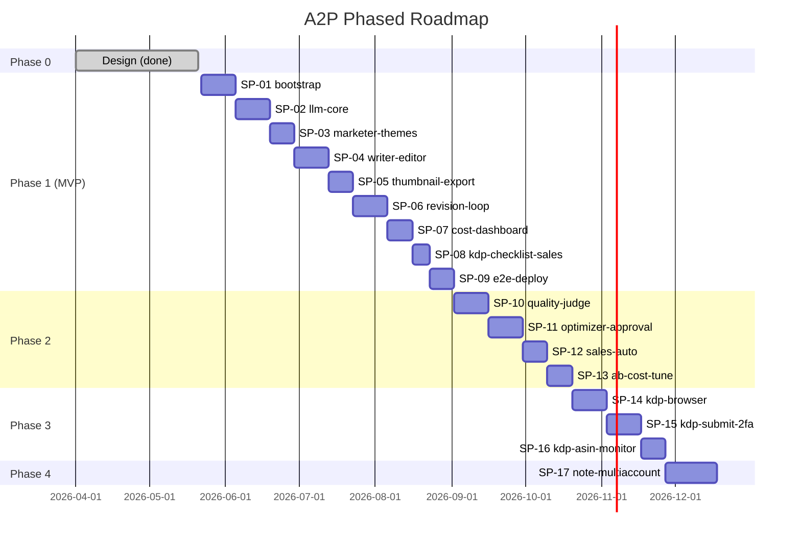
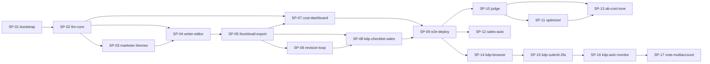
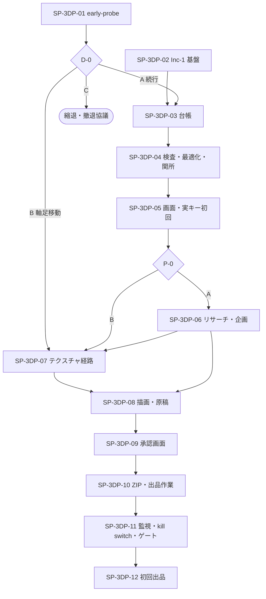
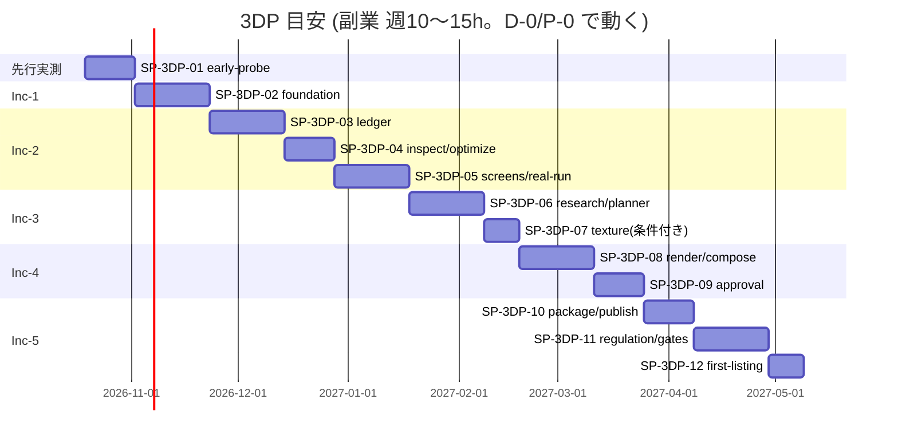

# 開発計画 (dev-plan)

> 本ドキュメントは `pm` ハーネスエージェントが計画モードで生成・更新する。
> 起点ドキュメント: `CLAUDE.md`, `docs/01-business-requirements.md`, `docs/02-functional-requirements.md`, `docs/03-tech-selection.md`, `docs/04-ui-design.md`, `docs/05-program-design.md`。
> スプリント詳細は `docs/sprints/SP-NN-*.md` を参照。
> **3DP (M2P 第3ツール) の計画は §11 と `docs/sprints/SP-3DP-NN-*.md`** (A2P とは別系列の ID)。
> 完了確認は同じ pm を `MODE: REVIEW` で起動し、`## PHASE_COMPLETE` の出力を以て次フェーズへ進む。

---

## 1. 目的

A2P（Amazon Automated Publishing）の段階開発を、**個人開発・副業時間（週 10〜15 時間）** の制約下で破綻なく回すための実行計画を定義する。具体的には：

- Phase 1 (MVP) を **9 スプリント / 約 12〜16 週** で完走させ、夜セット → 朝レビュー → 修正コメント一括反映のループを稼働状態にする
- 月額コスト 5 万円・1 冊コスト 500 円・100 冊/月のスループットが **計測可能** な状態を作る（観測フックを Phase 1 から完備）
- Phase 2 以降の「Quality Judge / Prompt Optimizer / KDP 自動入稿 / note 連携」を増分追加できる土台（マルチプロバイダ抽象・プロンプト DB バージョニング・書籍排他・冪等ジョブ）を Phase 1 で確立する
- `programmer` エージェントが `/iterate` で 1 タスク = 1 起動・5 iteration 以内に `## DONE` までたどり着く粒度のタスク分解を提供する

---

## 2. マイルストーン

期間目安は週単位。1 週 = 副業時間 10〜15 時間想定。`PHASE_COMPLETE` 判定は pm `MODE: REVIEW` で機械的に行う。

| Phase | 期間目安 | 主目的 | 完了条件（PHASE_COMPLETE 判定基準） |
|---|---|---|---|
| **Phase 0** (設計) | 完了済 | 10 ハーネスエージェント整備 + `docs/01..05` + ワイヤーフレーム + 本 dev-plan | `docs/01..05` 実体あり / `docs/wireframes/` 1 ファイル以上 / `docs/dev-plan.md` と `SP-01` 存在 / `docs/01` 申し送り 7 項が `docs/02` で参照 |
| **Phase 1** (MVP) | 12〜16 週（SP-01 〜 SP-09） | パイプライン (Marketer → Writer → Editor → Thumbnail) + Word/PDF/PNG 出力 + ダッシュボード + コメント→一括反映 + マルチプロバイダ抽象 + コスト/単価カタログ + バッチ計画 + KDP 入稿チェックリスト | SP-01〜SP-09 全タスク `## DONE` / Phase 1 対象 P0 機能（F-001〜F-007, F-010〜F-025, F-027〜F-028, F-032〜F-037, F-039〜F-040, F-043〜F-046, F-049〜F-050）が実装かつ E2E PASS / 月額コスト試算が 5 万円以内に収まる実測あり |
| **Phase 2** (品質ループ) ✅**完了 (2026-06-14, コード/設計/テスト)** | 6〜10 週（SP-10 〜 SP-13） | Quality Judge / Prompt Optimizer + 自動承認 / プロンプト A/B 配信 / 売上 Amazon 自動取得 / モデル A/B 比較ビュー / Prompt Caching | F-008, F-009, F-026, F-029〜F-031, F-038 実装 / UC-02・UC-03 E2E PASS / Prompt Optimizer 1 サイクル稼働 |
| **Phase 3** (KDP 自動入稿) ⏸**保留（KDP は当面手動運用, 2026-06-15 決定）** | 6〜8 週（SP-14 〜 SP-16） | Playwright + stealth による KDP 自動入稿 (F-041) + 2FA push-and-wait + ASIN 取り込み (F-042) | F-041, F-042 実装 / UC-05 E2E PASS / 本番 KDP で 1 冊以上を「公開待ち」まで到達確認 ／ ※保留中は F-020 入稿チェックリスト(S-015)で運営者が手動入稿 |
| **Phase 4** (他チャネル) | 未確定（SP-17 〜） | note 記事化 (F-047) + 複数 KDP アカウント運用 (F-048) | Phase 3 完了後に詳細化（本書では枠のみ） |

### 2.1 マイルストーンガント（概観）



---

## 3. Phase 1 スプリント一覧（詳細化対象）

Phase 1 は **9 スプリント**。各スプリントの目的・期間目安・主な成果物・対応機能 ID を以下に列挙する。タスク詳細は各 `docs/sprints/SP-NN-*.md` を参照。

| SP | スラッグ | 目的 | 期間目安 | 主な成果物 | 主な対応機能 |
|---|---|---|---|---|---|
| **SP-01** | `bootstrap-monorepo` | pnpm モノレポ・Prisma・NextAuth・最小ダッシュボード骨格・env 検証・Pino ロガー・Resend メール基盤を確立 | 2 週 | `apps/web` `apps/worker` 起動 / `packages/{db,contracts,storage,notify,crypto}` 雛形 / `docs/03 §5` env 28 項目 / Railway デプロイ通る | F-043, F-044, インフラ全般 |
| **SP-02** | `llm-core-cost-foundation` | マルチプロバイダ LLM 二層クライアント / `withTokenLogging` / `BookLock` / モデル単価カタログ + 為替日次バッチ / モデル割当 UI（最小） | 2 週 | `packages/agents/lib/*` 完成 / `catalog.fetch` `fx.fetch` 動作 / S-019 / S-020 最小実装 | F-022, F-023, F-024, F-025, F-032 |
| **SP-03** | `marketer-themes-bulk` | Marketer エージェント（Web Search + テーマ生成） / `theme_session_id` / テーマバルク承認 UI / 夜間バッチ計画 UI / `Book` 行作成 | 1.5 週 | S-006, S-007, S-008 動作 / `pipeline.book.kickoff` `pipeline.book.marketer` タスク | F-001, F-010, F-017, F-021, F-040 |
| **SP-04** | `writer-editor-pipeline` | Writer（アウトライン + 章執筆） / Editor / アウトライン承認 UI / 章並列実行 (p-limit) / book ステータス遷移 / 修正コメント反映後の Writer/Editor 再呼出基盤 | 2 週 | `pipeline.book.writer.outline/chapter` `pipeline.book.editor` / S-010 章エディタ / S-011 バルク承認 | F-003, F-004, F-005, F-011, F-016, F-018, F-027, F-028 |
| **SP-05** | `thumbnail-export-artifacts` | Thumbnail Designer（テキスト + gpt-image-1） / R2 永続化 / docx + PDF + KDP 寸法 PNG 出力 / サムネ承認 UI / 成果物ダウンロード | 1.5 週 | `pipeline.book.thumbnail.*` `pipeline.book.export` / S-009 ライブラリ / S-012 バルクサムネ / R2 キー規約 | F-006, F-007, F-012, F-013, F-014, F-015, F-019 |
| **SP-06** | `revision-comments-loop` | F-049 コメント記録（章/サムネ/メタ/アウトライン横断） / F-050 ユーザートリガー一括反映 / `revision_runs` + `chapter_revisions` + `BookLock` 衝突制御 / 差分レビュー UI | 2 週 | S-013, S-014 動作 / `revision.book.apply` タスク / Resend `revision-run-completed` メール | F-049, F-050（+ F-016 ロールバック） |
| **SP-07** | `cost-dashboard-alert` | F-033 書籍別コスト集計 / F-034 1 冊 500/750 円アラート + 自動ポーズ / F-035 月次ダッシュボード / F-036 月末予測アラート / Alert 通知メール / S-024 / S-027 / S-028 | 1.5 週 | S-024, S-027, S-028 動作 / `alert.cost.check` cron / Resend `cost-exceeded` `monthly-budget-alert` | F-033, F-034, F-035, F-036, F-046 |
| **SP-08** | `kdp-checklist-sales-kpi` | F-020 KDP 入稿チェックリスト（手動転記支援、`must` コメントで入稿ブロック） / F-037 売上手動入力 + CSV インポート / F-039 売上 KPI ダッシュボード / S-005 長期出版プラン（F-002） | 1 週 | S-015, S-017, S-018, S-005 動作 | F-002, F-020, F-037, F-039 |
| **SP-09** | `e2e-deploy-harden` | Playwright 環境構築（playwright.config + tests/e2e/、@playwright/test 導入）/ SP-01 から繰越したスモーク `tests/e2e/smoke-login-dashboard.spec.ts` / UC-01・UC-04・UC-06 本格 E2E / ジョブログ UI（S-025, S-026） / 監査ログ（S-029） / `archive.jobs` cron / Railway 本番デプロイ手順固め / 1 冊実走でコスト・リードタイム実測 | 1.5 週 | E2E spec 4 本 PASS（スモーク + UC×3） / S-025, S-026, S-029 / 本番運用ハンドブック | F-045, F-046, F-029(枠), F-030(枠), 観測 / Phase 1 完了判定 |

合計 **Phase 1 スプリント数: 9**、想定タスク総数: 約 **80〜95 タスク**（各スプリント詳細ファイル参照）。

---

## 4. Phase 2-4 スプリント一覧（枠のみ）

各スプリントは skelton ファイル（目的・対応機能 ID・想定タスク数）のみ作成。タスク詳細化は Phase 1 完了後に PM を再起動して行う。

### Phase 2 (品質ループ)

| SP | スラッグ | 目的 | 主な対応機能 |
|---|---|---|---|
| **SP-10** | `quality-judge` | Quality Judge エージェント (F-008) + 80 未満再生成ループ + 評価履歴 UI | F-008 |
| **SP-11** | `prompt-optimizer-approval` | Prompt Optimizer (F-009) + 改訂承認 UI (F-029) + 自動承認 5 冊連続改善ルール (F-030) + A/B 配信 (F-031) | F-009, F-029, F-030, F-031 |
| **SP-12** | `sales-auto-fetch` | KDP レポート Playwright 取得 (F-038) / 売上ダッシュボード自動更新 | F-038 |
| **SP-13** | `ab-comparison-cost-tune` | モデル A/B 比較ビュー (F-026) / Prompt Caching 有効化 (`AgentSdkClient` + `AISdkClient` 双方) / 比較集計クエリ + S-021 UI 実装 | F-026, OQ-07 |

### Phase 3 (KDP 自動入稿)

| SP | スラッグ | 目的 | 主な対応機能 |
|---|---|---|---|
| **SP-14** | `kdp-browser-base` | Playwright + stealth + Dockerfile 整備 / KDP 認証情報暗号化（既存 `crypto`）/ ローカルダミー HTML での E2E fixture | KDP-01〜KDP-05 |
| **SP-15** | `kdp-submit-2fa` | KDP 自動入稿実装 (F-041) / 2FA push-and-wait（Resend + 承認画面）/ S-016 モニター UI | F-041 |
| **SP-16** | `kdp-asin-monitor` | ASIN 自動取り込み (F-042) / KDP 入稿失敗時のスクショ保管 + リトライ | F-042 |

### Phase 4 (他チャネル / マルチアカウント)

| SP | スラッグ | 目的 | 主な対応機能 |
|---|---|---|---|
| **SP-17** | `note-multiaccount` | note 記事化 (F-047) + 複数 KDP アカウント運用 UI (F-048) | F-047, F-048 |

---

## 5. 依存関係

スプリント間の主要依存。前提が揃わないと後段は開始不可。



### 5.1 クリティカルパス（Phase 1）

`SP-01 → SP-02 → SP-04 → SP-05 → SP-06 → SP-09` がクリティカルパス。SP-03 は SP-02 完了後に SP-04 と部分並列可能、SP-07 / SP-08 は SP-05 完了後に部分並列可能。

### 5.2 共通前提（全スプリント）

- `CLAUDE.md` の Hard Rule 6 項を必ず守る（特に Rule 4 プロンプト DB / Rule 5 token_usage / Rule 6 secrets）
- 新スプリント開始時、pm を `MODE: REVIEW TARGET: SP-NN-1` で起動し前スプリント完了を機械検証してから着手
- 各タスクは `/iterate "<T-NN-MM>"` で起動。programmer → code-reviewer → e2e-tester の 3 段ループを APPROVED+PASS まで回す
- UI 実装タスクは `docs/wireframes/{S-xxx}-*/prompt.md`（運営者が ChatGPT 投入する手動デザインのプロンプト型ワイヤー）を必ず参照すること

---

## 6. リスクと緩和策

### 6.1 コスト関連

| # | リスク | 影響度 | 緩和策 | 関連スプリント |
|---|---|---|---|---|
| R-01 | 月額 5 万円上限の張り付き（`docs/03 §6.2` 試算 42,000〜57,500 円） | 高 | SP-02 で `token_usage` を必ず仕込み、SP-07 でアラート + 自動ポーズ。SP-13 で Prompt Caching + Gemini Flash 切替を A/B 検証 | SP-02, SP-07, SP-13 |
| R-02 | OQ-01: `@react-pdf/renderer` が 5 万字 PDF で性能不足 | 中 | SP-05 のタスクに「200 ページ 30 秒以内」ベンチを含め、未達なら Puppeteer フォールバック切替判断を SP-09 で記録 | SP-05, SP-09 |
| R-03 | OpenAI gpt-image-1 価格変動 / レート制限 | 中 | SP-02 のカタログバッチでサイズ別価格追跡（OQ-D-08）。SP-05 で再生成リトライ実装 | SP-02, SP-05 |
| R-04 | Anthropic Web Search server tool のレート/コスト超過 (OQ-02) | 中 | SP-03 で Tavily フォールバックの I/F だけ用意（Phase 2 で有効化） | SP-03 |

### 6.2 仕様・規約関連

| # | リスク | 影響度 | 緩和策 | 関連スプリント |
|---|---|---|---|---|
| R-05 | KDP 規約変更（AI 開示文・サムネ規則の改定） | 高 | F-005 で挿入する AI 開示文は `AppSettings.ai_disclosure_text` に保存（OQ-D-07）。SP-04 で実装、SP-09 で運用ハンドブック化 | SP-04, SP-09 |
| R-06 | KDP の Bot 検出による Playwright 自動入稿失敗 (OQ-03) | 高 | Phase 3 開始（SP-14）で stealth プラグイン PoC を最初に実施。失敗時はローカル PC 常駐 worker への切替を SP-14 完了判定に組込 | SP-14 |
| R-07 | プロバイダ価格 API 非提供 → スクレイピング破綻 | 中 | SP-02 で手動編集 UI（B-03）+ 前日値継続使用 + `catalog_fetch_failed` Alert を必ず実装 | SP-02 |

### 6.3 副業時間・運用関連

| # | リスク | 影響度 | 緩和策 | 関連スプリント |
|---|---|---|---|---|
| R-08 | 副業時間（週 10〜15h）でスプリント遅延 | 高 | 各スプリントを 1〜2 週 × 12 タスク以下に抑制。`/iterate` 5 iteration で完了しない場合は escalate して人間判断 | 全 SP |
| R-09 | 30 分/冊の操作時間制約が UI 設計どおりに守れない | 高 | SP-03/SP-04/SP-05/SP-06 のバルク UI を実装後、SP-09 の UC-01 E2E で「1 操作 20 件処理可能」を必ず assertion | SP-03〜SP-09 |
| R-10 | OQ-D-05: `BookLock` の expires 超過解放の運用 | 低 | SP-07 の `alert.cost.check` cron と同 worker に `book_locks` 掃除ロジック相乗り | SP-07 |
| R-11 | Resend 無料 3,000 通超過 (OQ-05) | 低 | SP-01 で実装時に送信ログを `Alert` に記録。Phase 1 末で実測し、超過なら $20 プランに切替 | SP-01 |
| R-12 | Railway 障害で全停止 | 中 | SP-01 で `pg_dump` を週次 R2 退避する cron を設定。SP-09 で復旧手順をハンドブック化 | SP-01, SP-09 |

### 6.4 設計トレース

| # | リスク | 影響度 | 緩和策 |
|---|---|---|---|
| R-13 | `token_usage` の記録漏れ（Hard Rule 5 違反） | 高 | SP-02 で `withTokenLogging` ミドルウェアを必須化、CI で `grep -r "AISdkClient\|AgentSdkClient"` が `packages/agents/lib/` 以外に出たら fail（`docs/05 §10.1`） |
| R-14 | プロンプトをコードに直書き（Hard Rule 4 違反） | 中 | SP-01 の seed 実装で `prompts` 全件投入。SP-04 から `prompt-loader.ts` 経由のみ許可。CI で grep |
| R-15 | 申し送り 7 項（`docs/01` 末尾）の未対応 | 中 | 各スプリントの「完了判定」に該当項目を明示。SP-09 完了時に pm `MODE: REVIEW` で全件チェック |

---

## 7. 意思決定ログ

主要な決定事項を日付付きで列挙。新規決定が発生したら追記する（運用ルール）。

| 日付 | 決定 | 根拠ドキュメント |
|---|---|---|
| 2026-05-21 | Phase 1 から **マルチプロバイダ二層**（`AISdkClient` + `AgentSdkClient`）を採用。Marketer の Anthropic Web Search server tool と他 4 役の Vercel AI SDK 統一を両立 | `docs/03 §A`, `docs/05 §6.1` |
| 2026-05-21 | F-050 修正一括反映は **運営者の明示的ボタン押下のみがトリガー**（自動スケジュール実行は採用しない） | `docs/01 §申し送り 7`, `docs/02 F-050`, `docs/04 S-013` |
| 2026-05-21 | 1 冊あたり想定文字数を **45,000〜55,000 字** に確定。章数 7〜10、章あたり 5,000〜7,500 字 | `docs/02 §Assumptions 1-2`, `docs/05 §6.3.2` |
| 2026-05-21 | カバー画像は **OpenAI gpt-image-1**（KDP 2560×1600 を直接生成）。日本語タイポ品質を優先 | `docs/03 C-07`, `docs/05 §6.3.4` |
| 2026-05-21 | ワイヤーフレーム画像は **運営者が ChatGPT で手動生成** する「投入プロンプト型 designer」運用とする。各 UI 実装タスクは `docs/wireframes/{S-xxx}-*/prompt.md` を必ず参照 | `docs/04 §8 申し送り 1` |
| 2026-05-21 | 月額コスト上限 **5 万円 / 1 冊 500 円**、100 冊/月目標。コスト/売上比率 33% 上限 | `docs/01 §3.2 §7.3` |
| 2026-05-21 | プロンプトは DB (`prompts` テーブル) に格納し、コード直書き禁止。シードスクリプトで初期投入 | `CLAUDE.md` Hard Rule 4 |
| 2026-05-21 | `token_usage` は `withTokenLogging` ミドルウェア経由でのみ INSERT（CI で grep チェック） | `CLAUDE.md` Hard Rule 5, `docs/05 §10.1` |
| 2026-05-21 | 書籍排他は `BookLock` テーブル（`book_id` 主キー + `expires_at` 自動解放）で行い、`revision_run` × `pipeline` × `kdp_submit` の衝突を防ぐ | `docs/05 §14 #4` |
| 2026-05-21 | リアルタイム進捗は **SSE 一次採用**、WebSocket は将来検討。Postgres `LISTEN/NOTIFY` でブリッジ | `docs/05 §1.4 §14 #10` |
| 2026-05-21 | SA = UI mutation / RH = SSE・バイナリ / RSC = GET 集計、の使い分けを固定 | `docs/05 §4.1 §14 #1` |
| 2026-05-21 | KDP 関連（F-041, F-042）は **Phase 3**。Phase 1 では F-020 入稿チェックリスト UI のみ実装 | `docs/02 §4.1 工程 8`, `docs/05 §1.3` |
| 2026-05-21 | 売上自動取得 (F-038) は **Phase 2**。Phase 1 では F-037 手動入力 + CSV インポートで運用 | `docs/02 F-037 F-038`, `docs/05 §1.3` |
| 2026-05-21 | Quality Judge (F-008) と Prompt Optimizer (F-009) は **Phase 2** 開始時に有効化。Phase 1 の `pipeline.book.judge` はスキップ枝で出荷 | `docs/05 §1.3 §5.3.8` |
| 2026-05-21 | Phase 3 用スキーマ（`accounts.kdp_credentials_enc`, `kdp_2fa_codes`, `kdp_submission_progress.auto_*`）は **Phase 1 で先取り保持**（null 許容） | `docs/05 §14 #5` |
| 2026-05-21 | メール送信は **Resend + react-email**。Phase 1 から `cost-exceeded` / `monthly-budget-alert` / `pricing-changed` / `revision-run-completed` の 4 テンプレを実装、`kdp-2fa` は Phase 3 で追加 | `docs/03 §D`, `docs/03 §10 申し送り 7` |
| 2026-05-21 | 環境変数は `packages/contracts/env.ts` で zod 検証、起動時に必須項目を verify。CI で `.env.example` との差分検出 | `docs/03 §J`, `docs/05 §13 #2` |
| 2026-06-14 | **Phase 2（品質ループ, SP-10〜SP-13）をコード/設計/テスト面で完了**。F-008/009/026/029-031/038 実装＋ユニット/E2E 検証済み。残るは実 LLM/本番実走を要する人間ゲートのみ | 各 `docs/sprints/SP-10..13`, pm `MODE: REVIEW TARGET: Phase 2` |
| 2026-06-15 | **KDP へのアップロードは当面「人間が手動」運用**とする（運営者決定）。Phase 1 実装済みの F-020 KDP 入稿チェックリスト UI（S-015）で生成成果物（docx/PDF/PNG＋メタデータ）を確認し、運営者が KDP へ手動転記・入稿する。**Phase 3（KDP 自動入稿 F-041/F-042, SP-14〜16）は保留**（実 Amazon への Playwright 自動操作は bot 検出による BAN リスク R-06 が高く、実認証・2FA も要するため、必要になった時点で別途着手） | `docs/02 F-020/F-041/F-042`, `docs/04 S-015`, `docs/dev-plan §6.2 R-06` |

---

## 8. 完了確認の運用

各スプリント / Phase の完了は pm エージェントを `MODE: REVIEW TARGET: <対象>` で起動し、機械検証する。

### スプリント完了確認

```
/iterate(... )  # 各タスクを APPROVED+PASS まで回す
↓ 全タスク完了
pm MODE: REVIEW TARGET: SP-NN  # → ## PHASE_COMPLETE or ## PHASE_INCOMPLETE
```

### Phase 完了確認

```
SP-01..SP-09 全完了
↓
pm MODE: REVIEW TARGET: Phase 1
↓ PHASE_COMPLETE
Phase 2 のスプリントを詳細化 (pm 計画モード再起動)
```

各スプリントファイルの「完了判定」セクションには上記運用が明記されている。

---

## 9. トレーサビリティ：機能 ID → スプリント

Phase 1 対象の全 P0/P1 機能（F-001〜F-050 のうち Phase 1 / Phase 2 期待開始）と担当スプリントのマッピング。

| F-ID | 機能名 | 主担当 SP | 補助 SP |
|---|---|---|---|
| F-001 | テーマ候補生成 | SP-03 | — |
| F-002 | 長期出版プラン | SP-08 | — |
| F-003 | アウトライン生成 | SP-04 | — |
| F-004 | 章執筆 | SP-04 | SP-06 (修正反映で再呼出) |
| F-005 | 校閲 | SP-04 | SP-06 |
| F-006 | カバーテキスト | SP-05 | SP-06 |
| F-007 | カバー画像 | SP-05 | SP-06 |
| F-008 | Quality Judge | SP-10 (Phase 2) | — |
| F-009 | Prompt Optimizer | SP-11 (Phase 2) | — |
| F-010 | 書籍ジョブ作成 | SP-03 | SP-04 |
| F-011 | 並列実行 | SP-04 | SP-01 (worker 起動), SP-05 |
| F-012 | Word 出力 | SP-05 | — |
| F-013 | PDF 出力 | SP-05 | — |
| F-014 | カバー PNG | SP-05 | — |
| F-015 | R2 永続化 | SP-05 | SP-01 (storage 雛形) |
| F-016 | リトライ/部分再開 | SP-04 | SP-06, SP-09 |
| F-017 | テーマバルク承認 | SP-03 | — |
| F-018 | アウトラインバルク承認 | SP-04 | — |
| F-019 | サムネバルク承認 | SP-05 | — |
| F-020 | KDP 入稿チェックリスト | SP-08 | — |
| F-021 | 夜間バッチ計画 | SP-03 | — |
| F-022 | モデル割当 | SP-02 | — |
| F-023 | UI モデル切替 | SP-02 | — |
| F-024 | 単価カタログ日次取得 | SP-02 | — |
| F-025 | カタログダッシュボード | SP-02 | — |
| F-026 | モデル A/B 比較 | SP-13 (Phase 2) | — |
| F-027 | DB プロンプトテンプレ | SP-01 (seed), SP-04 (loader) | 全 SP |
| F-028 | プロンプトバージョン履歴 | SP-04 | SP-11 |
| F-029 | プロンプト改訂承認 UI | SP-11 (Phase 2) | — |
| F-030 | プロンプト自動承認 | SP-11 (Phase 2) | — |
| F-031 | プロンプト A/B 配信 | SP-11 (Phase 2) | — |
| F-032 | トークン使用量記録 | SP-02 | 全 SP |
| F-033 | 書籍別コスト集計 | SP-07 | — |
| F-034 | 1 冊 500 円超過アラート | SP-07 | — |
| F-035 | 月次コストダッシュボード | SP-07 | — |
| F-036 | 月次予測アラート | SP-07 | — |
| F-037 | 売上手動入力 | SP-08 | — |
| F-038 | 売上自動取得 | SP-12 (Phase 2) | — |
| F-039 | 書籍 KPI ダッシュボード | SP-08 | — |
| F-040 | KDP メタデータ生成 | SP-03 | — |
| F-041 | KDP 自動入稿 | SP-15 (Phase 3) | — |
| F-042 | ASIN 取り込み | SP-16 (Phase 3) | — |
| F-043 | NextAuth 認証 | SP-01 | — |
| F-044 | アカウント管理 | SP-01 | SP-15 (KDP 認証情報暗号化) |
| F-045 | ジョブログ UI | SP-09 | — |
| F-046 | 失敗ジョブリトライ | SP-09 | SP-07 |
| F-047 | note 連携 | SP-17 (Phase 4) | — |
| F-048 | 複数 KDP アカウント | SP-17 (Phase 4) | — |
| F-049 | 修正コメント記録 | SP-06 | — |
| F-050 | 修正一括適用 | SP-06 | — |

### 9.1 docs/03 申し送り 7 項 のスプリント割当

| docs/03 §10 申し送り | 担当 SP |
|---|---|
| 1. LLM クライアント二層構造 | SP-02 |
| 2. `token_usage` は middleware 経由のみ | SP-02 |
| 3. 環境変数 zod スキーマ + CI 差分検出 | SP-01 |
| 4. graphile-worker task_identifier 命名規約 | SP-01（規約）, SP-03 以降（実装） |
| 5. R2 キー設計 | SP-01（規約）, SP-05（実装） |
| 6. PDF 出力性能ベンチ | SP-05（実測）, SP-09（判断記録） |
| 7. メールテンプレ 5 種（kdp-2fa は Phase 3） | SP-01（基盤）, SP-07（cost）, SP-06（revision）, SP-15（kdp-2fa） |

### 9.2 docs/05 申し送り 10 項 のスプリント割当

| docs/05 §13 申し送り | 担当 SP |
|---|---|
| 1. Prisma シングルトン | SP-01 |
| 2. env zod 検証 | SP-01 |
| 3. SA/RH の最初に zod parse + auth | SP-01（auth ラッパ）, 全 SP |
| 4. audit_log 記録対象 | SP-02（モデル切替）, SP-06（ジョブ操作）, SP-07（設定）, SP-11（プロンプト承認） |
| 5. 冪等性チェックリスト | SP-02（基盤）, SP-04 以降（タスク実装） |
| 6. createAgentClient 経由のみ | SP-02 |
| 7. R2 アクセスは packages/storage のみ | SP-01 |
| 8. getSessionOrThrow() | SP-01 |
| 9. シードデータ | SP-01（Account/Settings/Prompts/Assignments） |
| 10. Phase 3 用テーブル空欄保持 | SP-01（schema.prisma に nullable 列） |

---

## 10. 横断規約（ADR ハイライト）

スプリント間で揺らぎがちな技術判断を ADR として `docs/05-program-design.md §16` に記録し、本ファイルからも参照する。新規 sprint detail を起こす際は必ず該当 ADR に従うこと。

| ADR | 内容 | 影響範囲 |
|---|---|---|
| **ADR-001** | PostgreSQL `LISTEN/NOTIFY` チャネル名は **`'jobs'`** に統一（SP-03 T-03-11 SSE 配信、worker 側 `notifyJobChange` ヘルパ） | SP-03 以降の全 worker タスクで `pg_notify` を使う箇所、`/api/sse/jobs` route handler |

**Sprint detail 執筆時の注記**: SSE / pg_notify を参照する箇所では必ず `docs/05 §16 ADR-001` に従う（`'jobs'`）。旧表記 `'jobs_progress'` は誤りで、過去 sprint detail (SP-03 T-03-11, SP-04 T-04-04) は ADR-001 確定時に修正済み。

---

（以上、Phase 1 を 9 スプリント / Phase 2 を 4 / Phase 3 を 3 / Phase 4 を 1 で分解。詳細は各 `docs/sprints/SP-NN-*.md` を参照。）

---

## 11. 3DP (M2P 第3ツール) 開発計画 — SP-3DP 系列

> 2026-10-15 追記 (pm 計画モード)。**§1〜§10 の A2P の計画は変更していない。** 3DP は別系列の ID で管理する。
> 設計の正本 = `docs/12-3dp-design.md` (約 4,500 行)。スプリント詳細 = `docs/sprints/SP-3DP-NN-*.md` (12 本)。

### 11.1 位置づけと ID 規約

| 項目 | 規約 |
|---|---|
| スプリント | `SP-3DP-NN` (NN = 01〜12)。A2P の `SP-01`〜`SP-17` とは独立 |
| タスク | `T-3DP-NN-MM` (例 `T-3DP-05-11`)。1 タスク = `/iterate` 1 起動を原則とし、1〜3 ファイルが目安 |
| 運営者の手が要るもの | `OP-nn` (§11.6)。実装を待たずに運営者へ渡す |
| 設計書の不整合 | §11.12 に列挙し、直すタスクを割り当てる |
| 増分 | docs/12 §10 の Inc-1〜5 をそのまま使う。1 増分が複数スプリントになる |
| 完了確認 | `pm MODE: REVIEW TARGET: SP-3DP-NN` (スプリント) / `TARGET: Inc-N` (増分)。最終行は `## PHASE_COMPLETE` か `## PHASE_INCOMPLETE: ...` |
| 状態凡例 | ⬜ 未着手 / 🔶 着手中 / ✅ 完了 / ⛔ 運営者待ち |

### 11.2 設計フェーズ完了確認 (機械検証の結果)

| # | 検証項目 | 結果 | 詳細 |
|---|---|---|---|
| 1 | 設計書が実体を持つ | OK | `docs/12-3dp-design.md` 4,475 行。§1〜§17 (業務要件 §14 → 機能要件 §15 → 技術選定 §16 → 画面設計 §9 → プログラム設計 §17)。`docs/05` (4,524 行) と同規模 |
| 2 | 機能 ID の突合 | OK | §15.1 一覧 50 件 = §15.2 受入基準 50 件 (§15.6)。本計画の §11.11 で **50 件すべてを SP に割当** |
| 3 | 申し送りの連鎖 (業務要件 §14.8 の 9 項目 → 機能要件) | OK | F-3DP-36〜45 に落ちている |
| 4 | 申し送りの連鎖 (機能要件 §15.8 / 画面設計 §9.12 / 技術選定 §16.13 → プログラム設計) | OK | §17.0 の「前段の申し送り 14 項目の所在」が 1 対 1 で回答 |
| 5 | 申し送りの連鎖 (プログラム設計 §17.17 の 10 項目 → 本計画) | OK | §11.8 で 10 項目すべての所在を示した |
| 6 | 運営者の依頼 10 項目 (本計画の起動時) | OK | §11.8 |
| 7 | ワイヤーフレーム | OK (注意あり) | `docs/wireframes/S-3DP-{01,03,04,06,08}/prompt.md` の 5 枚。**PNG は 0 枚** (運営者が ChatGPT で生成する運用: 2026-05-21 の決定)。**S-3DP-02・05・07 の `prompt.md` が無い** (designer の優先順位 13 に入っていない)。UI タスクは `prompt.md` と §9.8 の文章から実装でき、PNG はブロッカーではない (OP-17) |
| 8 | 設計書内の数値・仕様の整合 | 注意あり | **不整合 11 件を発見** (§11.12)。いずれも修正タスクに割当済みで、着手を妨げない |
| 9 | 既存実装との整合 | OK (注意あり) | `apps/3dp` (ポート 3004)・`packages/mesh`・`derivative-guard.ts` (20 件)・DB 3 表は設計と一致。**設計が前提にして現リポジトリに無いもの**: 実 PG の統合テスト基盤 (`@testcontainers/postgresql` はどの `package.json` にも無く、`ci.yml` に Postgres サービスも無い) / `apps/3dp` の E2E (`playwright.config.ts` は `apps/web` のみ) / `apps/3dp` から graphile へ投入する基盤 (ANP の `graphile-client.ts` 相当) / worker の `@a2p/mesh` 依存と Dockerfile の COPY / `meshy` プロバイダ。すべてタスク化済み (SP-3DP-02 T-04/-11、SP-3DP-05 T-02、SP-3DP-03 T-03/-11) |
| 10 | 次フェーズ (SP-3DP-01) の前提 | OK | T-3DP-01-01〜04 のコードは運営者待ち無しで着手できる。実キー実行 (T-3DP-01-05) だけ OP-01/02/03 待ち |

### 11.3 計画の組み方 — 「やめる判断が早い順」

設計 §10 は「Inc-2 で品質が届かなければテクスチャに軸足を移す」という撤退分岐を持つが、その判定 (G-A / P-0) は **Inc-2 の完了時** — 台帳・キュー・検査・画面を全部作った後 (SP-3DP-02〜05 の 45 タスク) — にしか出ない。
**判断に必要な情報は、台帳なしの数回の POST で得られる。** そこで最初に置いたのが SP-3DP-01 (5 タスク) で、**投資を決める前に D-0 を出す**。以降も同じ原則で、各スプリントを「その結果で止められる位置」から並べた。

| 判定点 | いつ (目安) | 何を見るか | 結果が悪かったら | そこまでに使うタスク数 |
|---|---|---|---|---|
| **D-0** | SP-3DP-01 完了 (開始から約 2 週) | 実キーで 3D の技術面・運営者面・費用面、テクスチャの代替の成否 | **B 軸足移動** (SP-3DP-07 を SP-3DP-03 の前へ。Meshy 関連を凍結) / **C 縮退・撤退協議** | 4 (+運営者の実測 1) |
| **P-0** | SP-3DP-05 完了 (約 13 週) | 台帳経由の実測 (U-13/14/17/24/25/26/29)・G-A の運営者判定 | 同上 (正式判定) | 50 (SP-3DP-01〜05) |
| **U-15** | SP-3DP-08 T-10 | SwiftShader 描画が当方のイメージで動くか | 逃げ道 4 段 (解像度 → 別サービス → ローカル → Blender) | 78 |
| **U-19** | SP-3DP-10 T-10 | FBX が Unity で開けるか | Blender CLI へ (新規タスク) | 100 |
| **G-D (常時)** | 初回出品の後 | 公開状態の異常 | **緊急停止** (kill switch。自動) | — |
| **P-1** | 初回出品 + 90 日 | 最初の 8 商品の累計販売 5 本以上 | 縮退 / 軸足移動 | — |
| **P-2** | 初回出品 + 180 日 | 月次の手取り ≥ 実コスト | 縮退 (Meshy 解約) | — |
| G-E | 毎月 | 運営者の作業時間 | R-1 を下げる | — |

> SP-3DP-01 が無ければ最初の「やめる」判断は P-0 (約 13 週) まで出ない。SP-3DP-01 により **約 11 週早く**出せる。代償は、台帳整備前に実キーで回す**例外**の運営者承認 (OP-02) と、その費用 (約 150 credits ≒ ¥450) が `token_usage` に載らないこと (手書き記録)。

**pm を計画モードで再起動する点** (結果が計画を変える): D-0 / P-0 が B・C のとき / U-15 が不合格のとき / U-19 が不合格のとき / OP-10 が「許容と読めない」のとき。Inc-3 以降のタスクは Inc-2 の実測 (U-14 歩留まり・U-13 ポーリング値) を入力にするので、**SP-3DP-06 の着手前に必ず再確認**する。

### 11.4 増分とスプリントの対応

| スプリント | 増分 | 目的 | 期間目安 (週。副業 週 10〜15 時間) | タスク | 完了の目安 |
|---|---|---|---|---|---|
| **SP-3DP-01** early-probe | (Inc-2 の先行実測) | 実キーでの最小実測と D-0 | 1〜2 (+運営者の評価) | 5 | D-0 が A/B/C で記録 |
| **SP-3DP-02** inc1-foundation | **Inc-1** | 天井 12・状態/設定の形・U-9/U-10 回答欄・実 PG テスト基盤・E2E 基盤 | 2〜3 | 12 | 天井 13 を API が拒否 (E2E)・実 PG で CHECK |
| **SP-3DP-03** inc2a-ledger-submit-poll | **Inc-2** | 二重課金を防ぐ台帳と Meshy の投入・待ち | 2〜3 | 11 | 失敗系 10 ケース + 静的テストが CI で緑 |
| **SP-3DP-04** inc2b-inspect-optimize-orchestrate | Inc-2 | 検査・補正・最適化・生成の関所・`tdp.prompter` | 2 | 10 | 合成データで企画 → `ready`、キュー直列を実 PG で証明 |
| **SP-3DP-05** inc2c-screens-g-a-real-run | Inc-2 | 画面・実行状況・G-A の運営者判定・**実キー初回実行** | 3 | 12 | **P-0**。アクセサリ 1 点を生成→検査→配布用 GLB (§10) |
| **SP-3DP-06** inc3a-research-planner | **Inc-3** | 週次リサーチ・企画の自動作成・依拠性の許可規則 | 2〜3 | 12 | 企画が自動で立ち、ガードを通った物だけが生成へ |
| **SP-3DP-07** inc3b-texture-path | Inc-3 (条件付き) | テクスチャ商材の生成経路 | 1〜2 | 6 | テクスチャ 1 点が `ready` |
| **SP-3DP-08** inc4a-render-compose | **Inc-4** | プレビュー 6 枚の描画・商品ページ原稿 | 2〜3 (+実機計測) | 11 | `ready → review`、**U-15 の判定** |
| **SP-3DP-09** inc4b-approval-gate | Inc-4 | 承認画面・稼働の実測・標準文面の承認 | 2 | 11 | 承認画面で可否を押せる (§10) |
| **SP-3DP-10** inc5a-package-and-publish-work | **Inc-5** | 配布 ZIP・R-1 の枠 (予約)・出品作業・公開記録 | 2 | 11 | ZIP が Unity で開く (U-19) |
| **SP-3DP-11** inc5b-regulation-and-gates | Inc-5 | 公開状態の監視・kill switch・ゲート・損益 | 3 | 12 | 初回出品の前提チェック 5 項目 |
| **SP-3DP-12** inc5c-first-listing | Inc-5 | BOOTH への初回出品・Jinxxy 手動 1 件 | 1〜2 (+運営者) | 8 | **1 商品を実際に BOOTH に出品し、売上が入力できる** (§10) |

合計 **12 スプリント / 121 タスク / 約 26〜33 週 (6〜8 か月)**。**Inc-5 の完了はゴールではなく、そこから P-1 (90 日) / P-2 (180 日) が始まる** (§10 の追記)。

増分ごとのタスク数: **Inc-1 = 12** / **Inc-2 = 5 (probe) + 33** / **Inc-3 = 18** / **Inc-4 = 22** / **Inc-5 = 31**。
(SP-3DP-01 は Inc-2 の先行実測。Inc-2 本体 = SP-3DP-03〜05 の 33。)

**進捗 (2026-10-19 記録)**

| 増分 / スプリント | 状態 |
|---|---|
| **Inc-1 (SP-3DP-02)** | **コード完了・本番適用済み (2026-10-19)。** migration `20261016010000_tdp_inc1_foundation` を手動経路 (1 トランザクション + `lock_timeout 5s` + `migrate resolve --applied`) で適用し OP-18 を消化。**順番を間違えると本番が壊れることが実証された**: 共有 `jobs` に列を足した schema でコードを先にデプロイしたため、`prisma.job.update()` が全タスクで失敗し `note.engage` が 3 回再試行された (docs/12 §12 Inc-1 の節)。OP-11 (U-9/U-10) は未回答 |
| SP-3DP-01 | 全タスク未着手 (T-3DP-01-05 は ⛔)。**D-0 は未記録** (OP-01 キー未発行 / OP-02 未承認) |
| **SP-3DP-03 以降** | **着手不可。** §11.3・各スプリントの前提どおり **D-0 = A** が必要で、D-0 には OP-01 (Meshy キー) と OP-02 (実キー検証の承認) が要る。揃うまで進めない |
| 未決の設計判断 | TBD-12 (`inspecting` + ガード #2 NG の辺。SP-3DP-04 着手前) / `status_check_unreachable_warn_days` の group (SP-3DP-11 着手前)。いずれも docs/12 §17.16 / §7.3a に記録済み |

### 11.5 依存関係



- **並行してよい**: SP-3DP-02 は D-0 を待たず SP-3DP-01 と並行できる (ただし T-3DP-02-02 の天井 12 は最優先)。SP-3DP-01 の運営者評価待ちの間に SP-3DP-02 を進める。
- **順序を守る**: SP-3DP-03 → 04 → 05 (実キーは台帳が緑になってから)。SP-3DP-11 は SP-3DP-12 の前 (**出品が始まった瞬間から監視が必要**)。
- **SP-3DP-07 は条件付き**: P-0 = A なら SP-3DP-06 の後・SP-3DP-08 の前。B なら SP-3DP-03 の前 (pm 再編)。



### 11.6 運営者の手が要るもの (一覧)

「いつまでに」は**必要になるタスク**。**早く聞いても困らないもの (聞くだけ・調べるだけ)** は「今」と書いた。

| ID | 内容 | 必要になる所 | 今聞くべきか | 未対応のときの挙動 |
|---|---|---|---|---|
| **OP-01** | Meshy Pro ($20/月) の契約とキー発行。まずローカルの `.env.local` のみ。ポータル API 管理への登録は SP-3DP-03 の CI が緑になってから | SP-3DP-01 T-05 / SP-3DP-05 T-11 | **今** | D-0 / P-0 が出ない |
| **OP-02** | ① 台帳整備前に実キーで probe を回す**例外**の承認 ② D-0 の判定基準 (SP-3DP-01 §6) の承認 | SP-3DP-01 T-05 | **今** | probe を回さない = 判断が約 11 週遅れる |
| **OP-03** | 生成物を目視し「これを ¥500 で売れる」かを入力 (probe の `operator_verdict` / 画面の G-A 判定) | SP-3DP-01 T-05 / SP-3DP-05 T-11 / SP-3DP-07 T-01 | 実行後 | D-0 / P-0 が出ない |
| **OP-04** | 実 PG テストの置き場: A Docker Desktop / B ローカル PG の URL / C CI のみ | SP-3DP-02 T-04 | **今** | 既定は C。進められる |
| **OP-05** | R2 バケットの CORS (許可オリジン = 本番 `https://3dp.m2p.tools` と開発 `http://localhost:3004`。設計の `3010` は誤り) | SP-3DP-05 T-04 (手動確認) / T-11 | 任意 | ModelViewer が読み込めず G-A の目視ができない |
| **OP-06** | U-21 (R2 の現使用量) と U-22 (Meshy クレジットの繰越・追加購入単価) の確認 | SP-3DP-05 T-11 前 | **今** (調べるだけ) | 仮置きの安全側で進む |
| **OP-07** | U-18: Railway の worker の割当 vCPU/RAM と直近のメモリピーク | SP-3DP-08 T-10 | **今** | 描画の合格基準を判定できない (⛔) |
| **OP-08** | U-12: 月間作業時間の上限 (既定 240 分) の承認/変更と、判定値グループの「確認した」 | SP-3DP-09 〜 SP-3DP-11 | 後でよい | 提案値のまま動く |
| **OP-09** | **標準文面の承認** (ライセンス・再配布条件 / AI 開示)。案は SP-3DP-08 T-02 が作る。**Inc-4 のブロッカー (TBD-3)** | SP-3DP-09 T-09 | 案が出たら | 出品が保留される。**初回出品の前に必須** |
| **OP-10** | U-8: BOOTH 改定後ガイドライン本文を読み「低頻度の素の取得」が許容かを判断 + UA に載せる連絡先 | SP-3DP-06 T-06 / **SP-3DP-11 T-02** | **今** (読むだけ) | 公開状態確認 (G-D) が実装できない = **初回出品できない** |
| **OP-11** | **U-9 / U-10 に回答** (同じ pixiv アカウントの他用途 / A2P の BOOTH 書籍売上の割合) | 画面は SP-3DP-02 T-09。初回出品 (SP-3DP-12) の前に必須 | **今** (数字は既存データから出せる) | 出品が保留される (F-3DP-42) |
| **OP-12** | U-16: 自分の BOOTH 商品 1 点で「公開 → 取得」「自主非公開 → 取得」を比べる (終わったら公開に戻す。強制非公開は再現しない) | SP-3DP-11 T-10 | 後でよい | 200 の中身の判定は安全側 (`unreachable`) のまま = 検知力が弱い。受容の明示が必要 |
| **OP-13** | U-11: 強制非公開・警告が運営者に通知されるか (公式ヘルプ・処分事例) | SP-3DP-11 T-10 | **今** (読むだけ) | 通知されない前提で設計済み |
| **OP-14** | U-19: 実 FBX を Unity で開く + ZIP の日本語名が文字化けしないか | SP-3DP-10 T-10 | 後 | 初回出品の前提 |
| **OP-15** | U-28: `manage.booth.pm` の売上画面に商品別の販売数・CSV があるか | SP-3DP-11 T-10 | 任意 | 売上は手入力が既定 |
| **OP-16** | **R-1 の初期値**: 既定 8 のまま出すか、下げて始めるか。U-3 (BOOTH の閾値は非開示) と U-10 の結果を見て決める。天井 12 は変えられない | 初回出品の前 (SP-3DP-12 T-05) | U-10 の後 | 既定 8 で動く。**推奨: 最初は低く** (「月 8」は上限であって目標ではない) |
| **OP-17** | ワイヤーフレーム PNG の生成 (5 枚)。優先順 = S-3DP-04 > 01 > 03 > 06 > 08 | 各 UI タスク前 (S-3DP-04 は SP-3DP-09 前) | 順次 | `prompt.md` と §9.8 から実装 (**ブロッカーではない**) |
| **OP-18** | 本番 DB への migration 適用と worker/web のデプロイ (`railway up --service <svc> --detach`)。**migration → コードの順**。適用前の確認 SQL の結果を運営者が確認 | 各スプリント末 | 各回 | **本番が壊れる。** 「3DP のタスクは cron に載るまで本番を壊さない」と書いていたが誤り — 共有 `jobs` / `app_settings` に列を足すと、3DP を動かしていなくても Prisma が全タスクの job 行更新でその列を要求し、A2P/ANP の worker が落ちる (2026-10-19 実証) |
| **OP-19** | TBD-5 の受容: worker 全体が止まると 3DP 内から通知できない (画面を開いたときのナビの異常印が最後の砦) | 初回出品の前 (SP-3DP-11 §3) | 後 | 受容の記録が必須 |
| **OP-20** | 提案値 (A-1〜A-14) のグループ別「確認した」(UR-7) | 各機能を ON にする前 | 随時 | 提案値のまま動く (注意書きが残る) |
| **OP-21** | a) U-1': `booth-cat-recon.mjs` の実行 b) 初回出品の商品選択と BOOTH での UP + 公開 | SP-3DP-12 T-02 / T-05 | 後 | 初回出品が始まらない |
| **OP-22** | Jinxxy のアカウント・API キー・手動 1 件・初回売上後の着金確認 (U-5/U-6)。**P1** | SP-3DP-12 T-07 | 後 | Jinxxy は出品しない |

**今すぐ聞く / 調べるべきもの (待ち時間が長い or 聞くだけ)**: OP-01 / 02 (契約・承認)、OP-04、OP-06、OP-07、OP-10 (読むだけ)、OP-11 (数字を出すだけ)、OP-13 (読むだけ)。

### 11.7 TBD-1〜11 と U-NN の仕分け

**A. 着手前に運営者の判断が要る** (実装を始めてから詰まる項目を先に出した): OP-01/02/03/04/09/10/11/16/19 — §11.6。

**B. PM が決定した (運営者に拒否権あり。拒否されたら該当タスクを外して再計画)**

| TBD | 決定 | 反映先 |
|---|---|---|
| TBD-1 | **docs/12 は分割しない** (§11.11) | SP-3DP-02 T-12 (目次の追加) |
| TBD-2 | `tdp.prompter` を **Inc-2 へ前倒し** | SP-3DP-04 T-04 |
| TBD-4 | S-3DP-03 に `ModelViewer` を **Inc-2** で (R2 CORS の運営作業も Inc-2 へ) | SP-3DP-05 T-04, OP-05 |
| TBD-6 | R-1 の数え方 = 予約 + 公開記録 (D-2)。ホームは「N 件 (うち作業中 K 件)」 | SP-3DP-10 T-05/-06/-08 |
| TBD-7 | 寸法・原点・テクスチャ解像度は**補正で直す** (D-8)。補正通過は歩留まりに別計上 | SP-3DP-04 T-02/-05/-08 |
| TBD-9 | Jinxxy の自動化は Inc-5 後半・まず手動 1 件 | SP-3DP-12 T-06/-07 |
| TBD-10 | `Job.status` に `skipped` を足さず `result_json.outcome` で表す | SP-3DP-03 T-06 |

**C. 実測で閉じる** (どのタスクで測るか)

| U | 閉じるタスク | | U | 閉じるタスク |
|---|---|---|---|---|
| U-2 / U-17 / U-26 / U-29 | SP-3DP-01 T-02 → SP-3DP-05 T-11 | | U-19 | SP-3DP-10 T-10 (OP-14) |
| U-13 / U-14 | SP-3DP-01 (暫定) → SP-3DP-05 T-11 | | U-23 | SP-3DP-01 T-03 → SP-3DP-07 T-01 |
| U-24 | SP-3DP-01 T-02 (一覧 API の有無) → SP-3DP-05 T-11 | | U-25 / U-30 | SP-3DP-04 T-09 (実 PG) → SP-3DP-05 T-11 (任意の本番確認) |
| U-15 / U-18 | SP-3DP-08 T-10 (OP-07) | | U-31 | SP-3DP-05 T-04/-11 (OP-05) |
| U-16 / U-8 / U-11 / U-28 | SP-3DP-11 T-10 (OP-10/12/13/15) | | U-4 | SP-3DP-01 T-04 |
| U-1' | SP-3DP-12 T-02 (OP-21) | | U-5 / U-6 | SP-3DP-12 T-06/-07 (U-6 は初回売上まで未確認) |
| TBD-8 (`maxTextureCount` と PBR) | SP-3DP-01 T-05 で**データ駆動で決定** → SP-3DP-04 T-01 | | U-7 | 出品後 2〜3 か月の実績 (計画外。それまで月商の数字を根拠にしない) |

**D. 範囲外 / 受容**: TBD-3 → OP-09 (A に含む) / TBD-5 → OP-19 / TBD-11 (AI 組織の予算配分対象に含めるか) → docs/06 側の判断で本計画の範囲外 (含める場合も自動停止は禁止) / U-3 (閾値は非開示の推測) → R-1 を低めに始める (OP-16) / U-20 (`.unitypackage`) → P1、売れ行きが悪いとき (G-B) の最初の仮説として残す / U-27 (Meshy 月額をポータルの全社コストに載せる) → docs/10 側の判断。3DP は `tdp_meshy_plan_jpy_month` で自分の G-C を閉じる。

### 11.8 申し送りの所在

**本計画の起動時に運営者から受けた 10 項目**

| # | 申し送り | 反映先 |
|---|---|---|
| 1 | 増分の再編 2 件 (prompter → Inc-2 / ModelViewer → Inc-2) | SP-3DP-04 T-04 / SP-3DP-05 T-04 / SP-3DP-02 T-12 (docs/12 §10・§9.8 の追記) |
| 2 | Inc-1 に前倒しするもの | 天井 12 = SP-3DP-02 T-01/-02/-03、`approved`/`withdrawn` を許可値に = T-01/-03、`tdp_tuning_json` を含む `app_settings` 列 = T-03、U-9/U-10 回答欄 = T-09、`jobs.tdp_product_id` = T-03 |
| 3 | Inc-2 の実装タスクを漏らさない | `Dockerfile` の `COPY packages/mesh/package.json` + `apps/worker/package.json` の `@a2p/mesh` + `pnpm-lock.yaml` = **SP-3DP-03 T-11** / `MESHY_API_KEY` = SP-3DP-03 T-03 / `contracts` の `exports` = 各タスクの対象ファイルに明記 / `AgentRole` と `defaultToolForRole` のテスト = SP-3DP-07 T-03 (`tdp.texture`・`tdp.meshy`) |
| 4 | 実キー前に静的テスト・統合テストが緑 / Inc-2 完了条件に実測記録 | SP-3DP-03 T-02/-07/-08/-09/-10 + SP-3DP-04 T-10 が**着手条件** (SP-3DP-05 T-11)。実測 = U-13/14/17/24/25/26/29 (+30/31) を SP-3DP-05 T-11 の受入に |
| 5 | cron `tdp.product.plan` を `30 21` に / §16.5.2 の更新 | SP-3DP-05 T-01 (実装) / SP-3DP-02 T-12 (docs) |
| 6 | 手書き SQL は Prisma が追跡しない — レビューで (a)〜(f) を確認 | 各 migration タスクの受入に**静的テスト**を置いた: SP-3DP-02 T-03 (d)(f) / SP-3DP-03 T-01 (a)(b)(c) / SP-3DP-10 T-01 (e)。code-reviewer への観点も各スプリント §7 に明記 |
| 7 | R-1 の数え方 (最初の ZIP 発行で枠を予約、公開記録で確定) | SP-3DP-02 T-06 (`computeSlots`) / SP-3DP-10 T-05/-06/-08 |
| 8 | 標準文面は運営者の承認 (Inc-4 のブロッカー) / U-9・U-10 は Inc-5 初回出品の前 | OP-09 (SP-3DP-09 T-09 ⛔) / OP-11 (画面は SP-3DP-02 T-09、preflight で確認 SP-3DP-12 T-04) |
| 9 | `docs/10 §10.4b` と `docs/03 §4・§5` を実装と同じ変更で更新 | SP-3DP-05 T-12 (docs/10 に Meshy) / SP-3DP-02 T-04 (docs/03 の PG 方式) / SP-3DP-08 T-11 (docs/03 の `three`) |
| 10 | docs/12 の分割判断 | §11.11 |

**プログラム設計 §17.17 の 10 項目** は上記と同じ内容 (1〜4・6〜8・10 が上の 1〜9 に対応)。残る 5 (「台帳と `meshy-submit.ts` が最重要。`createTextTo3d` / `createRemesh` を他から呼ぶ変更は却下」) = SP-3DP-03 T-10 の静的テスト + 各スプリント §7 のレビュー観点 / 9 (「本設計で解かなかったもの」) = §11.7 C・D の仕分け。

### 11.9 リスクと緩和策

| # | リスク | 影響 | 緩和 |
|---|---|---|---|
| R-3DP-1 | **BOOTH アカウントの処分** (A2P と共用: 1 件の違反が商品 → ショップ → アカウントへ。別名義の再出品も封じられる) | 最大。A2P の BOOTH チャネルも失う | R-1 の天井 12 (DB の CHECK + API 拒否 + 定数) / R-2 の決定論ガード (企画・生成・承認の 3 箇所) / 外せない承認ゲート / 公開状態の日次確認 + kill switch / 共用セッションは**読むだけ** / U-9・U-10 の事前回答 |
| R-3DP-2 | **3D 生成の品質が販売水準に届かない** | 事業の前提が崩れる | **SP-3DP-01 (D-0) で最速に判定**・テクスチャへの軸足移動 (SP-3DP-07)・P-0 で再判定 |
| R-3DP-3 | **Meshy の二重課金** (再試行・並走・再起動・応答喪失) | 金銭損失 | 台帳 + CAS + 部分 UNIQUE + `maxAttempts=1` + 応答喪失は再投入しない (`lost`)・静的テスト・**実キー前の CI ゲート** (SP-3DP-03/04)・月/商品の credit 上限 |
| R-3DP-4 | SwiftShader 描画が動かない/遅い/メモリを食う (U-15/U-18) | 承認画面の材料が作れない | SP-3DP-08 T-10 の実機計測と 4 段の逃げ道。描画キュー `tdp-render` は直列 |
| R-3DP-5 | **テスト基盤の不在** (実 PG・3DP の E2E) | 直列性・CAS・制約を証明できない | SP-3DP-02 T-04/-11 を最初に。OP-04。`TDP_REQUIRE_PG=1` で skip を許さない |
| R-3DP-6 | 配布 FBX/ZIP が Unity で壊れる (U-19)・競合上位の納品形態 (unitypackage + lilToon) と不一致 | 売れない/苦情 | `package.verify` (±1%)・OP-14・Blender CLI を保険に。**売れ行きが悪いとき (G-B) は納品形態を最初に疑う**と dev-plan に残す |
| R-3DP-7 | 売れない (G-B/G-C 未達) | 継続の損失 | 推測の月商で意思決定しない (U-7)・P-1/P-2 を画面で見える化・縮退 (Meshy 解約で月 ¥600〜1,900) |
| R-3DP-8 | 運営者の稼働が持たない (G-E) | 量を増やす方向に逃げる | 承認 1 画面・稼働の実測・超過時は「R-1 を下げる」提案のみ |
| R-3DP-9 | 共有 `jobs` テーブルへの索引追加で A2P/ANP の書込みがブロック | A2P の停止 | SP-3DP-02 T-03 で行数を事前確認・低負荷時に適用 (OP-18)。`CONCURRENTLY` は Prisma の transaction 内で使えない |
| R-3DP-10 | graphile の 4 時間ロック・デプロイ中の旧新 worker 並走 (U-25/U-30) | 無言で生成が止まる | 起動時回収 (15 分超のみ)・滞留 24 時間の表示・全ステップ 10 分タイムアウト |
| R-3DP-11 | worker 全停止を 3DP 内から検知できない (TBD-5) | 処分に気付かない | ナビの異常印・OP-19 の受容記録。外形監視は A2P/ANP 共通の課題 |
| R-3DP-12 | 設計書のドリフト (4,475 行・不整合 11 件) | 実装が食い違う | 各スプリント末の docs 追従タスク (Rule #7/#8)・SP-3DP-02 T-12・§11.12 |
| R-3DP-13 | Inc-3 以降の計画が Inc-2 の実測で陳腐化 | 手戻り | §11.3 の pm 再起動点。SP-3DP-06 の着手前に再確認 |

### 11.10 意思決定ログ (3DP)

| 日付 | 決定 | 根拠 |
|---|---|---|
| 2026-10-15 | 3DP の計画は A2P と**別系列** (`SP-3DP-NN` / `T-3DP-NN-MM`)。本ファイルへは §11 として追記し既存の節は変えない | 運営者の指示 |
| 2026-10-15 | **SP-3DP-01 (早期の実測) を先頭に置き、D-0 を台帳整備前に出す**。台帳整備前に実キーで回す例外は運営者承認 (OP-02) を条件とし、probe は `runProbe` が 1 起動 1 POST を構造的に守る | 「やめる判断が最も早くできる順」。G-A を待つと最初の判断が約 13 週後になる |
| 2026-10-15 | D-0 の判定基準を**事前登録** (SP-3DP-01 §6)。結果を見てから基準を決めない | 推測で続行も撤退も決めない (§14.5.1-1) |
| 2026-10-15 | 台帳 (SP-3DP-03) は検査・最適化・画面より先。実キーは CI の静的/統合テストが緑になってから | 申し送り 4。二重課金が 3DP で最も壊れてはいけない箇所 |
| 2026-10-15 | 実 PG の統合テスト基盤を SP-3DP-02 に入れる (`@testcontainers/postgresql` は未導入)。既定は CI の Postgres サービス (OP-04 の C)。`TDP_REQUIRE_PG=1` で skip を許さない | 直列性・CAS・制約はモックで証明できない |
| 2026-10-15 | `approved_at` を Inc-4 から **Inc-1 に前倒す** | CHECK (d) が `approved_at` を参照するため |
| 2026-10-15 | BOOTH の手数料式は `ceil(price × 0.056 + 45)` (手取りは切り捨て) とし、§17.5.6 の `floor` を訂正する | F-3DP-20 ②と §13.3.1 の 6 行 (¥100 → ¥49) の期待値と矛盾しないため。実入金との差は F-3DP-32 ⑤で突合 |
| 2026-10-15 | テクスチャ商品の配布版 = (product, version)。`is_distribution` は代表行 (`albedo`) | 部分 UNIQUE (b) が商品ごとに 1 行のため |
| 2026-10-15 | `TDP_MONTHLY_LIMIT_HARD_MAX` の定義は `settings.ts` の 1 箇所 | §17.14 d-2 ④の `derivative-guard.ts` との二重定義を避ける |
| 2026-10-15 | `tdp_tuning_json.booth_fetch` に `contact` を追加 | 「UA に連絡先を明示」(F-3DP-23/39) を満たす値の置き場 |
| 2026-10-15 | 未実装のタスクを cron/enqueue しない (`TdpCronTask.implemented`・`enqueueIfRegistered`) | 未登録のタスク名の投入は graphile が失敗を繰り返す |
| 2026-10-15 | docs/12 は**分割しない** (§11.11) | 同規模の docs/05 (4,524 行) が単一ファイルで運用できている・25 ファイルが § 番号で参照 |

### 11.11 docs/12 の分割判断 (TBD-1)

**結論: 分割しない。** 代わりに SP-3DP-02 T-12 で**冒頭に目次 (§1〜§17)** を足す。

| 観点 | 事実 | 判断 |
|---|---|---|
| 規模 | docs/12 = 4,475 行。docs/05 (A2P のプログラム設計) = 4,524 行、docs/11 (ANP) = 2,534 行 | 同規模の前例が単一ファイルで運用できている |
| 参照 | `docs/12-3dp-design.md` を参照するファイルは 25 (コード 16 = `apps/3dp` 8・`packages` 8 / ワイヤーフレーム 6 / docs/03・docs/10・CLAUDE.md 3)。多くが `§9.8` `§17.6` のような § 番号で参照 | 分割すると § 参照が壊れる/二重管理になる |
| programmer の読み方 | 各タスクは「参照」に § を明記しており、全文を読ませない | 分割の利得が小さい |
| 欠点 | §9 (画面) と §17 (プログラム設計) が長く、探しにくい | 目次で緩和 |
| 再検討の条件 | 6,000 行を超える/ § 参照が 1 回の変更で 3 か所以上壊れる誤読が実害になった | その時点で `docs/12a-3dp-screens.md` (§9) と `docs/12b-3dp-program.md` (§17) に切る |

### 11.12 設計書内の不整合 (発見した 11 件と対応タスク)

| # | 不整合 | 正 | 直すタスク |
|---|---|---|---|
| 1 | §17.15 Inc-1 の「CHECK (a)(d)(f)」— (a) の対象表が Inc-1 に無い | (d)(f) | SP-3DP-02 T-12 |
| 2 | CHECK (d) は `approved_at` を参照するが、`approved_at` は §17.15 で Inc-4 の列 | Inc-1 に前倒す | SP-3DP-02 T-03 / T-12 |
| 3 | §17.5.6 の BOOTH 手数料式 `floor(...)+45` と F-3DP-20 ②・§13.3.1 の 6 行の期待値が矛盾 | `ceil(price × 0.056 + 45)` (手取りは切り捨て) | SP-3DP-06 T-03 / T-12 |
| 4 | F-3DP-22 の受入「この 12 件」だが列挙は 13 本 | 13 本すべて通す | SP-3DP-06 T-04 / T-12 |
| 5 | §17.9.4 の CORS 開発オリジン `3010` (仮置き) と `apps/3dp` の実ポート 3004 | 3004 | SP-3DP-02 T-12 / OP-05 |
| 6 | docs/10 のタイル節が `NEXT_PUBLIC_3DP_URL`、実装 (F-3DP-10) は `NEXT_PUBLIC_TOOL_3DP_URL` | 実装に合わせる | SP-3DP-02 T-12 |
| 7 | §12 に「ポータルタイル 完了・コミット済 (fec85db)」と「ポータルタイル 未着手」の 2 行が共存 | 後者を削除 | SP-3DP-02 T-12 |
| 8 | §10 / F-3DP-21 は `tdp.prompter` を Inc-3、§17.15 は Inc-2 | Inc-2 | SP-3DP-02 T-12 |
| 9 | §16.5.2 の cron 表が `tdp.product.plan` = `0 21` (§17.5.1 は `30 21`) | `30 21` | SP-3DP-02 T-12 |
| 10 | S-3DP-03 のアセット節に `ModelViewer` が無い (§9.8 は承認画面のみ) が G-A の運営者判定に必要 | Inc-2 で置く | SP-3DP-02 T-12 / SP-3DP-05 T-04 |
| 11 | テクスチャ商品は複数マップを持つが、部分 UNIQUE (b) は商品ごとに配布版 1 行 | 代表行 + 同 version | SP-3DP-07 T-01 / T-06 |

### 11.13 トレーサビリティ: F-3DP → スプリント

| F-3DP | 主担当 SP (タスク) | | F-3DP | 主担当 SP (タスク) |
|---|---|---|---|---|
| 01 依拠性ガード | 実装済 + SP-04 T-03 / SP-06 T-04 / SP-09 T-01 | | 26 原稿 | SP-08 T-03/-05 |
| 02 月間上限 | 実装済 + SP-02 T-06 | | 27 AI 開示 | SP-08 T-02/-03, SP-09 T-09 |
| 03 検査 | 実装済 + SP-04 T-01 | | 28 承認 | SP-09 T-01/-02/-05 |
| 04 最適化 | 実装済 + SP-04 T-08 | | 29 BOOTH 半自動 | SP-10 T-03/-06/-07, SP-12 T-01〜05 |
| 05 Meshy クライアント | 実装済 + SP-01 T-01, SP-03 T-08/-09 | | 30 R-1 強制 | SP-02 T-06, SP-10 T-05/-06/-08 |
| 06 DB 3 表 | 実装済 + SP-03/08/10 の migration | | 31 売上取得 | SP-11 T-06 |
| 07 コスト帰属 | 実装済 + SP-03 T-08 | | 32 純利益 | SP-11 T-06/-07 |
| 08 設定列 | 実装済 + SP-02 T-03 | | 33 Jinxxy | SP-12 T-06/-07 |
| 09 SSO | 実装済 | | 34 媒体別枠 | SP-02 T-07, SP-10 T-05 |
| 10 ポータルタイル | 実装済 (docs の env 名訂正 = SP-02 T-12) | | 35 ホーム | SP-02 T-10, SP-05 T-08, SP-11 T-08 |
| 11 設定画面 | SP-02 T-08, SP-03 T-03, SP-05 T-09 | | 36 ゲート算出 | SP-05 T-01 (G-A), SP-11 T-04/-05 |
| 12 一覧/詳細 | SP-02 T-10, SP-05 T-03/-05 | | 37 判定パネル | SP-05 T-08, SP-11 T-08 |
| 13 生成 (2 段) | SP-03 T-09, SP-04 T-06/-07, SP-07 T-04 | | 38 判定値を設定に | SP-02 T-01/-03/-07/-08 |
| 14 検査・再生成 | SP-04 T-05/-06/-07, SP-05 T-03 | | 39 公開状態確認 | SP-11 T-01/-02/-10 |
| 15 最適化・版 | SP-04 T-08, SP-10 T-02/-04 | | 40 kill switch | SP-11 T-03/-08/-09 |
| 16 しきい値の出典 | SP-01 T-04, SP-05 T-09 | | 41 天井 12 | SP-02 T-01/-02/-03 |
| 17 credit 記録 | SP-03 T-08, SP-05 T-07 | | 42 共用アカウント | SP-02 T-09, SP-10 T-05, SP-12 T-04 |
| 18 リサーチ | SP-06 T-05/-07 | | 43 稼働の実測 | SP-09 T-02/-03, SP-10 T-06, SP-12 T-05 |
| 19 企画 + 構成比 | SP-06 T-08/-09, SP-07 T-05 | | 44 撤退/取り下げ | SP-10 T-06/-07, SP-11 T-03/-09 |
| 20 価格下限・手取り | SP-06 T-03/-09 | | 45 算入フラグ | SP-11 T-04/-07/-09 |
| 21 prompter | SP-04 T-04 (Inc-2 へ前倒し) | | 46 `jobs` 行 | SP-03 T-04/-06, SP-05 T-01/-06 |
| 22 許可規則 | SP-06 T-04 | | 47 歩留まり | SP-04 T-05, SP-05 T-07 |
| 23 BOOTH 公開データ | SP-06 T-06 (⛔ OP-10) | | 48 直列化 | SP-03 T-01/-02, SP-04 T-10 |
| 24 リサーチ画面 | SP-06 T-10 | | 49 R2 保持 | SP-05 T-01/-09, SP-11 T-05 |
| 25 プレビュー | SP-08 T-06/-07/-08 | | 50 媒体定義 | SP-06 T-03, SP-08 T-02, SP-09 T-08 |

### 11.14 完了確認の運用 (3DP)

```
/iterate "T-3DP-NN-MM"   # 各タスクを APPROVED + PASS まで回す (最大 5 iterations)
↓ 全タスク完了
pm MODE: REVIEW TARGET: SP-3DP-NN   # → ## PHASE_COMPLETE / ## PHASE_INCOMPLETE
↓ Inc の最後のスプリント
pm MODE: REVIEW TARGET: Inc-N
```

- 運営者待ち (⛔) のタスクは**未完了として数える** (隠さない)。例: SP-3DP-01 は T-3DP-01-05 が済むまで `PHASE_INCOMPLETE`。
- 実キーでの実測・実出品を伴うタスクは、受入基準の「記録の有無」を機械的に確認する (docs/12 の U 行が空欄でないこと等)。
- **「甘く通さない」**: コードが完成していても、本番未適用の migration は「コード完了・本番未適用」と書く。
